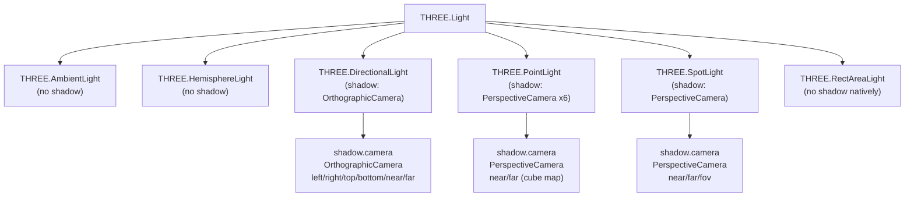
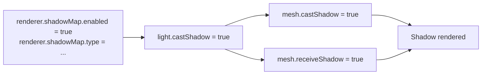
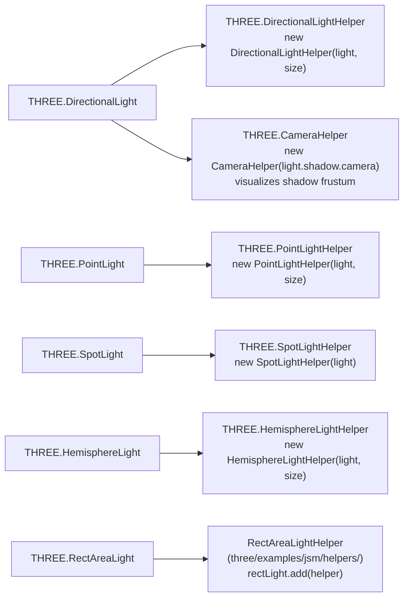
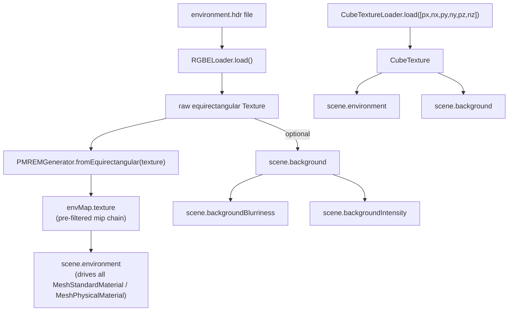

<!-- source: DeepWiki mcp.deepwiki.com · repo CloudAI-X/threejs-skills · extra page threejs-lighting · fetched 2026-10-26 -->

# threejs-lighting

<details>
<summary>Relevant source files</summary>

The following files were used as context for generating this wiki page:

- [skills/threejs-lighting/SKILL.md](skills/threejs-lighting/SKILL.md)

</details>


This page documents the `threejs-lighting` skill file located at [skills/threejs-lighting/SKILL.md](). It covers all light types available in Three.js, shadow map configuration, image-based lighting (IBL) via `RGBELoader` and `PMREMGenerator`, cube texture environments, light helpers, `LightProbe`, and lighting performance strategies.

For material light response properties (roughness, metalness, emissive), see [threejs-materials](#2.1.3). For texture resources used with lighting (lightmaps, environment maps), see [threejs-textures](#2.1.4). For post-processing effects that interact with lighting (bloom), see [threejs-postprocessing](#2.2.3).

---

## Light Types

Three.js provides six light classes. They differ in directionality, shadow support, and GPU cost.

| Class | Shape | Shadow | GPU Cost | Key Parameters |
|---|---|---|---|---|
| `AmbientLight` | Uniform everywhere | No | Very Low | `color`, `intensity` |
| `HemisphereLight` | Sky/ground gradient | No | Very Low | `color`, `groundColor`, `intensity` |
| `DirectionalLight` | Parallel rays (sun) | Yes | Low | `color`, `intensity`, `target` |
| `PointLight` | Omnidirectional (bulb) | Yes | Medium | `color`, `intensity`, `distance`, `decay` |
| `SpotLight` | Cone-shaped | Yes | Medium | `color`, `intensity`, `distance`, `angle`, `penumbra`, `decay` |
| `RectAreaLight` | Rectangular area | No* | High | `color`, `intensity`, `width`, `height` |

\* `RectAreaLight` shadows require custom solutions. It also requires `RectAreaLightUniformsLib.init()` before use, and only affects `MeshStandardMaterial` and `MeshPhysicalMaterial`.

Sources: [skills/threejs-lighting/SKILL.md:24-33]()

---

**Diagram: Light Class Hierarchy and Shadow Camera Types**



Sources: [skills/threejs-lighting/SKILL.md:81-177]()

---

### AmbientLight

Illuminates all objects equally regardless of position or normal. No direction, no shadows.

Constructor: `new THREE.AmbientLight(color, intensity)`

Key properties: `color`, `intensity`

[skills/threejs-lighting/SKILL.md:35-47]()

---

### HemisphereLight

Simulates sky/ground ambient gradient. Good for outdoor scenes to distinguish top-lit from ground-reflected surfaces.

Constructor: `new THREE.HemisphereLight(skyColor, groundColor, intensity)`

Key properties: `color` (sky), `groundColor`, `intensity`

[skills/threejs-lighting/SKILL.md:49-63]()

---

### DirectionalLight

Parallel rays simulating a distant light source (sun). Uses an `OrthographicCamera` for its shadow frustum. The light direction is determined by `light.position` relative to `light.target.position`. The `target` object must be added to the scene separately.

Constructor: `new THREE.DirectionalLight(color, intensity)`

Key properties: `color`, `intensity`, `position`, `target`, `castShadow`, `shadow`

[skills/threejs-lighting/SKILL.md:65-108]()

---

### PointLight

Emits light in all directions from a single point. Uses a cube-map shadow (six `PerspectiveCamera` renders), making it more expensive than `DirectionalLight`.

Constructor: `new THREE.PointLight(color, intensity, distance, decay)`

| Parameter | Default | Notes |
|---|---|---|
| `distance` | `0` | Maximum range; `0` = infinite |
| `decay` | `2` | Physically correct falloff = `2` |

[skills/threejs-lighting/SKILL.md:111-137]()

---

### SpotLight

Cone-shaped light. Direction is determined by `position` relative to `target.position`, same pattern as `DirectionalLight`. The `target` must also be added to the scene.

Constructor: `new THREE.SpotLight(color, intensity, distance, angle, penumbra, decay)`

| Parameter | Notes |
|---|---|
| `angle` | Cone half-angle in radians, max `Math.PI / 2` |
| `penumbra` | Soft edge fraction (0–1) |
| `decay` | Falloff (physically correct = `2`) |
| `shadow.focus` | Controls shadow map projection |

[skills/threejs-lighting/SKILL.md:139-177]()

---

### RectAreaLight

Rectangular area light that simulates windows or fluorescent panels. Requires calling `RectAreaLightUniformsLib.init()` once before use. Only works with `MeshStandardMaterial` and `MeshPhysicalMaterial`. Does not cast shadows natively.

Import path: `three/examples/jsm/lights/RectAreaLightUniformsLib.js`

Constructor: `new THREE.RectAreaLight(color, intensity, width, height)`

[skills/threejs-lighting/SKILL.md:179-202]()

---

## Shadow Maps

### Enabling Shadows

Shadow rendering requires three opt-ins: the renderer, the light, and each mesh.

**Diagram: Shadow Enablement Chain**



Sources: [skills/threejs-lighting/SKILL.md:204-229]()

### Shadow Map Types

| Constant | Quality | Notes |
|---|---|---|
| `THREE.BasicShadowMap` | Lowest | Fastest |
| `THREE.PCFShadowMap` | Medium | Default, percentage-closer filtering |
| `THREE.PCFSoftShadowMap` | Soft edges | Enables `shadow.radius` blur |
| `THREE.VSMShadowMap` | Smooth | Variance shadow maps, bleed artifacts possible |

Set via `renderer.shadowMap.type`.

Sources: [skills/threejs-lighting/SKILL.md:210-213]()

### Shadow Camera Frustum

For `DirectionalLight`, the shadow camera is an `OrthographicCamera`. Its frustum must be sized to tightly enclose only the shadow-casting region. Oversized frustums waste shadow map resolution.

Key properties on `dirLight.shadow.camera`: `left`, `right`, `top`, `bottom`, `near`, `far`

For `SpotLight`, the shadow camera is a `PerspectiveCamera` with `near`, `far`, and `fov`.

For `PointLight`, the shadow camera is a `PerspectiveCamera` with `near` and `far` only (six-face cube map is automatic).

Sources: [skills/threejs-lighting/SKILL.md:86-97](), [skills/threejs-lighting/SKILL.md:163-177](), [skills/threejs-lighting/SKILL.md:128-137]()

### Shadow Bias

Shadow acne is fixed by adjusting two bias values:

| Property | Purpose |
|---|---|
| `shadow.bias` | Depth offset (typically a small negative value like `-0.0001`) |
| `shadow.normalBias` | Offset along surface normal (typically `0.02`) |
| `shadow.radius` | Blur radius for `PCFSoftShadowMap` |

Sources: [skills/threejs-lighting/SKILL.md:98-103](), [skills/threejs-lighting/SKILL.md:244-246]()

### Shadow Map Resolution

`shadow.mapSize.width` and `shadow.mapSize.height` control resolution. Values must be powers of two.

| Size | Quality |
|---|---|
| `512` | Low |
| `1024` | Medium (often sufficient) |
| `2048` | High |
| `4096` | Very high (expensive) |

Sources: [skills/threejs-lighting/SKILL.md:247-252]()

### Contact Shadows

For a cheaper fake shadow solution, `ContactShadows` can be imported from `three/examples/jsm/objects/ContactShadows.js`. It renders a blur beneath objects without requiring shadow maps on any light.

Constructor options: `resolution`, `blur`, `opacity`, `scale`, `position`

[skills/threejs-lighting/SKILL.md:254-267]()

---

## Light Helpers

Helpers visualize light position, direction, and shadow camera frustum. All are added directly to the scene, except `RectAreaLightHelper` which is added as a child of the light itself.

**Diagram: Helper Classes and Their Light Types**



Sources: [skills/threejs-lighting/SKILL.md:269-297]()

Helpers with a `.update()` method (e.g., `DirectionalLightHelper`, `SpotLightHelper`) must be called each frame when the light moves.

---

## Environment Lighting (IBL)

Image-Based Lighting (IBL) uses a pre-captured environment map to drive ambient and specular reflections on PBR materials. It is set via `scene.environment`.

### RGBELoader + PMREMGenerator

For high-quality reflections, process the HDR texture through `PMREMGenerator` before assigning it to `scene.environment`.

Import paths:
- `RGBELoader`: `three/examples/jsm/loaders/RGBELoader.js`
- `PMREMGenerator`: `THREE.PMREMGenerator` (built-in)

Key steps:
1. Load `.hdr` file with `RGBELoader`
2. Call `pmremGenerator.fromEquirectangular(texture)` to produce the env map
3. Assign result to `scene.environment`
4. Dispose the original texture and the generator

Setting `texture.mapping = THREE.EquirectangularReflectionMapping` is sufficient for a background, but `PMREMGenerator` is preferred for accurate reflections on materials.

Optional scene properties:
- `scene.background` — use the same texture as background
- `scene.backgroundBlurriness` — 0–1 blur on background
- `scene.backgroundIntensity` — scale the background brightness

Sources: [skills/threejs-lighting/SKILL.md:299-329]()

### CubeTextureLoader

Load six face images as a cube environment map.

```
CubeTextureLoader.load([px, nx, py, ny, pz, nz])
```

The resulting `CubeTexture` can be assigned to both `scene.environment` and `scene.background`.

Sources: [skills/threejs-lighting/SKILL.md:331-346]()

---

**Diagram: IBL Setup Flow**



Sources: [skills/threejs-lighting/SKILL.md:299-346]()

---

## LightProbe

`THREE.LightProbe` captures spherical harmonics from a point in space to represent ambient lighting. More accurate than `AmbientLight` for capturing directional ambient variation.

Import path: `LightProbeGenerator` from `three/examples/jsm/lights/LightProbeGenerator.js`

Two generation paths:
- `LightProbeGenerator.fromCubeTexture(cubeTexture)` — from a static `CubeTexture`
- `LightProbeGenerator.fromCubeRenderTarget(renderer, cubeCamera.renderTarget)` — from a live `CubeCamera` render

[skills/threejs-lighting/SKILL.md:349-371]()

---

## Common Lighting Setups

### Three-Point Lighting

Classic studio lighting with three `DirectionalLight` instances: key (full intensity, one side), fill (half intensity, opposite side), back (rim/backlight). Supplemented by a low-intensity `AmbientLight`.

[skills/threejs-lighting/SKILL.md:375-396]()

### Outdoor Daylight

`DirectionalLight` for the sun with `castShadow = true`, combined with `HemisphereLight` for sky (blue) and ground (brown) ambient fill.

[skills/threejs-lighting/SKILL.md:398-410]()

### Indoor Studio

Multiple `RectAreaLight` instances simulating soft panel lights. Requires `RectAreaLightUniformsLib.init()`. Supplemented by low-intensity `AmbientLight`.

[skills/threejs-lighting/SKILL.md:412-431]()

---

## Light Animation

Lights can be animated each frame by mutating `position`, `intensity`, and `color`. Use `THREE.Clock.getElapsedTime()` for time-based motion. When helpers are present, call `helper.update()` each frame.

[skills/threejs-lighting/SKILL.md:433-453]()

---

## Performance Tips

| Strategy | Detail |
|---|---|
| Limit light count | Each light adds shader complexity proportional to number of lights in scene |
| Bake static lighting | Pre-bake to lightmap textures; use `AmbientLight` + lightmaps instead of many dynamic lights |
| Smaller shadow maps | `512`–`1024` is often sufficient; only use `2048`+  when detail is clearly needed |
| Tight shadow frustums | Size `shadow.camera` bounds to the minimum area that covers shadow receivers |
| Disable unneeded shadows | Set `castShadow = false` on small/decorative meshes |
| Use light layers | `light.layers.set(n)` and `mesh.layers.enable(n)` restrict which meshes a light affects, reducing shader work |

Sources: [skills/threejs-lighting/SKILL.md:456-475]()

### Light Layers Example

`light.layers.set(1)` limits the light to layer 1. `mesh.layers.enable(1)` puts a mesh on layer 1. Meshes not on the light's layer are unaffected, reducing overdraw.

[skills/threejs-lighting/SKILL.md:465-474]()

---

## See Also

- [threejs-materials](#2.1.3) — Material properties that respond to lights (`roughness`, `metalness`, `emissive`, `envMapIntensity`)
- [threejs-textures](#2.1.4) — Lightmaps, environment map textures, `CubeCamera` for dynamic reflections
- [threejs-postprocessing](#2.2.3) — Bloom and other light-dependent post-processing effects
- [threejs-fundamentals](#2.1.1) — `WebGLRenderer` configuration and scene setup required before adding lights

---

