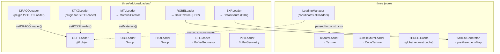
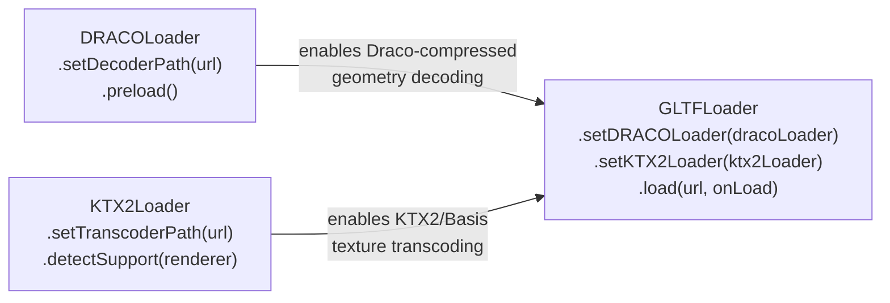
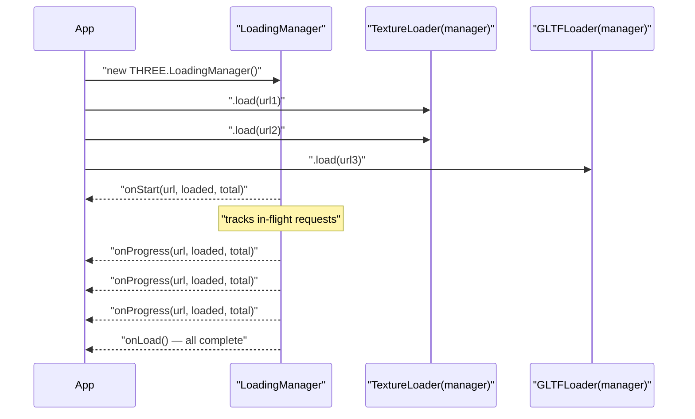
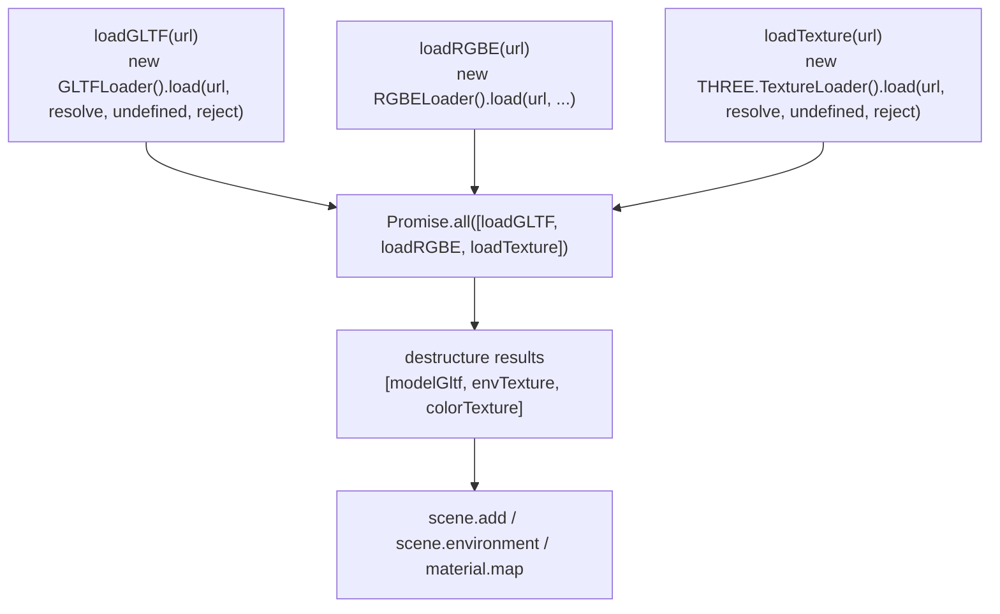

<!-- source: DeepWiki mcp.deepwiki.com · repo CloudAI-X/threejs-skills · extra page threejs-loaders · fetched 2026-10-26 -->

# threejs-loaders

<details>
<summary>Relevant source files</summary>

The following files were used as context for generating this wiki page:

- [skills/threejs-loaders/SKILL.md](skills/threejs-loaders/SKILL.md)

</details>


This page documents the `threejs-loaders` skill file ([skills/threejs-loaders/SKILL.md]()). It covers the full asset loading pipeline for Three.js: supported file formats, loader configuration, plugin setup, loading lifecycle management, async patterns, caching, and error handling.

For texture configuration properties (color space, filtering, wrapping, mipmaps) that apply *after* a texture is loaded, see [threejs-textures](#2.1.4). For playing animations retrieved from a loaded GLTF file, see [threejs-animation](#2.3.2).

---

## Skill Activation

The front matter description field ([skills/threejs-loaders/SKILL.md:2-4]()) tells Claude Code when to load this skill:

```
description: Three.js asset loading - GLTF, textures, images, models, async patterns.
             Use when loading 3D models, textures, HDR environments, or managing loading progress.
```

This skill is frequently co-loaded with `threejs-animation` when the request involves GLTF models that carry embedded animation clips.

---

## Loader Map

The following diagram shows all loaders covered in this skill, grouped by what they produce and where they are imported from.

**Diagram: Loader classes, import paths, and output types**



Sources: [skills/threejs-loaders/SKILL.md:1-23](), [skills/threejs-loaders/SKILL.md:153-192](), [skills/threejs-loaders/SKILL.md:307-370]()

---

## GLTFLoader

`GLTFLoader` is the standard loader for `.gltf` and `.glb` files. Import path: `three/addons/loaders/GLTFLoader.js`.

### The `gltf` Output Object

The callback receives a `gltf` object with these fields:

| Field | Type | Description |
|---|---|---|
| `gltf.scene` | `THREE.Group` | The root scene graph of the model |
| `gltf.animations` | `AnimationClip[]` | All embedded animation clips |
| `gltf.cameras` | `THREE.Camera[]` | Cameras defined in the file |
| `gltf.asset` | `object` | Metadata: version, generator, copyright |
| `gltf.userData` | `object` | Custom extras from the authoring tool |

Sources: [skills/threejs-loaders/SKILL.md:199-226]()

### Plugin Setup: DRACOLoader and KTX2Loader

Plugins must be configured on the `GLTFLoader` instance before calling `.load()`. They extend format support without changing the output API.

**Diagram: GLTFLoader plugin wiring**



- `DRACOLoader.setDecoderPath()` — points to the Draco WASM decoder files ([skills/threejs-loaders/SKILL.md:234-241]())
- `KTX2Loader.setTranscoderPath()` — points to the Basis transcoder ([skills/threejs-loaders/SKILL.md:255-261]())
- `KTX2Loader.detectSupport(renderer)` — queries GPU compressed format support at runtime

Sources: [skills/threejs-loaders/SKILL.md:229-266]()

### Post-Load Traversal

After loading, `gltf.scene.traverse()` is the standard way to configure shadows, find named meshes, or adjust materials on all children.

Common operations inside a `traverse` callback ([skills/threejs-loaders/SKILL.md:271-303]()):

- `child.castShadow = true` / `child.receiveShadow = true`
- `model.getObjectByName("Head")` — find a specific node by name
- `child.material.envMapIntensity = 0.5` — adjust material properties
- Centering with `THREE.Box3().setFromObject(model)` and `model.position.sub(center)`

---

## Texture Loaders

### TextureLoader

`THREE.TextureLoader` is a core class, no add-on import required.

| Method signature | Notes |
|---|---|
| `loader.load(url, onLoad, onProgress, onError)` | `onProgress` is not supported for image loading |
| `loader.load(url)` | Returns a `Texture` immediately; loads async, renders once ready |

After the texture is received in `onLoad`, configure its properties before assigning to a material — see [threejs-textures](#2.1.4) for the full property reference.

Sources: [skills/threejs-loaders/SKILL.md:65-124]()

### CubeTextureLoader

Loads six separate image files as faces of a cube map. The array order is: `[px, nx, py, ny, pz, nz]`.

Typical uses after loading ([skills/threejs-loaders/SKILL.md:126-149]()):
- `scene.background = cubeTexture` — skybox
- `scene.environment = cubeTexture` — image-based lighting
- `material.envMap = cubeTexture` — per-material reflection

### RGBELoader and EXRLoader

Both produce a `DataTexture` from HDR image formats. After loading, set `texture.mapping = THREE.EquirectangularReflectionMapping` before assigning to `scene.environment`.

| Loader | Format | Import |
|---|---|---|
| `RGBELoader` | `.hdr` (Radiance RGBE) | `three/addons/loaders/RGBELoader.js` |
| `EXRLoader` | `.exr` (OpenEXR) | `three/addons/loaders/EXRLoader.js` |

Sources: [skills/threejs-loaders/SKILL.md:153-171]()

### PMREMGenerator

`THREE.PMREMGenerator` converts an equirectangular `Texture` into a prefiltered mipmapped environment map suitable for PBR materials. It is a core Three.js class (not an add-on).

Steps ([skills/threejs-loaders/SKILL.md:177-192]()):
1. `new THREE.PMREMGenerator(renderer)` — pass the active `WebGLRenderer`
2. `.compileEquirectangularShader()` — compile the conversion shader ahead of time
3. `.fromEquirectangular(texture).texture` — convert and extract the result
4. Dispose both the source texture and the generator after use

---

## Other Format Loaders

| Loader | Import path | Output | Notes |
|---|---|---|---|
| `OBJLoader` | `three/addons/loaders/OBJLoader.js` | `Group` | Pair with `MTLLoader` for materials |
| `MTLLoader` | `three/addons/loaders/MTLLoader.js` | `MaterialCreator` | Call `materials.preload()` before passing to `OBJLoader` |
| `FBXLoader` | `three/addons/loaders/FBXLoader.js` | `Group` | FBX models often arrive at 100× scale; apply `object.scale.setScalar(0.01)` |
| `STLLoader` | `three/addons/loaders/STLLoader.js` | `BufferGeometry` | Wrap in a `Mesh` manually |
| `PLYLoader` | `three/addons/loaders/PLYLoader.js` | `BufferGeometry` | Call `geometry.computeVertexNormals()` after load if missing |

The OBJ/MTL workflow requires loading MTL first, then wiring `materials` into `OBJLoader` via `.setMaterials()` ([skills/threejs-loaders/SKILL.md:307-323]()). FBX files may embed `object.animations`, usable with `AnimationMixer` the same way as GLTF ([skills/threejs-loaders/SKILL.md:325-343]()).

Sources: [skills/threejs-loaders/SKILL.md:305-370]()

---

## LoadingManager

`THREE.LoadingManager` coordinates multiple loaders so you can track aggregate progress and respond when everything finishes.

**Diagram: LoadingManager callback lifecycle**



| Callback | Signature | Fires |
|---|---|---|
| `onStart` | `(url, loaded, total)` | When first request begins |
| `onProgress` | `(url, loaded, total)` | After each item completes |
| `onLoad` | `()` | When all tracked requests finish |
| `onError` | `(url)` | When any request fails |

Pass the manager instance to each loader's constructor: `new THREE.TextureLoader(manager)`, `new GLTFLoader(manager)`.

Additional utility on `LoadingManager`:
- `manager.setURLModifier(fn)` — rewrite every URL (e.g., prepend a CDN base)
- `loader.setPath("assets/")` — prefix applied to all paths on that loader
- `loader.setResourcePath("assets/textures/")` — prefix for resources referenced inside a model

Sources: [skills/threejs-loaders/SKILL.md:27-61](), [skills/threejs-loaders/SKILL.md:538-553]()

---

## Async / Promise Patterns

The standard loader `.load()` API is callback-based. Wrapping it in a `Promise` allows `async/await` usage and parallel loading with `Promise.all`.

**Diagram: Async loading flow**



The helper functions `loadGLTF`, `loadRGBE`, and `loadTexture` are thin wrappers that pass `resolve` as `onLoad` and `reject` as `onError` ([skills/threejs-loaders/SKILL.md:409-435]()).

For in-memory sources, loaders also accept:
- **Data URL / Base64** — pass directly as the URL string
- **Blob URL** — `URL.createObjectURL(blob)`, revoke after load
- **ArrayBuffer** — use `GLTFLoader.parse(buffer, resourcePath, onLoad)` instead of `.load()`

Sources: [skills/threejs-loaders/SKILL.md:372-435](), [skills/threejs-loaders/SKILL.md:504-536]()

---

## Caching

### `THREE.Cache`

A global in-memory store keyed by URL. All loaders check it automatically when enabled.

```
THREE.Cache.enabled = true   // enable before any loads
THREE.Cache.add(key, data)
THREE.Cache.get(key)
THREE.Cache.remove(key)
THREE.Cache.clear()
```

Sources: [skills/threejs-loaders/SKILL.md:439-452]()

### `AssetManager` Pattern

For application-level deduplication and lifecycle management, the `AssetManager` class ([skills/threejs-loaders/SKILL.md:456-502]()) wraps loaders with `Map`-based caching:

| Method | Behavior |
|---|---|
| `loadTexture(key, url)` | Returns cached `Texture` on repeat calls |
| `loadModel(key, url)` | Stores root `Group`; returns `.clone()` on repeat calls |
| `dispose()` | Calls `.dispose()` on all textures and clears both maps |

The clone-on-read pattern for models ensures that each scene instance can have independent transforms and material overrides without re-fetching the asset.

---

## Error Handling Patterns

Three patterns are provided in the skill file for production robustness:

| Pattern | Function | Mechanism |
|---|---|---|
| Fallback URL | `loadWithFallback(primaryUrl, fallbackUrl)` | `catch` → retry with alternate URL |
| Retry with backoff | `loadWithRetry(url, maxRetries)` | Loop with `setTimeout(r, 1000 * (i + 1))` delay |
| Timeout | `loadWithTimeout(url, timeout)` | `AbortController` + `fetch` signal |

Sources: [skills/threejs-loaders/SKILL.md:554-595]()

---

## Performance Tips

| Tip | Detail |
|---|---|
| Compress geometry | Use Draco encoding; set up `DRACOLoader` as a plugin |
| Compress textures | Use KTX2/Basis; set up `KTX2Loader` as a plugin |
| Enable `THREE.Cache` | Prevents duplicate HTTP requests across loader instances |
| Progressive loading | Show a placeholder mesh while the real model loads, then swap |
| Lazy loading | Defer loads until the asset is needed in view |
| CDN delivery | Reduces latency for large binary files |
| Dispose promptly | After `PMREMGenerator.fromEquirectangular()`, dispose both source texture and the generator |

Sources: [skills/threejs-loaders/SKILL.md:597-617]()

---

## See Also

- [threejs-textures](#2.1.4) — Texture property configuration (color space, filtering, wrapping, UV transforms)
- [threejs-animation](#2.3.2) — Using `AnimationClip` arrays from `gltf.animations` with `AnimationMixer`
- [threejs-materials](#2.1.3) — Adjusting materials on meshes retrieved from loaded models
- [threejs-fundamentals](#2.1.1) — `LoadingManager` and scene graph basics

---

