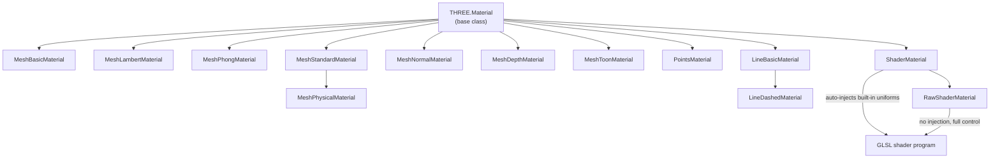
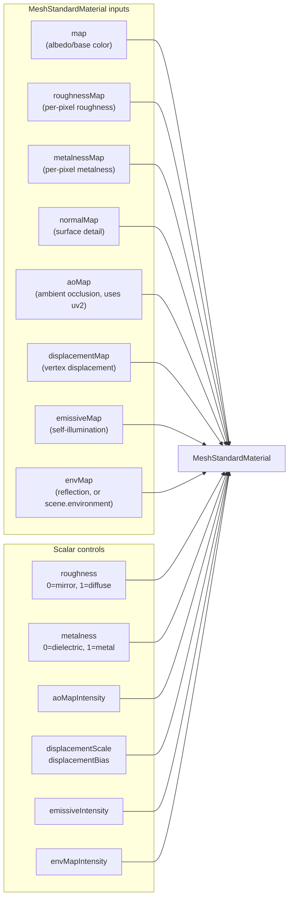
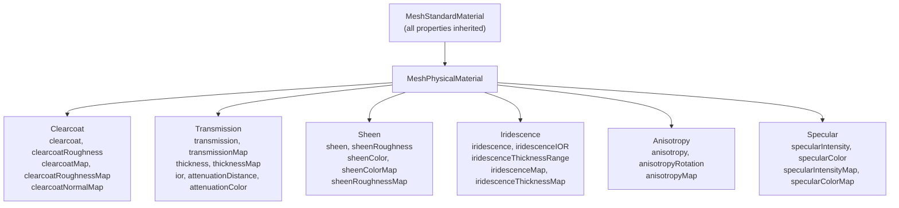
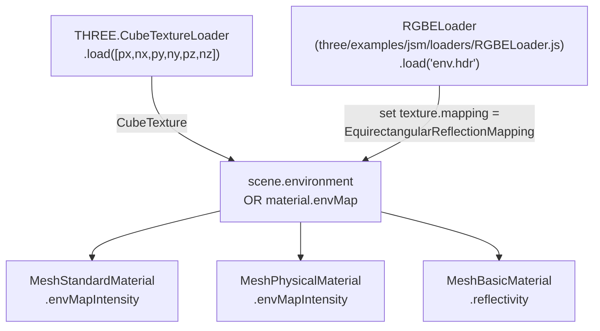

<!-- source: DeepWiki mcp.deepwiki.com · repo CloudAI-X/threejs-skills · extra page threejs-materials · fetched 2026-10-26 -->

# threejs-materials

<details>
<summary>Relevant source files</summary>

The following files were used as context for generating this wiki page:

- [skills/threejs-materials/SKILL.md](skills/threejs-materials/SKILL.md)

</details>


This page documents the `threejs-materials` skill file ([skills/threejs-materials/SKILL.md]()) and covers all Three.js material types, their constructors, PBR properties, common base properties, environment map integration, and the `needsUpdate` flag.

For texture loading and configuration (UV wrapping, filtering, render targets), see [threejs-textures (2.1.4)](#2.1.4). For custom GLSL shader authoring via `ShaderMaterial` and `onBeforeCompile`, see [threejs-shaders (2.2.2)](#2.2.2). For lighting configuration that interacts with PBR materials, see [threejs-lighting (2.2.1)](#2.2.1).

---

## Material Type Reference

All material classes extend `THREE.Material`. The choice of material determines whether lighting calculations are performed and at what complexity.

| Class | Lighting Model | Key Use Case | Relative Cost |
|---|---|---|---|
| `MeshBasicMaterial` | None | Flat colors, wireframes, UI elements | Lowest |
| `MeshLambertMaterial` | Diffuse only | Matte surfaces, foliage, terrain | Low |
| `MeshPhongMaterial` | Diffuse + specular | Plastic, shiny non-PBR surfaces | Medium |
| `MeshStandardMaterial` | PBR (GGX BRDF) | General realistic materials | High |
| `MeshPhysicalMaterial` | PBR + extensions | Glass, car paint, fabric, iridescence | Highest |
| `MeshToonMaterial` | Cel-shaded | Cartoon / stylized rendering | Medium |
| `MeshNormalMaterial` | None | Normal debugging | Low |
| `MeshDepthMaterial` | None | Depth visualization, shadow passes | Low |
| `PointsMaterial` | None | Particle systems, point clouds | Low |
| `LineBasicMaterial` | None | Wireframe overlays, debug lines | Low |
| `LineDashedMaterial` | None | Dashed line decorations | Low |
| `ShaderMaterial` | Custom | Any custom GLSL effect | Varies |
| `RawShaderMaterial` | Custom | Full GLSL control, no built-ins | Varies |

Sources: [skills/threejs-materials/SKILL.md:25-36]()

---

## Material Hierarchy and Relationships

**Diagram: Material class hierarchy and shader path**



Sources: [skills/threejs-materials/SKILL.md:25-36](), [skills/threejs-materials/SKILL.md:298-384]()

---

## Base Material Properties

These properties exist on every `THREE.Material` instance regardless of type.

**Visibility and transparency**

| Property | Type | Default | Notes |
|---|---|---|---|
| `visible` | `boolean` | `true` | When `false`, mesh is not rendered |
| `transparent` | `boolean` | `false` | Must be `true` for `opacity` < 1 to take effect |
| `opacity` | `float` | `1.0` | Range `0.0`–`1.0` |
| `alphaTest` | `float` | `0` | Pixels with alpha below this value are discarded |

**Depth and rendering**

| Property | Type | Default | Notes |
|---|---|---|---|
| `depthTest` | `boolean` | `true` | Disabling allows drawing on top of everything |
| `depthWrite` | `boolean` | `true` | Set to `false` for translucent objects in some cases |
| `colorWrite` | `boolean` | `true` | Set to `false` to write only to depth/stencil |
| `side` | `THREE.Side` | `THREE.FrontSide` | `FrontSide`, `BackSide`, or `DoubleSide` |
| `dithering` | `boolean` | `false` | Reduces banding on gradients |
| `toneMapped` | `boolean` | `true` | Applies renderer tone mapping |

**Blending modes**

`material.blending` accepts: `THREE.NormalBlending`, `THREE.AdditiveBlending`, `THREE.SubtractiveBlending`, `THREE.MultiplyBlending`, `THREE.CustomBlending`.

**Stencil operations**

| Property | Default |
|---|---|
| `stencilWrite` | `false` |
| `stencilFunc` | `THREE.AlwaysStencilFunc` |
| `stencilRef` | `0` |
| `stencilMask` | `0xff` |

**Polygon offset** (z-fighting mitigation)

| Property | Default |
|---|---|
| `polygonOffset` | `false` |
| `polygonOffsetFactor` | `0` |
| `polygonOffsetUnits` | `0` |

Sources: [skills/threejs-materials/SKILL.md:386-421]()

---

## Non-PBR Materials

### `MeshBasicMaterial`

No lighting calculations. Always rendered at full color regardless of scene lights.

Key properties: `color`, `map`, `alphaMap`, `envMap`, `reflectivity`, `wireframe`, `transparent`, `opacity`, `side`, `fog`.

See [skills/threejs-materials/SKILL.md:38-55]().

### `MeshLambertMaterial`

Diffuse lighting only. No specular highlights. Faster than Phong/Standard.

Adds over Basic: `emissive`, `emissiveIntensity`, `emissiveMap`, `envMap`, `reflectivity`.

See [skills/threejs-materials/SKILL.md:57-71]().

### `MeshPhongMaterial`

Diffuse + specular (Blinn-Phong model). Not physically based but widely used for legacy/stylized content.

Additional properties beyond Lambert:

| Property | Type | Notes |
|---|---|---|
| `specular` | `THREE.Color` | Specular highlight color |
| `shininess` | `float` | Range `0`–`1000`; higher = tighter highlight |
| `flatShading` | `boolean` | Per-face vs. per-vertex normals |
| `specularMap` | `Texture` | Per-pixel shininess mask |
| `normalMap` | `Texture` | Surface detail via normal perturbation |
| `normalScale` | `THREE.Vector2` | Normal map strength, default `(1,1)` |
| `bumpMap` | `Texture` | Grayscale height → normal |
| `bumpScale` | `float` | Bump map strength |
| `displacementMap` | `Texture` | Actual vertex displacement |
| `displacementScale` | `float` | Vertex displacement multiplier |

See [skills/threejs-materials/SKILL.md:73-93]().

---

## PBR Materials

### `MeshStandardMaterial`

The recommended material for realistic rendering. Uses the GGX BRDF model with the `roughness`/`metalness` workflow.

**Diagram: PBR texture slots for `MeshStandardMaterial`**



> **Note:** `aoMap` requires a second UV channel. Set it with `geometry.setAttribute('uv2', geometry.attributes.uv)` before rendering.

See [skills/threejs-materials/SKILL.md:95-134]().

### `MeshPhysicalMaterial`

Extends `MeshStandardMaterial` with additional lobes and effects for advanced material models.

**Diagram: `MeshPhysicalMaterial` feature groups**



**Feature → material preset mapping**

| Effect | Key Properties | Example Values |
|---|---|---|
| Glass / water | `transmission: 1`, `ior: 1.5`, `thickness: 0.5`, `roughness: 0` | See [skills/threejs-materials/SKILL.md:192-202]() |
| Car paint / lacquer | `clearcoat: 1`, `clearcoatRoughness: 0.1`, `metalness: 0.9` | See [skills/threejs-materials/SKILL.md:204-214]() |
| Fabric / velvet | `sheen: 1.0`, `sheenRoughness: 0.5`, `sheenColor` | |
| Brushed metal | `anisotropy: 1.0`, `anisotropyRotation` | |
| Soap bubble / oil slick | `iridescence: 1.0`, `iridescenceIOR: 1.3`, `iridescenceThicknessRange: [100, 400]` | |

Sources: [skills/threejs-materials/SKILL.md:136-214]()

---

## Specialized Materials

### `MeshToonMaterial`

Cel-shading via a `gradientMap` texture. Uses `THREE.NearestFilter` to produce discrete shading steps.

Key property: `gradientMap` — a `THREE.DataTexture` where each texel defines a shading band.

See [skills/threejs-materials/SKILL.md:216-232]().

### `MeshNormalMaterial`

Visualizes world-space normals as RGB color. Used for debugging geometry normal orientation.

Properties: `flatShading`, `wireframe`. See [skills/threejs-materials/SKILL.md:234-243]().

### `MeshDepthMaterial`

Encodes linear depth into the output color. Used internally by shadow maps and externally for depth-of-field passes.

Key property: `depthPacking` — `THREE.RGBADepthPacking` packs depth into four channels for higher precision.

See [skills/threejs-materials/SKILL.md:245-253]().

### `PointsMaterial`

Used with `THREE.Points` primitives. Key properties:

| Property | Notes |
|---|---|
| `size` | World-space point size |
| `sizeAttenuation` | Scale point size with distance from camera |
| `map` | Sprite texture per point |
| `alphaMap` | Transparency mask per point |
| `vertexColors` | Per-vertex color from `BufferAttribute` |
| `alphaTest` | Discard sub-threshold fragments |

See [skills/threejs-materials/SKILL.md:255-272]().

### `LineBasicMaterial` / `LineDashedMaterial`

Used with `THREE.Line` and `THREE.LineSegments`.

> **Note:** `linewidth > 1` only works on some WebGL implementations (mainly non-WebGL2 or certain GPU drivers). Typically only `1` is reliable cross-platform.

`LineDashedMaterial` requires calling `line.computeLineDistances()` after geometry is set to populate the distance attribute used for dash rendering.

See [skills/threejs-materials/SKILL.md:274-296]().

---

## Shader Materials

### `ShaderMaterial`

Provides custom GLSL shaders while Three.js automatically injects a set of built-in uniforms and attributes into the shader source.

**Built-in uniforms and attributes injected by Three.js into `ShaderMaterial`:**

| Uniform | Type | Description |
|---|---|---|
| `modelMatrix` | `mat4` | Object → world space |
| `modelViewMatrix` | `mat4` | Object → camera space |
| `projectionMatrix` | `mat4` | Camera projection |
| `viewMatrix` | `mat4` | World → camera space |
| `normalMatrix` | `mat3` | Transforms normals (inverse transpose of modelView) |
| `cameraPosition` | `vec3` | Camera world position |

| Attribute | Type | Description |
|---|---|---|
| `position` | `vec3` | Vertex position |
| `normal` | `vec3` | Vertex normal |
| `uv` | `vec2` | UV coordinate |

User-defined uniforms are set via the `uniforms` object, e.g. `material.uniforms.time.value = clock.getElapsedTime()`. No `needsUpdate` is required to update uniform values.

See [skills/threejs-materials/SKILL.md:298-337]().

### `RawShaderMaterial`

Identical API to `ShaderMaterial` but Three.js injects **nothing** into the shader source. The developer must declare all uniforms, attributes, and precision qualifiers manually.

Key differences from `ShaderMaterial`:
- No automatic injection of `projectionMatrix`, `modelViewMatrix`, etc.
- Must declare `precision highp float;` manually.
- All matrices must be passed as explicit `uniforms`.

See [skills/threejs-materials/SKILL.md:356-384]().

---

## Environment Maps

Environment maps can be applied per-material via `material.envMap`, or globally for all PBR materials by assigning to `scene.environment`.

**Diagram: Environment map data flow**



- Assigning to `scene.environment` automatically affects all `MeshStandardMaterial` and `MeshPhysicalMaterial` instances in the scene without setting `envMap` per material.
- `envMapIntensity` controls the contribution strength on a per-material basis.
- For HDR environments loaded with `RGBELoader`, set `texture.mapping = THREE.EquirectangularReflectionMapping` before assigning.

See [skills/threejs-materials/SKILL.md:444-473]().

---

## Multiple Materials on One Mesh

A `THREE.Mesh` can accept an array of materials. Material index assignment is controlled by `geometry.addGroup()`.

```
geometry.clearGroups();
geometry.addGroup(startIndex, count, materialIndex);
```

- `startIndex`: starting face index in the index buffer
- `count`: number of indices in the group
- `materialIndex`: index into the materials array passed to `new THREE.Mesh(geometry, materials)`

See [skills/threejs-materials/SKILL.md:423-442]().

---

## `needsUpdate` Flag

Most property changes on a material take effect immediately. However, some changes require setting `material.needsUpdate = true` to force a shader recompile:

| Change requiring `needsUpdate` | Reason |
|---|---|
| `flatShading` toggle | Changes vertex shader variant |
| Adding/removing a texture from a slot that was previously `null` | Changes shader `#define` for texture sampling |
| Toggling `transparent` | Changes depth sort and blend state pipeline |
| Modifying custom shader source strings | Triggers GLSL recompile |

Updating `material.color`, `material.roughness`, uniform values, and most numeric properties do **not** require `needsUpdate`.

Calling `material.clone()` produces an independent copy; modifying the clone does not affect the source.

See [skills/threejs-materials/SKILL.md:475-491]().

---

## Performance Tips

| Tip | Rationale |
|---|---|
| Reuse material instances across meshes | Same `THREE.Material` instance → shared draw call batch |
| Prefer `alphaTest` over `transparent: true` | Transparent meshes are sorted per-frame; `alphaTest` uses depth test |
| Use the cheapest material that meets visual requirements | `Basic < Lambert < Phong < Standard < Physical` in shader cost |
| Minimize light count in scenes using `MeshStandardMaterial` | Each light adds a shader evaluation pass |
| Use a material cache (keyed by parameters) | Prevents redundant material object creation |
| Call `material.dispose()` when removing from scene | Frees GPU shader program and associated WebGL state |

See [skills/threejs-materials/SKILL.md:493-514]().

---

## See Also

- [threejs-textures (2.1.4)](#2.1.4) — Texture loading, UV configuration, `colorSpace`, filtering, and `WebGLRenderTarget`
- [threejs-shaders (2.2.2)](#2.2.2) — `ShaderMaterial` deep-dive, `onBeforeCompile`, `ShaderChunk` reuse
- [threejs-lighting (2.2.1)](#2.2.1) — Light types and how they interact with PBR materials
- [threejs-fundamentals (2.1.1)](#2.1.1) — `Mesh`, `Scene`, and the scene graph that materials attach to

---

