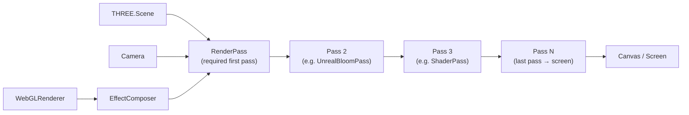
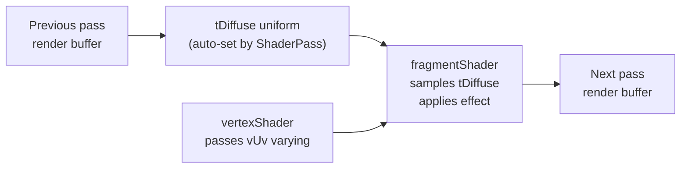
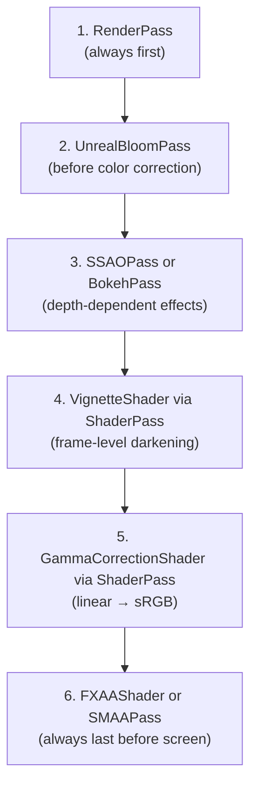

<!-- source: DeepWiki mcp.deepwiki.com · repo CloudAI-X/threejs-skills · extra page threejs-postprocessing · fetched 2026-10-26 -->

# threejs-postprocessing

<details>
<summary>Relevant source files</summary>

The following files were used as context for generating this wiki page:

- [skills/threejs-postprocessing/SKILL.md](skills/threejs-postprocessing/SKILL.md)

</details>


This page documents the `threejs-postprocessing` skill file, which covers Three.js screen-space post-processing: `EffectComposer`, built-in pass types, custom `ShaderPass` definitions, multi-pass rendering with `WebGLRenderTarget`, the selective bloom technique, and the WebGPU node-based post-processing path.

This skill is distinct from raw shader authoring (see [threejs-shaders](#2.2.2)) and from render target setup for reflections or off-screen rendering (see [threejs-textures](#2.1.4)). It is also layered on top of the basic renderer setup covered in [threejs-fundamentals](#2.1.1).

---

## How Post-Processing Fits into the Render Pipeline

Post-processing inserts between the scene render and the final screen output. The `EffectComposer` owns a chain of passes, each reading from and writing to internal render buffers.

**Diagram: Post-Processing Pipeline**



In the animation loop, `composer.render()` replaces `renderer.render(scene, camera)`. Every pass performs a full-screen quad draw.

Sources: [skills/threejs-postprocessing/SKILL.md:33-36]()

---

## EffectComposer Setup

`EffectComposer` is the central orchestrator. It holds an ordered list of passes and iterates through them on each call to `composer.render()`.

| API | Description |
|---|---|
| `new EffectComposer(renderer)` | Wrap an existing `WebGLRenderer` |
| `composer.addPass(pass)` | Append a pass to the chain |
| `composer.render()` | Execute all passes; replaces `renderer.render()` |
| `composer.setSize(w, h)` | Resize internal buffers; call alongside `renderer.setSize()` |
| `pass.enabled` | Boolean toggle to skip a pass without removing it |
| `pass.renderToScreen` | Force a pass to output to the canvas (automatic for last pass) |

Import paths:
- `EffectComposer` → `three/addons/postprocessing/EffectComposer.js`
- `RenderPass` → `three/addons/postprocessing/RenderPass.js`

`RenderPass` must always be the first pass. It renders `scene` and `camera` into the composer's internal buffer.

On window resize, both `renderer.setSize()` and `composer.setSize()` must be called. Some passes also require manual resolution updates (see [Handle Resize](#handle-resize)).

Sources: [skills/threejs-postprocessing/SKILL.md:39-68]()

---

## Built-In Pass Reference

**Diagram: Pass Classes and Their Import Paths**

```mermaid
flowchart TD
    EC["EffectComposer"]

    EC --> RP["RenderPass\nthree/addons/postprocessing/RenderPass.js"]
    EC --> UBP["UnrealBloomPass\nthree/addons/postprocessing/UnrealBloomPass.js"]
    EC --> SSAO["SSAOPass\nthree/addons/postprocessing/SSAOPass.js"]
    EC --> BOK["BokehPass\nthree/addons/postprocessing/BokehPass.js"]
    EC --> FILM["FilmPass\nthree/addons/postprocessing/FilmPass.js"]
    EC --> OUT["OutlinePass\nthree/addons/postprocessing/OutlinePass.js"]
    EC --> GLITCH["GlitchPass\nthree/addons/postprocessing/GlitchPass.js"]
    EC --> HALF["HalftonePass\nthree/addons/postprocessing/HalftonePass.js"]
    EC --> PIX["RenderPixelatedPass\nthree/addons/postprocessing/RenderPixelatedPass.js"]
    EC --> SMAA["SMAAPass\nthree/addons/postprocessing/SMAAPass.js"]
    EC --> SP["ShaderPass\nthree/addons/postprocessing/ShaderPass.js"]

    SP --> FXAA["FXAAShader\nthree/addons/shaders/FXAAShader.js"]
    SP --> VIG["VignetteShader\nthree/addons/shaders/VignetteShader.js"]
    SP --> CC["ColorCorrectionShader\nthree/addons/shaders/ColorCorrectionShader.js"]
    SP --> GC["GammaCorrectionShader\nthree/addons/shaders/GammaCorrectionShader.js"]
    SP --> CUSTOM["Custom shader object\n{ uniforms, vertexShader, fragmentShader }"]
```



Sources: [skills/threejs-postprocessing/SKILL.md:70-330]()

### Pass Parameters and Key Properties

| Pass Class | Constructor Arguments | Key Runtime Properties |
|---|---|---|
| `RenderPass` | `(scene, camera)` | — |
| `UnrealBloomPass` | `(resolution: Vector2, strength, radius, threshold)` | `.strength`, `.radius`, `.threshold`, `.resolution` |
| `SSAOPass` | `(scene, camera, width, height)` | `.kernelRadius`, `.minDistance`, `.maxDistance`, `.output` |
| `BokehPass` | `(scene, camera, { focus, aperture, maxblur })` | `.uniforms["focus"].value` |
| `FilmPass` | `(noiseIntensity, scanlineIntensity, scanlineCount, grayscale)` | — |
| `OutlinePass` | `(resolution: Vector2, scene, camera)` | `.selectedObjects`, `.edgeStrength`, `.edgeGlow`, `.edgeThickness`, `.pulsePeriod`, `.visibleEdgeColor`, `.hiddenEdgeColor` |
| `GlitchPass` | `()` | `.goWild` |
| `HalftonePass` | `(width, height, params)` | `params.shape`, `params.radius`, `params.scatter` |
| `RenderPixelatedPass` | `(pixelSize, scene, camera)` | — |
| `SMAAPass` | `(width * pixelRatio, height * pixelRatio)` | — |
| `ShaderPass` | `(shaderDefinition)` | `.material.uniforms`, `.uniforms` |

`SSAOPass.OUTPUT` enum values: `Default`, `SSAO`, `Blur`, `Depth`, `Normal`.

Sources: [skills/threejs-postprocessing/SKILL.md:72-330]()

---

## ShaderPass and Custom Effects

`ShaderPass` wraps any GLSL shader object into a composable pass. The shader object must follow a specific structure.

**Diagram: ShaderPass Data Flow**



The shader object has three required fields:

| Field | Type | Notes |
|---|---|---|
| `uniforms` | `object` | Must include `tDiffuse: { value: null }` |
| `vertexShader` | `string` | GLSL; must output `vUv` varying |
| `fragmentShader` | `string` | GLSL; must sample `tDiffuse` and write `gl_FragColor` |

The `tDiffuse` uniform is automatically populated by `ShaderPass` with the previous pass's output texture. Additional uniforms (e.g., `time`, `intensity`) can be updated each frame via `customPass.uniforms.time.value`.

Built-in shader objects usable with `ShaderPass`: `FXAAShader`, `VignetteShader`, `ColorCorrectionShader`, `GammaCorrectionShader`.

Sources: [skills/threejs-postprocessing/SKILL.md:332-436]()

---

## Selective Bloom

Selective bloom applies `UnrealBloomPass` only to objects on a specific layer, leaving other objects unaffected.

**Diagram: Selective Bloom Render Order**

```mermaid
sequenceDiagram
    participant Loop as "animate()"
    participant Scene as "THREE.Scene"
    participant Composer as "EffectComposer\n(bloom composer)"
    participant Renderer as "WebGLRenderer"

    Loop->>Scene: "traverse(darkenNonBloomed)"
    note over Scene: "Objects NOT on BLOOM_LAYER\nget darkMaterial assigned"
    Loop->>Composer: "composer.render()"
    note over Composer: "Bloom pass sees only\nglowig objects"
    Loop->>Scene: "traverse(restoreMaterial)"
    note over Scene: "Original materials restored\nfrom materials[obj.uuid]"
    Loop->>Renderer: "renderer.render(scene, camera)"
    note over Renderer: "Full scene rendered\nover bloom output"
```

Key implementation details from [skills/threejs-postprocessing/SKILL.md:96-136]():

- `THREE.Layers` with `bloomLayer.set(BLOOM_LAYER)` marks which layer receives bloom
- `glowingMesh.layers.enable(BLOOM_LAYER)` opts a mesh into bloom
- A `darkMaterial` (`MeshBasicMaterial({ color: 0x000000 })`) is swapped in for non-blooming meshes during the bloom render
- Original materials are stored in a `materials` map keyed by `obj.uuid` and restored after `composer.render()`

Sources: [skills/threejs-postprocessing/SKILL.md:93-136]()

---

## Multi-Pass Rendering with Multiple Composers

For scenes with separate layers (e.g., background and foreground with different effects), multiple `EffectComposer` instances can be combined in one loop.

| Step | Call | Purpose |
|---|---|---|
| 1 | `renderer.autoClear = false` | Prevent automatic clear between composers |
| 2 | `renderer.clear()` | Manually clear at loop start |
| 3 | `bgComposer.render()` | Render background with its pass chain |
| 4 | `renderer.clearDepth()` | Clear depth only, preserve color |
| 5 | `fgComposer.render()` | Render foreground over background |

For off-screen rendering without a pass chain, `WebGLRenderTarget` can be used directly via `renderer.setRenderTarget(renderTarget)` / `renderer.setRenderTarget(null)`. The resulting `renderTarget.texture` can be assigned to any material map slot.

Sources: [skills/threejs-postprocessing/SKILL.md:481-520](), [skills/threejs-postprocessing/SKILL.md:482-495]()

---

## Recommended Pass Ordering

When combining multiple effects, ordering matters. The following sequence is a typical production pipeline:



Anti-aliasing passes (FXAA, SMAA) must come last because they operate on the final pixel output. Gamma correction should precede anti-aliasing.

Sources: [skills/threejs-postprocessing/SKILL.md:438-479]()

---

## Handle Resize

`composer.setSize()` alone is insufficient. Passes that store their own resolution must also be updated.

| Pass | Additional resize step |
|---|---|
| `EffectComposer` | `composer.setSize(width, height)` |
| `ShaderPass(FXAAShader)` | `uniforms["resolution"].value.set(1 / (width * pixelRatio), 1 / (height * pixelRatio))` |
| `UnrealBloomPass` | `bloomPass.resolution.set(width, height)` |
| `SMAAPass` | Reconstruct with updated dimensions |

Sources: [skills/threejs-postprocessing/SKILL.md:568-596]()

---

## WebGPU Node-Based Post-Processing

Three.js r150+ includes a node-based post-processing system for the WebGPU renderer. It uses functional composition instead of an imperative pass list.

| Concept | WebGL (`EffectComposer`) | WebGPU (node-based) |
|---|---|---|
| Scene render | `new RenderPass(scene, camera)` | `pass(scene, camera)` |
| Bloom | `new UnrealBloomPass(...)` | `bloom(scenePass, strength, radius, threshold)` |
| Execution | `composer.render()` | `postProcessing.render()` |
| Entry point | `new EffectComposer(renderer)` | `new THREE.PostProcessing(renderer)` |

The output node is assigned to `postProcessing.outputNode` before calling `postProcessing.render()` in the animation loop.

Import sources: `three/addons/nodes/Nodes.js` for `pass`, `bloom`, and `dof` functions.

Sources: [skills/threejs-postprocessing/SKILL.md:522-539]()

---

## Performance Tips

| Tip | Detail |
|---|---|
| Limit pass count | Each pass is a full-screen render call |
| Reduce bloom resolution | Pass half-size `Vector2` to `UnrealBloomPass` constructor |
| Toggle passes at runtime | `pass.enabled = false` skips without reordering the chain |
| Prefer FXAA over MSAA | `ShaderPass(FXAAShader)` is cheaper than renderer-level MSAA |
| Skip on mobile | Check `navigator.userAgent` before adding expensive passes |
| Profile GPU | Use browser DevTools GPU timeline to identify pass cost |

Sources: [skills/threejs-postprocessing/SKILL.md:541-566]()

---

## See Also

- [threejs-shaders](#2.2.2) — Authoring GLSL uniforms, `ShaderMaterial`, `onBeforeCompile`; the foundation for custom `ShaderPass` definitions
- [threejs-textures](#2.1.4) — `WebGLRenderTarget`, depth textures, and off-screen render target patterns
- [threejs-fundamentals](#2.1.1) — `WebGLRenderer` constructor and configuration required before `EffectComposer` can be instantiated
- [threejs-lighting](#2.2.1) — Shadow maps and IBL, which interact with `SSAOPass` and bloom thresholds

---

