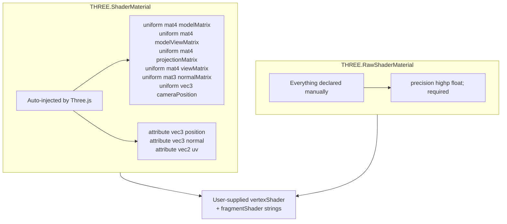
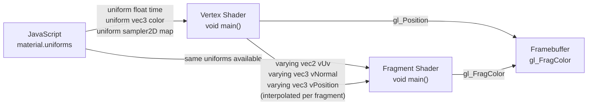
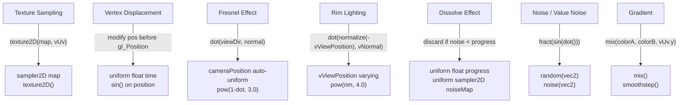
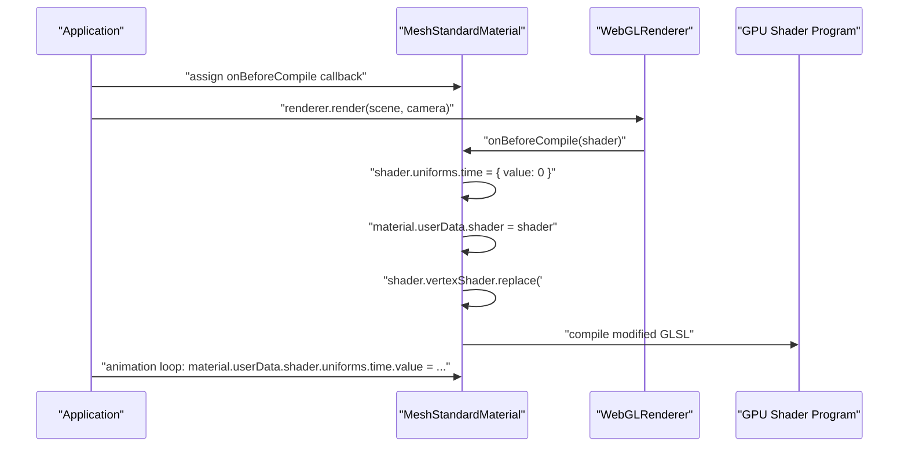
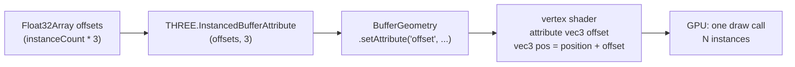

<!-- source: DeepWiki mcp.deepwiki.com · repo CloudAI-X/threejs-skills · extra page threejs-shaders · fetched 2026-10-26 -->

# threejs-shaders

Relevant source files

The following files were used as context for generating this wiki page:

- [skills/threejs-shaders/SKILL.md](skills/threejs-shaders/SKILL.md)

This page documents the `threejs-shaders` skill file, covering custom GLSL shader authoring in Three.js via `ShaderMaterial` and `RawShaderMaterial`, uniform management, vertex/fragment shader structure, the `onBeforeCompile` callback for extending built-in materials, `ShaderChunk` reuse, instanced shader attributes, and common GLSL patterns.

For built-in material types that do not require custom GLSL, see [threejs-materials](#2.1.3). For full-screen post-processing effects that use `ShaderPass`, see [threejs-postprocessing](#2.2.3). For texture loading and configuration used within shaders, see [threejs-textures](#2.1.4).

---

## Skill Activation

The `threejs-shaders` skill is activated by Claude Code when a user request involves custom visual effects, vertex manipulation, fragment shaders, or modifying built-in materials. It is frequently co-loaded with `threejs-postprocessing`.

**Activation description** (from front matter):

> Three.js shaders - GLSL, ShaderMaterial, uniforms, custom effects. Use when creating custom visual effects, modifying vertices, writing fragment shaders, or extending built-in materials.

Sources: [skills/threejs-shaders/SKILL.md:1-4]()

---

## ShaderMaterial vs RawShaderMaterial

Two classes provide custom GLSL shader support. The primary distinction is what Three.js automatically injects into the shader source.

**Diagram: ShaderMaterial vs RawShaderMaterial injection model**

Sources: [skills/threejs-shaders/SKILL.md:36-99]()

| Feature | `ShaderMaterial` | `RawShaderMaterial` |
|---|---|---|
| Built-in uniforms (matrices, camera) | Auto-injected | Must declare manually |
| Built-in attributes (`position`, `normal`, `uv`) | Auto-injected | Must declare manually |
| `precision` directive | Auto-added | Must add manually |
| Use case | Standard custom shaders | Full GPU-level control |

Sources: [skills/threejs-shaders/SKILL.md:36-99]()

---

## Uniforms

Uniforms are per-draw-call values passed from JavaScript to the GPU. They are defined in the `uniforms` object and must have a matching `uniform` declaration in the GLSL source.

### Uniform Type Mapping

| JavaScript value | GLSL type |
|---|---|
| `Number` (float) | `float` |
| `Number` (int) | `int` |
| `THREE.Vector2` | `vec2` |
| `THREE.Vector3` | `vec3` |
| `THREE.Color` | `vec3` |
| `THREE.Vector4` | `vec4` |
| `THREE.Matrix3` | `mat3` |
| `THREE.Matrix4` | `mat4` |
| `THREE.Texture` | `sampler2D` |
| `THREE.CubeTexture` | `samplerCube` |
| `Array` of `Number` | `float[n]` |
| `Array` of `THREE.Vector3` | `vec3[n]` |

Sources: [skills/threejs-shaders/SKILL.md:101-153]()

### Updating Uniforms at Runtime

Uniforms are updated by writing to `.value` on the uniform object:

- Scalar: direct assignment — [skills/threejs-shaders/SKILL.md:158-159]()
- Vector/Color: mutate in-place via `.set()` / `.setHSL()` — [skills/threejs-shaders/SKILL.md:162-163]()
- Matrix: copy from scene object via `.copy()` — [skills/threejs-shaders/SKILL.md:165-166]()

When using `onBeforeCompile`, store the shader reference in `material.userData.shader` to access its `uniforms` object in the animation loop — [skills/threejs-shaders/SKILL.md:400-421]()

---

## Varyings

Varyings carry interpolated data from the vertex shader to the fragment shader. They must be declared with identical names and types in both shader stages.

**Diagram: Data flow through the shader pipeline**

Sources: [skills/threejs-shaders/SKILL.md:169-199]()

Common varying conventions used in the skill file:

| Varying name | Type | Computed from |
|---|---|---|
| `vUv` | `vec2` | built-in `uv` attribute |
| `vNormal` | `vec3` | `normalMatrix * normal` |
| `vPosition` | `vec3` | `(modelViewMatrix * vec4(position, 1.0)).xyz` |
| `vWorldPosition` | `vec3` | `(modelMatrix * vec4(position, 1.0)).xyz` |
| `vViewPosition` | `vec3` | `(modelViewMatrix * vec4(position, 1.0)).xyz` |

Sources: [skills/threejs-shaders/SKILL.md:173-199](), [skills/threejs-shaders/SKILL.md:263-289](), [skills/threejs-shaders/SKILL.md:337-365]()

---

## Common Shader Patterns

**Diagram: Pattern → GLSL construct mapping**

Sources: [skills/threejs-shaders/SKILL.md:201-387]()

### Pattern Summary

| Pattern | Key construct | Shader stage |
|---|---|---|
| Texture sampling | `texture2D(map, vUv)` | Fragment |
| Vertex displacement | modify `pos` before `gl_Position` | Vertex |
| Fresnel | `pow(1.0 - dot(viewDir, vNormal), 3.0)` | Fragment |
| Rim lighting | `1.0 - max(0.0, dot(viewDir, vNormal))` | Fragment |
| Dissolve | `discard` when `noise < progress` | Fragment |
| Gradient | `mix(colorA, colorB, t)` | Fragment |
| Value noise | `fract(sin(dot(st, vec2(12.9898, 78.233))) * 43758.5453)` | Fragment |

Sources: [skills/threejs-shaders/SKILL.md:201-387]()

---

## Extending Built-in Materials with `onBeforeCompile`

`onBeforeCompile` is a callback on any Three.js material that fires before the shader program is compiled. It receives the internal shader object and allows string-replace injection into the GLSL source.

**Diagram: onBeforeCompile execution flow**

Sources: [skills/threejs-shaders/SKILL.md:389-422]()

### Common Injection Points

Injection works by replacing `#include` directives in Three.js's compiled shader source:

| Injection point | Location in shader |
|---|---|
| `#include <begin_vertex>` | After local position is established (vertex) |
| `#include <project_vertex>` | After `gl_Position` is set (vertex) |
| `#include <beginnormal_vertex>` | Normal calculation start (vertex) |
| `#include <color_fragment>` | After diffuse color assignment (fragment) |
| `#include <output_fragment>` | Final output before write (fragment) |
| `#include <fog_fragment>` | After fog blending (fragment) |

Sources: [skills/threejs-shaders/SKILL.md:424-436]()

---

## ShaderChunk Reuse

`THREE.ShaderChunk` (imported as `ShaderChunk` from `"three"`) provides reusable GLSL utility blocks that can be interpolated into custom shader strings.

Commonly used chunks:

| Chunk key | Contents |
|---|---|
| `ShaderChunk.common` | Basic math utilities, PI constants |
| `ShaderChunk.packing` | Depth/normal packing helpers (e.g. `perspectiveDepthToViewZ`) |

Usage: interpolate the chunk string directly into the shader source template literal — [skills/threejs-shaders/SKILL.md:532-551]()

---

## Instanced Shader Attributes

Per-instance data is supplied via `THREE.InstancedBufferAttribute` set on the geometry. The attribute is declared in the vertex shader the same way as a regular `attribute`.

**Diagram: InstancedBufferAttribute data flow**

Sources: [skills/threejs-shaders/SKILL.md:566-589]()

---

## Material Properties for ShaderMaterial

Key constructor properties beyond `uniforms`, `vertexShader`, `fragmentShader`:

| Property | Type | Notes |
|---|---|---|
| `transparent` | `boolean` | Required for alpha blending |
| `side` | `THREE.Side` | `FrontSide`, `BackSide`, `DoubleSide` |
| `depthTest` | `boolean` | Default `true` |
| `depthWrite` | `boolean` | Disable for transparent overlays |
| `blending` | `THREE.Blending` | `NormalBlending`, `AdditiveBlending`, `SubtractiveBlending`, `MultiplyBlending` |
| `wireframe` | `boolean` | Debug use |
| `glslVersion` | `THREE.GLSLVersion` | `THREE.GLSL3` enables WebGL2 `texture()` syntax and `out vec4 fragColor` |
| `extensions.derivatives` | `boolean` | Enables `fwidth`, `dFdx`, `dFdy` |
| `extensions.fragDepth` | `boolean` | Enables `gl_FragDepth` |
| `extensions.drawBuffers` | `boolean` | Multiple render targets |
| `extensions.shaderTextureLOD` | `boolean` | Enables `texture2DLod` |

Sources: [skills/threejs-shaders/SKILL.md:493-529]()

---

## GLSL Built-in Functions Reference

### Math

| Function | Description |
|---|---|
| `abs`, `sign`, `floor`, `ceil`, `fract` | Component-wise scalar ops |
| `mod(x, y)`, `min`, `max`, `clamp(x, min, max)` | Range operations |
| `mix(a, b, t)` | Linear interpolation |
| `step(edge, x)` | Returns 0.0 or 1.0 |
| `smoothstep(e0, e1, x)` | Hermite interpolation |
| `pow`, `exp`, `log`, `sqrt` | Exponential |
| `sin`, `cos`, `tan`, `atan(y, x)` | Trigonometry |

### Vector

| Function | Description |
|---|---|
| `length(v)`, `distance(p0, p1)` | Magnitude / distance |
| `dot(x, y)`, `cross(x, y)` | Dot and cross product |
| `normalize(v)` | Unit vector |
| `reflect(I, N)`, `refract(I, N, eta)` | Optics |

### Texture

| GLSL 1.0 (default) | GLSL 3.0 (`THREE.GLSL3`) |
|---|---|
| `texture2D(sampler, coord)` | `texture(sampler, coord)` |
| `textureCube(sampler, coord)` | `texture(sampler, coord)` |
| `gl_FragColor` | `out vec4 fragColor` |

Sources: [skills/threejs-shaders/SKILL.md:438-491]()

---

## Debugging Shaders

| Technique | How |
|---|---|
| Log compiled GLSL source | Use `onBeforeCompile` to `console.log(shader.vertexShader)` |
| Visualize UVs | Output `vec4(vUv, 0.0, 1.0)` as `gl_FragColor` |
| Visualize normals | Output `vec4(vNormal * 0.5 + 0.5, 1.0)` |
| Visualize position | Output `vec4(vPosition * 0.1 + 0.5, 1.0)` |
| WebGL error checking | Set `renderer.debug.checkShaderErrors = true` |

Sources: [skills/threejs-shaders/SKILL.md:591-616]()

---

## Performance Tips

Sources: [skills/threejs-shaders/SKILL.md:618-636]()

1. **Minimize uniforms** — Pack related values into vectors (e.g., `vec4` instead of four `float`s).
2. **Avoid branching** — Replace `if/else` with `mix()` + `step()`. Branch divergence in GLSL is costly on GPU.
3. **Precalculate on CPU** — Move any computation that doesn't vary per-vertex/fragment into JavaScript.
4. **Use lookup textures** — For complex functions (e.g., noise, color ramps), bake them into a `DataTexture` and sample it.
5. **Limit overdraw** — Transparent `ShaderMaterial` objects are drawn after opaque and sorted; minimize layering.

---

## See Also

- [threejs-materials](#2.1.3) — Built-in material types; use `onBeforeCompile` to extend them.
- [threejs-postprocessing](#2.2.3) — Full-screen `ShaderPass` effects using `EffectComposer`.
- [threejs-textures](#2.1.4) — Texture loading and configuration for `sampler2D` uniforms.
- [threejs-geometry](#2.1.2) — `InstancedBufferAttribute` for per-instance shader data.

---

