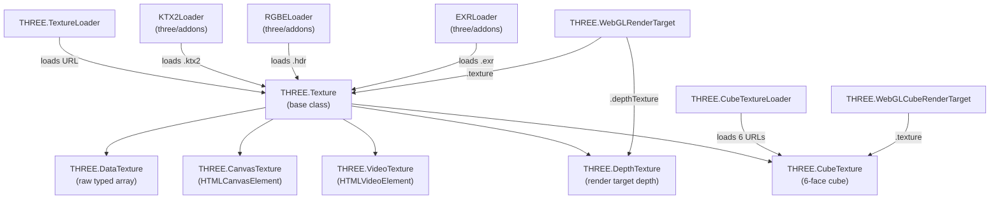
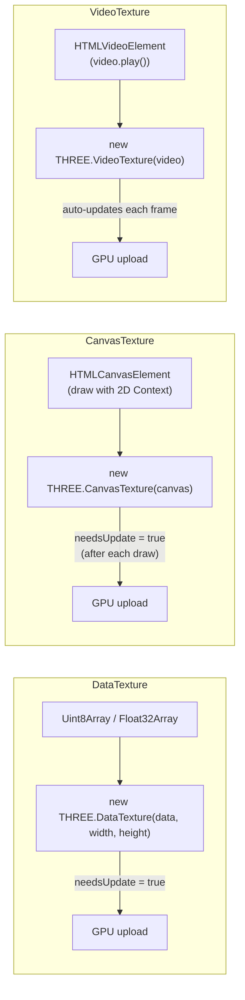
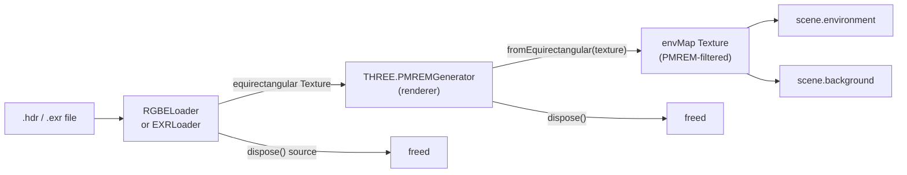
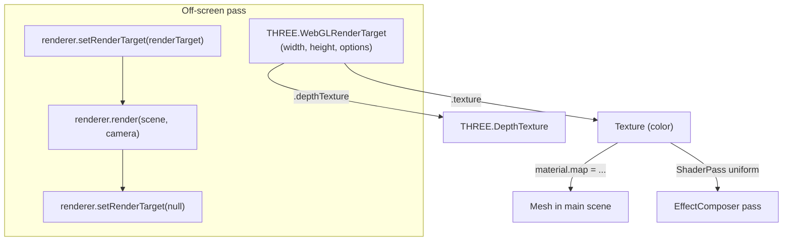

<!-- source: DeepWiki mcp.deepwiki.com · repo CloudAI-X/threejs-skills · extra page threejs-textures · fetched 2026-10-26 -->

# threejs-textures

<details>
<summary>Relevant source files</summary>

The following files were used as context for generating this wiki page:

- [skills/threejs-textures/SKILL.md](skills/threejs-textures/SKILL.md)

</details>


This page documents the `threejs-textures` skill file ([skills/threejs-textures/SKILL.md]()) and covers all texture-related APIs in Three.js: loading textures from files and programmatic sources, configuring their behavior, working with cube and HDR environment textures, rendering to textures via `WebGLRenderTarget`, and managing GPU memory through proper disposal.

This page is focused on texture objects themselves. For applying textures to specific material slots, see [threejs-materials](#2.1.3). For the loaders that produce textures as part of larger asset files (e.g. `GLTFLoader`), see [threejs-loaders](#2.3.1). For using textures inside GLSL shaders as `sampler2D` uniforms, see [threejs-shaders](#2.2.2).

---

## Skill Activation

The skill is loaded by Claude Code when a request description matches:

> *"Three.js textures – texture types, UV mapping, environment maps, texture settings. Use when working with images, UV coordinates, cubemaps, HDR environments, or texture optimization."*

[skills/threejs-textures/SKILL.md:1-4]()

---

## Texture Class Hierarchy

**Diagram: Texture type hierarchy and associated loaders**



Sources: [skills/threejs-textures/SKILL.md:129-209]()

---

## Loading Textures

### `TextureLoader`

The primary loader for standard image formats (JPG, PNG, WebP, etc.).

[skills/threejs-textures/SKILL.md:27-58]()

`TextureLoader.load(url, onLoad, onProgress, onError)` returns a `THREE.Texture` immediately — the underlying image loads asynchronously, and the texture is ready when `onLoad` fires.

For concurrent loading of multiple textures, wrap in a `Promise` and use `Promise.all`:

[skills/threejs-textures/SKILL.md:44-58]()

### `KTX2Loader` (Compressed Textures)

GPU-compressed KTX2/Basis textures significantly reduce VRAM and bandwidth. Requires the Basis Universal transcoder WASM binary.

[skills/threejs-textures/SKILL.md:199-209]()

Key setup steps:
1. `ktx2Loader.setTranscoderPath(path)` — path to the Basis WASM files
2. `ktx2Loader.detectSupport(renderer)` — selects the best compression format for the GPU

### HDR Loaders

| Class | Import path | Format | Use case |
|---|---|---|---|
| `RGBELoader` | `three/addons/loaders/RGBELoader.js` | `.hdr` (Radiance RGBE) | IBL environments |
| `EXRLoader` | `three/addons/loaders/EXRLoader.js` | `.exr` (OpenEXR) | VFX-quality HDR |

Both produce a `THREE.Texture` with `mapping` set to `THREE.EquirectangularReflectionMapping` for direct use as `scene.environment`.

[skills/threejs-textures/SKILL.md:255-279]()

---

## Texture Configuration Properties

### Color Space

Incorrectly set color spaces are a common source of washed-out or over-saturated renders.

| Texture type | `colorSpace` value | Notes |
|---|---|---|
| Color / albedo | `THREE.SRGBColorSpace` | Must be set explicitly |
| Normal map | (default, `NoColorSpace`) | Do **not** set |
| Roughness map | (default) | Do **not** set |
| Metalness map | (default) | Do **not** set |
| AO map | (default) | Do **not** set |
| `VideoTexture` | `THREE.SRGBColorSpace` | Set explicitly |

[skills/threejs-textures/SKILL.md:63-73]()

### Wrapping Modes

Controlled per-axis via `texture.wrapS` (horizontal) and `texture.wrapT` (vertical).

| Constant | Behavior |
|---|---|
| `THREE.ClampToEdgeWrapping` | Stretches edge pixels (default) |
| `THREE.RepeatWrapping` | Tiles the texture |
| `THREE.MirroredRepeatWrapping` | Tiles with mirror flip on each repeat |

`wrapS`/`wrapT` must be set to `RepeatWrapping` before `texture.repeat` has any effect.

[skills/threejs-textures/SKILL.md:76-84]()

### Repeat, Offset, Rotation

| Property | Type | Description |
|---|---|---|
| `texture.repeat` | `Vector2` | Tile count per axis |
| `texture.offset` | `Vector2` | UV origin shift (0–1 range) |
| `texture.rotation` | `number` | Rotation in radians |
| `texture.center` | `Vector2` | Pivot point for rotation (default `0,0`) |

[skills/threejs-textures/SKILL.md:87-100]()

### Filtering

| Property | Constant | Description |
|---|---|---|
| `minFilter` | `THREE.LinearMipmapLinearFilter` | Default; smooth with mipmaps |
| `minFilter` | `THREE.NearestFilter` | Pixelated |
| `minFilter` | `THREE.LinearFilter` | Smooth; disables mipmaps |
| `magFilter` | `THREE.LinearFilter` | Default; smooth |
| `magFilter` | `THREE.NearestFilter` | Pixelated (retro style) |

`texture.anisotropy = renderer.capabilities.getMaxAnisotropy()` sharpens textures on surfaces viewed at oblique angles. This is one of the highest-impact single-line quality improvements available.

[skills/threejs-textures/SKILL.md:103-127]()

### Mipmaps

`texture.generateMipmaps` is `true` by default. Disable it for:
- Non-power-of-2 textures
- Raw data textures (normals, LUTs, etc.)
- Render target textures used as input

When disabling mipmaps, also set `minFilter` to `THREE.LinearFilter` or `THREE.NearestFilter` to avoid WebGL warnings.

[skills/threejs-textures/SKILL.md:119-127]()

---

## Programmatic Texture Types

**Diagram: Programmatic texture construction and update flow**



Sources: [skills/threejs-textures/SKILL.md:138-195]()

- `DataTexture` — construct from a typed array; call `needsUpdate = true` after every data write
- `CanvasTexture` — wraps an `HTMLCanvasElement`; call `needsUpdate = true` after drawing
- `VideoTexture` — wraps an `HTMLVideoElement`; updates automatically each animation frame — **do not** set `needsUpdate` manually

---

## Cube Textures and Environment Maps

### `CubeTextureLoader`

Loads 6 separate images into a `THREE.CubeTexture` in the order: `+X, -X, +Y, -Y, +Z, -Z`.

[skills/threejs-textures/SKILL.md:216-234]()

Assign to `scene.background`, `scene.environment`, or `material.envMap`.

### HDR → PMREM Pipeline

Raw HDR/EXR equirectangular textures must be pre-filtered using `THREE.PMREMGenerator` before they can be used as a PBR environment map. The PMREM (Pre-filtered Mipmapped Radiance Environment Map) encodes roughness-level reflections into mip levels.

[skills/threejs-textures/SKILL.md:237-252]()

**Diagram: HDR environment map preparation pipeline**



Sources: [skills/threejs-textures/SKILL.md:237-252]()

Dispose both the source texture and the `PMREMGenerator` after the env map is produced — they are no longer needed.

### Scene Background Options

| Property | Type | Description |
|---|---|---|
| `scene.background` | `Texture \| CubeTexture \| Color` | Rendered behind the scene |
| `scene.backgroundBlurriness` | `number` (0–1) | Blur amount on background |
| `scene.backgroundIntensity` | `number` | Brightness multiplier |
| `scene.backgroundRotation.y` | `number` | Rotate background (radians) |

[skills/threejs-textures/SKILL.md:282-288]()

---

## Render Targets

`WebGLRenderTarget` redirects render output to a texture instead of the screen canvas. The result texture is available at `renderTarget.texture`.

**Diagram: WebGLRenderTarget render-to-texture pipeline**



Sources: [skills/threejs-textures/SKILL.md:291-332]()

### `WebGLRenderTarget` Options

| Option | Type | Description |
|---|---|---|
| `minFilter` | `TextureFilter` | Filtering for the output texture |
| `magFilter` | `TextureFilter` | Magnification filtering |
| `format` | `PixelFormat` | e.g. `THREE.RGBAFormat` |
| `samples` | `number` | MSAA sample count (default 0 = disabled) |

### Depth Texture

Attach a `THREE.DepthTexture` to a render target to make the depth buffer readable as a texture (e.g. for SSAO, soft particles):

[skills/threejs-textures/SKILL.md:313-323]()

Constructor: `new THREE.DepthTexture(width, height, type)` where `type` is typically `THREE.UnsignedShortType`.

---

## CubeCamera (Dynamic Reflections)

`THREE.CubeCamera` renders the scene from 6 directions into a `WebGLCubeRenderTarget`, producing a live environment map. This is expensive — update only when the scene changes.

[skills/threejs-textures/SKILL.md:335-357]()

Pattern:
1. Create `WebGLCubeRenderTarget` and `CubeCamera`
2. Set `reflectiveMaterial.envMap = cubeRenderTarget.texture`
3. In the animation loop: hide the reflective object, call `cubeCamera.update(renderer, scene)`, show it again

---

## UV Mapping

### Accessing and Modifying UVs

UV coordinates are stored in `geometry.attributes.uv` as a `BufferAttribute`. Read and write via `getX`, `getY`, `setXY`. Set `uvs.needsUpdate = true` after any writes.

[skills/threejs-textures/SKILL.md:361-374]()

### Second UV Channel (`uv2`)

Required for `aoMap` (ambient occlusion) and `lightMap`. Most built-in geometries do not include `uv2` — copy or create it manually:

[skills/threejs-textures/SKILL.md:376-385]()

### Texture Atlas

Use `texture.offset` and `texture.repeat` to select a sub-region of a sprite atlas texture, reducing texture bind calls.

[skills/threejs-textures/SKILL.md:418-435]()

---

## PBR Texture Map Slots

The following table covers all texture map slots on `MeshStandardMaterial` and `MeshPhysicalMaterial`:

| Slot | Property | Color space | Notes |
|---|---|---|---|
| Base color | `map` | `SRGBColorSpace` | Multiplied by `color` |
| Normal | `normalMap` | Linear (default) | Scale via `normalScale: Vector2` |
| Roughness | `roughnessMap` | Linear (default) | Multiplied by `roughness` |
| Metalness | `metalnessMap` | Linear (default) | Multiplied by `metalness` |
| Ambient occlusion | `aoMap` | Linear (default) | Requires `uv2`; intensity via `aoMapIntensity` |
| Emissive | `emissiveMap` | `SRGBColorSpace` | Multiplied by `emissive` color + `emissiveIntensity` |
| Displacement | `displacementMap` | Linear (default) | Moves vertices; scale via `displacementScale` |
| Alpha | `alphaMap` | Linear (default) | Requires `transparent: true` |
| Environment | `envMap` | — | Overrides `scene.environment` for this material |
| Light map | `lightMap` | Linear (default) | Requires `uv2` |
| Bump | `bumpMap` | Linear (default) | Alternative to normal map; scale via `bumpScale` |

[skills/threejs-textures/SKILL.md:437-479]()

### Normal Map Types

| Constant | Description |
|---|---|
| `THREE.TangentSpaceNormalMap` | Default; baked from high-poly mesh |
| `THREE.ObjectSpaceNormalMap` | Object-space normals; unique colors per face direction |

[skills/threejs-textures/SKILL.md:483-489]()

---

## Texture Memory Management

GPU texture memory is not garbage-collected. Textures must be explicitly disposed when no longer needed.

### `texture.dispose()`

Frees the GPU-side texture object. The JavaScript object becomes unusable after disposal.

[skills/threejs-textures/SKILL.md:535-566]()

The `disposeMaterial` helper pattern iterates over all known texture slots on a material and calls `.dispose()` on each before disposing the material itself.

### `TexturePool` Pattern

The `TexturePool` class ([skills/threejs-textures/SKILL.md:570-603]()) caches loaded textures by URL, preventing duplicate GPU uploads. It exposes `get(url)` (async, returns cached or newly loaded `Texture`), `dispose(url)`, and `disposeAll()`.

### Monitor Texture Count

```
renderer.info.memory.textures
```

[skills/threejs-textures/SKILL.md:616]()

---

## Performance Tips

| Tip | Rationale |
|---|---|
| Use power-of-2 dimensions (256, 512, 1024, 2048) | Required for mipmap generation; avoids resizing overhead |
| Use KTX2/Basis compression for web delivery | Stays compressed in VRAM; GPU decodes natively |
| Use texture atlases | Reduces texture bind/switch calls per draw |
| Enable mipmaps for distant objects | Prevents aliasing; improves cache efficiency |
| Cap texture size at 2048 for web | 4096+ textures may be clamped on mobile GPUs |
| Reuse the same texture instance across materials | GPU uploads once; better batching |
| Check `renderer.capabilities.maxTextureSize` | Clamp requested size to device limit |

[skills/threejs-textures/SKILL.md:605-622]()

---

## See Also

- [threejs-materials](#2.1.3) — applying textures to material slots, PBR workflow
- [threejs-loaders](#2.3.1) — `GLTFLoader`, `RGBELoader`, `KTX2Loader` as part of full asset pipelines
- [threejs-shaders](#2.2.2) — custom `sampler2D` uniforms, UV transforms in GLSL
- [threejs-postprocessing](#2.2.3) — `WebGLRenderTarget` as input to `EffectComposer` passes
- [threejs-lighting](#2.2.1) — IBL via `PMREMGenerator`, `RGBELoader` for environment lighting

---

