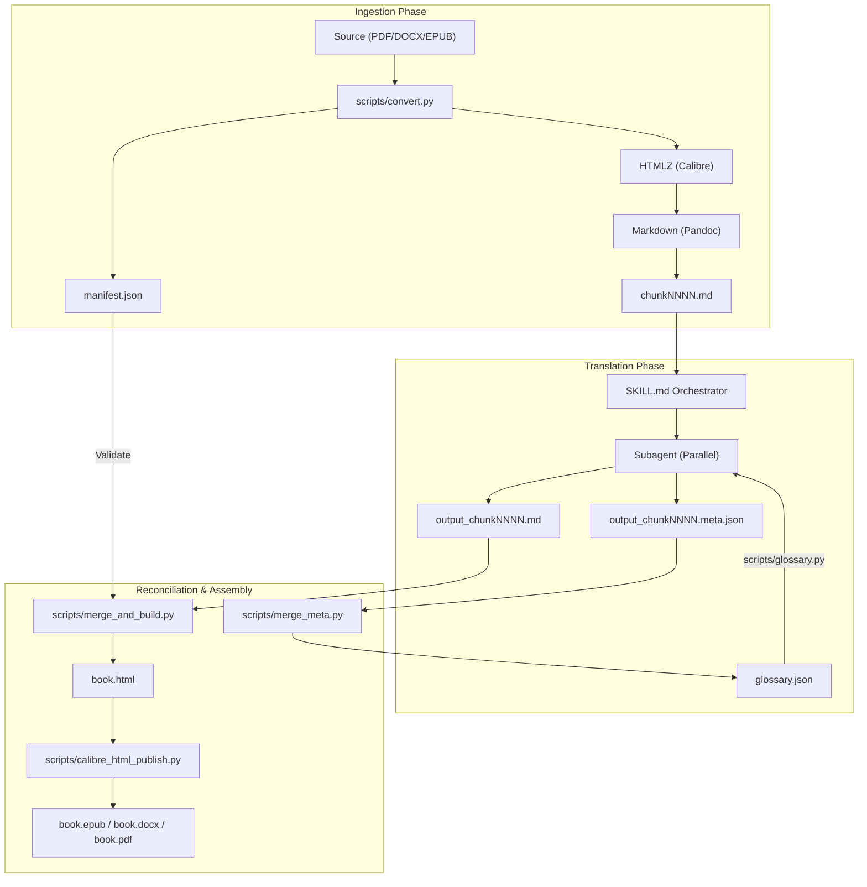
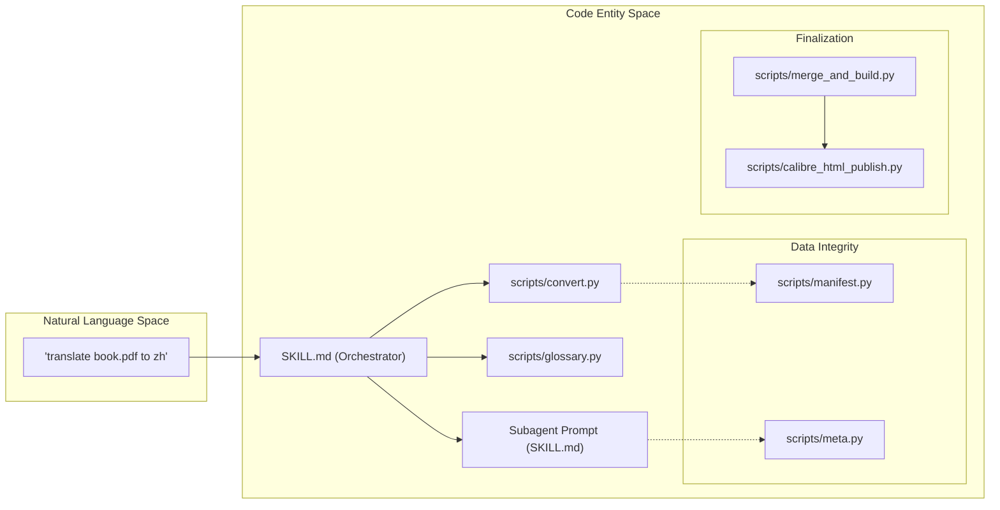

<!-- source: DeepWiki mcp.deepwiki.com · repo deusyu/translate-book · page 1 Overview · fetched 2026-10-26 -->

# Overview

Relevant source files

The following files were used as context for generating this wiki page:

- [AGENTS.md](AGENTS.md)
- [CLAUDE.md](CLAUDE.md)
- [README.md](README.md)
- [README.zh-CN.md](README.zh-CN.md)

`translate-book` is a technical framework and Claude Code Skill designed to translate long-form documents (PDF, DOCX, EPUB) into any target language using a parallelized multi-agent architecture. By breaking books into manageable chunks and employing independent subagents, the system bypasses the context window limitations and output truncation issues common in single-session LLM translations [README.md:5-7](), [README.md:33-33]().

The project emphasizes data integrity through manifest-driven validation, term consistency via a global glossary system, and professional-grade output formatting using Calibre and Pandoc [README.md:37-42]().

## System Philosophy

The pipeline is built on three core technical pillars:
1.  **Isolated Contexts**: Each chunk is processed by a fresh subagent to maintain high translation quality and prevent "hallucination drift" from previous chapters [README.md:33-33]().
2.  **Deterministic Bookkeeping**: While the translation is generative, the management of files, hashes, and state is handled by deterministic Python scripts [README.zh-CN:222-222]().
3.  **Conservative Merging**: The system uses a "merge-meta" feedback loop to reconcile entity names and genders across chunks without silently overwriting human-verified data [README.zh-CN:223-223]().

## End-to-End Pipeline

The following diagram illustrates the transformation from a source document to the final multi-format outputs, mapped to the specific Python entities responsible for each stage.

### High-Level Data Flow

Sources: [README.md:13-31](), [README.md:122-181](), [CLAUDE.md:9-17]()

## Code Entity Space Mapping

To navigate the codebase, it is essential to understand how the high-level "Pipeline Phases" map to specific Python modules and orchestration files.

### Orchestration and Logic Mapping

Sources: [SKILL.md:1-100](), [CLAUDE.md:7-18](), [AGENTS.md:7-17]()

## Key Components

### 1. Ingestion and Chunking
The pipeline begins with `scripts/convert.py`, which utilizes Calibre's `ebook-convert` to normalize various input formats into a temporary HTMLZ structure. This is then converted to Markdown and split into chunks of approximately 6000 characters [README.md:122-128](). For details, see [Getting Started](#1.1).

### 2. The Glossary System
To ensure "Manhattan" isn't translated as three different things across 50 chunks, `scripts/glossary.py` manages a `glossary.json` file. It samples the book to seed terms and then injects a context-aware term table into every subagent's prompt [README.md:130-140]().

### 3. Parallel Translation
The `SKILL.md` file defines the orchestration logic for launching up to 8 concurrent subagents. Each subagent is responsible for a single chunk, producing both the translated Markdown and a `.meta.json` file containing observed entities [README.md:160-168](). For details, see [Pipeline Architecture](#1.2).

### 4. Validation and Assembly
Before the final build, `scripts/manifest.py` verifies SHA-256 hashes to ensure no source chunks have changed since translation began [README.md:176-179](). Finally, `scripts/merge_and_build.py` and `scripts/calibre_html_publish.py` assemble the chunks into a unified document and export it to professional formats [README.md:170-181]().

## Wiki Navigation

*   **[Getting Started](#1.1)**: Installation of Calibre, Pandoc, and Python dependencies. How to run your first translation.
*   **[Pipeline Architecture](#1.2)**: A deep dive into the five phases of the translation lifecycle and the `{baseDir}` workspace.
*   **[Scripts Reference](#2)**: Detailed documentation for every Python script in the `scripts/` directory.
*   **[Orchestration and Skill Definition](#3)**: Understanding `SKILL.md` and the developer constraints in `CLAUDE.md`.
*   **[Testing](#4)**: How to use the baseline system (`tests/baselines/`) to verify pipeline changes.

Sources: [README.md:44-52](), [README.md:185-201](), [CLAUDE.md:31-47]()

---

