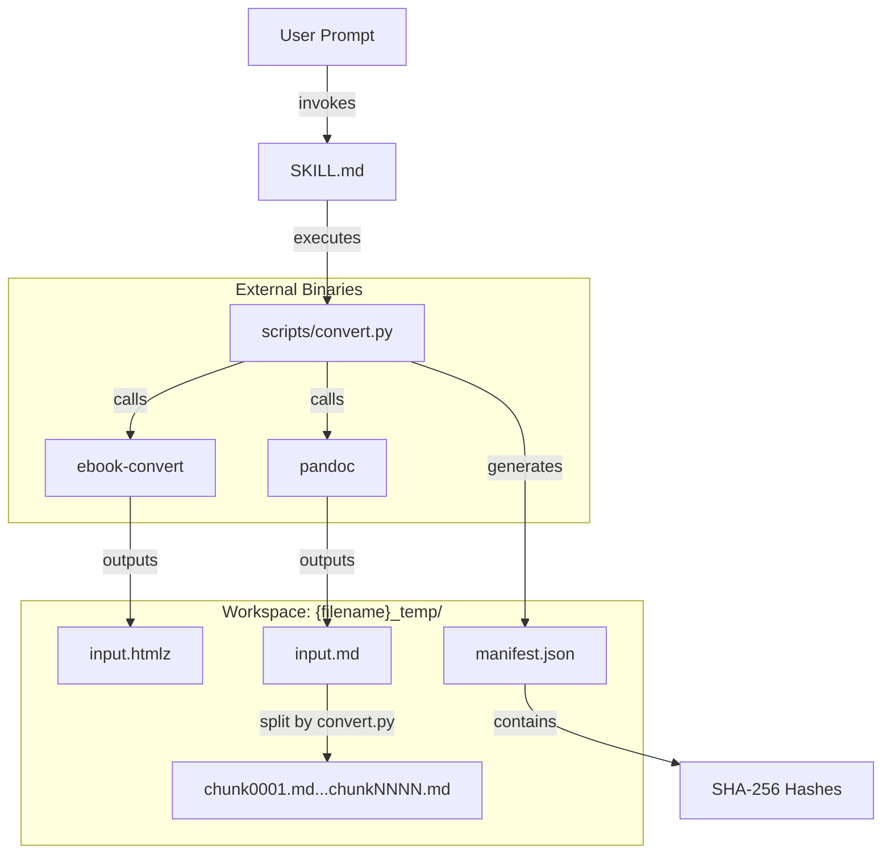
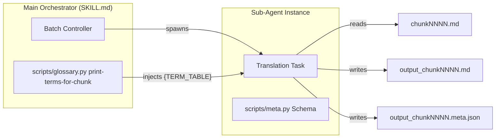

<!-- source: DeepWiki mcp.deepwiki.com · repo deusyu/translate-book · page 1.1 Getting Started · fetched 2026-10-26 -->

# Getting Started

<details>
<summary>Relevant source files</summary>

The following files were used as context for generating this wiki page:

- [.gitignore](.gitignore)
- [README.md](README.md)
- [README.zh-CN.md](README.zh-CN.md)
- [SKILL.md](SKILL.md)

</details>


This page provides a technical guide for setting up the `translate-book` environment and executing the first translation pipeline. It covers the installation of external binary dependencies, Python environment configuration, and the orchestration of the Claude Code skill.

## Purpose and Scope

The `translate-book` pipeline is a multi-stage workflow designed to convert, chunk, and translate books (PDF/DOCX/EPUB) using parallel LLM sub-agents. The system relies on a combination of established document processing tools (Calibre, Pandoc) and custom Python orchestration logic defined in `SKILL.md` [[SKILL.md:1-10]]().

## Prerequisites

The system requires three primary external dependencies and a specific Python environment to function.

### 1. External Binaries
| Dependency | Purpose | Requirement |
| :--- | :--- | :--- |
| **Claude Code CLI** | Main orchestration engine | Installed and authenticated [[README.md:46-46]]() |
| **Calibre** | Format conversion (PDF/DOCX/EPUB → HTMLZ) | `ebook-convert` must be in PATH [[README.md:47-47]]() |
| **Pandoc** | Markdown/HTML transformation | `pandoc` binary available [[README.md:48-48]]() |

### 2. Python Environment
The pipeline is tested on **Python 3.11** [[.github/workflows/ci.yml:16-16]](). 
*   **Required**: `pypandoc` (Python wrapper for Pandoc) [[README.md:50-50]]()
*   **Optional**: `beautifulsoup4` (Enhanced TOC generation and HTML parsing) [[README.md:51-51]]()

**Sources:** [[README.md:44-52]](), [[.github/workflows/ci.yml:16-16]]()

---

## Installation

### Skill Deployment
The skill can be installed via `npx` (recommended), `clawhub`, or direct git clone into the Claude Code skills directory [[README.md:55-73]]().

```bash
# Recommended: Install via npx
npx skills add deusyu/translate-book -a claude-code -g
```

### Path Abstraction: `{baseDir}`
The codebase uses a `{baseDir}` abstraction in `SKILL.md` and `AGENTS.md` to reference the skill's root directory regardless of where it is installed on the local filesystem [[SKILL.md:29-29]](), [[AGENTS.md:5-5]](). This ensures that the orchestration layer can reliably locate the `scripts/` directory for tool execution.

**Sources:** [[README.md:55-73]](), [[SKILL.md:29-29]]()

---

## Running Your First Translation

### Skill Invocation Syntax
The skill is invoked within the Claude Code environment using either natural language or a direct slash command [[README.md:78-88]]().

**Natural Language:**
> "translate /path/to/book.pdf to Chinese"

**Slash Command:**
> `/translate-book translate /path/to/book.pdf to Japanese`

### Parameters
The orchestration logic in `SKILL.md` extracts the following parameters from the user prompt:
*   `file_path`: The absolute path to the source document [[SKILL.md:17-17]]().
*   `target_lang`: The ISO language code (default: `zh`) [[SKILL.md:18-18]]().
*   `concurrency`: Number of parallel sub-agents (default: `8`) [[SKILL.md:19-19]]().
*   `custom_instructions`: User-defined style or terminology constraints [[SKILL.md:20-20]]().

**Sources:** [[README.md:78-88]](), [[SKILL.md:14-22]]()

---

## Data Flow and Workspace

When a translation starts, the system creates a workspace directory named `{filename}_temp/` in the current working directory [[README.md:94-94]](). This directory serves as the stateful scratchpad for the entire pipeline.

### System Entity Mapping: Ingestion to Workspace
The following diagram bridges the natural language request to the code entities and filesystem artifacts created during the "Preprocess" phase.

**Diagram: Ingestion Data Flow**

**Sources:** [[README.md:13-31]](), [[SKILL.md:24-37]](), [[scripts/convert.py:1-20]]()

---

## Execution Lifecycle

The pipeline follows a strict execution order managed by the main agent.

### 1. Preprocessing
The `scripts/convert.py` script is called to ingest the file. It uses Calibre to normalize the input to HTMLZ, then Pandoc to convert it to Markdown, and finally splits the text into ~6000 character chunks [[README.md:122-128]]().

### 2. Glossary Initialization
The skill samples the book (first, last, and middle chunks) to extract key terms [[SKILL.md:59-60]](). It creates a `glossary.json` file which is then used to enforce terminology consistency across the parallel sub-agents [[README.md:130-158]]().

### 3. Parallel Translation
The main agent spawns sub-agents in batches. Each sub-agent is responsible for a single chunk.

**Diagram: Sub-agent Invocation Logic**


### 4. Final Assembly
Once all chunks are translated and validated against `manifest.json`, the `scripts/merge_and_build.py` script aggregates the results into the final formats: `book.html`, `book.docx`, `book.epub`, and `book.pdf` [[README.md:170-181]]().

**Sources:** [[README.md:120-181]](), [[SKILL.md:38-124]]()

---

