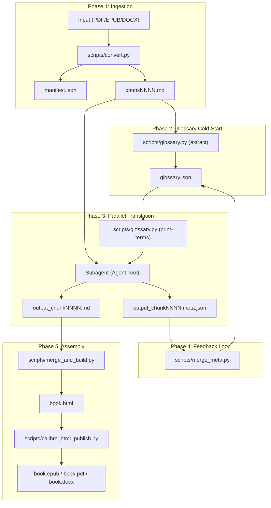
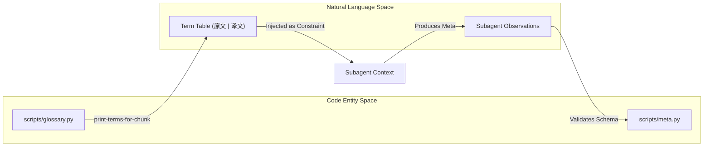
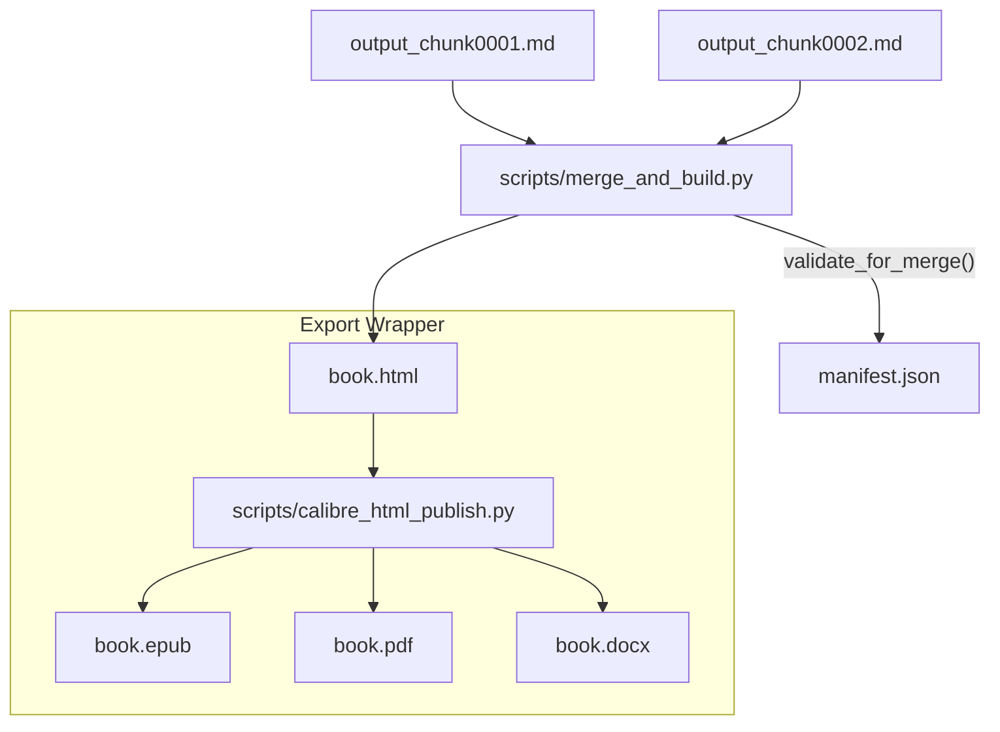

<!-- source: DeepWiki mcp.deepwiki.com · repo deusyu/translate-book · page 1.2 Pipeline Architecture · fetched 2026-10-26 -->

# Pipeline Architecture

Relevant source files

The following files were used as context for generating this wiki page:

- [AGENTS.md](AGENTS.md)
- [CLAUDE.md](CLAUDE.md)
- [README.md](README.md)
- [SKILL.md](SKILL.md)

The `translate-book` pipeline is a five-phase workflow designed to translate large-scale documents while maintaining term consistency and structural integrity. It employs a fan-out/fan-in architecture where a single book is decomposed into manageable units, processed by isolated subagents, and reassembled with a feedback loop that updates a global glossary.

## Pipeline Overview

The orchestration logic resides in `SKILL.md`, which coordinates the execution of specialized Python scripts. All intermediate artifacts are stored in a workspace directory named `{book_name}_temp/` [README.md:94-94]().

### Data Flow Diagram

The following diagram maps the high-level stages to the specific scripts and files involved in the process.

**Pipeline Flow: Source to Multi-Format Output**

**Sources:** [README.md:13-31](), [SKILL.md:12-175](), [CLAUDE.md:9-17]()

---

## 1. Ingestion and Chunking

The pipeline begins by normalizing diverse input formats into a consistent Markdown structure. 

- **Normalization**: `scripts/convert.py` uses Calibre's `ebook-convert` to transform the input into an `HTMLZ` archive, which is then processed via Pandoc into Markdown [README.md:125-128]().
- **Chunking**: The Markdown is split into chunks of approximately 6000 characters, named `chunkNNNN.md` [README.md:128-128]().
- **Integrity**: A `manifest.json` is generated using `scripts/manifest.py` to store SHA-256 hashes of every source chunk. This ensures that the final assembly only includes translations derived from the current version of the source [README.md:128-128](), [CLAUDE.md:11-11]().

**Sources:** [scripts/convert.py](), [scripts/manifest.py](), [SKILL.md:24-37]()

---

## 2. Glossary Cold-Start

To prevent "term drift" (where the same entity is translated differently across chunks), the system initializes a `glossary.json` file.

1. **Sampling**: The orchestrator reads the first, last, and three middle chunks [SKILL.md:59-59]().
2. **Extraction**: A subagent identifies proper nouns (people, places, technical terms) and proposes canonical translations [SKILL.md:60-60]().
3. **Frequency Analysis**: `scripts/glossary.py count-frequencies` scans all chunks to populate the `frequency` field in `glossary.json` [SKILL.md:79-85](). This allows the system to prioritize high-impact terms during injection.

**Sources:** [README.md:130-154](), [SKILL.md:51-88]()

---

## 3. Parallel Translation with Subagents

The "Fan-Out" phase launches up to 8 concurrent subagents [README.md:37-37](). Each subagent is a fresh instance with an isolated context window to prevent output truncation and context pollution [README.md:33-33]().

### Term Injection Mechanism
Before a subagent is spawned for `chunkNNNN.md`, the orchestrator runs:
`python3 scripts/glossary.py print-terms-for-chunk <temp_dir> chunkNNNN.md` [SKILL.md:113-114]().

This generates a Markdown table of relevant terms based on:
- **Direct Presence**: Terms found in the current chunk.
- **Global Importance**: The Top-N most frequent terms in the entire book [README.md:138-138]().

**Subagent Entity Mapping**

**Sources:** [SKILL.md:89-118](), [scripts/glossary.py](), [scripts/meta.py]()

---

## 4. Merge-Meta Feedback Loop

As subagents complete their tasks, they produce `output_chunkNNNN.meta.json` files containing observations about new entities, gender attributes, or translation conflicts [SKILL.md:125-148]().

The `scripts/merge_meta.py` tool performs the "Fan-In" of this metadata:
- **`prepare-merge`**: Classifies new observations into alias chains or new terms.
- **`apply-merge`**: Updates `glossary.json` atomically.
- **Idempotency**: The script tracks `applied_meta_hashes` to ensure no meta file is processed twice [README.md:150-150]().

**Sources:** [README.md:150-152](), [SKILL.md:123-152](), [scripts/merge_meta.py]()

---

## 5. Final Assembly

The final phase reassembles the translated chunks into the requested output formats.

1. **Validation**: `scripts/merge_and_build.py` verifies the `manifest.json` hashes and ensures a 1:1 match between source chunks and output chunks [README.md:27-27]().
2. **Merging**: Chunks are concatenated into a single `output.md` [README.md:98-98]().
3. **HTML Generation**: Pandoc converts the Markdown into a web-optimized HTML file using `scripts/template.html`, which includes a floating Table of Contents [README.md:99-99]().
4. **Format Export**: `scripts/calibre_html_publish.py` wraps Calibre to produce `book.epub`, `book.pdf`, and `book.docx` [README.md:100-102]().

**Final Assembly Logic**

**Sources:** [README.md:170-175](), [SKILL.md:167-175](), [scripts/merge_and_build.py](), [scripts/calibre_html_publish.py]()

---

