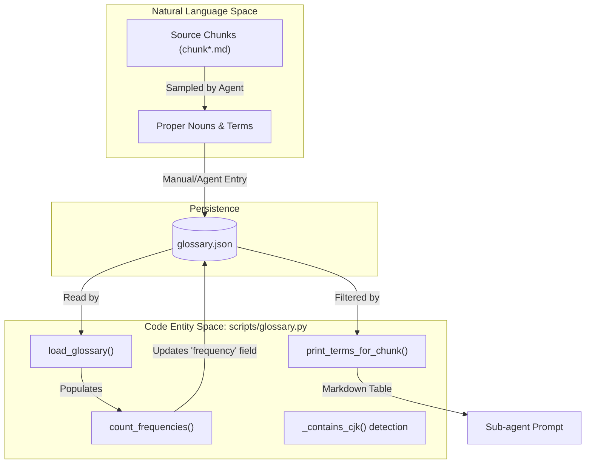
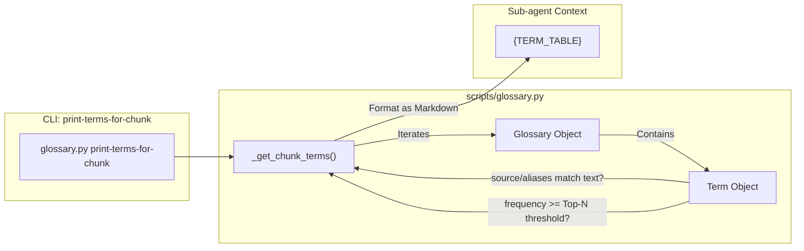

<!-- source: DeepWiki mcp.deepwiki.com · repo deusyu/translate-book · page 2.2 glossary.py — Term Consistency Management · fetched 2026-10-26 -->

# glossary.py — Term Consistency Management

Relevant source files

The following files were used as context for generating this wiki page:

- [SKILL.md](SKILL.md)
- [scripts/glossary.py](scripts/glossary.py)
- [tests/test_glossary.py](tests/test_glossary.py)

The `scripts/glossary.py` module is responsible for maintaining terminological consistency across the parallel translation pipeline. Since each chunk is translated by an independent sub-agent with a fresh context [SKILL.md:91-92](), the glossary serves as the shared state that ensures proper nouns (names, places, technical terms) are rendered identically throughout the book [scripts/glossary.py:5-10]().

## Glossary Schema (v2)

The system uses a structured JSON format (v2) stored at `<temp_dir>/glossary.json` [scripts/glossary.py:26](). It supports advanced metadata like alias chains, gender tracking for grammar consistency, and frequency-based injection priorities [scripts/glossary.py:12-24]().

### Core Schema Fields
| Field | Type | Description |
| :--- | :--- | :--- |
| `id` | string | Unique identifier for the term (defaults to `source`) [scripts/glossary.py:85](). |
| `source` | string | The term as it appears in the source text [scripts/glossary.py:100](). |
| `target` | string | The canonical translation in the target language [scripts/glossary.py:100](). |
| `aliases` | list[str] | Alternative forms of the source term (e.g., nicknames, abbreviations) [scripts/glossary.py:131](). |
| `gender` | string | `male`, `female`, `nonbinary`, or `unknown` [scripts/glossary.py:43](). |
| `confidence` | string | `low`, `medium`, or `high` [scripts/glossary.py:44](). |
| `frequency` | integer | Global count of occurrences across all source chunks [scripts/glossary.py:117-122](). |
| `evidence_refs` | list[str] | Quotes or references justifying the translation [scripts/glossary.py:175](). |

### Invariants and Validation
The script enforces strict invariants to prevent translation ambiguity:
1.  **Surface Form Uniqueness**: No string (source or alias) can be associated with more than one term ID [scripts/glossary.py:196-215]().
2.  **No Redundancy**: An alias cannot be identical to the primary source string [scripts/glossary.py:148-152]().
3.  **Atomic Updates**: All writes to `glossary.json` use a temporary file and rename pattern to prevent corruption during manual edits or crashes [scripts/glossary.py:291-297]().

**Sources:** [scripts/glossary.py:12-24](), [scripts/glossary.py:39-45](), [scripts/glossary.py:82-195]()

---

## Data Flow: From Discovery to Injection

The glossary lifecycle begins with a "cold-start" sampling of the book and ends with per-chunk table injection.

### Glossary Lifecycle Diagram
This diagram illustrates how `glossary.py` entities interact with the `SKILL.md` workflow.

**Sources:** [SKILL.md:51-86](), [scripts/glossary.py:241-289](), [scripts/glossary.py:440-514]()

---

## Key Subcommands

### `count-frequencies`
This command scans every `chunk*.md` (ignoring `output_` files) and updates the `frequency` field for every term in the glossary [scripts/glossary.py:440-445]().

*   **Regex Generation**: For each term, it builds a regex matching the `source` and all `aliases` [scripts/glossary.py:456-464]().
*   **CJK Detection**: It uses `_contains_cjk()` to determine if word boundaries (`\b`) should be applied. Non-CJK terms use word boundaries to avoid false positives (e.g., "cat" matching "category"), while CJK terms do not [scripts/glossary.py:57-63](), [scripts/glossary.py:466-474]().
*   **Safety**: Single-character CJK terms are ignored for frequency counting to prevent massive false-positive counts for common characters [scripts/glossary.py:476-483]().

### `print-terms-for-chunk`
Generates a Markdown table for a specific chunk's translation prompt [scripts/glossary.py:514-517]().

1.  **Local Matches**: Includes terms where the `source` or any `alias` appears in the specific chunk [scripts/glossary.py:541-546]().
2.  **Top-N Global Matches**: Includes the most frequent terms across the entire book, even if they don't appear in the current chunk, up to the `high_frequency_top_n` limit (default: 20) [scripts/glossary.py:534-539]().
3.  **Output**: A 3-column table: `原文 | 别名 | 译文` [SKILL.md:117]().

**Sources:** [scripts/glossary.py:440-512](), [scripts/glossary.py:514-573](), [SKILL.md:111-118]()

---

## Term Table Injection Logic

Before spawning a sub-agent, the orchestrator calls `print-terms-for-chunk`. The resulting table is injected into the translation prompt to guide the LLM.

### Logic Flow: Entity Association
This diagram bridges the CLI output to the internal data structures.

**Sources:** [scripts/glossary.py:514-550](), [SKILL.md:117-118]()

## Manual Editing and Robustness
*   **Hand-Editable**: The `glossary.json` is designed for human intervention. Users can refine `target` translations or add `aliases` between pipeline runs [SKILL.md:87-88]().
*   **Schema Upgrades**: The script automatically upgrades v1 glossaries (simple source/target pairs) to the v2 schema on load [scripts/glossary.py:241-248]().
*   **Validation**: The `_validate_term_strict` function ensures that manual edits do not introduce invalid types or missing required fields [scripts/glossary.py:94-194]().

**Sources:** [scripts/glossary.py:26-27](), [scripts/glossary.py:94-194](), [scripts/glossary.py:241-255]()

---

