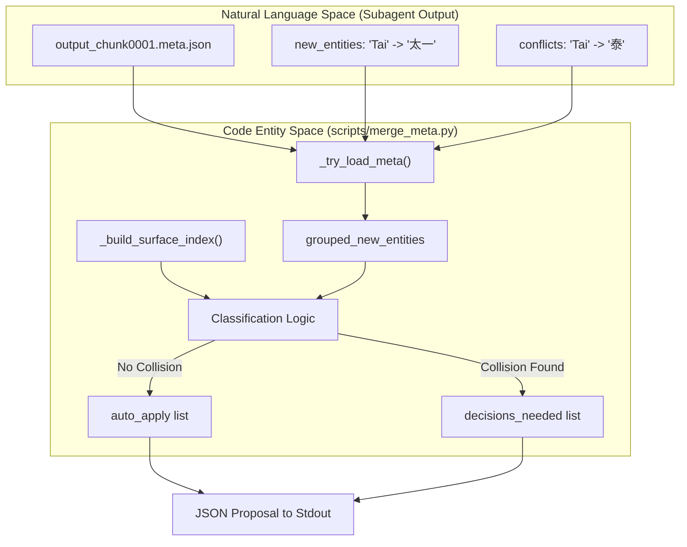
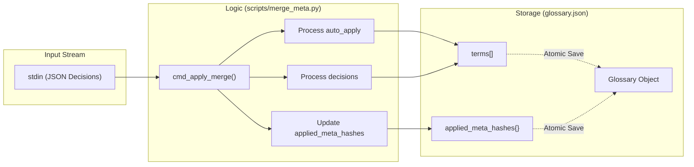

<!-- source: DeepWiki mcp.deepwiki.com · repo deusyu/translate-book · page 2.3 merge_meta.py — Subagent Feedback Loop · fetched 2026-10-26 -->

# merge_meta.py — Subagent Feedback Loop

Relevant source files

The following files were used as context for generating this wiki page:

- [SKILL.md](SKILL.md)
- [scripts/merge_meta.py](scripts/merge_meta.py)
- [tests/test_merge_meta.py](tests/test_merge_meta.py)

The `scripts/merge_meta.py` utility is the core of the translation pipeline's feedback loop. It bridges the gap between the independent, fresh-context subagents and the global, canonical `glossary.json`. Since each subagent translates only a single chunk (approx. 6000 characters), they often encounter new entities or nuances that were not in the initial glossary. `merge_meta.py` provides the mechanism to ingest these discoveries, resolve conflicts, and escalate confidence levels through a structured prepare-and-apply cycle.

## Overview and CLI Subcommands

The script operates via three primary subcommands, designed to be called by the orchestrator (e.g., `SKILL.md`) after a batch of translations completes [scripts/merge_meta.py:5-26]().

| Subcommand | Role | Execution Context |
| :--- | :--- | :--- |
| `prepare-merge` | Scans `*.meta.json` files, compares them against the current glossary, and generates a JSON proposal of "auto-applies" and "decisions needed". | Main Agent / Orchestrator |
| `apply-merge` | Consumes a decisions JSON (with user/agent choices) and updates `glossary.json` atomically. | Main Agent / Orchestrator |
| `status` | Provides a read-only snapshot of the merge state, including consumed hashes and quarantined files. | Verification / Reporting |

### The Meta File Contract
Subagents are required to emit an `output_chunk<NNNN>.meta.json` file for every chunk, even if no new information is found [SKILL.md:123-124](). This file contains:
*   `new_entities`: Proposed additions to the glossary [SKILL.md:130-132]().
*   `alias_hypotheses`: Suggestions that a term might be a variant of an existing one [SKILL.md:134-137]().
*   `attribute_hypotheses`: Metadata updates like gender or category [SKILL.md:138-141]().
*   `conflicts`: Observations where the injected glossary term felt incorrect in context [SKILL.md:143-147]().

Sources: [scripts/merge_meta.py:5-26](), [SKILL.md:123-152]()

## Data Flow: The Prepare-Merge Engine

The `prepare-merge` command performs a classification of every observation found in unmerged meta files. It uses `applied_meta_hashes` stored in the glossary to ensure idempotency—only new or changed meta files are processed [scripts/merge_meta.py:171-173]().

### Classification Logic
1.  **Grouping**: Identical proposals for the same source string across different chunks are grouped to reduce noise [scripts/merge_meta.py:179-188]().
2.  **Surface Indexing**: The script builds a map of every source and alias currently in the glossary to detect collisions [scripts/merge_meta.py:118-125]().
3.  **Conflict Detection**:
    *   **New Entity vs. Existing**: If a proposed new entity's source already exists as an alias elsewhere, it is routed to `decisions_needed` as `new_entity_existing_alias` [scripts/merge_meta.py:255-265]().
    *   **Conflicting Proposals**: If two chunks propose the same source but with different target translations, they are grouped into a `conflicting_new_entity_proposals` decision [scripts/merge_meta.py:236-248]().

### Confidence Escalation
The script implements a "Confidence Escalation" logic. A term's `confidence` is not static; it is promoted based on the number of unique chunks that have provided evidence for it [scripts/merge_meta.py:76-81]().
*   **1 Chunk**: `low`
*   **2 Chunks**: `medium`
*   **3+ Chunks**: `high`

Confidence can only be promoted, never downgraded [scripts/merge_meta.py:87-91]().

### Diagram: Prepare-Merge Logic
This diagram shows how `cmd_prepare_merge` transforms raw meta files into a structured proposal.

Sources: [scripts/merge_meta.py:118-200](), [scripts/merge_meta.py:76-109](), [scripts/merge_meta.py:143-200]()

## Atomic Apply Sequence

The `apply-merge` command follows a strict 4-phase sequence to ensure the glossary remains consistent even if the process is interrupted. It reads the decisions from `stdin` [scripts/merge_meta.py:534-540]().

### 1. Auto-Apply Phase
Terms in the `auto_apply` list are added to the glossary. If the term already exists (e.g., added by a previous decision in the same batch), the script merely appends the new `evidence_refs` and promotes confidence [scripts/merge_meta.py:551-569]().

### 2. Decision Resolution Phase
The script iterates through `decisions` provided by the orchestrator. Each decision must have a `choice` that matches the `VALID_CHOICES_BY_KIND` [scripts/merge_meta.py:44-51]().
*   **`alias`**: If `yes_alias`, the source is added to the target term's `aliases` array [scripts/merge_meta.py:581-590]().
*   **`conflict`**: If `accept_proposed`, the glossary's `target` field is overwritten [scripts/merge_meta.py:614-617]().

### 3. Metadata Updates
Attribute hypotheses (like gender) are applied. For example, if a subagent identifies a character's gender with "high" confidence, the `gender` field in the glossary is updated [scripts/merge_meta.py:656-665]().

### 4. Hash Committal
Finally, the content hashes of all processed meta files are written into `applied_meta_hashes` [scripts/merge_meta.py:688-693](). This ensures that even if `apply-merge` is called again, it will not re-process the same data. The glossary is then saved using `glossary_mod.save_glossary` for an atomic write [scripts/merge_meta.py:695]().

### Diagram: Apply-Merge State Transition
This diagram maps the `cmd_apply_merge` function to the data structures it modifies.

Sources: [scripts/merge_meta.py:534-697](), [scripts/merge_meta.py:44-51]()

## Error Handling and Idempotency

### Quarantine of Malformed Files
`merge_meta.py` adheres to a "non-blocking" promise. If a subagent produces a malformed JSON or a file that fails schema validation (handled via `meta_mod.load_meta`), the script captures the error, warns to `stderr`, and "quarantines" the file by skipping it [scripts/merge_meta.py:64-74](). This prevents a single failed subagent from halting the entire pipeline.

### Applied Meta Hashes
Idempotency is achieved through the `applied_meta_hashes` dictionary in the glossary.
*   **Key**: `chunk_id` (e.g., `chunk0001`)
*   **Value**: SHA-256 hash of the meta file content [scripts/merge_meta.py:171-172]().

If the hash on disk matches the hash in the glossary, `prepare-merge` ignores the file [scripts/merge_meta.py:172-173]().

### Summary Table: Conflict Kinds
| Kind | Trigger | Resolution Options |
| :--- | :--- | :--- |
| `alias` | Subagent suggests A is an alias of B. | `yes_alias`, `no_separate_entity`, `skip` |
| `conflict` | Subagent sees injected target T1 but suggests T2. | `keep_current`, `accept_proposed`, `record_in_notes` |
| `conflicting_new_entity_proposals` | Two chunks suggest the same source but different targets. | `use_variant_N`, `skip` |
| `new_entity_existing_alias` | Proposed new entity source is already an alias for another term. | `use_variant_N` (merge into existing), `skip` |

Sources: [scripts/merge_meta.py:44-51](), [scripts/merge_meta.py:163-176](), [scripts/merge_meta.py:205-300]()

---

