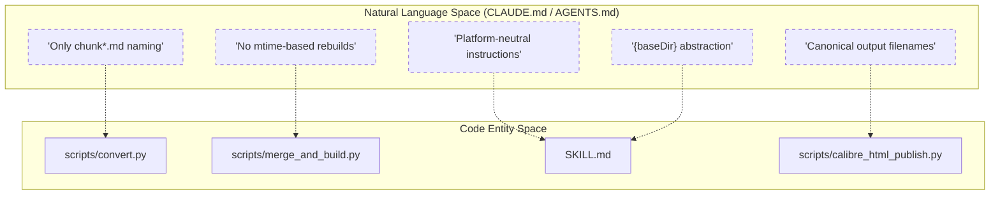
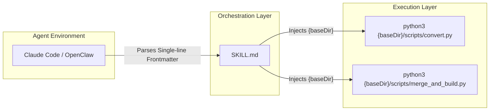

<!-- source: DeepWiki mcp.deepwiki.com · repo deusyu/translate-book · page 3.2 CLAUDE.md and AGENTS.md — Developer Constraints · fetched 2026-10-26 -->

# CLAUDE.md and AGENTS.md — Developer Constraints

Relevant source files

The following files were used as context for generating this wiki page:

- [AGENTS.md](AGENTS.md)
- [CLAUDE.md](CLAUDE.md)

This page documents the developer-facing constraint files `CLAUDE.md` and `AGENTS.md`. These files serve as the "instruction manual" for AI agents (such as Claude Code, Codex, or OpenClaw) that interact with the `translate-book` repository. They define strict naming conventions, platform-neutral abstractions, and architectural "do nots" to ensure the pipeline remains portable and robust across different agentic environments.

### The Constraint Architecture

The project utilizes two primary constraint files to guide development and maintenance. While they share significant overlap, they target different entry points:
- **CLAUDE.md**: Optimized for Claude Code and general GitHub-based development.
- **AGENTS.md**: Optimized for Codex and OpenClaw environments, with a focus on baseline testing.

#### Natural Language to Code Entity Mapping

The following diagram illustrates how the natural language constraints defined in these markdown files map to specific code entities and file system structures.

**Diagram: Constraint Mapping to Code Entities**

**Sources:** [CLAUDE.md:31-47](), [AGENTS.md:43-59]()

---

### Platform Neutrality and the `{baseDir}` Abstraction

A core requirement for `translate-book` is that the `SKILL.md` orchestration logic must function across Claude Code, OpenClaw, and Codex without modification.

1.  **Path Abstraction**: Developers must never hardcode absolute paths or home-relative paths like `~/.claude/skills/`. Instead, the `{baseDir}` placeholder is used. This allows the host environment to inject the correct local repository path at runtime [CLAUDE.md:36-37](), [CLAUDE.md:44-44]().
2.  **Tool Whitelisting**: The `allowed-tools` list in the skill definition must remain cross-platform. Platform-specific tools (e.g., `sessions_spawn`) must not be the sole option for a task [CLAUDE.md:45-45](), [AGENTS.md:57-57]().
3.  **Frontmatter Constraints**: The `SKILL.md` frontmatter must maintain a single-line-per-field format to accommodate the strict requirements of the OpenClaw parser [CLAUDE.md:35-35](), [AGENTS.md:46-46]().

**Diagram: Skill Invocation Data Flow**

**Sources:** [CLAUDE.md:35-37](), [AGENTS.md:46-48]()

---

### Canonical Naming and File Handling

The repository enforces strict naming conventions to prevent pipeline fragmentation and ensure the `merge_and_build.py` script can locate artifacts reliably.

#### Deprecation of `page*`
The codebase has intentionally removed support for `page*.md` naming. All ingestion must produce `chunk*.md` files [CLAUDE.md:33-33](), [AGENTS.md:45-45](). This change was made to decouple the translation units from physical page boundaries, which often vary between source formats (EPUB vs. PDF).

#### Output Contract
The `scripts/calibre_html_publish.py` wrapper and the final assembly logic in `scripts/merge_and_build.py` are bound to a specific set of output filenames. These are considered a "contract" for the skill [CLAUDE.md:34-34]():
- `book.html` (Primary web output)
- `book_doc.html` (Intermediate for DOCX)
- `book.docx`
- `book.epub`
- `book.pdf`

Developers are prohibited from adding mtime-based (modification time) incremental rebuild logic. The current skip logic is an existence check only: if the file exists, the script skips generation [CLAUDE.md:46-46](). Users must manually clean up the directory if they change templates or metadata.

**Sources:** [CLAUDE.md:33-34](), [CLAUDE.md:46-46](), [AGENTS.md:45-45](), [AGENTS.md:58-58]()

---

### Testing and Release Constraints

The constraint files define how changes must be validated before a release.

| Constraint Category | Requirement | Source |
| :--- | :--- | :--- |
| **Testing** | Must verify `output_chunk*.md` existence and manifest validation. | [CLAUDE.md:29-29]() |
| **Baselines** | Inputs located in `tests/baselines/`; artifacts in `tests/.artifacts/`. | [AGENTS.md:49-49]() |
| **Localization** | `README.md` and `README.zh-CN.md` must be kept in sync. | [CLAUDE.md:38-38]() |
| **Release Sequence** | 1. Git Push, 2. Git Tag (vX.Y.Z), 3. ClawHub Publish. | [CLAUDE.md:39-39]() |

#### Release Atomic Sequence
The release process defined in `.claude/commands/release.md` is codified in the constraints to prevent version drift between GitHub and ClawHub. The git tag is specifically cited as the "only version anchor in the repo" [CLAUDE.md:39-39](), [AGENTS.md:51-51]().

**Sources:** [CLAUDE.md:21-30](), [CLAUDE.md:39-39](), [AGENTS.md:31-41](), [AGENTS.md:51-51]()

---

