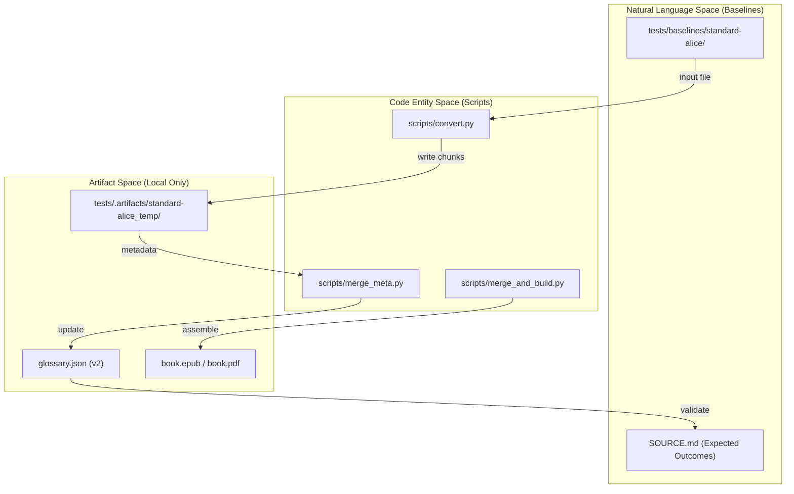
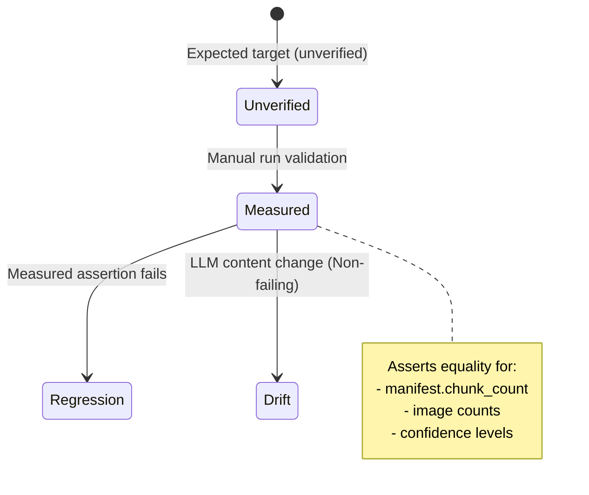

<!-- source: DeepWiki mcp.deepwiki.com · repo deusyu/translate-book · page 4.2 Baseline and Integration Tests · fetched 2026-10-26 -->

# Baseline and Integration Tests

Relevant source files

The following files were used as context for generating this wiki page:

- [tests/.artifacts/.gitkeep](tests/.artifacts/.gitkeep)
- [tests/.artifacts/README.md](tests/.artifacts/README.md)
- [tests/baselines/README.md](tests/baselines/README.md)
- [tests/baselines/diligent-dick/SOURCE.md](tests/baselines/diligent-dick/SOURCE.md)
- [tests/baselines/sleepy-hollow/SOURCE.md](tests/baselines/sleepy-hollow/SOURCE.md)
- [tests/baselines/standard-alice/SOURCE.md](tests/baselines/standard-alice/SOURCE.md)
- [tests/baselines/standard-alice/standard-alice.epub](tests/baselines/standard-alice/standard-alice.epub)

This page documents the regression testing framework for `translate-book`. Unlike unit tests that validate individual functions, baseline tests exercise the full pipeline—from ingestion to final format export—using real-world book inputs to detect regressions in chunking, entity tracking, and formatting.

## Overview of Baselines

Checked-in test inputs are stored in `tests/baselines/<book-id>/` [tests/baselines/README.md:3-3](). Each baseline serves a specific role in the CI/CD and release-gate process. To keep the repository size manageable, generated outputs are never checked into version control; they are written to a local `tests/.artifacts/` directory during execution [tests/baselines/README.md:10-10]().

### Baseline Tiers

The suite is divided into three tiers based on execution cost and coverage depth:

| Tier | Baseline ID | Chunks | Inline Images | Purpose |
| :--- | :--- | :--- | :--- | :--- |
| **Smoke** | `sleepy-hollow` | ~21 | 0 (cover only) | Default CI / Quick iteration. Exercises the basic pipeline [tests/baselines/README.md:16-16](). |
| **Gold** | `standard-alice` | ~38 | ~45 | Release-gate. Exercises complex EPUB structures and image-path integrity [tests/baselines/README.md:17-17](). |
| **Alias-stress** | `diligent-dick` | ~57 | 5 | Opt-in. Specifically targets `merge_meta` and `glossary` logic for cross-chunk entity collisions [tests/baselines/README.md:18-18](). |

Sources: [tests/baselines/README.md:12-20](), [tests/baselines/sleepy-hollow/SOURCE.md:1-8](), [tests/baselines/standard-alice/SOURCE.md:1-8](), [tests/baselines/diligent-dick/SOURCE.md:1-9]().

## Outcome Tiers and Assertion Logic

Every baseline includes a `SOURCE.md` file that defines success criteria using a three-tier outcome convention. This allows the system to distinguish between hard regressions and expected variations in LLM behavior.

1.  **Measured**: Values directly observable in the `tests/.artifacts/` output. Failure to match these values is considered a regression [tests/baselines/README.md:26-26]().
2.  **Expected target (unverified)**: Structurally deterministic targets (e.g., "should merge Dick and Richard") that have not yet been confirmed by a verified run. These are promoted to **Measured** once a manual review of a successful run occurs [tests/baselines/README.md:27-30]().
3.  **Drift indicator**: LLM-dependent content such as specific translation choices or gender attributions. These are recorded for spot-checking but do not trigger test failures [tests/baselines/README.md:28-28]().

### Data Flow: Baseline to Artifacts

The following diagram illustrates how code entities interact with the baseline data to produce artifacts.

**Baseline Execution Flow**

Sources: [tests/baselines/README.md:3-10](), [tests/baselines/standard-alice/SOURCE.md:9-17](), [tests/.artifacts/README.md:1-8]().

## Detailed Baseline Specifications

### 1. Smoke: `sleepy-hollow`
*   **Source**: *The Legend of Sleepy Hollow* [tests/baselines/sleepy-hollow/SOURCE.md:6-6]().
*   **Key Coverage**: Validates the `Headless Horseman / Galloping Hessian` alias chain which spans ~9 chunks [tests/baselines/sleepy-hollow/SOURCE.md:7-7]().
*   **Constraint**: Cover only; no inline images [tests/baselines/sleepy-hollow/SOURCE.md:8-8]().

### 2. Gold: `standard-alice`
*   **Source**: Standard Ebooks edition of *Alice's Adventures in Wonderland* [tests/baselines/standard-alice/SOURCE.md:6-6]().
*   **Key Coverage**: High-density image preservation (45 images) and complex chaptered prose [tests/baselines/standard-alice/SOURCE.md:7-7]().
*   **Measured Assertion**: 38 chunks, 45 image files, and specific high-confidence glossary entities (e.g., Alice, White Rabbit) [tests/baselines/standard-alice/SOURCE.md:28-60]().
*   **Known Redundancy**: The `King` entity and `King of Hearts` entity are expected to remain separate; `merge_meta` does not currently merge two distinct existing entities [tests/baselines/standard-alice/SOURCE.md:62-62]().

### 3. Alias-stress: `diligent-dick`
*   **Source**: *Diligent Dick; or, The Young Farmer* [tests/baselines/diligent-dick/SOURCE.md:6-6]().
*   **Key Coverage**: Specifically designed to test the `Dick / Richard / Stuart` ambiguation. These variants co-occur across ~9 consecutive chunks, forcing the `merge_meta` "Surface ALL competing proposals" logic to fire [tests/baselines/diligent-dick/SOURCE.md:7-7]().
*   **Primary Assertion**: `Dick` and `Richard` must resolve to a single glossary entity via alias mapping. `Stuart` (Father vs. Son) must trigger a non-silent disambiguation decision in `merge_meta prepare-merge` [tests/baselines/diligent-dick/SOURCE.md:37-38]().

Sources: [tests/baselines/sleepy-hollow/SOURCE.md:1-43](), [tests/baselines/standard-alice/SOURCE.md:1-90](), [tests/baselines/diligent-dick/SOURCE.md:1-46]().

## Implementation of Integration Tests

Integration testing is performed by running the pipeline scripts manually or via orchestration skills and comparing the results in `tests/.artifacts/` against the `SOURCE.md` specifications.

### Directory Structure and Artifact Management
The `tests/.artifacts/` directory is git-ignored except for a `.gitkeep` file [tests/.artifacts/README.md:5-5](). Users are instructed to change into this directory before running scripts to ensure the temporary `<book-name>_temp/` folders are isolated from the source tree [tests/.artifacts/README.md:7-7]().

### Verification Logic
The verification of a baseline run follows the `merge_meta` confidence rules. For example, an entity reaches `confidence: "high"` only when it has ≥3 `evidence_refs` [tests/baselines/README.md:34-34]().

**Entity State Transition in Baselines**

Sources: [tests/baselines/README.md:24-34](), [tests/baselines/standard-alice/SOURCE.md:23-44]().

## Process for Adding New Baselines

A book is not considered a baseline until it has been run through the full pipeline [tests/baselines/README.md:38-38](). The process for promotion is:

1.  **Initial Run**: Execute `convert.py`, perform translation, and run `merge_and_build.py` [tests/baselines/README.md:40-40]().
2.  **Capture Metrics**: Extract real chunk counts, image counts, and entity evidence from the `tests/.artifacts/` folder [tests/baselines/README.md:41-41]().
3.  **Document Gaps**: Explicitly note what the baseline *does not* cover (e.g., "no inline images") [tests/baselines/README.md:42-42]().
4.  **Define Outcomes**: Populate the `SOURCE.md` using the three-tier format, marking numerical assertions as "first run records exact value" to prevent estimation drift from being flagged as failures [tests/baselines/README.md:43-43]().

Sources: [tests/baselines/README.md:36-46]().

---

