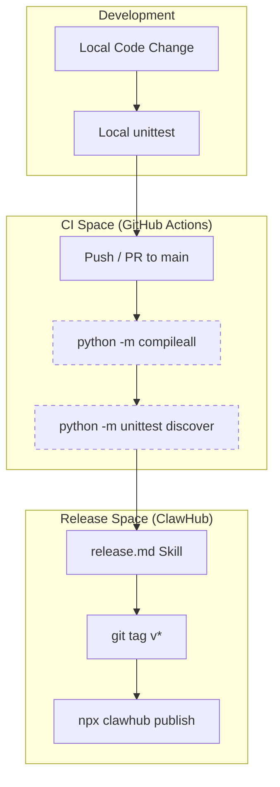
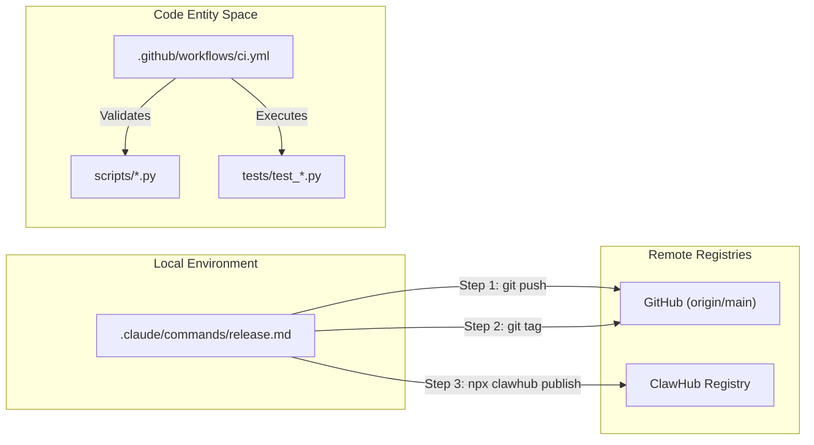

<!-- source: DeepWiki mcp.deepwiki.com · repo deusyu/translate-book · page 5 CI/CD and Release · fetched 2026-10-26 -->

# CI/CD and Release

Relevant source files

The following files were used as context for generating this wiki page:

- [.claude/commands/release.md](.claude/commands/release.md)
- [.github/FUNDING.yml](.github/FUNDING.yml)
- [.github/workflows/ci.yml](.github/workflows/ci.yml)

This section covers the automated quality assurance and distribution mechanisms for the `translate-book` repository. The project employs a standard GitHub Actions pipeline for continuous integration and a structured release process via the ClawHub ecosystem to distribute the translation skill.

## Automation Overview

The lifecycle of a change in this codebase moves from local development to automated verification, and finally to a tagged release.

Sources: [.github/workflows/ci.yml:3-8](), [.claude/commands/release.md:8-12]()

## GitHub Actions CI

The project uses GitHub Actions to ensure that every push to the `main` branch or any open pull request meets the minimum quality standards. The workflow is defined in `.github/workflows/ci.yml` and executes on an `ubuntu-latest` runner using Python 3.11.

The CI pipeline performs two primary checks:
1.  **Syntax Verification**: Uses `compileall` to ensure all Python scripts in `scripts/` and `tests/` are syntactically valid.
2.  **Test Execution**: Runs the full suite of unit tests using the `unittest` discovery mechanism.

To optimize the runner environment, the workflow sets `PYTHONPYCACHEPREFIX` to redirect bytecode compilation to a local `.pycache` directory.

For details, see [GitHub Actions CI](#5.1).

Sources: [.github/workflows/ci.yml:13-33]()

## Release Process

Releases are managed through a specialized Claude Code command defined in `.claude/commands/release.md`. This skill orchestrates the synchronization between the Git repository and the ClawHub registry.

The release process follows a strict three-step sequence:
1.  **Synchronization**: Pushing the latest `main` branch to the origin.
2.  **Versioning**: Creating a `v`-prefixed Git tag (e.g., `v0.3.0`) and pushing it.
3.  **Distribution**: Publishing the package to ClawHub using a bare semver version (e.g., `0.3.0`).

This process ensures that the published skill on ClawHub always corresponds to a specific immutable point in the Git history.

For details, see [Release Process](#5.2).

Sources: [.claude/commands/release.md:1-14]()

## System Integration Diagram

The following diagram bridges the release commands to the specific entities they interact with.

Sources: [.github/workflows/ci.yml:28-32](), [.claude/commands/release.md:8-12]()

---

