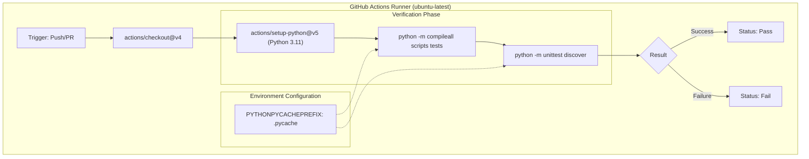
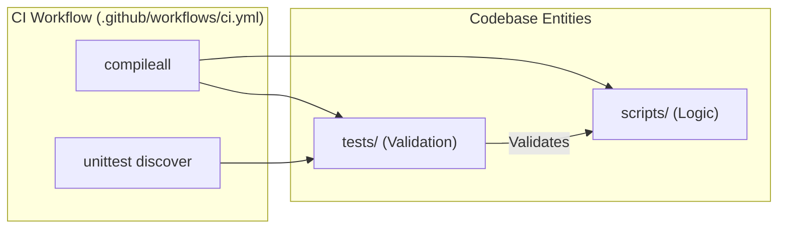

<!-- source: DeepWiki mcp.deepwiki.com · repo deusyu/translate-book · page 5.1 GitHub Actions CI · fetched 2026-10-26 -->

# GitHub Actions CI

Relevant source files

The following files were used as context for generating this wiki page:

- [.github/workflows/ci.yml](.github/workflows/ci.yml)

The `translate-book` repository utilizes GitHub Actions to ensure code quality and functional correctness through a Continuous Integration (CI) pipeline. The configuration is defined in `.github/workflows/ci.yml` and focuses on verifying Python syntax and executing the unit test suite across different contribution stages.

### Workflow Triggers and Permissions

The CI workflow is designed to validate changes before they are merged into the stable codebase and to ensure the `main` branch remains functional.

*   **Push Triggers**: The workflow automatically executes whenever a commit is pushed to the `main` branch [.github/workflows/ci.yml:4-6]().
*   **Pull Request Triggers**: The workflow runs for all pull requests, providing feedback on the viability of proposed changes [.github/workflows/ci.yml:7-8]().
*   **Security Permissions**: The workflow is granted restricted `contents: read` permissions, ensuring it can access the source code without unnecessary write access to the repository [.github/workflows/ci.yml:9-10]().

### Job Configuration: Python Checks

The workflow consists of a single job named `test` (displayed as "Python Checks") that runs on the `ubuntu-latest` runner [.github/workflows/ci.yml:12-15]().

#### Environment Management
The job sets the `PYTHONPYCACHEPREFIX` environment variable to `.pycache` [.github/workflows/ci.yml:16-17](). This redirects the generation of `.pyc` files to a specific local directory rather than scattering `__pycache__` folders throughout the source tree, keeping the workspace clean during the CI run.

#### Execution Steps
The pipeline follows a linear execution sequence:

1.  **Checkout**: Retrieves the repository source code using `actions/checkout@v4` [.github/workflows/ci.yml:20-21]().
2.  **Python Setup**: Initializes a Python 3.11 environment using `actions/setup-python@v5` [.github/workflows/ci.yml:23-26]().
3.  **Syntax Verification**: Executes `python -m compileall scripts tests` [.github/workflows/ci.yml:28-29](). This step performs a byte-compilation of all files in the `scripts/` and `tests/` directories to catch syntax errors or invalid Python code before attempting to run tests.
4.  **Test Execution**: Runs the automated test suite using `python -m unittest discover` [.github/workflows/ci.yml:31-32]().

**Sources:**
- [.github/workflows/ci.yml:1-33]()

---

### CI Execution Logic

The following diagram illustrates the data flow and step progression within the GitHub Actions runner.

**CI Pipeline Flow**

**Sources:**
- [.github/workflows/ci.yml:3-33]()

---

### Test Discovery and Execution

The CI pipeline uses the standard Python `unittest` discovery mechanism to locate and run tests.

| Parameter | Value | Purpose |
| :--- | :--- | :--- |
| **Search Directory** | `tests` | Instructs the runner to look for tests within the `tests/` directory [.github/workflows/ci.yml:32](). |
| **Pattern** | `test_*.py` | Filters files to ensure only relevant test modules are executed [.github/workflows/ci.yml:32](). |
| **Verbosity** | `-v` | Provides detailed output for each test case in the GitHub Actions logs [.github/workflows/ci.yml:32](). |

**CI Integration with Code Entities**

**Sources:**
- [.github/workflows/ci.yml:28-32]()

---

