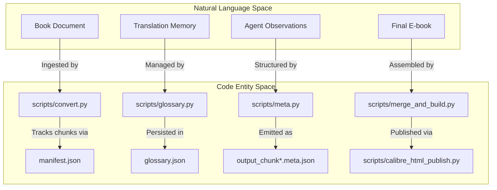
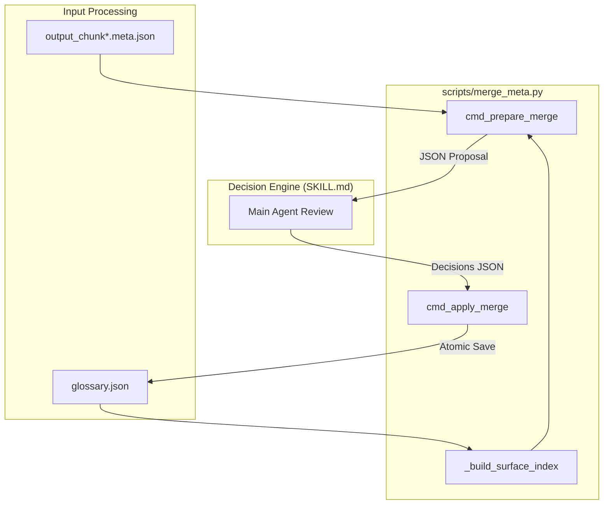

<!-- source: DeepWiki mcp.deepwiki.com · repo deusyu/translate-book · page 6 Glossary · fetched 2026-10-26 -->

# Glossary

Relevant source files

The following files were used as context for generating this wiki page:

- [LICENSE](LICENSE)
- [README.md](README.md)
- [SKILL.md](SKILL.md)
- [scripts/glossary.py](scripts/glossary.py)
- [scripts/manifest.py](scripts/manifest.py)
- [scripts/merge_and_build.py](scripts/merge_and_build.py)
- [scripts/merge_meta.py](scripts/merge_meta.py)
- [scripts/meta.py](scripts/meta.py)
- [tests/baselines/README.md](tests/baselines/README.md)
- [tests/test_merge_meta.py](tests/test_merge_meta.py)
- [tests/test_meta.py](tests/test_meta.py)

This page defines codebase-specific terms, jargon, and domain concepts used in the `translate-book` pipeline. It provides a mapping between natural language concepts and their technical implementations in the code.

## Core Concepts

### Pipeline Entity Mapping
The following diagram bridges the high-level translation concepts to the specific Python classes and scripts that implement them.

**Diagram: Natural Language Space to Code Entity Space**

**Sources:** [README.md:13-31](), [scripts/convert.py:1-10](), [scripts/glossary.py:1-10](), [scripts/meta.py:1-7](), [scripts/merge_and_build.py:1-4]().

---

## Domain Terms

### Chunking & Manifests
*   **Chunk**: A segment of the source book, typically ~6000 characters, used as the atomic unit of translation to fit within LLM context windows [README.md:20-20](), [README.md:128-128]().
*   **Manifest**: A JSON file (`manifest.json`) that acts as the source of truth for the pipeline. It tracks the `source_hash` of each chunk to detect staleness and ensures all parts are accounted for before merging [scripts/manifest.py:3-4](), [scripts/manifest.py:45-53]().
*   **Stale Output**: A translated chunk whose corresponding source chunk hash no longer matches the manifest record, indicating the source was modified after translation [scripts/manifest.py:100-107]().

### Glossary & Consistency
*   **Surface Form**: Any string (either the `source` or an `alias`) that refers to a specific term in the glossary [scripts/merge_meta.py:118-125](), [scripts/glossary.py:196-197]().
*   **Alias Chain**: A relationship where multiple source strings map to a single canonical term ID [scripts/merge_meta.py:118-125]().
*   **Top-N Injection**: The process of taking the $N$ most frequent terms in the book and injecting them into every sub-agent's prompt, regardless of whether they appear in the specific chunk, to ensure global consistency [README.md:138-138](), [scripts/glossary.py:40-40]().

### Metadata & Feedback Loop
*   **Sub-agent Meta**: A JSON file (`output_chunk*.meta.json`) emitted by a translation sub-agent containing observations like newly discovered entities or conflicts with the provided glossary [scripts/meta.py:3-7](), [SKILL.md:123-125]().
*   **Evidence Reference**: A snippet of text (max 200 chars) provided by a sub-agent to justify a metadata observation [scripts/meta.py:39-39](), [scripts/merge_meta.py:41-41]().
*   **Confidence Escalation**: A mechanism where a term's confidence level (`low`, `medium`, `high`) is automatically promoted based on the number of unique chunks providing evidence for it [scripts/merge_meta.py:76-81](), [scripts/merge_meta.py:94-109]().

---

## Technical Implementation Details

### Merge-Meta Logic
The `merge_meta.py` script handles the complex logic of reconciling sub-agent observations with the canonical glossary.

**Diagram: Metadata Reconciliation Flow**

**Sources:** [scripts/merge_meta.py:5-25](), [scripts/merge_meta.py:143-146](), [SKILL.md:152-155]().

### Glossary Schema (v2)
The glossary uses a strictly versioned schema to prevent data corruption during parallel processing.

| Field | Type | Description |
| :--- | :--- | :--- |
| `id` | `string` | Unique identifier for the term (often matches `source`) [scripts/glossary.py:124-129](). |
| `source` | `string` | The original text in the source language [scripts/glossary.py:100-104](). |
| `target` | `string` | The canonical translation in the target language [scripts/glossary.py:100-104](). |
| `aliases` | `list` | Alternative surface forms found in the text [scripts/glossary.py:131-136](). |
| `confidence` | `enum` | `low`, `medium`, or `high` [scripts/glossary.py:168-173](). |
| `applied_meta_hashes` | `dict` | Maps `chunk_id` to `meta_content_hash` to ensure idempotency [scripts/merge_meta.py:15-17](). |

**Sources:** [scripts/glossary.py:12-24](), [scripts/glossary.py:39-44](), [scripts/merge_meta.py:147-147]().

---

## Validation Jargon

*   **Image Integrity**: A check performed by `merge_and_build.py` using `_ImgTagCollector` to ensure that the number and source paths of `` tags in the translated output exactly match the source chunks [scripts/merge_and_build.py:36-47](), [scripts/merge_and_build.py:83-94]().
*   **Quarantine**: The state of a malformed `.meta.json` file that fails validation. It is skipped during the merge process and logged as a warning rather than crashing the pipeline [scripts/merge_meta.py:10-12](), [scripts/merge_meta.py:64-69]().
*   **Atomic Save**: A file-writing pattern used in `meta.py` and `glossary.py` where data is written to a temporary hidden file and then renamed to the target path to prevent partial writes during crashes [scripts/meta.py:148-166](), [scripts/merge_meta.py:17-17]().

**Sources:** [scripts/merge_and_build.py:125-141](), [scripts/merge_meta.py:164-169](), [scripts/meta.py:148-166]().