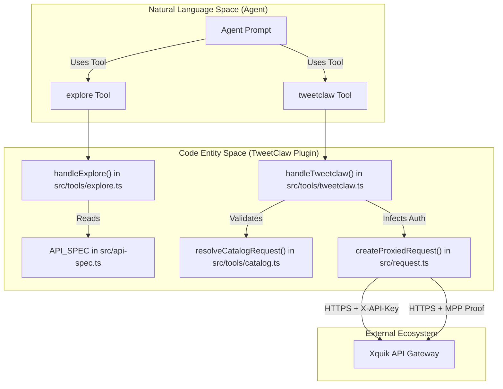
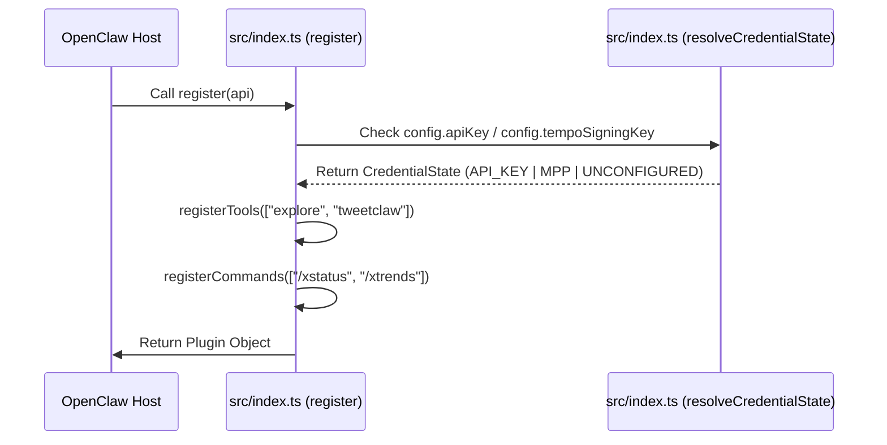

<!-- source: DeepWiki mcp.deepwiki.com · repo Xquik-dev/tweetclaw · page 1 TweetClaw Overview · fetched 2026-10-26 -->

# TweetClaw Overview

Relevant source files

The following files were used as context for generating this wiki page:

- [README.md](README.md)
- [package.json](package.json)
- [server.json](server.json)

TweetClaw is a high-performance automation plugin and [MCP Server Interface](#5) server designed for the [OpenClaw](https://github.com/openclaw/openclaw) ecosystem. It provides AI agents with a structured interface to the [Xquik API](https://xquik.com), enabling them to perform complex X (formerly Twitter) operations—including reading timelines, posting tweets, managing DMs, and extracting bulk data—at a fraction of the cost of the official X API.

### System Integration

TweetClaw acts as the bridge between an OpenClaw agent and the Xquik infrastructure. It abstracts the underlying HTTP complexity into two primary tools: `explore` (for discovery) and `tweetclaw` (for execution).

**High-Level Architecture & Entity Mapping**

**Sources:** [src/tools/explore.ts:1-20](), [src/tools/tweetclaw.ts:1-30](), [src/api-spec.ts:1-50](), [src/request.ts:1-40]()

### Key Capabilities

*   **Cost Efficiency**: Read operations start at **$0.00015** per call, approximately 33x cheaper than official X API equivalents [README.md:15-30]().
*   **Comprehensive API Surface**: Exposes 99 agent-callable endpoints across 9 categories, including Account, Composition, Extraction, and Radar [server.json:4]().
*   **Flexible Authentication**: Supports traditional API keys, credit-based top-ups, and anonymous on-chain payments via the **Machine Payments Protocol (MPP)** [README.md:73-96]().
*   **Safety & Governance**: Implements a write-action approval gate and prohibits access to sensitive account/billing endpoints [src/request.ts:10-30]().

### Plugin Entry Point

The plugin is registered via `definePluginEntry` in `src/index.ts`. During initialization, it resolves the credential state to determine if the agent has access to live data or should operate in a restricted "catalog-only" mode.

**Registration Lifecycle**

**Sources:** [src/index.ts:10-100](), [package.json:18-28]()

---

### Detailed Documentation

For deeper technical dives into specific subsystems, refer to the following child pages:

#### [Getting Started & Installation](#1.1)
Covers the prerequisites, installation via `openclaw plugins install`, and initial configuration. It details how to verify the installation using the `/xstatus` command.

#### [Authentication & Credential Modes](#1.2)
Deep dive into the `CredentialState` enum and how TweetClaw handles three distinct modes:
1.  **API-Key**: Full access backed by an Xquik account.
2.  **MPP/Tempo**: Pay-per-use anonymous access for 32 read-only endpoints using `mppx` and `viem`.
3.  **Unconfigured**: Safety mode allowing only the `explore` tool and setup guidance.

---
**Sources:** [README.md:1-120](), [package.json:1-44](), [server.json:1-21]()

---

