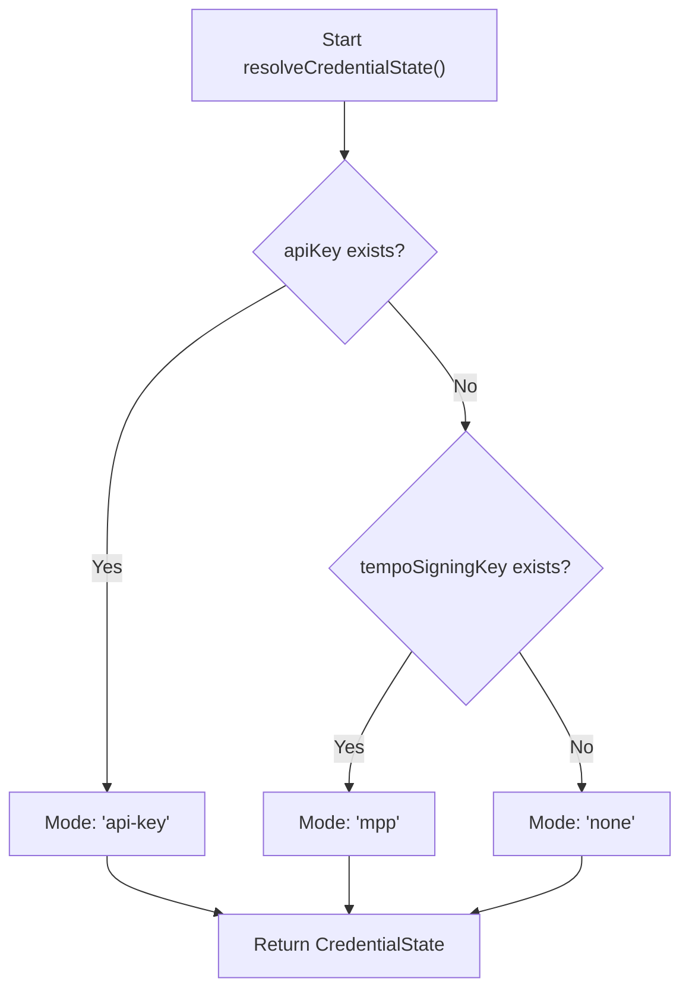
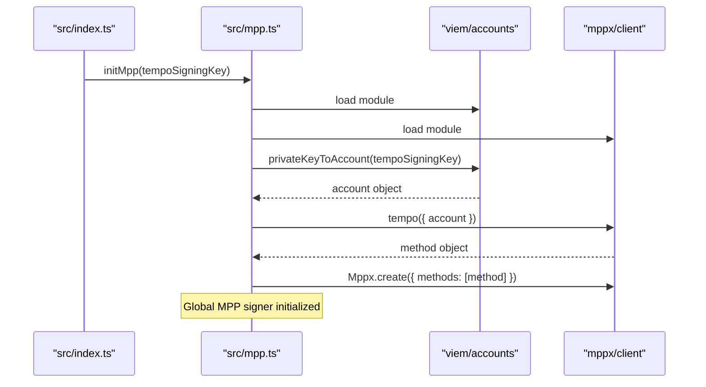
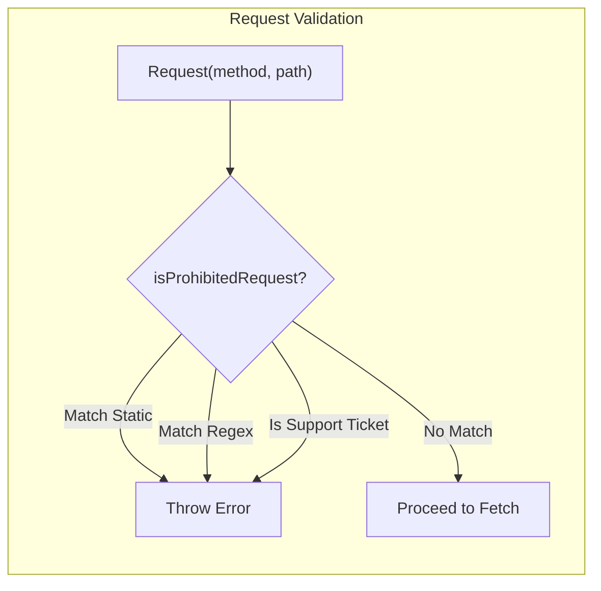

<!-- source: DeepWiki mcp.deepwiki.com · repo Xquik-dev/tweetclaw · page 1.2 Authentication & Credential Modes · fetched 2026-10-26 -->

# Authentication & Credential Modes

Relevant source files

The following files were used as context for generating this wiki page:

- [src/index.ts](src/index.ts)
- [src/mpp.ts](src/mpp.ts)
- [src/request.ts](src/request.ts)
- [src/types.ts](src/types.ts)
- [tests/index.test.ts](tests/index.test.ts)
- [tests/mpp.test.ts](tests/mpp.test.ts)
- [tests/request.test.ts](tests/request.test.ts)

TweetClaw supports multiple authentication strategies to accommodate different use cases, ranging from full account automation to pay-per-use read-only access. The system resolves these modes during plugin registration and enforces security boundaries during request execution.

## Credential Modes Overview

TweetClaw operates in one of three mutually exclusive `CredentialMode` states [src/index.ts:84-84](). These modes are determined by the configuration provided in the `openclaw.plugin.json` manifest or via the OpenClaw environment [src/index.ts:27-49]().

| Mode | Configuration Key | Description | Capabilities |
| :--- | :--- | :--- | :--- |
| **API Key** | `apiKey` | Standard Xquik API key (starts with `xq_`). [src/request.ts:8-8]() | Full access to all authorized Read/Write endpoints. |
| **MPP** | `tempoSigningKey` | Ethereum private key for Tempo/MPP signing. [src/index.ts:42-46]() | Accountless, pay-per-use access to ~32 read-only endpoints. |
| **None** | N/A | Neither key is provided. | Tool execution fails with configuration guidance. [src/index.ts:24-26]() |

### Credential Resolution Flow
The `resolveCredentialState` function in `src/index.ts` determines the active mode based on the priority of provided configuration values.

Sources: [src/index.ts:94-98](), [src/index.ts:244-256]()

## Auth Header Injection

The `src/request.ts` module is responsible for transforming raw credentials into valid HTTP headers. The logic differentiates between Xquik-native API keys and external bearer tokens (such as those used in MPP proxying).

### Key Functions
- `buildAuthHeader(credential)`: Determines if the credential is an Xquik key (prefix `xq_`) or a standard Bearer token [src/request.ts:12-17]().
- `buildFetchHeaders(credential, hasBody)`: Combines authentication headers with `content-type: application/json` if a request body is present [src/request.ts:19-25]().

### Header Mapping
| Credential Prefix | Header Key | Header Value Format |
| :--- | :--- | :--- |
| `xq_` | `x-api-key` | `xq_...` |
| (Other) | `authorization` | `Bearer ...` |

Sources: [src/request.ts:5-8](), [src/request.ts:12-17](), [tests/request.test.ts:4-14]()

## MPP (Multi-Party Payment) Initialization

MPP mode allows for "accountless" access by signing requests with an Ethereum private key. This flow is managed in `src/mpp.ts` and requires dynamic loading of the `mppx` and `viem` libraries.

### Initialization Flow
When `tempoSigningKey` is detected, `src/index.ts` calls `initMpp` [src/index.ts:274-274]().

### Implementation Details
- **Dynamic Loading**: Modules are loaded at runtime via `loadDynamicModule` to avoid forcing heavy dependencies on users who only use API-key mode [src/mpp.ts:11-17]().
- **Validation**: The system checks for the existence of `privateKeyToAccount` in `viem` and `tempo`/`Mppx` in `mppx` before proceeding [src/mpp.ts:31-35]().

Sources: [src/mpp.ts:23-39](), [tests/mpp.test.ts:79-92]()

## Security Boundaries & Prohibited Endpoints

Regardless of the authentication mode, certain endpoints are hard-blocked within the `createProxiedRequest` factory to prevent agents from performing sensitive account management or billing operations.

### Prohibited Patterns
The `validateRequestPath` function checks every request against `PROHIBITED_PATHS` and `PROHIBITED_PATH_PATTERNS` [src/request.ts:76-85]().

- **Static Blocks**: `/api/v1/api-keys`, `/api/v1/credits/topup`, `/api/v1/subscribe` [src/request.ts:37-49]().
- **Pattern Blocks**: Deleting X accounts or re-authenticating identities via regex [src/request.ts:51-56]().
- **Support Tickets**: All support ticket operations are blocked for agents [src/request.ts:58-63]().

Sources: [src/request.ts:65-74](), [src/request.ts:87-110](), [tests/request.test.ts:121-170]()

---

