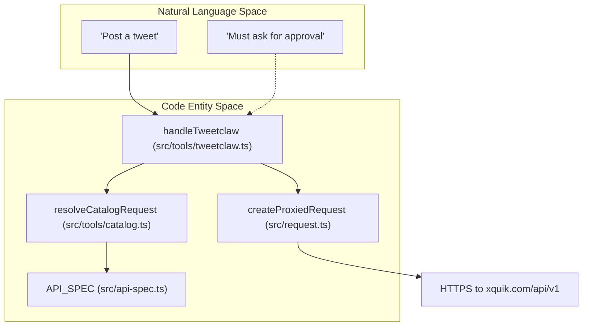
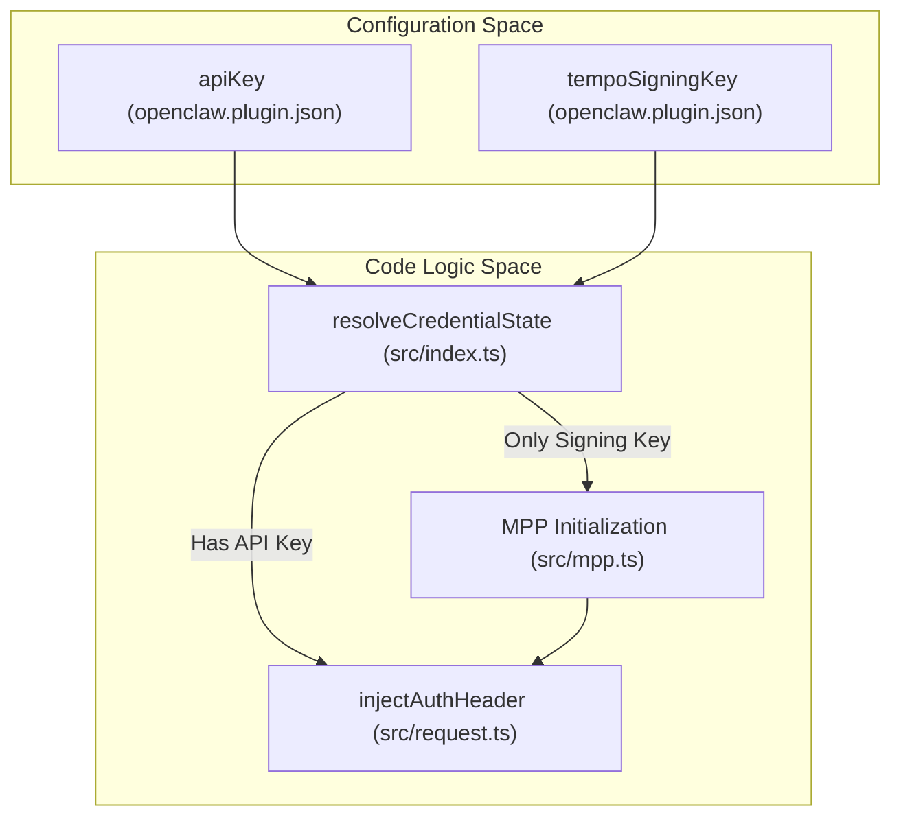

<!-- source: DeepWiki mcp.deepwiki.com · repo Xquik-dev/tweetclaw · page 10 Glossary · fetched 2026-10-26 -->

# Glossary

Relevant source files

The following files were used as context for generating this wiki page:

- [README.md](README.md)
- [docs/clawpack-release.md](docs/clawpack-release.md)
- [docs/discoverability-audit.md](docs/discoverability-audit.md)
- [openclaw.plugin.json](openclaw.plugin.json)
- [package.json](package.json)
- [scripts/clawpack.mjs](scripts/clawpack.mjs)
- [server.json](server.json)
- [skills/tweetclaw/SKILL.md](skills/tweetclaw/SKILL.md)
- [src/api-spec.ts](src/api-spec.ts)
- [src/tools/tweetclaw.ts](src/tools/tweetclaw.ts)

This page provides definitions for codebase-specific terms, abbreviations, and domain concepts used throughout TweetClaw and the wider Xquik/OpenClaw ecosystem.

## Core Concepts

### OpenClaw Plugin
A modular extension for the OpenClaw agent framework. TweetClaw is a "code-plugin" that provides X/Twitter automation capabilities [package.json:18-38](). It registers tools, commands, and services via an entry point defined in `src/index.ts` [package.json:20-21]().

### ClawPack
The distribution format for OpenClaw plugins. It is an npm-pack artifact containing the plugin's code, manifest, and metadata [docs/clawpack-release.md:1-4](). The release process uses `scripts/clawpack.mjs` to package the project with specific family metadata (`code-plugin`) and source-commit hashes [scripts/clawpack.mjs:64-83]().

### Xquik API
The backend service that TweetClaw interfaces with. It provides structured access to X/Twitter data and actions, abstracting the complexity of the underlying platform [README.md:11-15]().

### MPP (Machine Payments Protocol)
A decentralized payment protocol allowing agents to pay for API calls on a per-use basis using on-chain signatures [README.md:89-92](). In the codebase, this is referred to as "Tempo" or "MPP mode" [openclaw.plugin.json:24]().
- **MPP Mode**: A restricted state where only 32 read-only endpoints are accessible using a `tempoSigningKey` instead of a standard API key [SKILL.md:32-33](), [SKILL.md:71-72]().

## Code Entities & Systems

### API_SPEC
A comprehensive constant in `src/api-spec.ts` that defines the schema for all 99 agent-callable endpoints [src/api-spec.ts:1-116](). It includes metadata such as HTTP methods, parameter types, and billing categories.

### explore Tool
A safe, read-only tool used by agents to discover available endpoints within the `API_SPEC` without making live network calls [src/tools/tweetclaw.ts:6-10](). It uses `exploreCatalog` to filter and describe endpoints [src/tools/tweetclaw.ts:83]().

### tweetclaw Tool
The primary execution tool that performs live API requests to Xquik [src/tools/tweetclaw.ts:51-81](). It enforces security boundaries, such as rejecting prohibited paths and requiring user approval for write actions [src/tools/tweetclaw.ts:16-22]().

### Event Poller
A background service registered with OpenClaw that periodically checks for new monitor events or extraction completions [openclaw.plugin.json:26-28](). It is configured via `pollingInterval` and `pollingEnabled` [openclaw.plugin.json:34-36]().

## Technical Terms & Abbreviations

| Term | Definition | Code Reference |
| :--- | :--- | :--- |
| **Agent-Prohibited** | Endpoints that an AI agent is strictly forbidden from calling (e.g., billing, account deletion). | `src/api-spec.ts` (implied by exclusion) |
| **Extraction** | Long-running jobs for bulk data (e.g., followers, search results) billed per-result. | [SKILL.md:46-49]() |
| **Radar** | A curated feed of trends and real-time events provided by Xquik. | [src/tools/tweetclaw.ts:23]() |
| **Write Action** | Any operation that modifies state on X (Post, Like, Follow). Requires explicit user approval. | [SKILL.md:24-25]() |
| **Credits** | The internal currency for Xquik. 1 credit = $0.00015. | [SKILL.md:36-38]() |

## System Mapping: Natural Language to Code

The following diagrams bridge high-level user concepts to specific code entities and implementation logic.

### Request Lifecycle Mapping
This diagram shows how a user's natural language request (e.g., "Post a tweet") maps to the internal code execution flow.

Sources: [src/tools/tweetclaw.ts:51-81](), [src/tools/catalog.ts:2-3](), [src/request.ts:1-2](), [src/api-spec.ts:1-116]()

### Credential & Mode Resolution
This diagram illustrates how the system determines the operating mode (API Key vs. MPP) based on the provided configuration.

Sources: [openclaw.plugin.json:19-29](), [src/index.ts:20-22](), [src/request.ts:1-10](), [src/mpp.ts:1-15]()

## Release & Discoverability Terms

### Smithery / Glama
External registries where the TweetClaw MCP server is listed for discovery by users of Claude Desktop and other MCP clients [README.md:7-8]().

### Smithery.yaml / Server.json
Configuration files that define the MCP interface, including the `streamable-http` transport and the `X-API-Key` authentication header [server.json:1-21]().

### Discoverability Audit
A persistent log (`docs/discoverability-audit.md`) used to track submissions to "Awesome OpenClaw" lists and other ecosystem catalogs to prevent duplicate PRs [docs/discoverability-audit.md:1-15]().

Sources: [docs/discoverability-audit.md:1-15](), [server.json:1-21](), [README.md:7-8]()