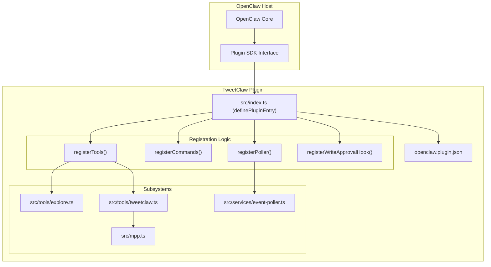
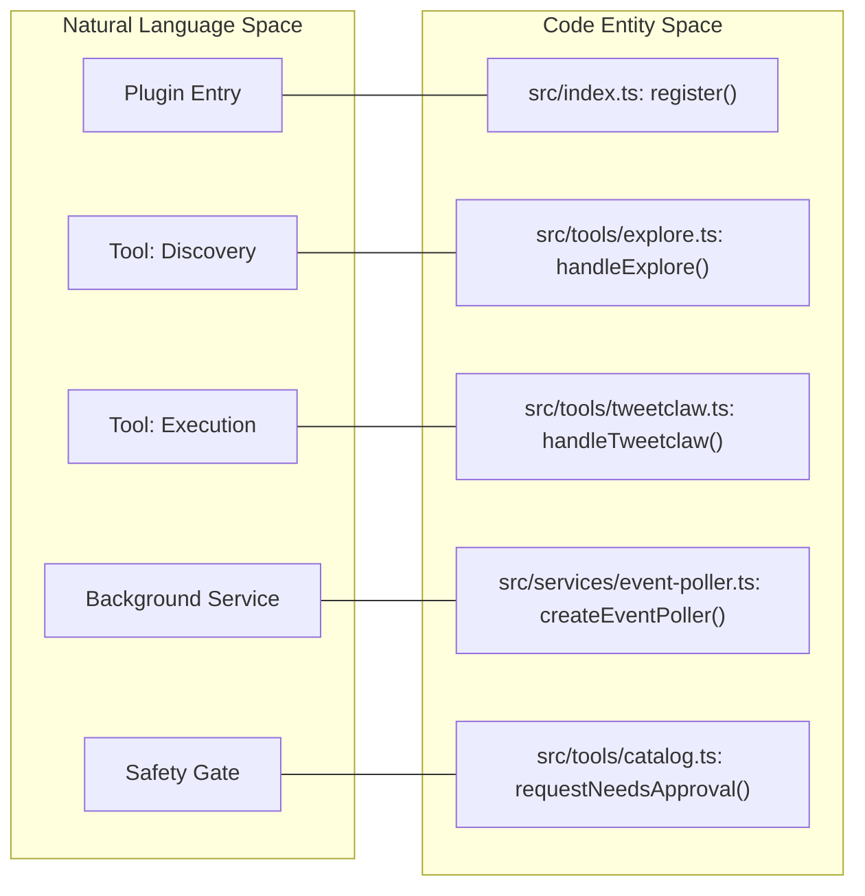

<!-- source: DeepWiki mcp.deepwiki.com · repo Xquik-dev/tweetclaw · page 2 Plugin Architecture · fetched 2026-10-26 -->

# Plugin Architecture

Relevant source files

The following files were used as context for generating this wiki page:

- [openclaw.plugin.json](openclaw.plugin.json)
- [package.json](package.json)
- [src/index.ts](src/index.ts)
- [types/openclaw-plugin-sdk.d.ts](types/openclaw-plugin-sdk.d.ts)

TweetClaw is architected as an **OpenClaw plugin**, leveraging the OpenClaw Plugin SDK to extend the host application with specialized X/Twitter capabilities. It operates as a bridge between the OpenClaw agent environment and the Xquik API, providing structured tools for tweet interaction, account monitoring, and data extraction.

The architecture is defined by a declarative manifest (`openclaw.plugin.json`) and a functional entry point (`src/index.ts`) that manages the lifecycle of tools, commands, and background services.

### Core Architecture Components

The following diagram illustrates the relationship between the OpenClaw host, the TweetClaw plugin entry point, and the underlying services.

**TweetClaw System Overview**

Sources: [src/index.ts:1-138](), [openclaw.plugin.json:1-37](), [package.json:18-38]()

---

### Plugin Manifest & Configuration

The plugin's identity and requirements are defined in `openclaw.plugin.json`. This file acts as the contract with OpenClaw, specifying:
*   **Activation Rules**: When the plugin should be loaded (e.g., when "tool" capabilities are requested) [openclaw.plugin.json:6-9]().
*   **Capabilities**: The tools (`explore`, `tweetclaw`) and skills it provides to the agent [openclaw.plugin.json:10-13]().
*   **Configuration Schema**: The settings available to the user, including `apiKey` for account-backed access and `tempoSigningKey` for Machine Payments Protocol (MPP) mode [openclaw.plugin.json:19-29]().

For details, see [Plugin Manifest & Configuration Schema](#2.1).

### Registration & Lifecycle

The entry point of the plugin is `src/index.ts`, which uses the `definePluginEntry` function from the OpenClaw SDK [src/index.ts:1](). During the `register` phase, the plugin performs several critical setup tasks:

1.  **Credential Resolution**: It evaluates the `PluginConfig` to determine if the user is using an API Key, an MPP/Tempo key, or is unconfigured [src/index.ts:245-280]().
2.  **Tool Registration**: It registers the `explore` and `tweetclaw` tools, which allow agents to search the API catalog and execute requests respectively [src/index.ts:119-127]().
3.  **Command Registration**: It exposes slash commands like `/xstatus` and `/xtrends` for direct user interaction [src/index.ts:108-113]().
4.  **Safety Hooks**: It registers a `before_tool_call` hook to intercept write actions (like posting a tweet) and request explicit user approval [src/index.ts:133-137]().

For details, see [Plugin Entry Point & Registration Flow](#2.2).

### Service Architecture: Event Polling

TweetClaw includes a background service for asynchronous event monitoring. If `pollingEnabled` is set to `true` in the configuration, the plugin registers a poller service [src/index.ts:36-41]().

This service periodically queries the Xquik API for new events (such as monitor alerts or extraction completions) and pushes them into the OpenClaw conversation context. It uses a cursor-based pagination strategy and exponential backoff to handle rate limits or transient network issues.

For details, see [Event Polling Service](#2.3).

---

### Code Entity Mapping

The following diagram maps high-level architectural concepts to their specific implementations in the codebase.

**Component to Code Entity Mapping**

Sources: [src/index.ts:212-320](), [src/tools/explore.ts:8](), [src/tools/tweetclaw.ts:10](), [src/services/event-poller.ts:6](), [src/tools/catalog.ts:7]()

### Technical Constraints & Interfaces

| Feature | Implementation | Description |
| :--- | :--- | :--- |
| **SDK Version** | `2026.5.4` | Minimum required OpenClaw Plugin API version [package.json:26-32](). |
| **Runtime** | Node.js >= 22 | Required for modern ESM and fetch support [package.json:15-17](). |
| **Transport** | Proxied Fetch | All requests are routed through `createProxiedRequest` in `src/request.ts` [src/index.ts:5](). |
| **Approval** | `before_tool_call` | Hook used to gate `POST`, `PUT`, `DELETE`, and `PATCH` methods [src/index.ts:133-137](). |

Sources: [package.json:1-131](), [src/index.ts:1-138]()

---

