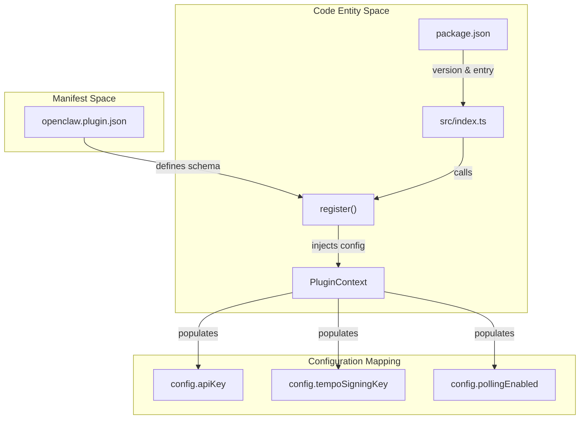
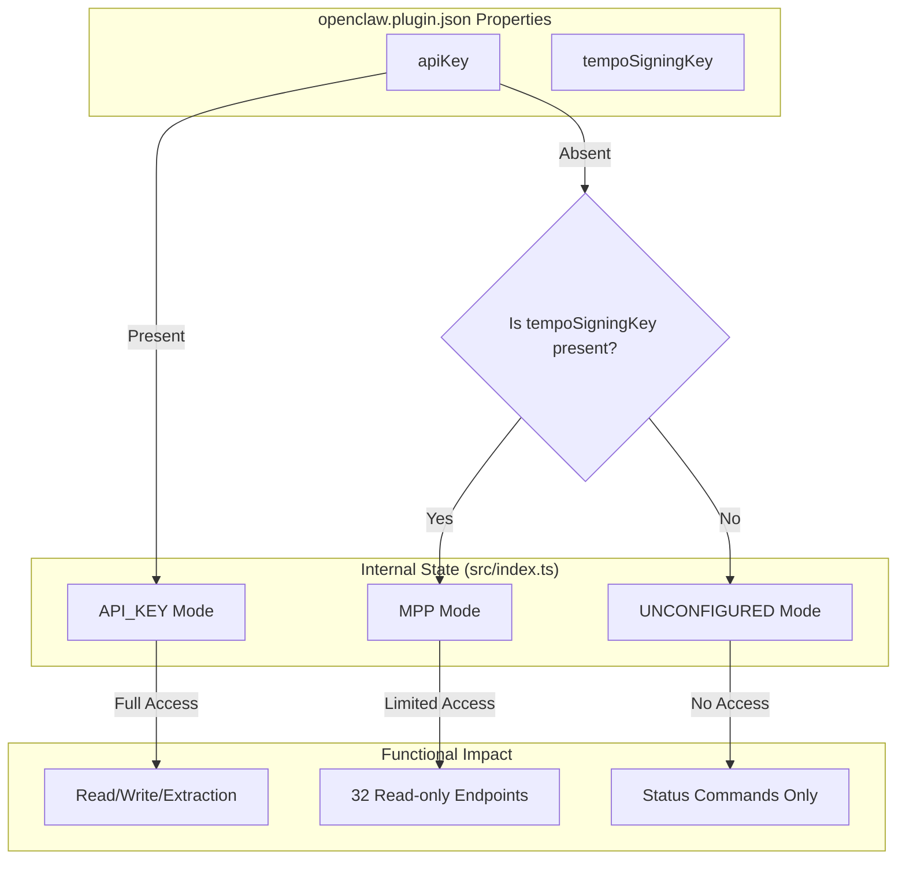

<!-- source: DeepWiki mcp.deepwiki.com · repo Xquik-dev/tweetclaw · page 2.1 Plugin Manifest & Configuration Schema · fetched 2026-10-26 -->

# Plugin Manifest & Configuration Schema

Relevant source files

The following files were used as context for generating this wiki page:

- [openclaw.plugin.json](openclaw.plugin.json)
- [package.json](package.json)

The `openclaw.plugin.json` file serves as the foundational metadata layer for the TweetClaw plugin. It defines how the plugin is identified, when it is activated by the OpenClaw host, the configuration interface presented to the user, and the functional contracts (tools and skills) it fulfills.

## Manifest Overview

The manifest provides essential metadata such as the plugin `id` (`tweetclaw`), `version`, and `description` [openclaw.plugin.json:2-5](). It acts as the bridge between the static code and the OpenClaw runtime environment.

### Activation Rules
TweetClaw uses capability-based activation. It does not load immediately on startup (`onStartup: false`) but triggers when the host environment requires "tool" capabilities [openclaw.plugin.json:6-9]().

### Contracts and Skills
The manifest explicitly declares the functional interfaces it provides:
*   **Contracts**: Registers two primary tools: `explore` and `tweetclaw` [openclaw.plugin.json:11-13]().
*   **Skills**: Points to the `skills/tweetclaw` directory, which contains the `SKILL.md` file used by agents to understand how to utilize the plugin effectively [openclaw.plugin.json:10-10]().

### Tool Metadata
The `toolMetadata` section marks the `tweetclaw` tool as `optional` [openclaw.plugin.json:14-18](). This allows the plugin to remain functional (e.g., for exploration or status checks) even if the primary execution tool is restricted by host policy.

## Configuration Schema

The `configSchema` defines the structured data required to initialize the plugin. It uses JSON Schema to validate user input and environment variables.

### Key Properties
| Property | Type | Default | Description |
| :--- | :--- | :--- | :--- |
| `apiKey` | `string` | N/A | Xquik API key for account-backed automation [openclaw.plugin.json:23-23](). |
| `tempoSigningKey` | `string` | N/A | MPP signing key for pay-per-use, accountless read access [openclaw.plugin.json:24-24](). |
| `baseUrl` | `string` | `https://xquik.com` | The target API endpoint [openclaw.plugin.json:25-25](). |
| `pollingEnabled` | `boolean` | `true` | Toggles the background event poller [openclaw.plugin.json:27-27](). |
| `pollingInterval` | `number` | `60` | Frequency (in seconds) for checking monitor events [openclaw.plugin.json:26-26](). |

### UI Hints
The `uiHints` object provides metadata for the OpenClaw graphical interface to render configuration forms. It marks sensitive fields like `apiKey` and `tempoSigningKey` as `sensitive: true` to ensure they are masked in the UI [openclaw.plugin.json:30-36]().

## Data Flow: Manifest to Runtime

The following diagram illustrates how the `openclaw.plugin.json` manifest informs the plugin registration process and influences the behavior of the `PluginContext`.

**Manifest Integration Flow**

**Sources:** [openclaw.plugin.json:1-37](), [package.json:18-38]()

## Configuration Dependency Graph

The plugin's operational mode is determined by which configuration keys are provided in the manifest-defined schema. This logic is implemented during the registration flow to determine the "Credential State."

**Credential Resolution Logic**

**Sources:** [openclaw.plugin.json:19-29](), [package.json:87-91]()

## Compatibility and Build Metadata

The `package.json` file complements the manifest by defining the compatibility requirements for the OpenClaw host.

*   **Plugin API Compatibility**: Requires `pluginApi` version `>=2026.5.4` [package.json:25-28]().
*   **Runtime Extensions**: Specifies `./dist/index.js` as the compiled entry point for the plugin [package.json:22-24]().
*   **Peer Dependencies**: Declares `mppx` and `viem` as optional dependencies, which are only required if the user configures a `tempoSigningKey` for Machine Payments Protocol (MPP) mode [package.json:87-99]().

**Sources:** [package.json:18-38](), [package.json:87-99]()

---

