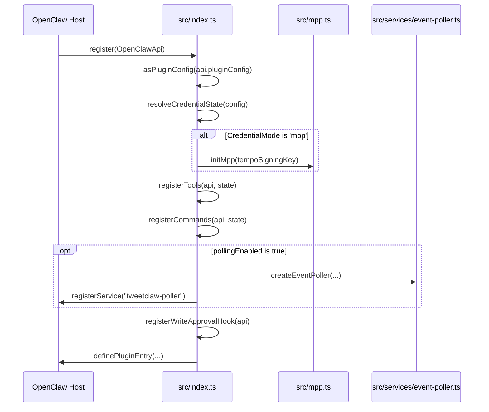
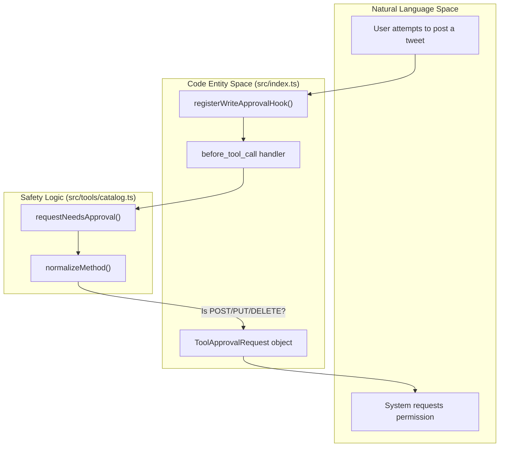
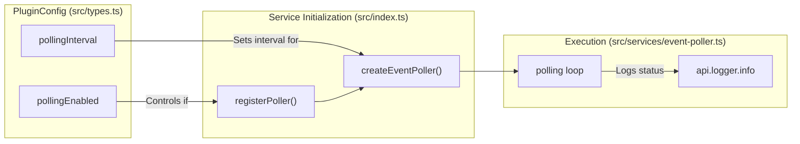

<!-- source: DeepWiki mcp.deepwiki.com · repo Xquik-dev/tweetclaw · page 2.2 Plugin Entry Point & Registration Flow · fetched 2026-10-26 -->

# Plugin Entry Point & Registration Flow

<details>
<summary>Relevant source files</summary>

The following files were used as context for generating this wiki page:

- [src/index.ts](src/index.ts)
- [src/mpp.ts](src/mpp.ts)
- [src/types.ts](src/types.ts)
- [tests/index.test.ts](tests/index.test.ts)
- [tests/openclaw-plugin-entry.ts](tests/openclaw-plugin-entry.ts)

</details>


This page provides a technical walkthrough of the initialization and registration lifecycle of the TweetClaw plugin within the OpenClaw ecosystem. The entry point, located in `src/index.ts`, manages configuration parsing, credential resolution, and the registration of tools, commands, and background services.

## Overview of `src/index.ts`

The `src/index.ts` file serves as the bridge between the TweetClaw logic and the OpenClaw Plugin SDK. It exports a `register` function that is called by the OpenClaw host during the plugin activation phase.

### Key Registration Components

| Component | Function | Responsibility |
| :--- | :--- | :--- |
| **Credentials** | `resolveCredentialState` | Determines if the plugin operates in `api-key`, `mpp`, or `none` mode. |
| **Tools** | `registerTools` | Registers the `explore` and `tweetclaw` agentic tools. |
| **Commands** | `registerCommands` | Registers `/xstatus` and `/xtrends` slash commands. |
| **Services** | `registerPoller` | Initializes the background `EventPoller` for monitoring X events. |
| **Hooks** | `registerWriteApprovalHook` | Injects a middleware to intercept and approve write-actions. |

**Sources:** [src/index.ts:1-11](), [src/index.ts:100-138]()

---

## Registration Lifecycle Diagram

The following diagram illustrates the sequence of operations when `register()` is invoked by the OpenClaw host.

### Registration Sequence

**Sources:** [src/index.ts:257-295](), [src/index.ts:316-333](), [src/index.ts:404-419]()

---

## Credential Resolution

The function `resolveCredentialState` determines the operational mode based on the `PluginConfig`. TweetClaw supports three distinct modes that dictate which endpoints can be accessed.

| Mode | Required Config | Capabilities |
| :--- | :--- | :--- |
| `api-key` | `apiKey` | Full access to all 99+ endpoints (Read/Write/Extraction). |
| `mpp` | `tempoSigningKey` | Access to 32 read-only endpoints via MPP (Pay-per-use). |
| `none` | None | Only the `explore` tool and `/xstatus` command are functional. |

### Implementation Details
*   **Validation**: `asPluginConfig` filters and validates the raw configuration object from OpenClaw [src/index.ts:180-192]().
*   **State Object**: Returns a `CredentialState` object containing the `mode`, `accountValue` (API Key), and `signingValue` (Tempo Key) [src/index.ts:94-98]().
*   **MPP Initialization**: If `mpp` mode is selected, `initMpp` is called to dynamically load `mppx` and `viem` for signing requests [src/mpp.ts:23-39]().

**Sources:** [src/index.ts:219-236](), [src/index.ts:241-255](), [src/mpp.ts:23-39]()

---

## Tool & Command Registration

### Tool Registration (`registerTools`)
The plugin registers two primary tools using `api.registerTool`. 

1.  **`explore`**: Used by agents to search the Xquik API catalog. It uses `EXPLORE_PARAMETERS` for schema validation [src/index.ts:140-151]().
2.  **`tweetclaw`**: The execution tool for making concrete API requests. It uses `TWEETCLAW_PARAMETERS` [src/index.ts:153-171]().

If no credentials are provided, `tweetclaw` is still registered but will return a `MISSING_CREDENTIALS_MESSAGE` upon execution to guide the user [src/index.ts:24-25](), [src/index.ts:303-311]().

### Command Registration (`registerCommands`)
Slash commands are registered via `api.registerCommand`. These bypass the LLM reasoning loop and provide direct utility:
*   **`/xstatus`**: Displays the current connection state and credit balance [src/commands/xstatus.ts:10-18]().
*   **`/xtrends`**: Fetches current X/Twitter trends [src/commands/xtrends.ts:7-12]().

**Sources:** [src/index.ts:297-314](), [src/index.ts:316-333](), [tests/index.test.ts:152-177]()

---

## Write Approval Hook

To ensure safety, TweetClaw registers a `before_tool_call` hook. This middleware inspects every call to the `tweetclaw` tool.

### Logic Flow
1.  **Detection**: The hook calls `requestNeedsApproval(path, method)` from `src/tools/catalog.ts` [src/index.ts:342-343]().
2.  **Identification**: It checks if the requested endpoint is a "Write" action (e.g., `POST /api/v1/x/tweets`) [src/tools/catalog.ts:58-64]().
3.  **Intervention**: If a write-action is detected, it returns a `requireApproval` object to OpenClaw, triggering a UI prompt for the user [src/index.ts:347-352]().

### Code-to-System Mapping

**Sources:** [src/index.ts:335-361](), [src/tools/catalog.ts:58-64]()

---

## Background Service: Event Poller

If `pollingEnabled` is set to `true` (default), the plugin registers a background service named `tweetclaw-poller`.

*   **Registration**: Uses `api.registerService` [src/index.ts:413-417]().
*   **Lifecycle**: The `start()` method initializes the `EventPoller` which begins fetching notifications and mentions from Xquik [src/index.ts:384-402]().
*   **Data Flow**: Polled events are passed back to the OpenClaw host via a callback, where they can trigger agent workflows [src/index.ts:387-393]().

### Poller Configuration Mapping

**Sources:** [src/index.ts:363-419](), [src/services/event-poller.ts:25-40]()

---

## Plugin Entry Definition

The final step in `src/index.ts` is the call to `definePluginEntry`. This function (imported from the SDK) wraps the plugin object, ensuring it adheres to the expected interface for OpenClaw's dynamic loading mechanism.

```typescript
export default definePluginEntry({
  configSchema: CONFIG_SCHEMA,
  register,
});
```
**Sources:** [src/index.ts:421-424](), [tests/openclaw-plugin-entry.ts:1-5]()

---

