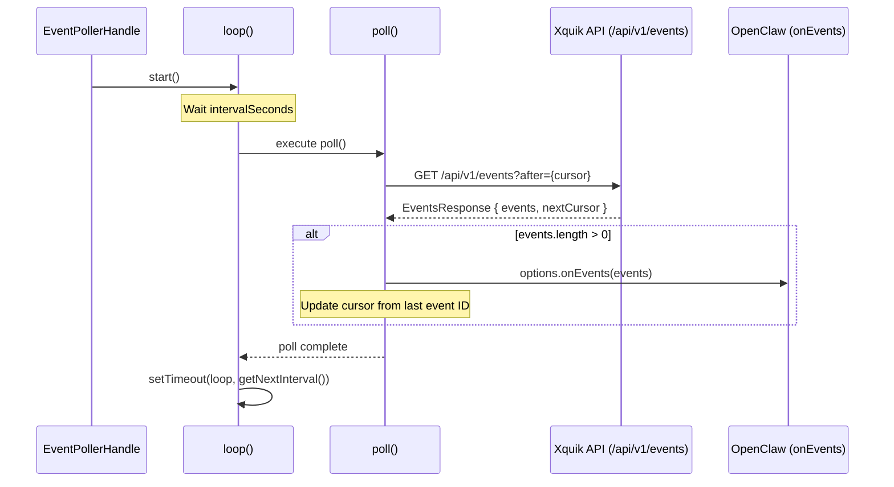
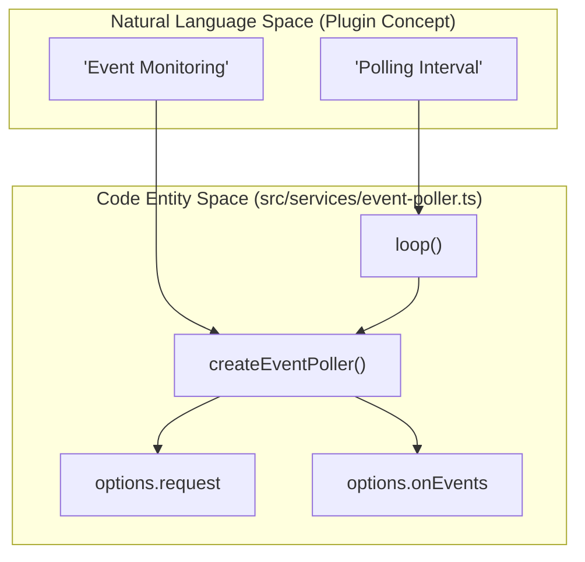

<!-- source: DeepWiki mcp.deepwiki.com · repo Xquik-dev/tweetclaw · page 2.3 Event Polling Service · fetched 2026-10-26 -->

# Event Polling Service

Relevant source files

The following files were used as context for generating this wiki page:

- [src/commands/xtrends.ts](src/commands/xtrends.ts)
- [src/services/event-poller.ts](src/services/event-poller.ts)
- [tests/event-poller.test.ts](tests/event-poller.test.ts)
- [tsconfig.eslint.json](tsconfig.eslint.json)
- [tsconfig.json](tsconfig.json)

The Event Polling Service is responsible for monitoring the Xquik API for new events (such as new tweets or radar updates) and delivering them to the OpenClaw host. It implements a robust polling loop with cursor-based pagination and exponential backoff to ensure reliable event delivery even during network instability or API downtime.

### Implementation: createEventPoller

The core logic resides in the `createEventPoller()` function, which returns a handle to control the lifecycle of the polling process.

| Entity | Role |
| :--- | :--- |
| `createEventPoller` | Factory function that initializes the poller state and returns `start`/`stop` methods [src/services/event-poller.ts:27-95](). |
| `poll` | An internal asynchronous function that performs the HTTP request to `/api/v1/events` [src/services/event-poller.ts:33-61](). |
| `loop` | The recursive execution wrapper that schedules the next `poll` using `setTimeout` [src/services/event-poller.ts:74-80](). |
| `EventPollerHandle` | Interface defining the `start` and `stop` controls for the service [src/services/event-poller.ts:17-20](). |

**Sources:** [src/services/event-poller.ts:1-98]()

### Polling Logic and Data Flow

The poller maintains an internal `cursor` to track the last processed event. This cursor is sent as the `after` query parameter in subsequent requests to fetch only new data.

#### Sequence Diagram: Polling Cycle
The following diagram illustrates the interaction between the `EventPollerHandle`, the internal `poll` logic, and the Xquik API.

**Sources:** [src/services/event-poller.ts:33-80](), [src/services/event-poller.ts:22-25]()

### Cursor-Based Pagination
The poller uses the `id` field of the final event in a batch to update its cursor. The `extractCursor` function safely retrieves this identifier to ensure the next poll starts exactly where the previous one ended [src/services/event-poller.ts:22-25]().

### Error Handling and Exponential Backoff

To prevent overwhelming the API during failures, the service tracks `consecutiveErrors` [src/services/event-poller.ts:30](). 

- **Success:** `consecutiveErrors` is reset to `0`, and the interval returns to the configured `options.intervalSeconds` [src/services/event-poller.ts:57]().
- **Failure:** The interval increases exponentially using the formula: 
  `min(2^consecutiveErrors * intervalSeconds, 300)` [src/services/event-poller.ts:67-71]().

| Constant | Value | Description |
| :--- | :--- | :--- |
| `BACKOFF_BASE` | `2` | The multiplier for exponential growth [src/services/event-poller.ts:4](). |
| `MAX_BACKOFF_SECONDS` | `300` | The maximum delay (5 minutes) between polls [src/services/event-poller.ts:3](). |

**Sources:** [src/services/event-poller.ts:3-5](), [src/services/event-poller.ts:63-72]()

### Integration with OpenClaw

The poller is registered as a background service during the plugin initialization. It bridges the "Code Entity Space" of the polling logic with the "Natural Language Space" of the plugin's capabilities.

#### Mapping: Service Logic to Plugin Entities

**Sources:** [src/services/event-poller.ts:27-32](), [src/services/event-poller.ts:74-80]()

### Lifecycle Management

The `EventPollerHandle` provides explicit control over the polling state:
- **`start()`**: Sets `stopped` to `false` and schedules the first execution [src/services/event-poller.ts:83-86]().
- **`stop()`**: Sets `stopped` to `true` and clears any pending `setTimeout` using `clearTimeout(timer)` [src/services/event-poller.ts:87-93]().

The `loop` function checks the `stopped` flag before scheduling the next iteration, ensuring that an in-progress poll does not trigger a subsequent one if the service was halted [src/services/event-poller.ts:76-78]().

**Sources:** [src/services/event-poller.ts:82-94](), [tests/event-poller.test.ts:141-161]()

---

