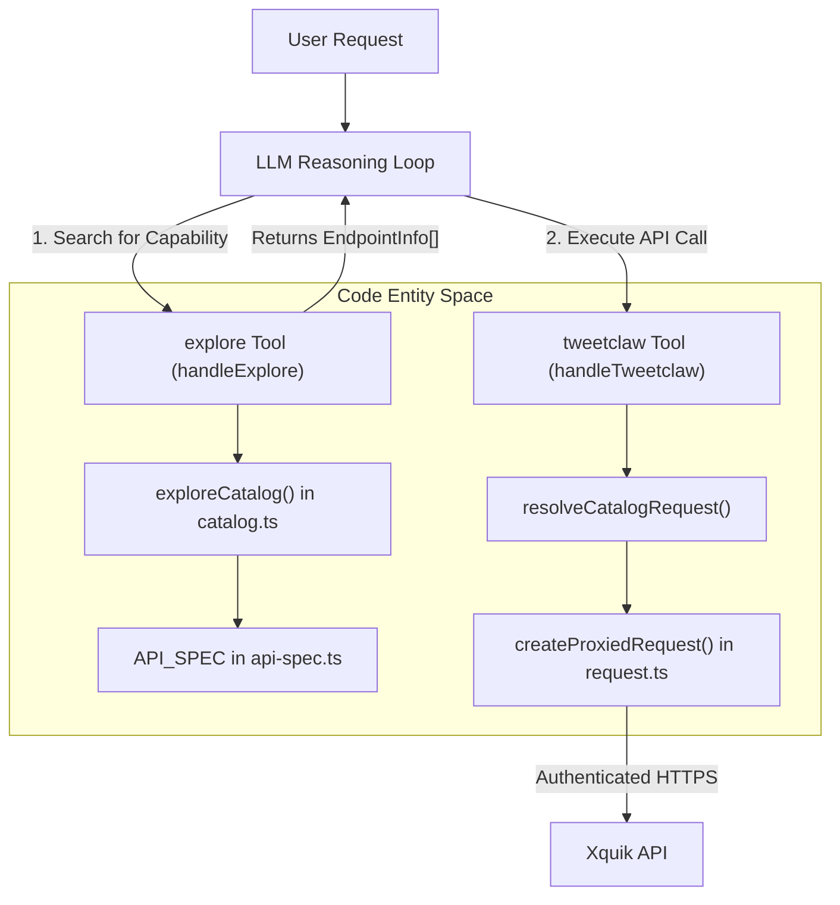

<!-- source: DeepWiki mcp.deepwiki.com · repo Xquik-dev/tweetclaw · page 3 Tools: explore & tweetclaw · fetched 2026-10-26 -->

# Tools: explore & tweetclaw

<details>
<summary>Relevant source files</summary>

The following files were used as context for generating this wiki page:

- [eslint.config.ts](eslint.config.ts)
- [skills/tweetclaw/SKILL.md](skills/tweetclaw/SKILL.md)
- [src/tools/explore.ts](src/tools/explore.ts)
- [src/tools/tweetclaw.ts](src/tools/tweetclaw.ts)
- [tests/tweetclaw.test.ts](tests/tweetclaw.test.ts)

</details>


TweetClaw exposes two primary tools to the AI agent to facilitate interaction with the Xquik API: `explore` and `tweetclaw`. These tools follow a "Discovery-then-Execution" pattern, where the agent first searches for capabilities and then executes them within a secure, governed environment.

## Overview of Agent Tools

The toolset is designed to abstract the complexity of the X (Twitter) API while maintaining strict safety boundaries and credential isolation.

| Tool | Purpose | Primary Function | File |
| :--- | :--- | :--- | :--- |
| `explore` | Catalog discovery and documentation retrieval. | `handleExplore()` | [src/tools/explore.ts:22-29]() |
| `tweetclaw` | API request execution and result handling. | `handleTweetclaw()` | [src/tools/tweetclaw.ts:51-81]() |

### Interaction Flow
The following diagram illustrates how the agent moves from a natural language request to a concrete code execution via these tools.

**Agent Reasoning & Tool Execution Flow**

Sources: [src/tools/explore.ts:22-29](), [src/tools/tweetclaw.ts:51-81](), [src/tools/catalog.ts:2-2](), [src/request.ts:1-1]()

---

## 3.1 explore Tool
The `explore` tool serves as the agent's documentation layer. It allows the agent to search through the `API_SPEC` to find the correct `path`, `method`, and `parameters` required for a specific task without making any network requests.

*   **Discovery Logic**: It utilizes `exploreCatalog()` to filter endpoints based on categories, cost (free vs. paid), or MPP eligibility.
*   **Categories**: The tool provides access to 9 categories including `Account`, `Composition`, `Extraction`, and `Twitter/Read`.
*   **Safety**: It never returns "agent-prohibited" endpoints like those used for API key management or billing.

For details, see [explore Tool](#3.1).

Sources: [src/tools/explore.ts:5-20](), [src/tools/explore.ts:22-29](), [src/tools/catalog.ts:1-2]()

---

## 3.2 tweetclaw Tool & Request Execution
The `tweetclaw` tool is the execution engine. It accepts a structured `TweetclawParams` object (containing `path`, `method`, `query`, and `body`) and proxies the request to the Xquik API.

*   **Validation**: Every request is validated against the `specEndpoints` catalog via `resolveCatalogRequest()`. Unknown or prohibited paths are rejected before any network call is made.
*   **Timeout Management**: Execution is wrapped in a `Promise.race` with an `EXECUTION_TIMEOUT_MS` (default 30s) to prevent hanging agent sessions.
*   **Credential Injection**: Auth headers (API Key or MPP signature) are injected automatically by `createProxiedRequest()`; the agent never sees or handles raw credentials.
*   **Safety Gates**: Write actions (POST/PATCH/DELETE) and paid actions trigger an OpenClaw approval hook, requiring explicit user confirmation.

For details, see [tweetclaw Tool & Request Execution](#3.2).

Sources: [src/tools/tweetclaw.ts:6-37](), [src/tools/tweetclaw.ts:51-81](), [src/tools/tweetclaw.ts:64-75](), [src/request.ts:1-1]()

---

## 3.3 Slash Commands: /xstatus & /xtrends
In addition to the LLM-facing tools, TweetClaw provides direct "Slash Commands" that bypass the reasoning loop for common administrative and informational tasks.

*   **`/xstatus`**: Displays the current credential state (API Key vs. MPP), credit balance, and connected X account information.
*   **`/xtrends`**: A shortcut to retrieve curated global or regional trends via the `/api/v1/radar` endpoint.

These commands provide a predictable, formatted output that is more efficient for users than prompting an agent to call a tool.

For details, see [Slash Commands: /xstatus & /xtrends](#3.3).

Sources: [src/commands/xstatus.ts:1-1](), [src/commands/xtrends.ts:1-1](), [skills/tweetclaw/SKILL.md:18-18]()

---

## Technical Mapping: Language to Code

This diagram maps natural language concepts used in the tool descriptions to their specific implementations in the codebase.

**System Concept Mapping**
```mermaid
classDiagram
    class "Natural Language Space" {
        "Search the catalog"
        "Send a tweet"
        "Check credits"
        "MPP Mode"
    }
    class "Code Entity Space" {
        handleExplore()
        handleTweetclaw()
        handleXStatus()
        resolveCatalogRequest()
    }
    "Search the catalog" ..> handleExplore : triggers
    "Send a tweet" ..> handleTweetclaw : triggers
    "Check credits" ..> handleXStatus : triggers
    "MPP Mode" ..> resolveCatalogRequest : restricts via mppMode flag
```
Sources: [src/tools/explore.ts:9-20](), [src/tools/tweetclaw.ts:6-37](), [src/commands/xstatus.ts:1-1](), [src/tools/catalog.ts:62-62]()

---

