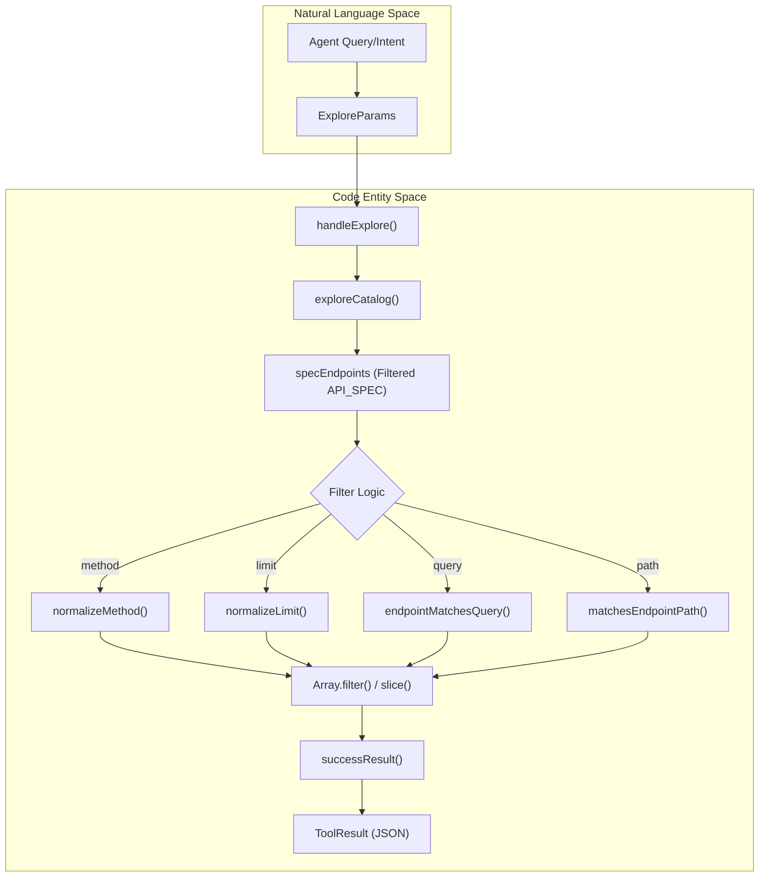
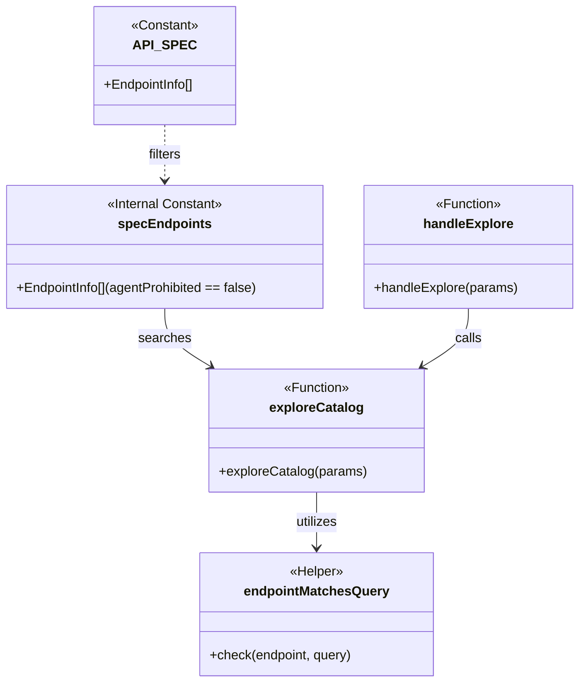

<!-- source: DeepWiki mcp.deepwiki.com · repo Xquik-dev/tweetclaw · page 3.1 explore Tool · fetched 2026-10-26 -->

# explore Tool

Relevant source files

The following files were used as context for generating this wiki page:

- [eslint.config.ts](eslint.config.ts)
- [src/tools/catalog.ts](src/tools/catalog.ts)
- [src/tools/explore.ts](src/tools/explore.ts)
- [tests/catalog.test.ts](tests/catalog.test.ts)
- [tests/explore.test.ts](tests/explore.test.ts)
- [tests/tweetclaw.test.ts](tests/tweetclaw.test.ts)

The `explore` tool is a non-executing utility designed to allow AI agents to discover and inspect the Xquik API capabilities within the TweetClaw environment. It provides a searchable catalog of available endpoints, their parameters, costs, and response shapes without performing any network requests.

## Overview and Purpose

The primary goal of `handleExplore()` is to bridge the gap between an agent's natural language intent and the specific technical requirements of the `tweetclaw` execution tool. By searching the catalog, agents can identify the correct `path`, `method`, and `query` parameters needed to perform tasks such as searching tweets, extracting data, or managing account status.

### Key Characteristics
- **Zero Network Latency**: All data is derived from the local `API_SPEC` constant [src/tools/catalog.ts:8-8]().
- **Safety Filtering**: Automatically excludes `agentProhibited` endpoints (e.g., billing, API key management) to prevent the agent from discovering restricted administrative paths [src/tools/catalog.ts:8-8]().
- **Structured Search**: Supports filtering by category, cost (free/paid), and MPP eligibility [src/tools/explore.ts:11-18]().

---

## Data Flow: From Spec to Search

The tool transforms the static `API_SPEC` into a searchable interface through several layers of normalization and filtering.

### Data Derivation
The `specEndpoints` constant serves as the ground truth for the tool. It is derived by filtering the master `API_SPEC` to remove any endpoints flagged as `agentProhibited` [src/tools/catalog.ts:8-8]().

### Logic Flow
The following diagram illustrates how a user's `ExploreParams` are processed by `handleExplore` and `exploreCatalog`.

**Logic Flow: exploreCatalog**

**Sources:** [src/tools/explore.ts:22-29](), [src/tools/catalog.ts:120-135]()

---

## Implementation Details

### ExploreParams Interface
The `ExploreParams` interface defines the structured filters available to the agent:

| Parameter | Type | Description |
| :--- | :--- | :--- |
| `query` | `string` | Keyword search across summaries, paths, response shapes, and parameters. |
| `category` | `string` | Filters by functional group (e.g., `twitter`, `extraction`, `composition`). |
| `method` | `string` | HTTP method (GET, POST, etc.). |
| `path` | `string` | Exact or partial API path match. |
| `free` | `boolean` | Filter for free vs. paid endpoints. |
| `mpp` | `boolean` | Filter for endpoints eligible for Multi-Party Protocol (MPP) signing. |
| `limit` | `number` | Result cap (1-100, default 25). |

**Sources:** [src/tools/explore.ts:9-20](), [src/tools/catalog.ts:120-125]()

### Filtering Logic
The core filtering occurs in `exploreCatalog()` [src/tools/catalog.ts:120-135](). 

1. **Keyword Search**: `endpointMatchesQuery()` creates a "haystack" string by joining the endpoint's category, method, path, response shape, summary, and all parameter metadata (names, descriptions, types) [src/tools/catalog.ts:101-118]().
2. **Path Matching**: `matchesEndpointPath()` handles template variables (e.g., matching `/api/v1/x/tweets/123` against `/api/v1/x/tweets/:id`) by splitting paths into segments and treating segments starting with `:` as wildcards [src/tools/catalog.ts:26-36]().
3. **Limit Enforcement**: `normalizeLimit()` ensures the agent cannot request more than 100 descriptors at once, protecting the context window from overflow [src/tools/catalog.ts:14-19]().

### SEARCH_DESCRIPTION
The tool exports a `SEARCH_DESCRIPTION` constant [src/tools/explore.ts:9-20](). This string is used during tool registration to provide the LLM with instructions on how to use the filters effectively. It dynamically lists available categories by extracting unique values from `specEndpoints` [src/tools/explore.ts:5-7]().

---

## Relationship with API Specification

The `explore` tool acts as the "Read-Only" view of the `API_SPEC`. While the `tweetclaw` tool uses `resolveCatalogRequest()` to validate and execute calls, `explore` uses the same catalog to facilitate discovery.

**Entity Association: Spec to Tool**

**Sources:** [src/tools/catalog.ts:1-8](), [src/tools/explore.ts:1-25]()

## Error Handling
The tool is designed to be resilient. If `exploreCatalog` throws an error (e.g., due to invalid parameter types), `handleExplore` catches the exception and returns a `ToolResult` with `isError: true` using the `errorResult` helper [src/tools/explore.ts:26-28]().

**Sources:** [src/tools/explore.ts:22-29](), [src/tools/result.ts:109-115]()

---

