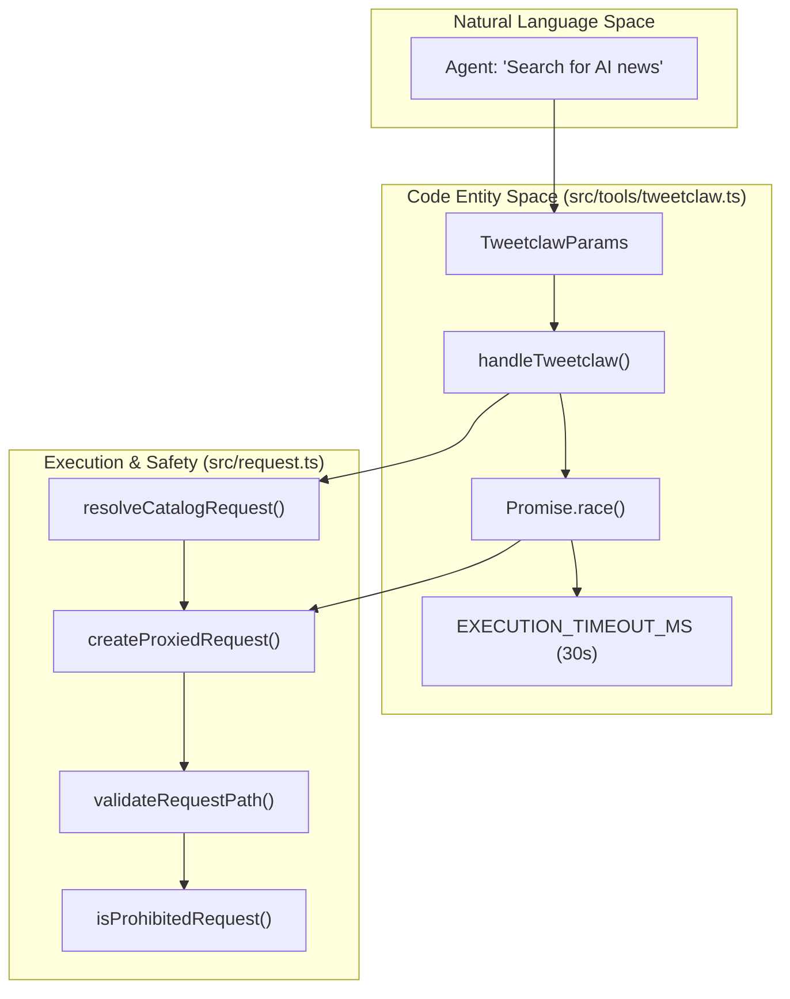
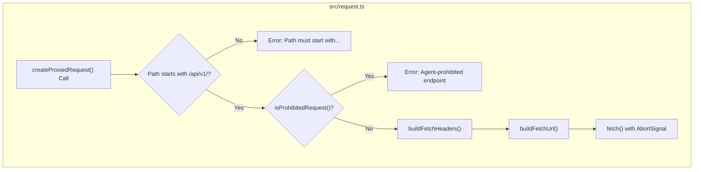

<!-- source: DeepWiki mcp.deepwiki.com · repo Xquik-dev/tweetclaw · page 3.2 tweetclaw Tool & Request Execution · fetched 2026-10-26 -->

# tweetclaw Tool & Request Execution

Relevant source files

The following files were used as context for generating this wiki page:

- [src/request.ts](src/request.ts)
- [src/tools/result.ts](src/tools/result.ts)
- [src/tools/tweetclaw.ts](src/tools/tweetclaw.ts)
- [src/truncate.ts](src/truncate.ts)
- [tests/request.test.ts](tests/request.test.ts)

This page details the implementation of the core execution engine for the `tweetclaw` tool. It covers the flow from tool invocation to HTTP request dispatching, including safety enforcement, timeout handling, and credential injection.

## Tool Entry Point: `handleTweetclaw`

The `handleTweetclaw` function is the primary entry point for the `tweetclaw` tool [src/tools/tweetclaw.ts:51-51](). It orchestrates the translation of agent-provided parameters into a concrete API request and handles the lifecycle of that request.

### Execution Flow
1.  **Resolution**: The function calls `resolveCatalogRequest` to validate the requested path and method against the bundled API specification [src/tools/tweetclaw.ts:62-62]().
2.  **Request Creation**: It initializes a `RequestFunction` via `createProxiedRequest`, which encapsulates base URL, credentials, and fetch logic [src/tools/tweetclaw.ts:63-63]().
3.  **Timeout Race**: To prevent hanging tool calls, the execution is wrapped in a `Promise.race` between the actual network request and a 30-second timer [src/tools/tweetclaw.ts:64-75]().
4.  **Result Processing**: On success, the JSON response is passed to `successResult` for truncation and formatting [src/tools/tweetclaw.ts:77-77](). Errors are caught and returned as `errorResult` [src/tools/tweetclaw.ts:79-79]().

### Diagram: Tool Execution Pipeline
The following diagram maps the logical execution steps to the specific code entities involved.

Sources: [src/tools/tweetclaw.ts:39-75](), [src/request.ts:76-110]()

## Request Proxying & Safety Enforcement

The `createProxiedRequest` function in `src/request.ts` returns an asynchronous function that handles the low-level HTTP mechanics [src/request.ts:87-91](). It acts as a gatekeeper, ensuring no prohibited actions are taken by the agent.

### Prohibited Endpoint Enforcement
Before any request is dispatched, `validateRequestPath` is called [src/request.ts:94-94](). This function enforces two critical rules:
1.  **Prefix Check**: All paths must start with `/api/v1/` [src/request.ts:77-79]().
2.  **Prohibited List**: It checks the `isProhibitedRequest` helper against static lists and regex patterns [src/request.ts:80-85]().

#### Blocked Operations
The system explicitly blocks endpoints related to account security and billing to prevent prompt injection from compromising user accounts:
*   **Account Management**: `PATCH /api/v1/account`, `PUT /api/v1/account/x-identity`, and account deletion [src/request.ts:38-39, 53-54]().
*   **Authentication**: Account connection (`POST /api/v1/x/accounts`) and re-authentication [src/request.ts:46-47, 55-55]().
*   **Billing**: Credit top-ups, subscription checkouts, and billing status reads [src/request.ts:42-45, 173-174]().
*   **Support**: All support ticket interactions are prohibited for agents [src/request.ts:58-63]().

### Credential Injection
The proxy automatically determines the correct authentication header based on the credential format:
*   **X-API-Key**: Used if the credential starts with `xq_` [src/request.ts:13-15]().
*   **Bearer Token**: Used for all other credentials (MPP/Tempo tokens) [src/request.ts:16-16]().
*   **MPP Mode**: If no credential is provided, auth headers are omitted [src/request.ts:20-20]().

### Diagram: Request Validation & Dispatch
This diagram illustrates the internal logic of the request proxying system.

Sources: [src/request.ts:12-35](), [src/request.ts:65-110]()

## Response Truncation

To stay within LLM context window limits, all successful tool results are processed by `truncateResponse` [src/truncate.ts:24-26]().

| Constant | Value | Description |
| :--- | :--- | :--- |
| `MAX_RESPONSE_CHARS` | 24,000 | The maximum string length allowed before truncation [src/truncate.ts:1-1](). |
| `MAX_TOKENS` | 6,000 | The approximate token limit reported in the truncation message [src/truncate.ts:3-3](). |
| `CHARS_PER_TOKEN` | 4 | The heuristic used to estimate token counts [src/truncate.ts:2-2](). |

If a response exceeds the limit, it is sliced, and a message is appended advising the agent to use more specific queries or filters [src/truncate.ts:5-12]().

Sources: [src/truncate.ts:1-29](), [src/tools/result.ts:11-13]()

## Summary of Constraints

| Feature | Implementation Detail |
| :--- | :--- |
| **Timeout** | 30 seconds enforced via `Promise.race` [src/tools/tweetclaw.ts:39-75](). |
| **MPP Mode** | Enforced in `resolveCatalogRequest`; limits available endpoints to MPP-eligible ones [src/tools/tweetclaw.ts:62-62](). |
| **Write Gates** | Handled via the OpenClaw `write-action` approval hook (configured during plugin registration). |
| **Method Safety** | Validated against the `API_SPEC` to ensure the agent uses the correct HTTP verb for the target path [src/tools/tweetclaw.ts:62-62](). |

Sources: [src/tools/tweetclaw.ts:39-83](), [src/request.ts:76-85]()

---

