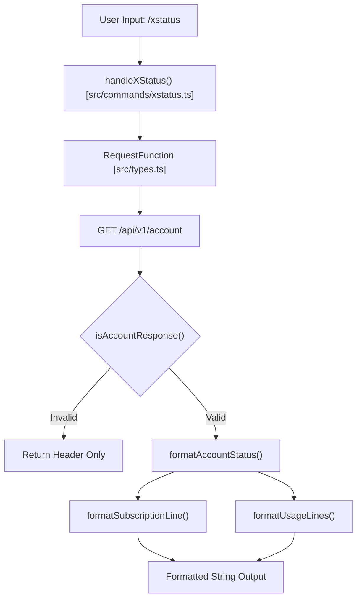
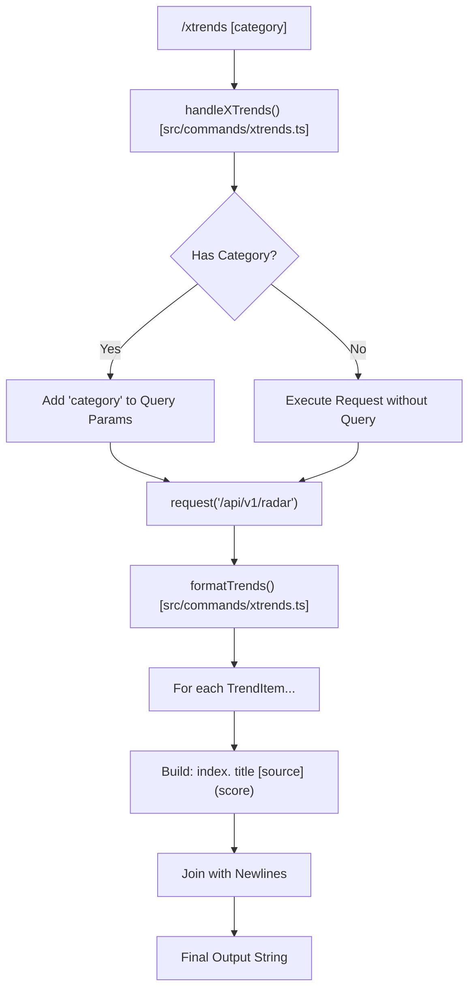

<!-- source: DeepWiki mcp.deepwiki.com · repo Xquik-dev/tweetclaw · page 3.3 Slash Commands: /xstatus & /xtrends · fetched 2026-10-26 -->

# Slash Commands: /xstatus & /xtrends

Relevant source files

The following files were used as context for generating this wiki page:

- [src/commands/xstatus.ts](src/commands/xstatus.ts)
- [src/commands/xtrends.ts](src/commands/xtrends.ts)
- [src/services/event-poller.ts](src/services/event-poller.ts)
- [tests/xstatus.test.ts](tests/xstatus.test.ts)
- [tests/xtrends.test.ts](tests/xtrends.test.ts)
- [tsconfig.eslint.json](tsconfig.eslint.json)
- [tsconfig.json](tsconfig.json)

This page documents the implementation of the two primary slash commands provided by TweetClaw: `/xstatus` and `/xtrends`. Unlike agentic tools (e.g., `explore` or `tweetclaw`), these commands are designed for direct user interaction. They bypass the LLM reasoning loop to provide immediate, formatted feedback regarding account health and real-time trending data.

## Command Architecture and Data Flow

Slash commands in TweetClaw are implemented as standalone handler functions that consume a `RequestFunction`. This abstraction allows the commands to execute authenticated requests against the Xquik API regardless of whether the plugin is running in API-key or MPP mode.

### Execution Loop Bypass
While tools require the LLM to decide on parameters and parse results, slash commands return pre-formatted strings directly to the user interface. This ensures low latency and consistent presentation of system information.

### Command Implementation Overview

| Command | Entry Point | API Endpoint | Purpose |
| :--- | :--- | :--- | :--- |
| `/xstatus` | `handleXStatus()` | `/api/v1/account` | Displays subscription status, usage percentages, and X account linkage. |
| `/xtrends` | `handleXTrends()` | `/api/v1/radar` | Fetches and formats the top trending topics, optionally filtered by category. |

**Sources:** [src/commands/xstatus.ts:68-74](), [src/commands/xtrends.ts:43-57]()

---

## /xstatus: Account and Usage Monitoring

The `/xstatus` command provides a snapshot of the user's Xquik environment. It is primarily used to verify authentication and monitor credit consumption.

### Implementation: handleXStatus
The `handleXStatus` function invokes the `/api/v1/account` endpoint. The response is validated against the `AccountResponse` interface and passed to a formatter.

**Key Components:**
- **`AccountResponse`**: Interface defining the structure of the Xquik account data, including `subscription` details and `usage` metrics [src/commands/xstatus.ts:3-15]().
- **`formatAccountStatus`**: Orchestrates the assembly of the status string, calling sub-formatters for subscription and usage blocks [src/commands/xstatus.ts:44-66]().

### Account Status Logic Flow

The following diagram maps the natural language command to the code entities responsible for processing the account status.

**Diagram: /xstatus Execution Path**

**Sources:** [src/commands/xstatus.ts:17-42](), [src/commands/xstatus.ts:68-76]()

---

## /xtrends: Real-time Radar Data

The `/xtrends` command allows users to query the Xquik "Radar" system for trending topics. It supports an optional category filter (e.g., `tech`, `news`).

### Implementation: handleXTrends
The `handleXTrends` function constructs an optional query object if a `categoryFilter` is provided. It targets the `/api/v1/radar` endpoint.

**Key Components:**
- **`TrendItem`**: Represents a single trending topic, including its `score`, `source`, and `url` [src/commands/xtrends.ts:3-10]().
- **`RadarResponse`**: A wrapper for a list of `TrendItem` objects and a `total` count [src/commands/xtrends.ts:12-15]().
- **`formatTrends`**: Iterates through the items to build a numbered list with metadata annotations [src/commands/xtrends.ts:21-41]().

### Parameter Handling
The command logic ensures that empty or whitespace-only category filters are ignored to prevent malformed API queries [src/commands/xtrends.ts:44-51]().

**Diagram: /xtrends Parameter and Formatting Flow**

**Sources:** [src/commands/xtrends.ts:21-57]()

---

## Error Handling and Fallbacks

Both commands implement defensive programming patterns to ensure the UI remains stable even if the API returns unexpected data or the network fails.

### Validation Guards
The functions `isAccountResponse` [src/commands/xstatus.ts:17-19]() and `isRadarResponse` [src/commands/xtrends.ts:17-19]() act as type guards. If the API response does not match the expected schema, the commands return a "header-only" fallback string rather than throwing an unhandled exception or returning `undefined`.

### Request Failures
If the underlying `RequestFunction` throws an error (e.g., 401 Unauthorized or 500 Internal Server Error), the error is propagated up to the OpenClaw plugin host. This allows the host to display a standardized error message to the user.

| Scenario | Behavior | Code Reference |
| :--- | :--- | :--- |
| API returns non-object | Returns "--- [Title] (0 items) ---" | [src/commands/xtrends.ts:53-56]() |
| Missing optional fields | Formatter skips specific lines (e.g., missing score) | [src/commands/xstatus.ts:30-33]() |
| Network/Auth Error | Error is re-thrown to Plugin Host | [tests/xstatus.test.ts:48-54]() |

**Sources:** [src/commands/xstatus.ts:70-73](), [src/commands/xtrends.ts:53-56](), [tests/xstatus.test.ts:48-62]()

---

