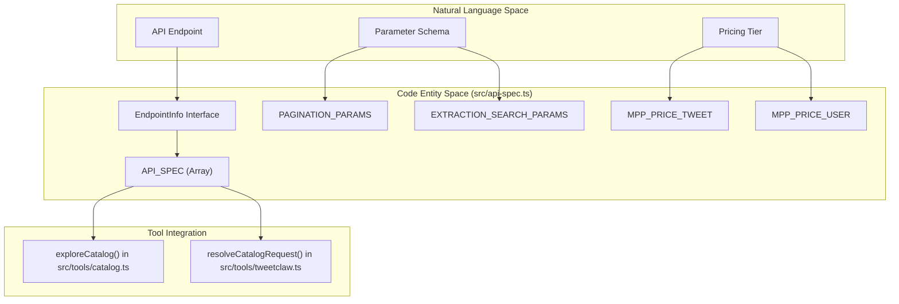
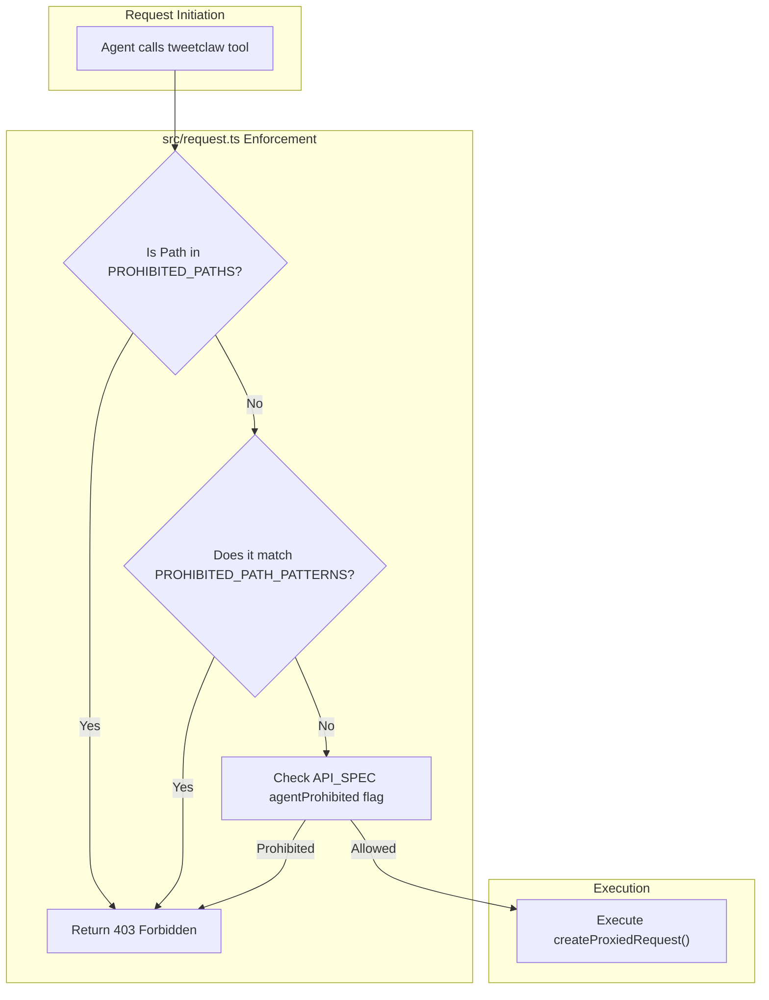

<!-- source: DeepWiki mcp.deepwiki.com · repo Xquik-dev/tweetclaw · page 4 Xquik API Specification · fetched 2026-10-26 -->

# Xquik API Specification

Relevant source files

The following files were used as context for generating this wiki page:

- [skills/tweetclaw/SKILL.md](skills/tweetclaw/SKILL.md)
- [src/api-spec.ts](src/api-spec.ts)

The Xquik API Specification defines the surface area of the Xquik platform accessible via the TweetClaw plugin. This specification serves as the source of truth for the `explore` tool to provide discovery and for the `tweetclaw` tool to execute requests against Xquik's high-performance X/Twitter infrastructure.

The specification is codified in `src/api-spec.ts` as the `API_SPEC` constant, which includes metadata for 99 endpoints, including their HTTP methods, paths, parameter schemas, and pricing information.

## System Overview

The API is structured to bridge the gap between high-level agent intents and low-level RESTful operations. It categorizes functionality into distinct domains such as Extraction (bulk data), Radar (keyword monitoring), and Twitter/Read (direct X data access).

### Code Entity Mapping
The following diagram maps the logical API concepts to their specific implementations within the codebase.

**Diagram: API Specification to Code Entity Mapping**

**Sources:** [src/api-spec.ts:1-119](), [src/tools/catalog.ts:1-15](), [src/tools/tweetclaw.ts:1-25]()

---

## Endpoint Categories

The API surface is organized into nine functional categories. Each category defines a specific set of capabilities, from account management to advanced data extraction.

| Category | Purpose | Example Endpoint |
| :--- | :--- | :--- |
| `x-accounts` | Manage connected X accounts | `POST /x/accounts/connect` |
| `composition` | AI-assisted tweet and style generation | `POST /compose/tweet` |
| `extraction` | Bulk data harvesting jobs | `POST /extract/tweet-search` |
| `monitoring` | Track specific users for new events | `POST /monitors` |
| `radar` | Global keyword and phrase tracking | `POST /radar` |
| `twitter-read` | Real-time X data retrieval | `GET /x/tweets/:id` |
| `x-write` | State-changing actions on X | `POST /x/tweets` |
| `webhooks` | Real-time data delivery to external URLs | `POST /webhooks` |
| `credits` | Billing and usage management | `GET /credits/balance` |

For a full list of endpoints and their parameters, see [Endpoint Catalog & Categories](#4.1).

**Sources:** [src/api-spec.ts:7-14](), [src/api-spec.ts:121-150]()

---

## Billing and Credit Model

Xquik operates on a credit-based billing system where 1 credit equals $0.00015. The `API_SPEC` defines the cost for each operation, allowing the plugin to calculate and warn users about costs before execution.

### Operation Tiers
The system differentiates between standard credit-based billing (for authenticated accounts) and the Machine Payments Protocol (MPP) for anonymous, read-only access.

*   **Read Actions:** Generally cost 1 credit (e.g., tweet lookup).
*   **Write Actions:** Cost 10 credits (e.g., posting a tweet).
*   **Extraction:** Charged per result returned (typically 1 credit/result).
*   **Free:** Management endpoints (monitoring, webhooks) are often 0 credits.

For detailed pricing tables and MPP flow, see [Credit Billing & MPP Pricing](#4.2).

**Sources:** [skills/tweetclaw/SKILL.md:36-52](), [src/api-spec.ts:8-14]()

---

## Safety and Security Boundaries

The API specification includes an `agentProhibited` flag on specific endpoints to prevent autonomous agents from performing sensitive administrative tasks without direct user intervention via a UI.

**Diagram: Request Filtering Flow**

Key security features include:
*   **Prohibited Paths:** Hardcoded list in `src/request.ts` (e.g., `/credits/topup`, `/x/accounts/connect`).
*   **Write Approval:** All state-changing actions require an explicit user confirmation hook.
*   **Credential Isolation:** API keys are managed by the plugin and never exposed to the LLM context.

For more information on the security model, see [Safety Boundaries & Agent-Prohibited Endpoints](#4.3).

**Sources:** [src/request.ts:10-35](), [src/tools/tweetclaw.ts:40-60](), [skills/tweetclaw/SKILL.md:20-33]()

---

