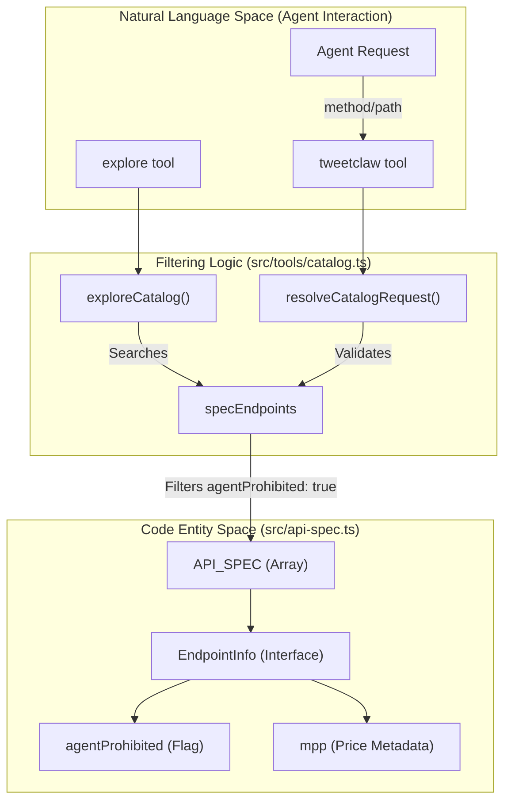
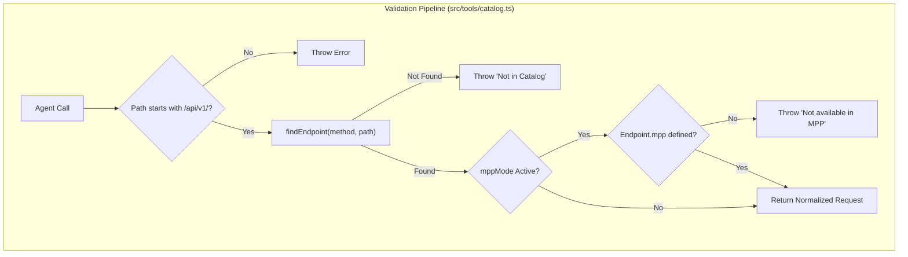

<!-- source: DeepWiki mcp.deepwiki.com · repo Xquik-dev/tweetclaw · page 4.1 Endpoint Catalog & Categories · fetched 2026-10-26 -->

# Endpoint Catalog & Categories

Relevant source files

The following files were used as context for generating this wiki page:

- [registry/agentregistry-steps.md](registry/agentregistry-steps.md)
- [src/api-spec.ts](src/api-spec.ts)
- [src/tools/catalog.ts](src/tools/catalog.ts)
- [tests/api-spec.test.ts](tests/api-spec.test.ts)
- [tests/catalog.test.ts](tests/catalog.test.ts)

TweetClaw exposes a comprehensive catalog of 118 endpoints defined in the Xquik API specification [src/api-spec.ts:40](). While the full API is defined, only 99 endpoints are made available to AI agents via the `explore` and `tweetclaw` tools [registry/agentregistry-steps.md:41-42](). This section details the categorization, parameter patterns, and security constraints governing this catalog.

## Catalog Architecture

The catalog is defined as a central constant, `API_SPEC`, which serves as the single source of truth for tool discovery and request validation [src/api-spec.ts:1]().

### Data Flow: From Spec to Tool
The system filters the raw `API_SPEC` into `specEndpoints` by excluding any routes marked with the `agentProhibited` flag [src/tools/catalog.ts:8-9]().

1.  **Discovery**: The `explore` tool queries `specEndpoints` to help the agent find the correct path and method [src/tools/catalog.ts:120-135]().
2.  **Validation**: When the `tweetclaw` tool is called, `resolveCatalogRequest` verifies the requested path and method against `specEndpoints` [src/tools/catalog.ts:86-89]().
3.  **Normalization**: Parameters are converted to the expected types (e.g., converting numeric query params to strings for URL construction) [src/tools/catalog.ts:53-56]().

### Mapping Code Entities to API Concepts

The following diagram illustrates how the static specification in `src/api-spec.ts` is transformed into executable tool logic.

**API Specification to Tool Execution Map**

Sources: [src/api-spec.ts:1-50](), [src/tools/catalog.ts:8-135]()

## Endpoint Categories

Endpoints are organized into 9 primary categories. Each category represents a specific functional domain within the X/Twitter ecosystem.

| Category | Description | Key Endpoints |
| :--- | :--- | :--- |
| **Account** | Management of X credentials and session status. | `/api/v1/x/accounts`, `/api/v1/xstatus` |
| **Composition** | AI-assisted tweet drafting and style management. | `/api/v1/composition/draft`, `/api/v1/composition/styles` |
| **Extraction** | High-volume data scraping and search exports. | `/api/v1/extractions/search`, `/api/v1/extractions/:id` |
| **Monitoring** | Real-time tracking of keywords and users. | `/api/v1/monitors/keywords`, `/api/v1/monitors/users` |
| **Radar** | Discovery of trending topics and signals. | `/api/v1/x/trends`, `/api/v1/radar/signals` |
| **Twitter/Read** | Standard data retrieval from X (Timelines, Profiles). | `/api/v1/x/tweets/:id`, `/api/v1/x/users/:id` |
| **X Write** | State-changing actions on X. | `/api/v1/x/tweets` (POST), `/api/v1/x/users/:id/follow` |
| **Webhooks** | Configuration for push notifications. | `/api/v1/webhooks` |
| **Credits** | Billing and usage information. | `/api/v1/credits/balance` |

Sources: [src/api-spec.ts:7-15](), [tests/api-spec.test.ts:43-61]()

## Parameter Reuse Patterns

To ensure consistency across 99 endpoints, TweetClaw utilizes standardized parameter sets.

### Pagination (PAGINATION_PARAMS)
Most `GET` requests involving lists (followers, timelines, search results) utilize `PAGINATION_PARAMS` [src/api-spec.ts:16-19]():
*   `limit`: Max items per page (number).
*   `after`: Pagination cursor for the next page (string).

### Extraction Search (EXTRACTION_SEARCH_PARAMS)
The Extraction engine uses a robust set of filters for deep-history searches [src/api-spec.ts:21-38]():
*   **Temporal**: `sinceDate`, `untilDate`.
*   **Engagement**: `minFaves`, `minRetweets`, `minReplies`.
*   **Filters**: `mediaType`, `verifiedOnly`, `language`.
*   **Query**: `exactPhrase`, `excludeWords`, `advancedQuery`.

Sources: [src/api-spec.ts:16-38]()

## Security Boundaries: agentProhibited

The `agentProhibited` flag is a critical security control. It prevents the LLM from accessing endpoints that could compromise the user's account or financial security [src/tools/catalog.ts:8-9]().

### Prohibited Actions
Endpoints marked `agentProhibited: true` are stripped from the `specEndpoints` list and cannot be called via the `tweetclaw` tool [src/tools/catalog.ts:74-85](). These include:
*   **Credential Management**: Re-authenticating accounts or adding new X accounts [tests/catalog.test.ts:77-78]().
*   **API Key Management**: Creating or deleting Xquik API keys [tests/catalog.test.ts:80]().
*   **Billing**: Initiating credit top-ups or viewing payment status [tests/catalog.test.ts:82-83]().
*   **Support**: Creating support tickets [tests/catalog.test.ts:84]().

### Request Validation Logic
The `resolveCatalogRequest` function enforces these boundaries at runtime.

**Request Validation Flow**

Sources: [src/tools/catalog.ts:38-51](), [src/tools/catalog.ts:73-99]()

## Catalog Integrity and Testing

The catalog is strictly validated to ensure it remains a reliable interface for agents.
*   **Uniqueness**: Tests verify there are no duplicate `method + path` combinations [tests/api-spec.test.ts:5-10]().
*   **Structure**: Every entry must contain a `category`, `free` status, `method`, `path`, and `summary` [tests/api-spec.test.ts:12-23]().
*   **Parameter Safety**: Tests ensure no sensitive parameter names like `password` or `totp_secret` are exposed in the catalog [tests/catalog.test.ts:87-97]().

Sources: [tests/api-spec.test.ts:1-96](), [tests/catalog.test.ts:1-122]()

---

