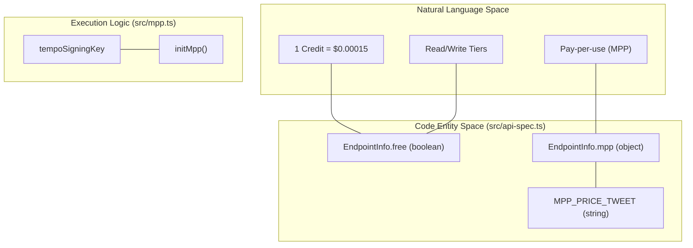
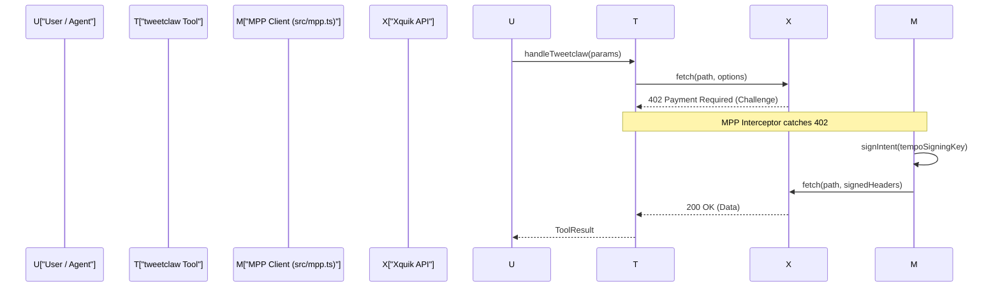

<!-- source: DeepWiki mcp.deepwiki.com · repo Xquik-dev/tweetclaw · page 4.2 Credit Billing & MPP Pricing · fetched 2026-10-26 -->

# Credit Billing & MPP Pricing

Relevant source files

The following files were used as context for generating this wiki page:

- [skills/tweetclaw/SKILL.md](skills/tweetclaw/SKILL.md)
- [src/api-spec.ts](src/api-spec.ts)
- [src/mpp.ts](src/mpp.ts)
- [src/types.ts](src/types.ts)
- [tests/index.test.ts](tests/index.test.ts)

TweetClaw operates on a credit-based billing model provided by Xquik, where operations are charged based on their resource intensity and type. It supports two primary payment flows: account-backed credits (via API Key) and Machine Payments Protocol (MPP) for anonymous, on-chain, pay-per-use access.

## Credit Model Overview

The fundamental unit of currency in the ecosystem is the credit.
*   **Exchange Rate**: 1 credit = $0.00015 [skills/tweetclaw/SKILL.md:36-36]().
*   **Balance Management**: Users top up credits via the Xquik dashboard, and the plugin can query the current balance via the `/api/v1/credits` endpoint [skills/tweetclaw/SKILL.md:68-68]().

### Operation Cost Tiers

Costs are categorized by the nature of the interaction with the X platform.

| Operation Category | Credits | Cost (USD) | Examples |
|:---|:---|:---|:---|
| **Free** | 0 | $0.00000 | Monitors, Webhooks, Radar, Compose [skills/tweetclaw/SKILL.md:51-51]() |
| **Read (Standard)** | 1 | $0.00015 | Tweet lookup, Search, Timelines, User Profiles [skills/tweetclaw/SKILL.md:42-43]() |
| **Read (Trends)** | 3 | $0.00045 | Global or specific trends [skills/tweetclaw/SKILL.md:44-44]() |
| **Specialized Read** | 5 | $0.00075 | Follow checks, Article lookups [skills/tweetclaw/SKILL.md:45-45]() |
| **Write** | 10 | $0.00150 | Posting, Liking, Retweeting, Following, DMs [skills/tweetclaw/SKILL.md:46-46]() |
| **Extraction** | 1 / result | $0.00015 / result | Bulk replies, followers, or likes [skills/tweetclaw/SKILL.md:47-48]() |

**Sources:** [skills/tweetclaw/SKILL.md:36-52]()

---

## Machine Payments Protocol (MPP)

MPP allows for anonymous, read-only access to a subset of the Xquik API without requiring a traditional account or subscription [skills/tweetclaw/SKILL.md:69-69]().

### MPP Price Constants
The codebase defines specific price strings used for the `mpp` metadata in the API specification. These constants reflect the per-unit cost in USD.

*   `MPP_PRICE_CALL`: $0.00015/call [src/api-spec.ts:8-8]()
*   `MPP_PRICE_TWEET`: $0.00015/tweet [src/api-spec.ts:13-13]()
*   `MPP_PRICE_USER`: $0.00015/user [src/api-spec.ts:14-14]()
*   `MPP_PRICE_TREND`: $0.00045/call [src/api-spec.ts:12-12]()
*   `MPP_PRICE_FOLLOW_CHECK`: $0.00105/call [src/api-spec.ts:10-10]()

### MPP Implementation and Initialization
MPP is initialized using the `tempoSigningKey` provided in the plugin configuration [src/types.ts:59-59](). The initialization process dynamically loads the required blockchain libraries to keep the core plugin lightweight.

**MPP Initialization Flow**
The `initMpp` function handles the setup of the `mppx` client.

1.  **Dependency Check**: It attempts to load `mppx/client` and `viem/accounts` [src/mpp.ts:25-30]().
2.  **Account Creation**: It converts the `tempoSigningKey` into a blockchain account using `privateKeyToAccount` [src/mpp.ts:36-36]().
3.  **Method Registration**: It creates a `tempo` payment method and registers it with the `Mppx` global instance [src/mpp.ts:37-38]().

**Sources:** [src/mpp.ts:23-39](), [src/api-spec.ts:8-14](), [skills/tweetclaw/SKILL.md:69-72]()

---

## Technical Data Flow: Pricing & Billing

The following diagram bridges the natural language pricing concepts to the code entities that define and enforce them.

**Pricing Logic to Code Entity Mapping**

**Sources:** [src/api-spec.ts:8-14](), [src/types.ts:9-20](), [src/mpp.ts:23-39]()

---

## HTTP 402 Challenge Flow

When an operation requires payment (either because the API key balance is exhausted or an MPP payment is required), the Xquik API issues an **HTTP 402 Payment Required** challenge.

1.  **Request Initiation**: The `tweetclaw` tool or a service calls `fetch`.
2.  **Challenge**: The server responds with `402`.
3.  **Interception**: The `mppx` client (if initialized via `initMpp`) intercepts the 402 response.
4.  **Signing**: The client uses the `tempoSigningKey` to sign a micropayment "intent".
5.  **Retry**: The request is automatically retried with the payment headers attached.

### Payment Safety Gates
Before any paid action is executed, the agent is instructed to follow safety rules:
*   **Summarize Costs**: The agent must state the estimated credits/cost to the user [skills/tweetclaw/SKILL.md:24-24]().
*   **Explicit Approval**: For writes (10 credits) or extractions (1/result), the agent must wait for user confirmation [skills/tweetclaw/SKILL.md:24-24]().
*   **MPP Restriction**: MPP mode is strictly read-only. The system must never attempt writes or account-backed actions when only a `tempoSigningKey` is present [skills/tweetclaw/SKILL.md:32-32]().

**Billing Challenge and Approval Flow**

**Sources:** [src/mpp.ts:23-39](), [skills/tweetclaw/SKILL.md:24-32](), [tests/index.test.ts:187-211]()

---

## Credits & Topup Endpoints

The system provides specific endpoints within the `Credits` category to manage and monitor billing state.

| Path | Method | Summary |
|:---|:---|:---|
| `/api/v1/credits` | GET | Check current credit balance and usage statistics. |
| `/api/v1/credits/topup` | POST | Generate a top-up session for adding credits to an account. |

These endpoints are marked as `agentProhibited: true` in the `API_SPEC` to prevent autonomous agents from managing financial resources without direct user interaction [src/api-spec.ts:1176-1193]().

**Sources:** [src/api-spec.ts:1176-1193](), [skills/tweetclaw/SKILL.md:68-68]()

---

