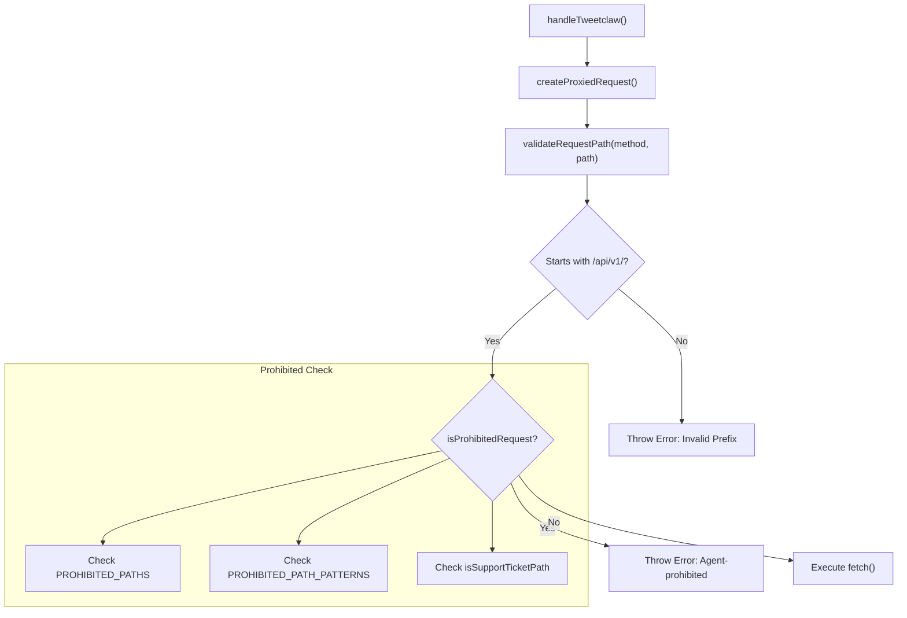
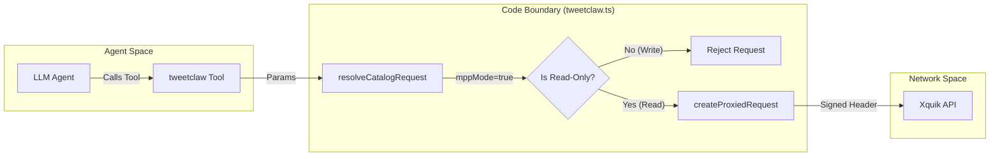

<!-- source: DeepWiki mcp.deepwiki.com · repo Xquik-dev/tweetclaw · page 4.3 Safety Boundaries & Agent-Prohibited Endpoints · fetched 2026-10-26 -->

# Safety Boundaries & Agent-Prohibited Endpoints

Relevant source files

The following files were used as context for generating this wiki page:

- [skills/tweetclaw/SKILL.md](skills/tweetclaw/SKILL.md)
- [src/request.ts](src/request.ts)
- [src/tools/tweetclaw.ts](src/tools/tweetclaw.ts)
- [tests/request.test.ts](tests/request.test.ts)

This page documents the security model of TweetClaw, focusing on the multi-layered defense strategy used to protect user credentials, prevent unauthorized financial transactions, and isolate the agent from sensitive account management functions.

## Overview of Security Layers

TweetClaw implements a "Defense in Depth" strategy to ensure that while an agent can perform useful work, it cannot compromise the underlying Xquik account or perform high-risk actions without oversight.

1.  **Path-Based Blocking**: Hard-coded lists of prohibited API endpoints in `src/request.ts` [src/request.ts:37-56]().
2.  **Write-Action Approval**: A mandatory hook that intercepts state-changing requests for user confirmation [src/tools/tweetclaw.ts:21-21]().
3.  **Credential Isolation**: Automatic injection of authentication headers, preventing the agent from ever seeing or managing API keys [src/request.ts:12-25]().
4.  **MPP Mode Restrictions**: Strict enforcement of read-only access when using Machine Payments Protocol [src/tools/tweetclaw.ts:22-22]().

## Agent-Prohibited Endpoints

The system identifies specific endpoints that are critical to account security and financial integrity. These are blocked at the request level, regardless of the agent's intent or prompt.

### Prohibited Path Lists

The validation logic uses two primary lists to identify forbidden requests:

| List Name | Implementation | Purpose |
| :--- | :--- | :--- |
| `PROHIBITED_PATHS` | Static `[Method, Path]` tuples | Blocks specific account, billing, and API key management routes [src/request.ts:37-49](). |
| `PROHIBITED_PATH_PATTERNS` | `[Method, RegExp]` tuples | Blocks parameterized routes like specific API key deletion or account re-authentication [src/request.ts:51-56](). |

### Support Ticket Protection
In addition to the lists above, any request starting with `/api/v1/support/tickets` using `GET`, `PATCH`, or `POST` is automatically blocked via `isSupportTicketPath` [src/request.ts:58-63](). This prevents agents from impersonating users in support contexts.

### Logic Flow: `validateRequestPath`

The following diagram illustrates how every request generated by the `tweetclaw` tool is validated before transmission.

**Request Validation Logic**

**Sources:** [src/request.ts:65-85](), [src/request.ts:87-110](), [src/tools/tweetclaw.ts:51-81]()

## Write-Action Approval Hook

TweetClaw adheres to a "Human-in-the-Loop" model for all state-changing or paid actions. This is enforced through the `SKILL.md` safety rules and the `tweetclaw` tool's execution logic.

### Protected Action Categories
Before the following actions are executed, the agent must summarize the target and cost, then wait for explicit confirmation [skills/tweetclaw/SKILL.md:24-25]():
*   **X Interactions**: Posting, replying, liking, following, or sending DMs.
*   **Management**: Creating webhooks, monitors, or starting extraction jobs.
*   **Financials**: Any action that consumes credits (Draws, Extractions).

### Implementation in `handleTweetclaw`
The `handleTweetclaw` function utilizes `resolveCatalogRequest` to determine the nature of the request. If the endpoint is identified as a write action in the `API_SPEC`, the OpenClaw environment triggers an approval prompt [src/tools/tweetclaw.ts:21-21](), [src/tools/tweetclaw.ts:62-63]().

## Content Isolation & Prompt Injection

To protect against prompt injection and data exfiltration, TweetClaw implements several data flow boundaries.

### Credential Redaction
The `buildAuthHeader` function ensures that the `xq_` API key or Bearer token is injected only at the final transport layer [src/request.ts:12-17](). The agent interacts with the `tweetclaw` tool using high-level parameters (`path`, `method`, `query`, `body`), never handling the raw `Authorization` header [src/tools/tweetclaw.ts:14-14]().

### MPP Read-Only Boundary
When the plugin is configured in MPP (Machine Payments Protocol) mode (`mppMode: true`), it enters a restricted state. 

**MPP Boundary Enforcement**

**Sources:** [src/tools/tweetclaw.ts:56-62](), [skills/tweetclaw/SKILL.md:32-32]()

### Sensitive Data Redaction
Safety rules in `SKILL.md` explicitly instruct the agent to:
*   Confirm ownership before showing account-scoped data (bookmarks, notifications) [skills/tweetclaw/SKILL.md:26-26]().
*   Redact credentials and sensitive personal data from tool outputs [skills/tweetclaw/SKILL.md:26-26]().
*   Keep bulk extraction limits narrow by default to prevent unintentional credit depletion [skills/tweetclaw/SKILL.md:28-28]().

## Security Configuration Summary

| Feature | Implementation | File Reference |
| :--- | :--- | :--- |
| **Auth Header Injection** | `buildAuthHeader` | [src/request.ts:12-17]() |
| **Path Validation** | `validateRequestPath` | [src/request.ts:76-85]() |
| **Timeout Protection** | `EXECUTION_TIMEOUT_MS` (30s) | [src/tools/tweetclaw.ts:39-39]() |
| **Forbidden Methods** | `isProhibitedRequest` | [src/request.ts:65-74]() |
| **Safety Guidelines** | `SKILL.md` | [skills/tweetclaw/SKILL.md:20-33]() |

**Sources:** [src/request.ts:1-113](), [src/tools/tweetclaw.ts:1-83](), [skills/tweetclaw/SKILL.md:1-83]()

---

