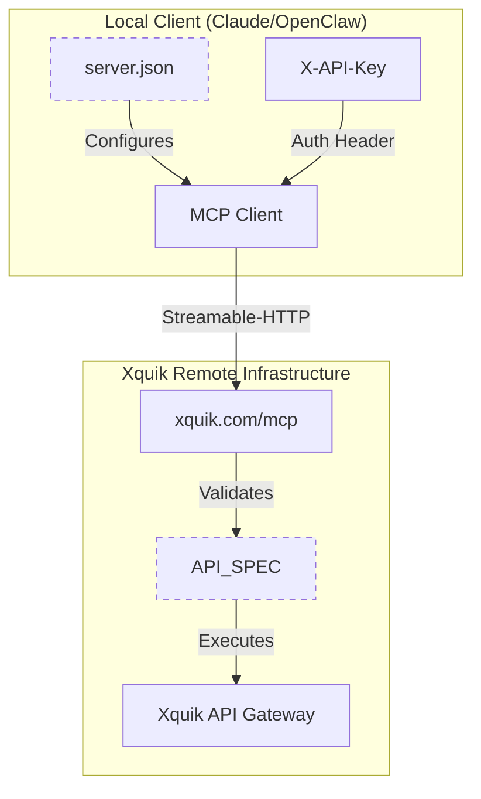
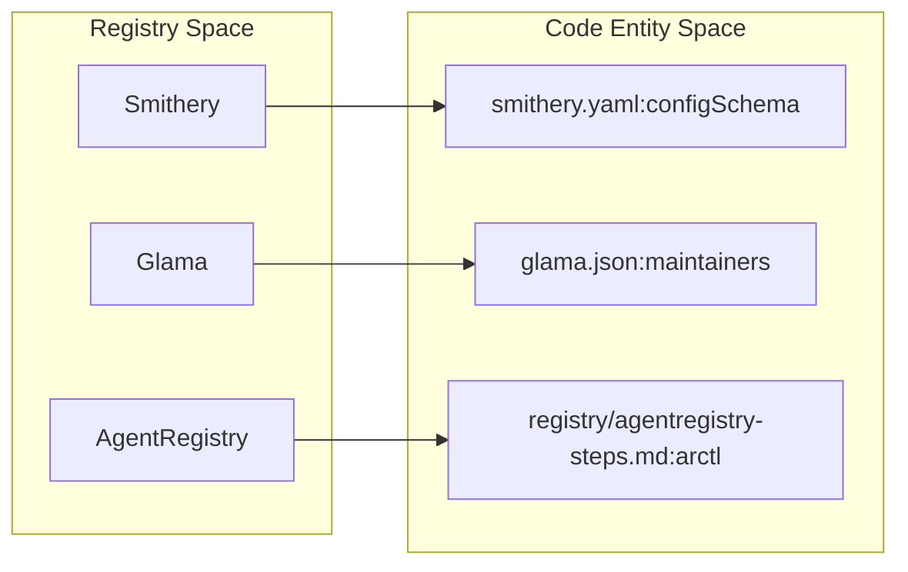

<!-- source: DeepWiki mcp.deepwiki.com · repo Xquik-dev/tweetclaw · page 5 MCP Server Interface · fetched 2026-10-26 -->

# MCP Server Interface

Relevant source files

The following files were used as context for generating this wiki page:

- [glama.json](glama.json)
- [registry/agentregistry-steps.md](registry/agentregistry-steps.md)
- [server.json](server.json)
- [smithery.yaml](smithery.yaml)
- [tests/api-spec.test.ts](tests/api-spec.test.ts)

TweetClaw implements the **Model Context Protocol (MCP)**, allowing it to function as a standardized server for AI agents. By exposing its 99 agent-callable endpoints via the MCP standard, TweetClaw enables LLMs to perform complex X (Twitter) operations—ranging from simple searches to automated posting and follower extraction—across any MCP-compliant client (e.g., Claude Desktop, Cursor, or OpenClaw).

The implementation focuses on a **Remote Streamable-HTTP** transport, offloading the heavy lifting of API execution to the Xquik infrastructure while maintaining local configuration and security controls.

### MCP System Overview

The following diagram illustrates how the MCP interface bridges the local configuration (Natural Language/User Space) to the remote execution environment (Code Entity Space).

**Diagram: MCP Transport and Authentication Flow**

Sources: [server.json:1-21](), [src/api-spec.ts:1-40]()

### Core Integration Details

TweetClaw's MCP identity is defined by its manifest and transport layer:

*   **Manifest Identification**: The server is identified as `io.github.Xquik-dev/tweetclaw` [server.json:3-3]().
*   **Transport Layer**: It utilizes `streamable-http` targeting `https://xquik.com/mcp` [server.json:12-13](). This allows for real-time streaming of tool outputs and efficient handling of long-running extraction tasks.
*   **Authentication**: Security is handled via the `X-API-Key` header [server.json:16-16](). Users must provide a key with the `xq_` prefix obtained from the Xquik dashboard [server.json:17-17]().
*   **Capabilities**: The server exposes 2 primary tools (`explore` and `tweetclaw`) which wrap the underlying `API_SPEC` [server.json:4-4]().

### Distribution & Registries

To ensure high discoverability and ease of installation, TweetClaw is distributed across multiple MCP ecosystems.

| Registry | Entry Type | Key Files |
| :--- | :--- | :--- |
| **Smithery** | HTTP Config | `smithery.yaml` |
| **Glama** | MCP Server | `glama.json` |
| **AgentRegistry** | Remote/NPM | `registry/agentregistry-steps.md` |

**Diagram: Registry Mapping to Code Entities**

Sources: [smithery.yaml:3-10](), [glama.json:1-8](), [registry/agentregistry-steps.md:21-43]()

---

### [MCP Configuration Files](#5.1)
This section details the specific schema requirements for different MCP environments. It covers the `anyOf` credential requirement in `smithery.yaml` (allowing either `apiKey` or `tempoSigningKey`) and the authentication instructions provided to the Glama registry.

For details, see [MCP Configuration Files](#5.1).

### [Registry & Discoverability](#5.2)
Covers the ecosystem-wide strategy for making TweetClaw discoverable. This includes the `arctl` CLI submission steps for `aregistry.ai`, registration as an NPM-based entry (`@xquik/tweetclaw`), and maintenance of the remote HTTP endpoint metadata.

For details, see [Registry & Discoverability](#5.2).

---

