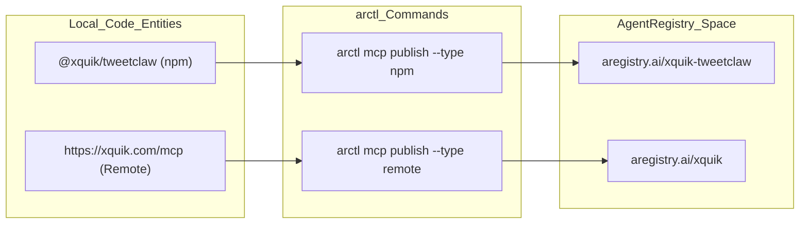

<!-- source: DeepWiki mcp.deepwiki.com · repo Xquik-dev/tweetclaw · page 5.2 Registry & Discoverability · fetched 2026-10-26 -->

# Registry & Discoverability

<details>
<summary>Relevant source files</summary>

The following files were used as context for generating this wiki page:

- [context7.json](context7.json)
- [docs/discoverability-audit.md](docs/discoverability-audit.md)
- [registry/agentregistry-steps.md](registry/agentregistry-steps.md)
- [tests/api-spec.test.ts](tests/api-spec.test.ts)

</details>


This page details the ecosystem registry strategy for TweetClaw, as tracked in the discoverability audit. It covers the various directories, marketplaces, and submission workflows used to ensure the plugin and MCP server are discoverable across the OpenClaw and Model Context Protocol (MCP) landscapes.

## Ecosystem Strategy Overview

The TweetClaw discoverability strategy focuses on high-value, relevant repositories and registries. The goal is to provide visibility for both the OpenClaw plugin (via `openclaw.plugin.json`) and the standalone MCP server interface.

### Discoverability Flow

The following diagram illustrates how TweetClaw metadata flows from the codebase to external registries and marketplaces.

**Registry Data Flow**
```mermaid
graph TD
    subgraph "Codebase_Source"
        [package.json] --> "Metadata_Sync"
        [openclaw.plugin.json] --> "Metadata_Sync"
        [server.json] --> "Metadata_Sync"
    end

    subgraph "Distribution_Channels"
        "Metadata_Sync" --> [NPM_Registry]
        "Metadata_Sync" --> [ClawHub_Marketplace]
        "Metadata_Sync" --> [Xquik_Hosted_MCP]
    end

    subgraph "External_Registries"
        [NPM_Registry] --> [Smithery_ai]
        [NPM_Registry] --> [AgentRegistry_arctl]
        [Xquik_Hosted_MCP] --> [PulseMCP]
        [Xquik_Hosted_MCP] --> [MCP_Directory]
        [ClawHub_Marketplace] --> [Awesome_Lists]
    end
```
**Sources:** [docs/discoverability-audit.md:1-16](), [registry/agentregistry-steps.md:1-6](), [context7.json:1-6]()

---

## Audited Registries & Awesome Lists

TweetClaw maintains a persistent audit of external repositories to avoid duplicate submissions and ensure high-quality listings.

| Registry / List | Status | Repository Path |
| :--- | :--- | :--- |
| **Awesome OpenClaw** | PR Open | `jensrot/awesome-openclaw` |
| **Awesome OpenClaw Plugins** | PR Open | `composio-community/awesome-openclaw-plugins` |
| **Awesome OpenClaw Plugins (Utility)** | **Listed** | `ThisIsJeron/awesome-openclaw-plugins` |
| **Awesome OpenClaw Tips** | PR Open | `alvinreal/awesome-openclaw-tips` |
| **AgentRegistry** | Active | `aregistry.ai` |

### Submission Rules
To maintain ecosystem health, the following rules are enforced for all external submissions:
1. **No Duplicates:** Check open/closed PRs for `tweetclaw`, `xquik`, or `x-twitter-scraper` before proposing [docs/discoverability-audit.md:8-10]().
2. **Contextual Value:** Only contribute if the target repo is relevant. For tip repos, provide tested artifacts like the `tools.alsoAllow` pattern [docs/discoverability-audit.md:135-141]().
3. **Style Adherence:** Entries must match the target repository's established style (e.g., alphabetical order, specific Markdown formatting) [docs/discoverability-audit.md:28-32]().

**Sources:** [docs/discoverability-audit.md:5-17](), [docs/discoverability-audit.md:64-83]()

---

## AgentRegistry (aregistry.ai) Submission

TweetClaw is registered on `aregistry.ai` using two primary vectors: the hosted StreamableHTTP endpoint and the `@xquik/tweetclaw` npm package.

### Submission Methods

The `arctl` CLI is used to manage these registrations.

**Code to Registry Mapping**


#### Option A: Remote MCP Server
The hosted endpoint provides immediate access without local installation.
*   **Command:** `arctl mcp publish xquik --type remote --url https://xquik.com/mcp --transport streamable-http` [registry/agentregistry-steps.md:21-31]().

#### Option B: NPM Package
Registering the npm package allows users to run the server locally via `npx`.
*   **Command:** `arctl mcp publish xquik-tweetclaw --type npm --package @xquik/tweetclaw` [registry/agentregistry-steps.md:33-43]().

**Sources:** [registry/agentregistry-steps.md:1-50]()

---

## ClawHub & Marketplace Strategy

As an OpenClaw plugin, TweetClaw utilizes the `ClawPack` workflow for distribution on the ClawHub marketplace.

### Discovery Metadata
The `openclaw.plugin.json` and `context7.json` files serve as the source of truth for marketplace crawlers:
*   **Capabilities:** The plugin defines 99 agent-callable endpoints across 9 categories [tests/api-spec.test.ts:38-41]().
*   **Safety Boundaries:** Explicit mentions of MPP (Multi-Party Protocol) read-only mode and write-approval gates are included in the metadata to build user trust [context7.json:6-28]().
*   **Tool Configuration:** The registry strategy promotes the use of `tools.alsoAllow` in OpenClaw configurations to ensure `explore` and `tweetclaw` tools can be added to existing personas without overriding default toolsets [docs/discoverability-audit.md:135-141]().

**Sources:** [context7.json:1-30](), [docs/discoverability-audit.md:135-144](), [tests/api-spec.test.ts:38-41]()

---

