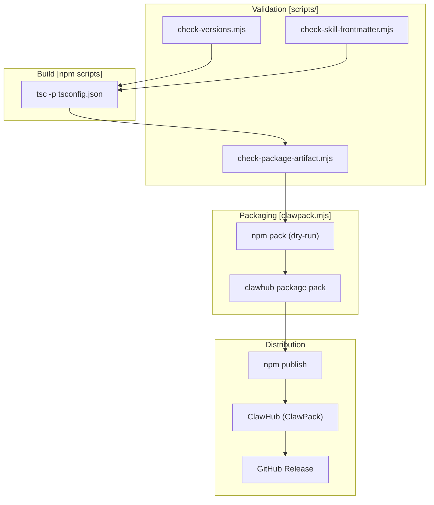

<!-- source: DeepWiki mcp.deepwiki.com · repo Xquik-dev/tweetclaw · page 6 Build, Release & CI/CD · fetched 2026-10-26 -->

# Build, Release & CI/CD

Relevant source files

The following files were used as context for generating this wiki page:

- [.github/workflows/publish.yml](.github/workflows/publish.yml)
- [docs/clawpack-release.md](docs/clawpack-release.md)
- [package.json](package.json)
- [scripts/clawpack.mjs](scripts/clawpack.mjs)

This page provides an overview of the TweetClaw build pipeline, the multi-stage release workflow involving npm and ClawHub, and the automated CI/CD processes hosted on GitHub Actions. The system is designed to ensure version consistency across multiple manifests and provide cryptographically verifiable artifacts for the OpenClaw ecosystem.

## Pipeline Overview

The TweetClaw release lifecycle moves from local development and validation to artifact generation, followed by publication to both the npm registry and the ClawHub marketplace.

### Build & Release Flow

**Sources:** [package.json:70-86](), [scripts/clawpack.mjs:1-90]()

## ClawPack Release Pipeline

TweetClaw is distributed as a **ClawPack**, a specialized `npm-pack` artifact format preferred by the OpenClaw gateway [docs/clawpack-release.md:3-4](). Unlike legacy ZIP distributions, ClawPacks include extensive metadata such as npm integrity strings, SHA256 digests, and source-commit references [docs/clawpack-release.md:43-45]().

The release is managed via `scripts/clawpack.mjs`, which orchestrates:
- **Dry-runs**: Validates the generated tarball and metadata without uploading [scripts/clawpack.mjs:85-87]().
- **ClawHub Integration**: Uses the `clawhub` CLI to package the repository as a `code-plugin` family artifact [scripts/clawpack.mjs:68-69]().
- **Security Scanning**: Triggers a fresh static analysis scan on ClawHub after publication to ensure the artifact is "clean" [docs/clawpack-release.md:32-33]().

For details, see [ClawPack Release Pipeline](#6.1).

**Sources:** [scripts/clawpack.mjs:64-83](), [docs/clawpack-release.md:1-9]()

## Pre-publish Validation Scripts

To prevent "version drift" and metadata errors, the codebase employs several strict validation scripts that run during the `prepack` and `prepublishOnly` lifecycle hooks [package.json:83-84]().

| Script | Purpose |
| :--- | :--- |
| `check-versions.mjs` | Ensures version strings match across `package.json`, `server.json`, `openclaw.plugin.json`, and `tsconfig.json`. |
| `check-skill-frontmatter.mjs` | Validates that the `SKILL.md` file contains the required metadata headers for the OpenClaw Skill system. |
| `check-package-artifact.mjs` | Performs a dry-run of `npm pack` and inspects the resulting tarball for missing files or incorrect structure. |

For details, see [Pre-publish Validation Scripts](#6.2).

**Sources:** [package.json:80-82](), [docs/clawpack-release.md:57-57]()

## GitHub Actions Workflows

Automated CI/CD is handled through GitHub Actions to ensure consistent environments for testing and distribution.

### Release Automation (`publish.yml`)
Triggered by version tags (e.g., `v1.6.16`), this workflow:
1. Verifies that the git tag matches the version in `package.json` [ .github/workflows/publish.yml:43-46]().
2. Checks if the version is already published to npm to prevent redundant attempts [ .github/workflows/publish.yml:58-63]().
3. Publishes to the npm registry with **provenance** [ .github/workflows/publish.yml:66-66]().
4. Automatically generates a GitHub Release with release notes [ .github/workflows/publish.yml:69-74]().

### Documentation Indexing (`context7-refresh.yml`)
A secondary workflow manages the automated indexing of documentation for Context7, ensuring that the AI-readable documentation remains in sync with source code changes.

For details, see [GitHub Actions Workflows](#6.3).

**Sources:** [ .github/workflows/publish.yml:1-74]()

## Release History & Auditing

The `docs/clawpack-release.md` file serves as a manual audit log for every production release. It tracks:
- **Release IDs**: Unique identifiers from ClawHub (e.g., `rd7dy2n8...`) [docs/clawpack-release.md:59-59]().
- **Integrity Hashes**: SHA256 and npm integrity strings for every published tarball [docs/clawpack-release.md:51-51]().
- **Scan Status**: Results of the static analysis scans (e.g., resolving false positives like `exposed_secret_literal`) [docs/clawpack-release.md:53-55]().

**Sources:** [docs/clawpack-release.md:47-60]()

---

