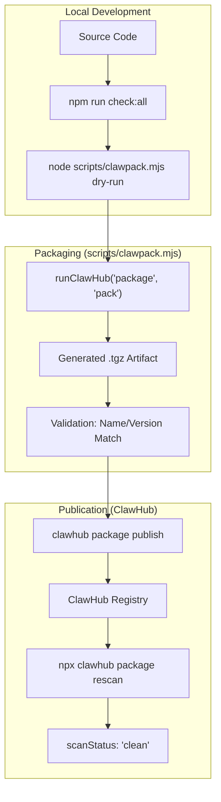
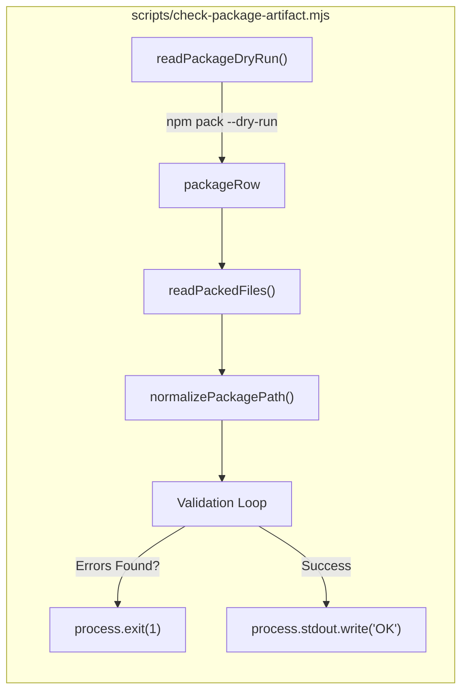

<!-- source: DeepWiki mcp.deepwiki.com · repo Xquik-dev/tweetclaw · page 6.1 ClawPack Release Pipeline · fetched 2026-10-26 -->

# ClawPack Release Pipeline

Relevant source files

The following files were used as context for generating this wiki page:

- [docs/clawpack-release.md](docs/clawpack-release.md)
- [scripts/check-package-artifact.mjs](scripts/check-package-artifact.mjs)
- [scripts/clawpack.mjs](scripts/clawpack.mjs)

The ClawPack Release Pipeline manages the lifecycle of TweetClaw as a native OpenClaw code plugin. It automates the creation of `npm-pack` artifacts, validates package contents, and facilitates publication to the ClawHub marketplace while ensuring strict metadata integrity and security scanning [docs/clawpack-release.md:1-9]().

## Pipeline Overview

TweetClaw is distributed as a **ClawPack**, which is a specialized `npm-pack` tarball artifact rather than a legacy ZIP folder [docs/clawpack-release.md:3-3](). This format allows OpenClaw to verify the package using npm integrity hashes and SHA256 digests [docs/clawpack-release.md:3-3]().

The pipeline is primarily driven by `scripts/clawpack.mjs`, which orchestrates the `clawhub` CLI to pack and publish the plugin [scripts/clawpack.mjs:1-12]().

### Release Lifecycle Flow

The following diagram illustrates the transition from source code to a verified ClawHub release.

**ClawPack Release Process**

Sources: [docs/clawpack-release.md:11-33](), [scripts/clawpack.mjs:31-52](), [scripts/clawpack.mjs:64-83]()

## Implementation Detail: scripts/clawpack.mjs

The `clawpack.mjs` script acts as a wrapper around the `clawhub` CLI (version `0.12.2`) [scripts/clawpack.mjs:9-9](). It manages environment-specific variables like the source repository, git commit hash, and owner handle [scripts/clawpack.mjs:15-21]().

### Key Functions

*   **`runClawHub(args, options)`**: A utility that executes `npx clawhub@0.12.2` with the provided arguments [scripts/clawpack.mjs:23-29]().
*   **`packClawPack()`**: Executes the `package pack` command. It validates that the resulting JSON metadata matches the local `package.json` name and version [scripts/clawpack.mjs:31-52]().
*   **Command Handling**: Supports three modes: `dry-run`, `pack`, and `publish` [scripts/clawpack.mjs:54-57]().

### Metadata Injection

During the `publish` phase, the script injects critical provenance metadata into the ClawHub release:
*   `--family code-plugin`: Identifies TweetClaw as a native code plugin [scripts/clawpack.mjs:68-69]().
*   `--source-commit`: The current Git HEAD SHA [scripts/clawpack.mjs:74-75]().
*   `--source-repo`: Defaults to `Xquik-dev/tweetclaw` [scripts/clawpack.mjs:72-73]().

Sources: [scripts/clawpack.mjs:9-21](), [scripts/clawpack.mjs:31-52](), [scripts/clawpack.mjs:64-83]()

## Artifact Validation

Before publication, the pipeline performs rigorous checks on the artifact contents via `scripts/check-package-artifact.mjs` [scripts/check-package-artifact.mjs:1-11](). This ensures that the generated tarball contains all necessary runtime files while excluding sensitive or unnecessary data.

### Validation Logic

| Check Type | Code Entity / Criteria | File Reference |
| :--- | :--- | :--- |
| **Required Files** | `LICENSE`, `README.md`, `openclaw.plugin.json`, `package.json` | [scripts/check-package-artifact.mjs:68-72]() |
| **Extensions** | Must match `openclaw.extensions` and `openclaw.runtimeExtensions` | [scripts/check-package-artifact.mjs:65-66]() |
| **Skills** | Must include all `SKILL.md` files listed in the manifest | [scripts/check-package-artifact.mjs:57-60]() |
| **Forbidden Files** | `.env`, `.github/`, `tests/`, `node_modules/`, `src/tools/executor.ts` | [scripts/check-package-artifact.mjs:77-89]() |

**Artifact Check Data Flow**

Sources: [scripts/check-package-artifact.mjs:16-31](), [scripts/check-package-artifact.mjs:62-90](), [scripts/check-package-artifact.mjs:112-132]()

## Release History and Security Scanning

TweetClaw maintains a detailed release history in `docs/clawpack-release.md`. This log tracks the transition from legacy ZIP formats to modern ClawPacks and records the results of ClawHub's automated security scans [docs/clawpack-release.md:47-59]().

### Scan Status Lifecycle

ClawHub performs static analysis on every published artifact. The pipeline uses the following commands to monitor and request rescans:
1.  **Inspect**: `npx clawhub package inspect @xquik/tweetclaw --json` [docs/clawpack-release.md:31-31]().
2.  **Rescan**: `npx clawhub package rescan @xquik/tweetclaw --yes --json` [docs/clawpack-release.md:32-32]().

### Recent Release Metadata Example

The following table summarizes the metadata recorded for a typical release (`1.6.16`):

| Metadata Field | Value (Example: 1.6.16) |
| :--- | :--- |
| **Artifact Kind** | `npm-pack` |
| **SHA256** | `19951648c36bae7b9b1a0dc1f8092f46ffb7867d1809b87ed84aa8b6cc72dd25` |
| **NPM Integrity** | `sha512-ihMPIiAx2p9r1g0E1XVKRtsY69i2oBIssCxM1ny5pPnAFx7vn3LN71f280QbpI797r6Gi0lrPiwEcSXvIYpj5g==` |
| **Scan Status** | `clean` (Engine v2.4.22) |
| **Source Commit** | `44102cab7efde1ef6dd82d8386742d75d4087057` |

Sources: [docs/clawpack-release.md:7-7](), [docs/clawpack-release.md:59-59]()

## Usage Instructions

To execute a full release, the following sequence is followed:

1.  **Validate**: Run `npm run check:all` and `node scripts/clawpack.mjs dry-run` [docs/clawpack-release.md:16-17]().
2.  **Authenticate**: Log in to ClawHub using a token (stored in `CLAWHUB_TOKEN`) [docs/clawpack-release.md:23-23]().
3.  **Publish**: Run `node scripts/clawpack.mjs publish` [docs/clawpack-release.md:30-30]().
4.  **Verify**: Inspect the package on ClawHub and trigger a manual rescan to ensure `scanStatus: "clean"` [docs/clawpack-release.md:31-32]().

Sources: [docs/clawpack-release.md:11-33]()

---

