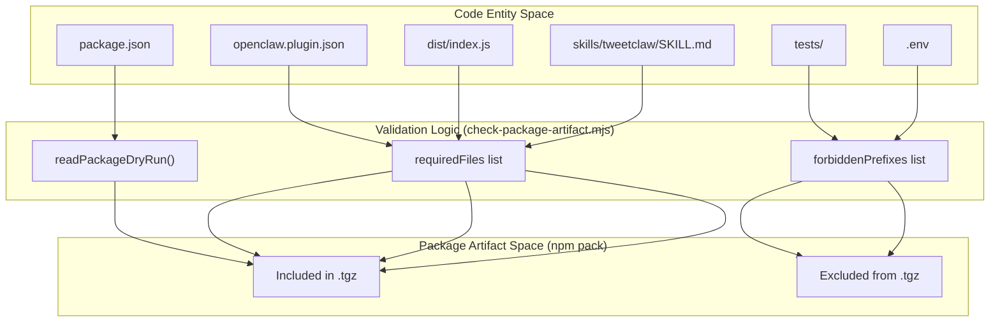
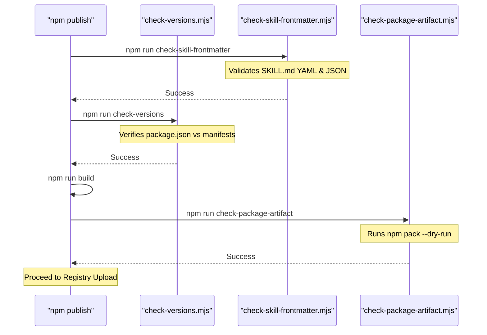

<!-- source: DeepWiki mcp.deepwiki.com · repo Xquik-dev/tweetclaw · page 6.2 Pre-publish Validation Scripts · fetched 2026-10-26 -->

# Pre-publish Validation Scripts

Relevant source files

The following files were used as context for generating this wiki page:

- [scripts/check-package-artifact.mjs](scripts/check-package-artifact.mjs)
- [scripts/check-skill-frontmatter.mjs](scripts/check-skill-frontmatter.mjs)
- [scripts/check-versions.mjs](scripts/check-versions.mjs)

The TweetClaw repository utilizes a suite of Node.js validation scripts to ensure consistency across multiple configuration files, validate skill metadata for the OpenClaw ecosystem, and verify the integrity of the npm package artifact before release. These scripts act as a quality gate in the `prepack` and `prepublishOnly` lifecycle hooks.

### Purpose and Scope
These scripts prevent "version drift" (where `package.json` versioning disagrees with plugin manifests), ensure that the `SKILL.md` files required by OpenClaw contain valid frontmatter, and perform dry-runs of the npm packaging process to ensure no sensitive files (like `.env` or tests) are accidentally included in the published artifact.

---

## 1. Version Drift Detection (`check-versions.mjs`)

The `scripts/check-versions.mjs` script is a pre-publish guard designed to ensure that the version string defined in `package.json` is synchronized across all public-facing manifests and that the TypeScript configuration adheres to strict project standards.

### Implementation Details
The script reads the `package.json` version as the "source of truth" [scripts/check-versions.mjs:11-12]() and compares it against:
*   **Manifests**: `server.json` and `openclaw.plugin.json` [scripts/check-versions.mjs:14-17]().
*   **OpenClaw Metadata**: Validates `peerDependencies.openclaw`, `openclaw.compat.pluginApi`, and `openclaw.install.npmSpec` to ensure they match the current version and build requirements [scripts/check-versions.mjs:28-63]().
*   **TypeScript Strictness**: Enforces a specific set of `compilerOptions` (e.g., `strict: true`, `verbatimModuleSyntax: true`, `noUncheckedIndexedAccess: true`) across both `tsconfig.json` and `tsconfig.eslint.json` [scripts/check-versions.mjs:91-114]().
*   **Content Consistency**: Performs string-level checks on `README.md` and `SKILL.md` to ensure documentation regarding endpoint counts (99) and credit pricing ($0.00015/credit) is not stale [scripts/check-versions.mjs:116-167]().

### Version Validation Logic
| Entity | Logic / Expected Value |
| :--- | :--- |
| `server.json` | Must match `package.json` version [scripts/check-versions.mjs:15](). |
| `openclaw.plugin.json` | Must match `package.json` version [scripts/check-versions.mjs:16](). |
| `peerDependencies.openclaw` | Must be `>=` the build version [scripts/check-versions.mjs:33-37](). |
| `npmSpec` | Must be `${name}@${version}` [scripts/check-versions.mjs:53-58](). |
| `runtimeExtensions` | Must contain exactly `["./dist/index.js"]` [scripts/check-versions.mjs:64-68](). |

**Sources:** [scripts/check-versions.mjs:1-177]()

---

## 2. Skill Frontmatter Validation (`check-skill-frontmatter.mjs`)

OpenClaw skills require a `SKILL.md` file with specific YAML-like frontmatter. This script validates that all skills listed in the `openclaw.plugin.json` manifest exist and contain the required metadata fields in a valid format.

### Key Functions
*   **`resolveSkillFile(skillEntry)`**: Converts a skill path from the manifest into an absolute path to a `SKILL.md` file [scripts/check-skill-frontmatter.mjs:23-36]().
*   **`parseFrontmatter(filePath)`**: Extracts the content between `---` delimiters and parses `key: value` pairs [scripts/check-skill-frontmatter.mjs:38-85]().
*   **`validateMetadata(filePath, fields)`**: Specifically validates the `metadata` key, which must be a valid, single-line JSON object [scripts/check-skill-frontmatter.mjs:98-114]().

### Required Frontmatter Fields
The script enforces the presence of the following keys for every skill:
1.  `name` [scripts/check-skill-frontmatter.mjs:134]()
2.  `description` [scripts/check-skill-frontmatter.mjs:134]()
3.  `homepage` [scripts/check-skill-frontmatter.mjs:134]()
4.  `license` [scripts/check-skill-frontmatter.mjs:134]()
5.  `metadata` (JSON) [scripts/check-skill-frontmatter.mjs:137]()

**Sources:** [scripts/check-skill-frontmatter.mjs:1-146]()

---

## 3. Package Artifact Verification (`check-package-artifact.mjs`)

This script performs a dry-run of the `npm pack` command to inspect the actual file list that would be uploaded to the registry. It ensures that required files are present and forbidden files (tests, source maps, secrets) are excluded.

### Data Flow: npm pack to Validation
The script executes `npm pack --dry-run --json` to get a structured list of files [scripts/check-package-artifact.mjs:17-31]().

**Artifact Content Validation**
"Code Entity Space" mapping to "Package Artifact Space":

*Sources: [scripts/check-package-artifact.mjs:62-89]()*

### Implementation Constraints
*   **Strict Matching**: The number of `openclaw.extensions` (source) must match the number of `openclaw.runtimeExtensions` (built) [scripts/check-package-artifact.mjs:101-103]().
*   **Path Normalization**: Uses `normalizePackagePath` to handle cross-platform slash differences and the `package/` prefix added by npm [scripts/check-package-artifact.mjs:12-14]().
*   **Forbidden Patterns**: Explicitly blocks `.github/`, `tests/`, `node_modules/`, and specific sensitive files like `src/tools/executor.ts` [scripts/check-package-artifact.mjs:77-89]().

**Sources:** [scripts/check-package-artifact.mjs:1-139]()

---

## 4. Integration in Build Lifecycle

The validation scripts are integrated into the standard `npm` lifecycle via `package.json` scripts. This ensures that no developer can publish or pack the plugin without passing all checks.

### Validation Sequence
The following diagram illustrates the execution order during a `prepublishOnly` event:

### Script Definitions
The `check-versions.mjs` script itself enforces that these lifecycle hooks are correctly defined in `package.json` [scripts/check-versions.mjs:72-89]():
*   `prepack`: `npm run build && npm run check-skill-frontmatter && npm run check-versions` [scripts/check-versions.mjs:75-77]().
*   `prepublishOnly`: `npm run check-skill-frontmatter && npm run check-versions && npm run build && npm run check-package-artifact` [scripts/check-versions.mjs:81-83]().

**Sources:** [scripts/check-versions.mjs:72-89](), [scripts/check-package-artifact.mjs:1-139]()

---

