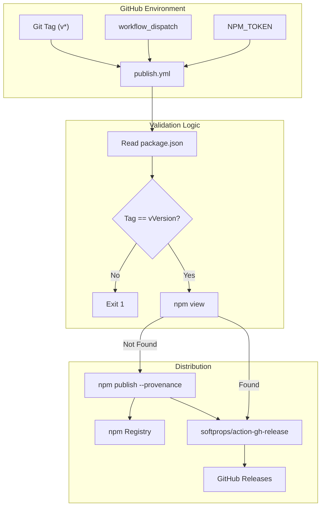
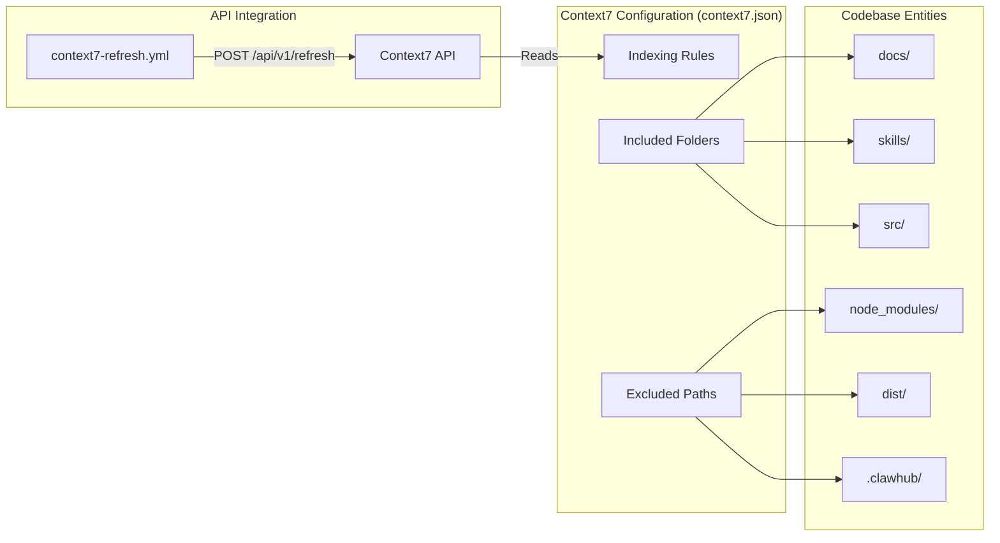

<!-- source: DeepWiki mcp.deepwiki.com · repo Xquik-dev/tweetclaw · page 6.3 GitHub Actions Workflows · fetched 2026-10-26 -->

# GitHub Actions Workflows

Relevant source files

The following files were used as context for generating this wiki page:

- [.github/workflows/context7-refresh.yml](.github/workflows/context7-refresh.yml)
- [.github/workflows/publish.yml](.github/workflows/publish.yml)
- [context7.json](context7.json)

This page details the automation infrastructure for TweetClaw using GitHub Actions. The codebase utilizes two primary workflows to manage the lifecycle of the project: one for distributing the package to the npm registry and creating GitHub Releases, and another for maintaining up-to-date AI-readable documentation via the Context7 service.

## npm Publish & GitHub Release

The `publish.yml` workflow automates the distribution of TweetClaw. It is triggered primarily by the creation of version tags (e.g., `v1.6.2`) or manually via `workflow_dispatch` [.github/workflows/publish.yml:3-13]().

### Release Logic and Validation

The workflow performs several safety checks before pushing artifacts:
1.  **Metadata Verification**: It extracts the `name` and `version` from `package.json` and ensures the git tag matches the version string (prefixed with `v`) [.github/workflows/publish.yml:33-46]().
2.  **Registry Idempotency**: It queries the npm registry to check if the specific version is already published. If it exists, the npm publish step is skipped to prevent workflow failure [.github/workflows/publish.yml:56-63]().
3.  **Secure Publication**: If the version is new, it executes `npm publish --provenance`, which links the npm package to the specific GitHub Actions run for enhanced supply chain security [.github/workflows/publish.yml:64-68]().
4.  **GitHub Release**: Finally, it creates a formal GitHub Release, automatically generating release notes based on commit history [.github/workflows/publish.yml:69-74]().

### Release Data Flow

The following diagram illustrates the flow from a git tag push to the final distribution points.

**Title: Release Automation Flow**

**Sources:** [.github/workflows/publish.yml:1-74]()

## Context7 Documentation Refresh

The `context7-refresh.yml` workflow ensures that the AI-optimized documentation index provided by Context7 remains synchronized with the source code. It targets the library `/xquik-dev/tweetclaw` [.github/workflows/context7-refresh.yml:39]().

### Trigger Conditions
The refresh is triggered on every push to the `master` branch, but only when changes occur in specific paths that affect the plugin's behavior or documentation [.github/workflows/context7-refresh.yml:3-15]():
*   `src/**`: Core logic changes.
*   `docs/**` & `skills/**`: Documentation and AI skill definition updates.
*   `README.md` & `context7.json`: Project metadata and indexing rules.
*   `package.json` & `openclaw.plugin.json`: Versioning and plugin manifest updates.

### Implementation Details
The workflow interacts with the Context7 API via a `POST` request to `https://context7.com/api/v1/refresh` [.github/workflows/context7-refresh.yml:36](). It handles various HTTP response codes to provide meaningful feedback in the GitHub Actions log:

| Status Code | Action / Meaning |
| :--- | :--- |
| `200` / `202` | **Success**: The refresh task has been accepted or completed [.github/workflows/context7-refresh.yml:42-44](). |
| `400` | **Warning**: Usually indicates a task is already in progress or the update frequency limit has been reached [.github/workflows/context7-refresh.yml:45-57](). |
| `404` | **Warning**: The library is not yet known to Context7 [.github/workflows/context7-refresh.yml:58-61](). |
| `401` / `403` | **Error**: Authentication failure using the `CONTEXT7_API_KEY` secret [.github/workflows/context7-refresh.yml:62-65](). |

### Context7 Configuration Mapping

The indexing behavior is governed by `context7.json`, which defines the scope of the documentation library.

**Title: Documentation Indexing Scope**

**Sources:** [.github/workflows/context7-refresh.yml:1-72](), [context7.json:1-37]()

## Workflow Secrets and Permissions

The workflows require specific permissions and secrets to interact with external registries and APIs.

| Workflow | Permission / Secret | Purpose |
| :--- | :--- | :--- |
| `publish.yml` | `contents: write` | To create GitHub Releases and upload artifacts [.github/workflows/publish.yml:18](). |
| `publish.yml` | `id-token: write` | Required for npm provenance (OIDC) [.github/workflows/publish.yml:19](). |
| `publish.yml` | `NPM_TOKEN` | Authentication for the npm registry [.github/workflows/publish.yml:68](). |
| `context7-refresh.yml` | `CONTEXT7_API_KEY` | Authentication for the Context7 refresh endpoint [.github/workflows/context7-refresh.yml:25](). |

**Sources:** [.github/workflows/publish.yml:17-20](), [.github/workflows/context7-refresh.yml:24-25]()

---

