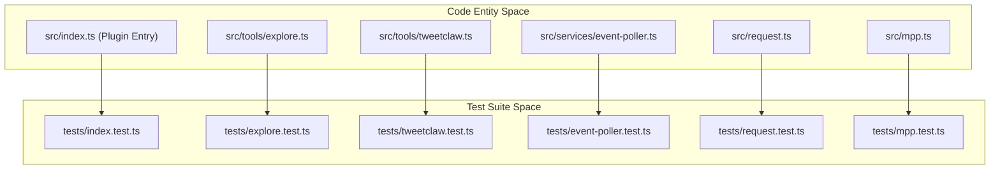
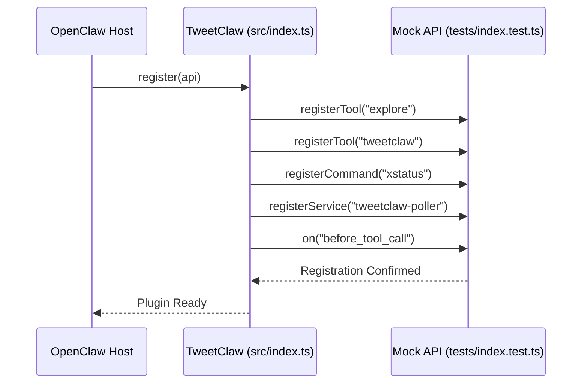

<!-- source: DeepWiki mcp.deepwiki.com · repo Xquik-dev/tweetclaw · page 7 Testing · fetched 2026-10-26 -->

# Testing

Relevant source files

The following files were used as context for generating this wiki page:

- [src/mpp.ts](src/mpp.ts)
- [src/types.ts](src/types.ts)
- [tests/index.test.ts](tests/index.test.ts)
- [vitest.config.ts](vitest.config.ts)

TweetClaw employs a rigorous testing strategy powered by **Vitest** to ensure the reliability of its Xquik API integrations and OpenClaw plugin lifecycle. The test suite is designed with a "100% coverage" philosophy for core logic, utilizing extensive mocking to simulate both the Xquik backend and the OpenClaw host environment.

## Testing Infrastructure

The testing environment is configured to enforce high code quality standards through strict coverage thresholds and strategic aliasing.

### Tooling & Configuration
TweetClaw uses **Vitest** as its primary test runner and coverage provider. The configuration in `vitest.config.ts` sets a 100% threshold for branches, functions, lines, and statements [vitest.config.ts:13-18](). To facilitate testing of the plugin entry point without a live OpenClaw environment, the configuration uses a resolve alias to redirect the SDK entry point to a local mock [vitest.config.ts:4-8]().

### Mocking Strategy
The test suite relies on several mocking patterns:
*   **API Mocking**: Functions like `createMockApi` simulate the OpenClaw plugin registry, capturing registered tools, commands, and hooks for assertion [tests/index.test.ts:64-113]().
*   **Module Mocking**: Dynamic module loading for optional dependencies (like `mppx` and `viem`) is tested using custom `ModuleLoader` mocks to verify error handling when packages are missing [src/mpp.ts:23-39]().
*   **Timer Mocking**: `vi.useFakeTimers()` is used to test time-sensitive logic like the event poller and request timeouts [tests/index.test.ts:115-121]().

**Sources:** [vitest.config.ts:1-22](), [tests/index.test.ts:1-121](), [src/mpp.ts:1-41]()

## Test Hierarchy

The test suite is divided into two primary categories: Unit Tests for isolated logic and Integration Tests for system-wide plugin behavior.

### System Mapping: Logic to Tests

The following diagram illustrates how core system components are mapped to their corresponding test files.

**Code Entity to Test Suite Mapping**

**Sources:** [tests/index.test.ts:3-7](), [src/mpp.ts:41](), [vitest.config.ts:10-12]()

### Unit Tests: Tools & Core Logic
These tests focus on the internal mechanics of individual tools and utility functions. They verify that the `explore` tool correctly filters the API catalog and that the `tweetclaw` tool properly formats requests and handles response timeouts.

*   **Key Areas**: Catalog filtering logic, request parameter validation, and MPP (Massively Parallel Processing) initialization checks.
*   **Details**: For a deep dive into tool-specific assertions and mock patterns, see [Unit Tests: Tools & Core Logic](#7.1).

### Integration Tests: Plugin Registration & Commands
Integration tests verify the "handshake" between TweetClaw and the OpenClaw host. This includes verifying that all tools and slash commands are correctly registered during the `register()` lifecycle [tests/index.test.ts:123-185]().

*   **Key Areas**: Manifest consistency, write-action approval hooks [tests/index.test.ts:187-212](), and command execution (e.g., `/xstatus`).
*   **Details**: For details on how the full plugin lifecycle is validated, see [Integration Tests: Plugin Registration & Commands](#7.2).

**Sources:** [tests/index.test.ts:123-212](), [src/types.ts:49-52]()

## Coverage Areas

The test suite is structured to ensure that every critical path in the plugin is exercised.

| Coverage Area | Code Entities Involved | Primary Test File |
| :--- | :--- | :--- |
| **Plugin Lifecycle** | `register()`, `configSchema` | `tests/index.test.ts` |
| **Tool Execution** | `handleExplore()`, `handleTweetclaw()` | `tests/explore.test.ts`, `tests/tweetclaw.test.ts` |
| **Security/Safety** | `PROHIBITED_PATHS`, `ApprovalHook` | `tests/request.test.ts`, `tests/index.test.ts` |
| **Background Services** | `createEventPoller()` | `tests/event-poller.test.ts` |
| **MPP Auth** | `initMpp()`, `tempo()` | `tests/mpp.test.ts` |

**Plugin Registration Flow**

**Sources:** [tests/index.test.ts:138-185](), [src/types.ts:54-60]()

---

