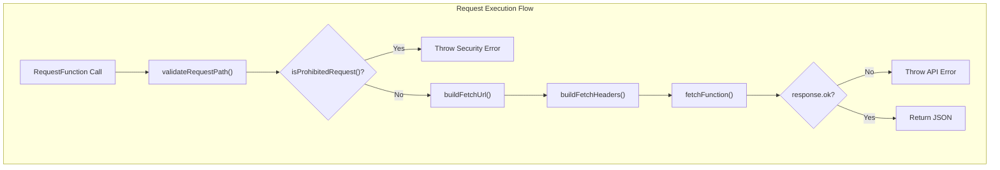
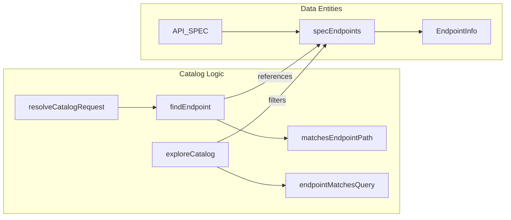

<!-- source: DeepWiki mcp.deepwiki.com · repo Xquik-dev/tweetclaw · page 7.1 Unit Tests: Tools & Core Logic · fetched 2026-10-26 -->

# Unit Tests: Tools & Core Logic

Relevant source files

The following files were used as context for generating this wiki page:

- [src/mpp.ts](src/mpp.ts)
- [src/request.ts](src/request.ts)
- [src/tools/catalog.ts](src/tools/catalog.ts)
- [src/types.ts](src/types.ts)
- [tests/catalog.test.ts](tests/catalog.test.ts)
- [tests/explore.test.ts](tests/explore.test.ts)
- [tests/index.test.ts](tests/index.test.ts)
- [tests/mpp.test.ts](tests/mpp.test.ts)
- [tests/request.test.ts](tests/request.test.ts)
- [tests/truncate.test.ts](tests/truncate.test.ts)

This page details the unit testing strategy for TweetClaw's core logic, including request handling, catalog management, MPP initialization, and tool execution. The test suite is built using **Vitest** and focuses on isolating business logic from external dependencies through comprehensive mocking.

## Overview of Unit Test Coverage

The unit tests ensure that the foundational components of TweetClaw behave correctly across various credential states and input scenarios.

| Test File | Target Component | Key Focus Areas |
| :--- | :--- | :--- |
| `tests/request.test.ts` | `src/request.ts` | Auth header construction, URL building, and prohibited path enforcement. |
| `tests/catalog.test.ts` | `src/tools/catalog.ts` | Path matching logic, catalog filtering, and request normalization. |
| `tests/mpp.test.ts` | `src/mpp.ts` | Dynamic module loading and MPP/Tempo initialization. |
| `tests/explore.test.ts` | `src/tools/explore.ts` | Search and discovery logic for the `explore` tool. |
| `tests/truncate.test.ts` | `src/truncate.ts` | Response size management and token estimation logic. |

Sources: [tests/request.test.ts:1-174](), [tests/catalog.test.ts:1-121](), [tests/mpp.test.ts:1-134](), [tests/explore.test.ts:1-53](), [tests/truncate.test.ts:1-59]()

## Request & Security Logic (`request.test.ts`)

The request tests verify the `createProxiedRequest` factory and its helper functions. These tests ensure that credentials are correctly mapped to HTTP headers and that security boundaries are enforced at the request level.

### Authentication Mapping
The `buildAuthHeader` function is tested to ensure it distinguishes between Xquik API keys (prefix `xq_`) and other bearer tokens.
*   **Xquik Keys**: Mapped to the `x-api-key` header [tests/request.test.ts:5-8]().
*   **Standard Tokens**: Mapped to the `Authorization: Bearer` header [tests/request.test.ts:10-13]().

### Prohibited Path Enforcement
A critical security feature is the blocking of "Agent-Prohibited" endpoints. The tests confirm that `createProxiedRequest` throws an error if an agent attempts to access sensitive account management or billing routes [tests/request.test.ts:121-174]().

**Request Execution Flow**
"This diagram illustrates how `createProxiedRequest` processes a call and enforces security."

Sources: [src/request.ts:87-110](), [tests/request.test.ts:97-109](), [tests/request.test.ts:121-127]()

## Catalog & Matching Logic (`catalog.test.ts`)

The catalog tests verify how TweetClaw identifies API endpoints from concrete URLs and how it filters the 99+ available endpoints for the agent.

### Path Matching
The `matchesEndpointPath` function uses segment-based matching to correlate dynamic paths (e.g., `/api/v1/x/tweets/:id`) with actual requests [tests/catalog.test.ts:13-18]().

### Request Normalization
`resolveCatalogRequest` is tested for its ability to:
1.  Reject paths not in the `API_SPEC` [tests/catalog.test.ts:38-41]().
2.  Block non-MPP endpoints when the plugin is in `mppMode` [tests/catalog.test.ts:48-51]().
3.  Normalize query parameters (e.g., converting booleans/numbers to strings) [tests/catalog.test.ts:53-60]().

**Catalog Entity Mapping**
"Associating catalog logic with the underlying specification entities."

Sources: [src/tools/catalog.ts:8-51](), [src/tools/catalog.ts:120-135](), [tests/catalog.test.ts:2-9]()

## MPP Initialization & Mocking (`mpp.test.ts`)

Since `mppx` and `viem` are optional peer dependencies, `initMpp` uses dynamic imports. The tests use a custom `ModuleLoader` mock to simulate the presence or absence of these packages.

*   **Dependency Checks**: Tests verify that `initMpp` throws specific errors if `mppx` or `viem` are missing [tests/mpp.test.ts:65-77]().
*   **Initialization Flow**: Verifies that `viem`'s `privateKeyToAccount` is called before `mppx`'s `tempo` and `Mppx.create` [tests/mpp.test.ts:79-92]().

Sources: [src/mpp.ts:23-39](), [tests/mpp.test.ts:56-62]()

## Response Truncation (`truncate.test.ts`)

To prevent context window overflow in LLMs, `truncateResponse` manages the size of API outputs.
*   **Thresholds**: The logic targets a limit of approximately 6,000 tokens (roughly 24,000 characters) [tests/truncate.test.ts:11-15]().
*   **Notice Injection**: When truncation occurs, the system injects a visible `--- TRUNCATED ---` warning into the text so the agent is aware of the missing data [tests/truncate.test.ts:17-24]().

Sources: [src/truncate.ts:2-25](), [tests/truncate.test.ts:4-32]()

## Core Logic Integration (`index.test.ts`)

While categorized as a unit test, `index.test.ts` serves as a "logic integration" test. It uses `createMockApi` to simulate the OpenClaw environment and verifies the `register()` lifecycle.

### Key Assertions
*   **Credential Resolution**: Ensures that the plugin provides configuration guidance if no keys are present [tests/index.test.ts:136-150]().
*   **Write Approval Hook**: Verifies that the `before_tool_call` hook correctly identifies write actions (like `POST /api/v1/x/tweets`) and requests manual approval from the user [tests/index.test.ts:187-211]().
*   **Tool Registration**: Confirms that both `explore` and `tweetclaw` tools are registered with the host [tests/index.test.ts:152-159]().

Sources: [src/index.ts:106-163](), [tests/index.test.ts:64-113](), [tests/index.test.ts:187-211]()

---

