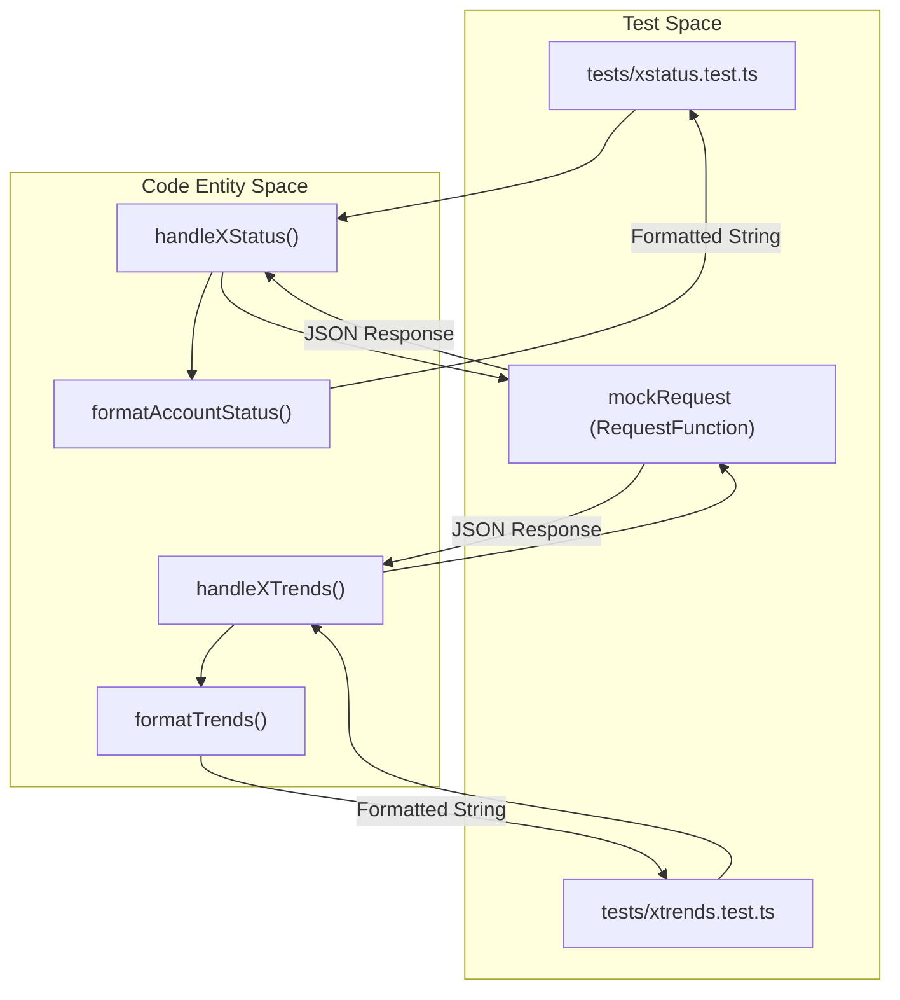
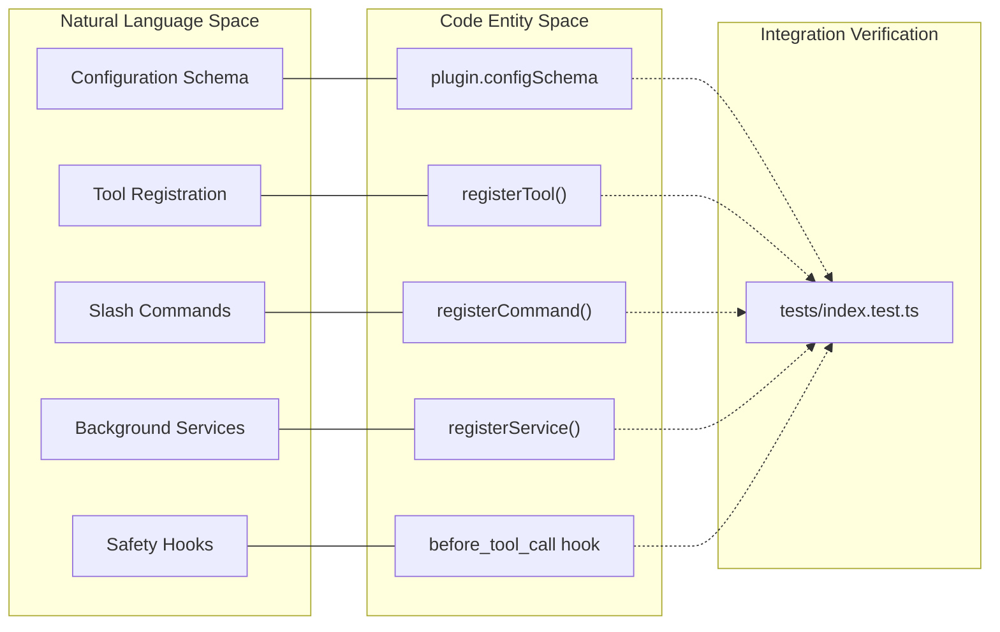

<!-- source: DeepWiki mcp.deepwiki.com · repo Xquik-dev/tweetclaw · page 7.2 Integration Tests: Plugin Registration & Commands · fetched 2026-10-26 -->

# Integration Tests: Plugin Registration & Commands

Relevant source files

The following files were used as context for generating this wiki page:

- [registry/agentregistry-steps.md](registry/agentregistry-steps.md)
- [src/mpp.ts](src/mpp.ts)
- [src/types.ts](src/types.ts)
- [tests/api-spec.test.ts](tests/api-spec.test.ts)
- [tests/event-poller.test.ts](tests/event-poller.test.ts)
- [tests/index.test.ts](tests/index.test.ts)
- [tests/openclaw-plugin-entry.ts](tests/openclaw-plugin-entry.ts)
- [tests/xstatus.test.ts](tests/xstatus.test.ts)
- [tests/xtrends.test.ts](tests/xtrends.test.ts)

This page details the integration testing suite for TweetClaw, focusing on the plugin lifecycle, command execution, service management, and API specification integrity. These tests verify the interaction between TweetClaw and the OpenClaw SDK, ensuring that tools and services are registered correctly and behave as expected under various configurations.

## Plugin Registration & Lifecycle

The core of the integration suite is `tests/index.test.ts`, which validates the `register` function exported by the plugin entry point. It uses a mock OpenClaw API to capture registered tools, commands, and services.

### Mocking the OpenClaw API
To simulate the OpenClaw environment, the test suite implements `createMockApi`, which provides a structure matching the `OpenClawApi` interface expected by `register()` [tests/index.test.ts:64-113]().

### Registration Scenarios
The suite covers several critical configuration states:
*   **Missing Credentials**: Verifies that the plugin still loads but issues a warning and returns an error message when tools are executed without an API key or signing key [tests/index.test.ts:136-150]().
*   **Valid API Key**: Confirms that both `explore` and `tweetclaw` tools are registered when an `apiKey` is provided [tests/index.test.ts:152-159]().
*   **Command Registration**: Ensures `/xstatus` and `/xtrends` slash commands are registered with the host [tests/index.test.ts:170-177]().
*   **Service Registration**: Validates that the `tweetclaw-poller` service is initialized by default [tests/index.test.ts:179-185]().

### Write-Action Approval Hook
A key security feature tested is the `before_tool_call` hook. The test verifies that:
1.  The hook is registered during plugin initialization [tests/index.test.ts:213]().
2.  `POST` requests to write-sensitive paths (e.g., `/api/v1/x/tweets`) trigger a `requireApproval` response [tests/index.test.ts:192-199]().
3.  Read-only requests (e.g., `/api/v1/account`) do not trigger approval gates [tests/index.test.ts:200-203]().

**Sources:** [tests/index.test.ts:7-213](), [src/index.ts:1-255]()

---

## Slash Commands: /xstatus & /xtrends

The slash commands provide direct user access to Xquik data without LLM intervention. Integration tests for these commands focus on data fetching and string formatting.

### Account Status (/xstatus)
The `handleXStatus` test ensures the command:
1.  Calls the correct endpoint: `/api/v1/account` [tests/xstatus.test.ts:40-42]().
2.  Formats complex objects, including subscription status and usage percentages, into a human-readable string [tests/xstatus.test.ts:5-20]().
3.  Handles missing fields or inactive subscriptions gracefully [tests/xstatus.test.ts:22-35]().

### Trending Topics (/xtrends)
The `handleXTrends` test validates:
1.  Target endpoint: `/api/v1/radar` [tests/xtrends.test.ts:30-32]().
2.  Parameter passing: Ensures the optional `category` argument is correctly sent as a query parameter [tests/xtrends.test.ts:38-46]().
3.  Output formatting: Verifies that trend titles, scores, and URLs are correctly indexed and displayed [tests/xtrends.test.ts:6-18]().

**Sources:** [tests/xstatus.test.ts:1-62](), [tests/xtrends.test.ts:1-72]()

---

## Event Poller Service

The `tests/event-poller.test.ts` file tests the background service responsible for monitoring X events.

### Polling Logic & Backoff
*   **Interval Execution**: Verifies that the poller triggers requests at the specified `intervalSeconds` [tests/event-poller.test.ts:27-45]().
*   **Cursor Management**: Confirms that the poller extracts the `id` from the last received event and uses it as the `after` query parameter in subsequent requests to prevent duplicate processing [tests/event-poller.test.ts:47-64]().
*   **Resilience**: Validates that the poller continues to function after network errors by implementing a retry loop [tests/event-poller.test.ts:66-85]().

### Clean Shutdown
The suite ensures that calling `stop()` on the poller prevents further network requests and handles cases where a stop is requested during an active HTTP call [tests/event-poller.test.ts:141-181]().

**Sources:** [tests/event-poller.test.ts:1-182](), [src/services/event-poller.ts:1-100]()

---

## API Specification Integrity

The `tests/api-spec.test.ts` file acts as a linting and validation layer for the `API_SPEC` constant, ensuring it remains compatible with the Xquik backend.

### Structural Validation
*   **Uniqueness**: Ensures no two entries share the same method and path [tests/api-spec.test.ts:5-10]().
*   **Pathing**: Validates that every path follows the `/api/v1/` prefix convention [tests/api-spec.test.ts:25-29]().
*   **MPP Alignment**: Checks that exactly 32 endpoints are marked for MPP (Micropayment) support, matching the pay-per-use route list [tests/api-spec.test.ts:63-75]().

### Parameter Schema
The tests iterate through all parameters in the spec to ensure they define `name`, `description`, `required`, `type`, and a valid `in` location (`body`, `path`, or `query`) [tests/api-spec.test.ts:83-95]().

**Sources:** [tests/api-spec.test.ts:1-96](), [src/api-spec.ts:1-1500]()

---

## Data Flow: Command Execution

The following diagram illustrates the flow from a user-initiated slash command through the integration test components to the mock API.

**Command Integration Flow**

**Sources:** [tests/xstatus.test.ts:37-62](), [tests/xtrends.test.ts:27-72](), [src/commands/xstatus.ts:1-50](), [src/commands/xtrends.ts:1-60]()

---

## System Mapping: Plugin Registration

This diagram maps the natural language concepts of "Plugin Setup" to the specific code entities validated in `tests/index.test.ts`.

**Plugin Registration Mapping**

**Sources:** [tests/index.test.ts:123-213](), [src/index.ts:40-150](), [openclaw.plugin.json:1-100]()

---

