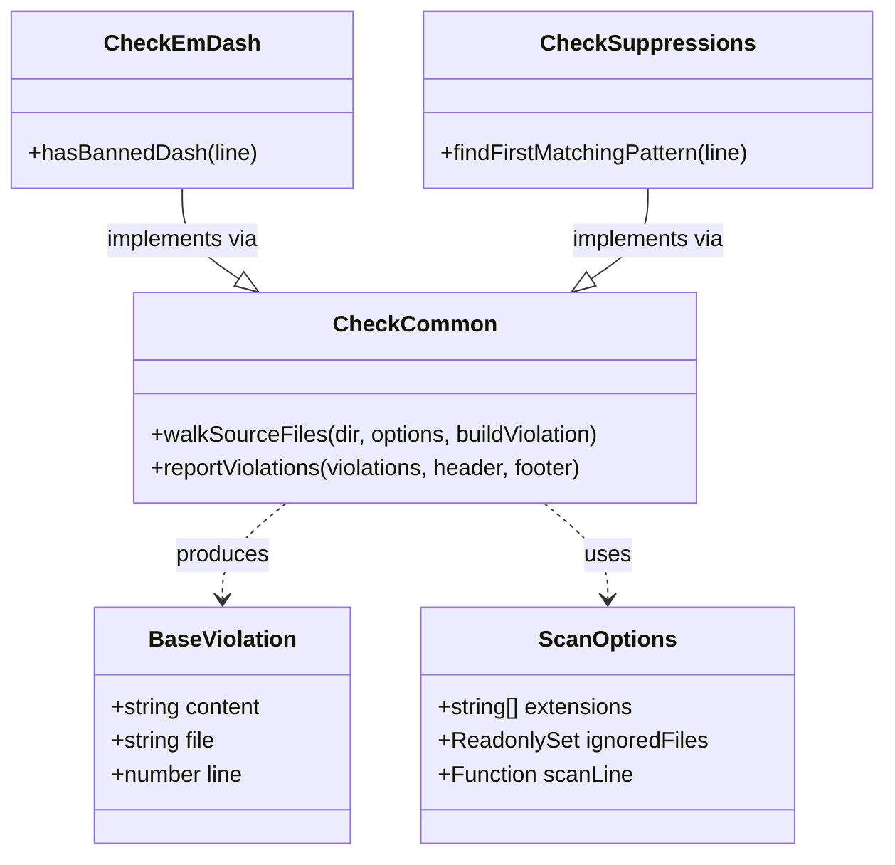

<!-- source: DeepWiki mcp.deepwiki.com · repo Xquik-dev/tweetclaw · page 8 Code Quality & Tooling · fetched 2026-10-26 -->

# Code Quality & Tooling

<details>
<summary>Relevant source files</summary>

The following files were used as context for generating this wiki page:

- [.jscpd.json](.jscpd.json)
- [check-common.ts](check-common.ts)
- [check-em-dash.ts](check-em-dash.ts)
- [check-suppressions.ts](check-suppressions.ts)
- [eslint-plugins.d.ts](eslint-plugins.d.ts)
- [eslint.config.ts](eslint.config.ts)
- [knip.config.ts](knip.config.ts)
- [src/commands/xtrends.ts](src/commands/xtrends.ts)
- [src/services/event-poller.ts](src/services/event-poller.ts)
- [src/tools/explore.ts](src/tools/explore.ts)
- [tests/tweetclaw.test.ts](tests/tweetclaw.test.ts)
- [tsconfig.eslint.json](tsconfig.eslint.json)
- [tsconfig.json](tsconfig.json)

</details>


TweetClaw maintains high engineering standards through a multi-layered static analysis and quality enforcement infrastructure. This system ensures type safety, security compliance, and architectural consistency across the plugin and MCP server components.

### Quality Infrastructure Overview

The quality stack is composed of industry-standard tools and custom scripts designed to catch errors before they reach production.

| Tool | Responsibility | Configuration |
| :--- | :--- | :--- |
| **TypeScript** | Strict type safety and module resolution | `tsconfig.json` [tsconfig.json:1-25](), `tsconfig.eslint.json` [tsconfig.eslint.json:1-23]() |
| **ESLint** | Security, logic, and style auditing | `eslint.config.ts` [eslint.config.ts:1-168]() |
| **jscpd** | Copy-paste and code duplication detection | `.jscpd.json` [jscpd.json:1-16]() |
| **Knip** | Unused dependencies and export detection | `knip.config.ts` |
| **Custom Scripts** | Domain-specific checks (em-dashes, suppressions) | `check-em-dash.ts` [check-em-dash.ts:1-48](), `check-suppressions.ts` [check-suppressions.ts:1-78]() |

### Static Analysis Flow

The following diagram illustrates how various tools interact with the source code to ensure quality.

**Quality Verification Pipeline**
```mermaid
graph TD
    subgraph "Source Code"
        [src/*.ts]
        [tests/*.ts]
    end

    subgraph "Type Safety"
        TS["TypeScript (tsc)"]
        TS_CFG["tsconfig.json"]
        TS --> TS_CFG
    end

    subgraph "Linting & Security"
        ESL["ESLint"]
        ESL_CFG["eslint.config.ts"]
        SEC["eslint-plugin-security"]
        SONAR["eslint-plugin-sonarjs"]
        ESL --> ESL_CFG
        ESL_CFG --> SEC
        ESL_CFG --> SONAR
    end

    subgraph "Custom Validation"
        C_COM["check-common.ts"]
        C_DASH["check-em-dash.ts"]
        C_SUPP["check-suppressions.ts"]
        C_DASH --> C_COM
        C_SUPP --> C_COM
    end

    [src/*.ts] --> TS
    [src/*.ts] --> ESL
    [src/*.ts] --> C_DASH
    [src/*.ts] --> C_SUPP
    [tests/*.ts] --> ESL
```
Sources: [tsconfig.json:1-25](), [eslint.config.ts:1-46](), [check-common.ts:1-97](), [check-em-dash.ts:1-15](), [check-suppressions.ts:1-11]()

### TypeScript Configuration

TweetClaw utilizes extremely strict TypeScript settings to prevent runtime errors. Key enforcements include:
*   `noUncheckedIndexedAccess`: Ensures array/object access is checked for `undefined` [tsconfig.json:15]().
*   `exactOptionalPropertyTypes`: Prevents setting optional properties to `undefined` [tsconfig.json:10]().
*   `verbatimModuleSyntax`: Enforces explicit type imports/exports for better tree-shaking and runtime predictability [tsconfig.json:16]().

For details, see [TypeScript Configuration](#8.1).

### ESLint & Security Plugins

The ESLint configuration [eslint.config.ts:16-46]() extends beyond style to include deep logic and security analysis. It integrates:
*   `eslint-plugin-security`: Identifies potential vulnerabilities like `unsafe-regex` or `non-literal-fs-filename` [eslint.config.ts:11]().
*   `eslint-plugin-sonarjs`: Detects "code smells" and complex logic bugs [eslint.config.ts:12]().
*   `no-secrets`: Prevents hardcoded API keys or credentials from entering the codebase [eslint.config.ts:8]().

For details, see [ESLint & Custom Lint Rules](#8.2).

### Custom Check Scripts

The codebase includes specialized scripts that leverage `check-common.ts` [check-common.ts:39-64]() to perform scans that generic tools cannot.

#### Duplicate Detection & Unused Code
*   **jscpd**: Configured with a strict 0% threshold [jscpd.json:2](), it scans for duplicated blocks of at least 5 lines or 50 tokens [jscpd.json:12-13]().
*   **knip**: Identifies unused files, dependencies, and exports to keep the bundle size minimal.

#### Domain-Specific Validation
*   **`check-em-dash.ts`**: Enforces the use of standard hyphens over em-dashes in agent-facing strings to ensure maximum compatibility with LLM tokenizers [check-em-dash.ts:24-26]().
*   **`check-suppressions.ts`**: Audits the codebase for any `eslint-disable` or `@ts-ignore` comments. TweetClaw policy strictly prohibits these suppressions; underlying issues must be fixed rather than ignored [check-suppressions.ts:6-9]().

**Validation Logic Association**

Sources: [check-common.ts:6-16](), [check-common.ts:39-43](), [check-em-dash.ts:24-26](), [check-suppressions.ts:41-48]()

### Child Pages
*   [TypeScript Configuration](#8.1)
*   [ESLint & Custom Lint Rules](#8.2)

---

