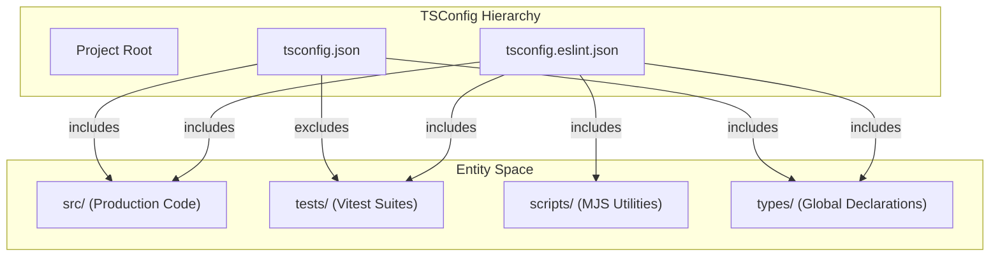
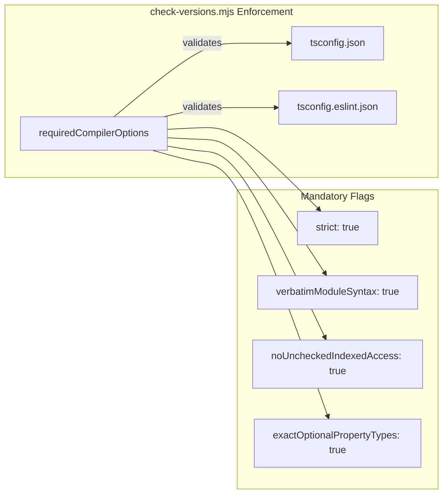

<!-- source: DeepWiki mcp.deepwiki.com · repo Xquik-dev/tweetclaw · page 8.1 TypeScript Configuration · fetched 2026-10-26 -->

# TypeScript Configuration

Relevant source files

The following files were used as context for generating this wiki page:

- [scripts/check-skill-frontmatter.mjs](scripts/check-skill-frontmatter.mjs)
- [scripts/check-versions.mjs](scripts/check-versions.mjs)
- [src/commands/xtrends.ts](src/commands/xtrends.ts)
- [src/services/event-poller.ts](src/services/event-poller.ts)
- [tsconfig.eslint.json](tsconfig.eslint.json)
- [tsconfig.json](tsconfig.json)

TweetClaw utilizes a strict TypeScript configuration to ensure type safety, runtime reliability, and consistent module behavior across its primary build and linting processes. The project maintains two primary configuration files: `tsconfig.json` for the production build and `tsconfig.eslint.json` for static analysis.

## Core Compiler Options

The codebase enforces a "Strict Plus" configuration. Beyond the standard `strict: true` setting, several advanced flags are enabled to catch edge cases in property access and module interop.

### Strict Property and Index Handling
TweetClaw enables specific flags to prevent common runtime errors associated with optional properties and array access:
*   **`exactOptionalPropertyTypes`**: Ensures that optional properties cannot be explicitly assigned `undefined`. They must either be present with the correct type or omitted entirely [tsconfig.json:10-10]().
*   **`noUncheckedIndexedAccess`**: Forces the compiler to include `undefined` in the type of any value accessed via an index signature or array index, such as `events.at(-1)` in the event poller [src/services/event-poller.ts:23-24]() [tsconfig.json:15-15]().
*   **`noPropertyAccessFromIndexSignature`**: Requires using bracket notation (e.g., `obj['key']`) for properties not explicitly declared in the type, preventing accidental access to undeclared fields [tsconfig.json:13-13]().

### Module System and Resolution
The project targets modern environments (`ES2023`) and utilizes a bundler-friendly module resolution strategy:
*   **`moduleResolution: "bundler"`**: Optimized for modern build tools that resolve modules similarly to Node.js but support newer ESM features [tsconfig.json:6-6]().
*   **`verbatimModuleSyntax`**: Simplifies the relationship between input and output imports/exports, ensuring that type-only imports are dropped and actual imports are preserved exactly as written [tsconfig.json:16-16]().

### Configuration Summary

| Option | Value | Purpose |
| :--- | :--- | :--- |
| `target` | `ES2023` | Modern JavaScript output [tsconfig.json:3-3]() |
| `module` | `ES2022` | ESM module support [tsconfig.json:4-4]() |
| `strict` | `true` | Enables all strict type-checking options [tsconfig.json:7-7]() |
| `noImplicitReturns` | `true` | Ensures all code paths in a function return a value [tsconfig.json:12-12]() |
| `outDir` | `dist` | Destination for compiled assets [tsconfig.json:18-18]() |
| `declaration` | `true` | Generates `.d.ts` files for plugin consumption [tsconfig.json:19-19]() |

**Sources:** [tsconfig.json:1-24](), [tsconfig.eslint.json:1-22]()

---

## Configuration Hierarchy

The project uses a split configuration strategy to handle the differing needs of the build process and the development/linting environment.

### TSConfig Mapping
"Code Entity Space" to "Configuration Scope" mapping:

**Sources:** [tsconfig.json:22-23](), [tsconfig.eslint.json:20-21]()

---

## Version and Compliance Enforcement

To prevent configuration drift and ensure that all distribution surfaces (npm, MCP, OpenClaw) are synchronized, the project uses a custom validation script: `scripts/check-versions.mjs`.

### Automated Validation Flow
The script `check-versions.mjs` acts as a guard during the `prepack` and `prepublishOnly` lifecycles [scripts/check-versions.mjs:75-83](). It performs a deep comparison between `package.json` and the TypeScript configurations to ensure strictness is never accidentally downgraded.

### Required Options List
The `requiredCompilerOptions` constant in the check script defines the non-negotiable settings for any configuration file in the repository:
*   `allowUnreachableCode: false` [scripts/check-versions.mjs:92-92]()
*   `noFallthroughCasesInSwitch: true` [scripts/check-versions.mjs:95-95]()
*   `noUncheckedSideEffectImports: true` [scripts/check-versions.mjs:99-99]()

If any file in the `surfaces` array (including `tsconfig.json` and `tsconfig.eslint.json`) deviates from these values, the script exits with a non-zero status and reports the "drift" [scripts/check-versions.mjs:104-114]().

**Sources:** [scripts/check-versions.mjs:91-114](), [scripts/check-versions.mjs:169-174]()

---

## Skill Metadata Integration

TypeScript definitions are also validated against the `SKILL.md` frontmatter via `scripts/check-skill-frontmatter.mjs`. This ensures that the plugin manifest `openclaw.plugin.json` correctly points to valid Markdown files containing the required metadata (name, description, license) and a single-line JSON `metadata` field [scripts/check-skill-frontmatter.mjs:134-138]().

**Sources:** [scripts/check-skill-frontmatter.mjs:1-146]()

---

