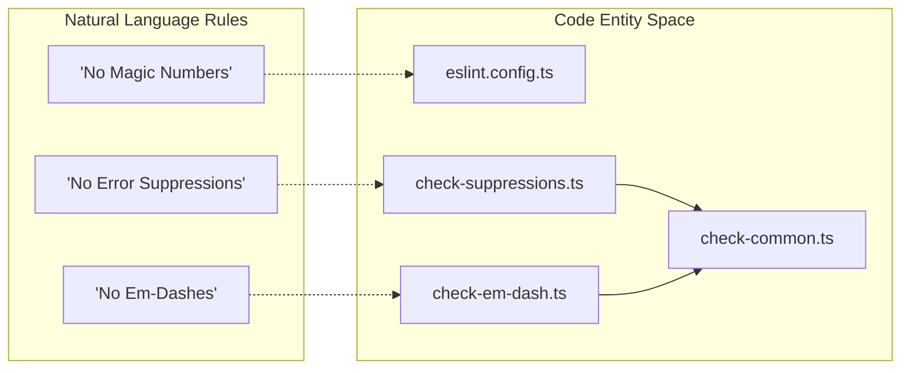

<!-- source: DeepWiki mcp.deepwiki.com · repo Xquik-dev/tweetclaw · page 8.2 ESLint & Custom Lint Rules · fetched 2026-10-26 -->

# ESLint & Custom Lint Rules

<details>
<summary>Relevant source files</summary>

The following files were used as context for generating this wiki page:

- [check-common.ts](check-common.ts)
- [check-em-dash.ts](check-em-dash.ts)
- [check-suppressions.ts](check-suppressions.ts)
- [eslint-plugins.d.ts](eslint-plugins.d.ts)
- [eslint.config.ts](eslint.config.ts)
- [src/tools/explore.ts](src/tools/explore.ts)
- [tests/tweetclaw.test.ts](tests/tweetclaw.test.ts)

</details>


TweetClaw employs a multi-layered static analysis strategy to ensure high code quality, security, and consistent documentation formatting. This system combines standard ESLint plugins with specialized custom scanners to enforce constraints that go beyond traditional linting, such as banning error suppressions and specific typography patterns.

## ESLint Configuration

The primary linting logic is defined in `eslint.config.ts`, utilizing the ESLint "Flat Config" format [eslint.config.ts:16-17](). It targets all TypeScript files in the project [eslint.config.ts:24-24]() using `@typescript-eslint/parser` [eslint.config.ts:26-26]() and a dedicated ESLint-specific TypeScript configuration `tsconfig.eslint.json` [eslint.config.ts:30-30]().

### Security and Quality Plugins

TweetClaw integrates several specialized plugins to catch logical and security flaws:

| Plugin | Purpose | Key Rule Examples |
| :--- | :--- | :--- |
| `eslint-plugin-security` | Detects vulnerable patterns | [eslint.config.ts:41-41]() |
| `eslint-plugin-sonarjs` | Bug detection and code smell analysis | [eslint.config.ts:42-42]() |
| `eslint-plugin-no-secrets` | Prevents hardcoded credentials/API keys | [eslint.config.ts:44-44]() |
| `eslint-plugin-unicorn` | Enforces modern JavaScript/TypeScript best practices | [eslint.config.ts:39-39]() |
| `eslint-plugin-promise` | Ensures correct Promise handling and avoids "floating" promises | [eslint.config.ts:40-40]() |

### Strict Type Safety Rules

The configuration enforces extreme type safety by enabling nearly all "Strict" and "Type-Checked" rules from the `@typescript-eslint` suite:

*   **Prohibited `any`**: The use of `any` is strictly forbidden [eslint.config.ts:99-99]().
*   **Unsafe Operations**: Direct member access or assignments from unsafe types are blocked [eslint.config.ts:100-103]().
*   **Magic Numbers**: Numbers other than -1, 0, 1, and 2 must be defined as constants [eslint.config.ts:119-126]().
*   **Exhaustiveness**: Switch statements must handle all possible enum or union members [eslint.config.ts:110-110]().

**Sources:** [eslint.config.ts:1-168](), [eslint-plugins.d.ts:1-10]()

---

## Custom Scan Infrastructure

To enforce project-specific constraints that are difficult to model in standard ESLint rules, TweetClaw uses a custom scanning framework based on `check-common.ts`.

### Scanning Architecture

The custom scanners follow a "Walk-and-Scan" pattern where source files are recursively traversed and evaluated line-by-line against specific predicates.

Title: Custom Scan Logic Flow
```mermaid
graph TD
    ["CLI Entry"] --> ["walkSourceFiles()"]
    subgraph "check-common.ts"
        ["walkSourceFiles()"] --> ["readdirSync()"]
        ["readdirSync()"] --> ["scanFile()"]
        ["scanFile()"] --> ["scanLine() Predicate"]
        ["scanLine() Predicate"] -- "Violation Found" --> ["buildViolation()"]
    end
    ["buildViolation()"] --> ["reportViolations()"]
    ["reportViolations()"] -- "count > 0" --> ["process.exit(1)"]
```

**Sources:** [check-common.ts:39-64](), [check-common.ts:66-93]()

---

## Suppression Auditing

The `check-suppressions.ts` script enforces a zero-tolerance policy for error suppressions. Unlike many codebases that allow `eslint-disable` or `@ts-ignore` in edge cases, TweetClaw mandates fixing the underlying issue.

### Monitored Patterns
The script searches for the following banned strings in all source extensions (`.ts`, `.tsx`, `.js`, `.mjs`, etc.) [check-suppressions.ts:32-32]():

*   **ESLint**: `eslint-disable`, `eslint-disable-next-line`, `eslint-disable-line` [check-suppressions.ts:14-16]().
*   **TypeScript**: `@ts-ignore`, `@ts-expect-error`, `@ts-nocheck` [check-suppressions.ts:17-19]().
*   **Coverage/Duplicates**: `v8 ignore`, `istanbul ignore`, `jscpd:ignore` [check-suppressions.ts:20-23]().

The scanner ignores itself and the ESLint configuration file to prevent false positives during the audit [check-suppressions.ts:26-30]().

**Sources:** [check-suppressions.ts:1-78]()

---

## Typography & Em-Dash Detection

The `check-em-dash.ts` script ensures documentation and string constants remain consistent for AI consumption and terminal rendering by banning specific dash characters.

### Prohibited Characters
*   **Raw Em-Dash**: `\u2014` (—) [check-em-dash.ts:25-25]().
*   **Escaped Em-Dash**: The literal string `\u2014` in JSON [check-em-dash.ts:25-25]().
*   **Double-Dash**: The pattern ` -- ` (space-hyphen-hyphen-space) [check-em-dash.ts:25-25]().

The system enforces the use of a single space-hyphen-space ` - ` instead [check-em-dash.ts:42-42]().

**Sources:** [check-em-dash.ts:1-48]()

---

## Data Flow: Linting to CI

Static analysis is integrated into the build and release pipeline. Any violation in the custom scanners or ESLint will cause the CI process to fail.

Title: Static Analysis Entity Mapping


**Sources:** [eslint.config.ts:119-126](), [check-suppressions.ts:13-24](), [check-em-dash.ts:24-26](), [check-common.ts:18-37]()

---

