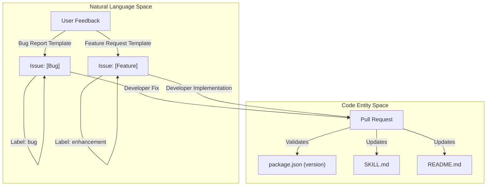
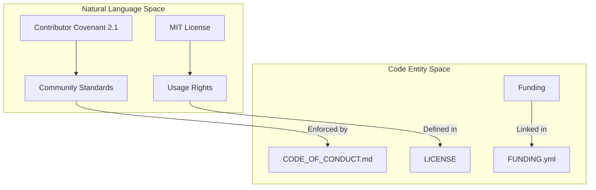

<!-- source: DeepWiki mcp.deepwiki.com · repo Xquik-dev/tweetclaw · page 9 Community & Contributing · fetched 2026-10-26 -->

# Community & Contributing

Relevant source files

The following files were used as context for generating this wiki page:

- [.github/CONTRIBUTING.md](.github/CONTRIBUTING.md)
- [.github/FUNDING.yml](.github/FUNDING.yml)
- [.github/ISSUE_TEMPLATE/bug_report.md](.github/ISSUE_TEMPLATE/bug_report.md)
- [.github/ISSUE_TEMPLATE/feature_request.md](.github/ISSUE_TEMPLATE/feature_request.md)
- [.github/PULL_REQUEST_TEMPLATE.md](.github/PULL_REQUEST_TEMPLATE.md)
- [.github/SECURITY.md](.github/SECURITY.md)
- [CODE_OF_CONDUCT.md](CODE_OF_CONDUCT.md)
- [LICENSE](LICENSE)

This page details the community health infrastructure, contribution workflows, and security policies governing the TweetClaw repository. It defines the standards for professional conduct, the process for reporting bugs or proposing features, and the security protocols for handling credentials and vulnerabilities.

## Contribution Scope and Workflow

The TweetClaw repository focuses on the packaging of the Xquik skill for AI coding agents and Model Context Protocol (MCP) clients. Contributions are expected to align with specific domains within the codebase.

### Contribution Domains
As defined in the contribution guidelines, changes should be restricted to the following areas:
*   **Skill Instructions**: Clarity and efficacy of agent instructions in `skills/` and `commands/` [ .github/CONTRIBUTING.md:9-9]().
*   **MCP Metadata**: Configuration files such as `server.json` and `smithery.yaml` [ .github/CONTRIBUTING.md:10-10]().
*   **Compatibility**: Adherence to the `SKILL.md` specification for cross-agent compatibility [ .github/CONTRIBUTING.md:11-11]().
*   **Documentation**: Updates to `README.md` or the `docs/` directory [ .github/CONTRIBUTING.md:12-12]().

Upstream changes to the Xquik API itself are considered out of scope for this repository [ .github/CONTRIBUTING.md:14-14]().

### Development Lifecycle
The standard workflow for contributors involves a fork-and-pull model:
1.  Fork the repository and create a feature/fix branch [ .github/CONTRIBUTING.md:18-19]().
2.  Implement changes following the project guidelines (e.g., keeping instructions agent-friendly) [ .github/CONTRIBUTING.md:25-25]().
3.  Update documentation (`SKILL.md` or `README.md`) if user-facing behavior or the API surface changes [ .github/CONTRIBUTING.md:26-27]().
4.  Submit a Pull Request using the provided template [ .github/CONTRIBUTING.md:21-21]().

**Sources:**
*   [.github/CONTRIBUTING.md:1-33]()

---

## Issue and Pull Request Infrastructure

The repository utilizes standardized templates to ensure high-quality reports and consistent PR reviews.

### Issue Templates
Two primary issue templates are provided to categorize community feedback:
*   **Bug Report**: Captures environment details (Agent, Version, OS), reproduction steps, and actual vs. expected behavior [ .github/ISSUE_TEMPLATE/bug_report.md:1-27]().
*   **Feature Request**: Focuses on the problem being solved, the proposed solution, and alternatives considered [ .github/ISSUE_TEMPLATE/feature_request.md:1-18]().

### Pull Request Template
The PR template enforces a checklist to prevent regressions in documentation and versioning. Contributors must verify:
*   `SKILL.md` updates for behavioral changes [ .github/PULL_REQUEST_TEMPLATE.md:11-11]().
*   `README.md` updates for API surface changes [ .github/PULL_REQUEST_TEMPLATE.md:12-12]().
*   Version bumps in `package.json` [ .github/PULL_REQUEST_TEMPLATE.md:13-13]().

### Information Flow: Issue to PR
The following diagram illustrates the data flow from a community report to a code contribution.

**Community Feedback Data Flow**

**Sources:**
*   [.github/ISSUE_TEMPLATE/bug_report.md:1-27]()
*   [.github/ISSUE_TEMPLATE/feature_request.md:1-18]()
*   [.github/PULL_REQUEST_TEMPLATE.md:1-14]()

---

## Security Policy

The security policy defines the boundaries for vulnerability reporting and the protocols for credential management.

### Vulnerability Reporting
Security vulnerabilities must **not** be reported via public issues. Instead, they should be emailed to `security@xquik.com` with a description, reproduction steps, and impact assessment [ .github/SECURITY.md:5-11](). The maintainers commit to a 72-hour response window [ .github/SECURITY.md:12-12]().

### Credential Handling
Since TweetClaw interacts with the Xquik API, strict key management is required:
*   **Storage**: Keys should be stored in environment variables (e.g., `XQUIK_API_KEY`) or agent-specific secret stores [ .github/SECURITY.md:19-19]().
*   **Prevention**: API keys must never be committed to the repository [ .github/SECURITY.md:18-18]().
*   **Isolation**: Users are encouraged to use per-agent or per-environment keys to limit the blast radius of a potential compromise [ .github/SECURITY.md:21-21]().

### Security Scope
The policy covers the skill files, MCP configuration, and the `x-developer` npm package [ .github/SECURITY.md:25-29](). Upstream API security remains the responsibility of the main Xquik platform [ .github/SECURITY.md:31-31]().

**Sources:**
*   [.github/SECURITY.md:1-33]()

---

## Community Standards and Governance

TweetClaw adopts the Contributor Covenant (version 2.1) to ensure a healthy and inclusive environment.

### Code of Conduct
The project pledges to provide a harassment-free experience regardless of background or identity [ CODE_OF_CONDUCT.md:6-6](). Acceptable behavior includes demonstrating empathy, being respectful of differing viewpoints, and accepting constructive feedback [ CODE_OF_CONDUCT.md:14-17]().

### Enforcement
Community leaders (reachable at `support@xquik.com`) are responsible for enforcing these standards [ CODE_OF_CONDUCT.md:40-40](). Enforcement follows a multi-tiered ladder:
1.  **Correction**: Private warning for unprofessional behavior [ CODE_OF_CONDUCT.md:48-52]().
2.  **Warning**: Formal warning with potential consequences for continued violation [ CODE_OF_CONDUCT.md:54-58]().
3.  **Temporary Ban**: Suspension from community interaction for a specified period [ CODE_OF_CONDUCT.md:60-64]().
4.  **Permanent Ban**: Permanent removal for patterns of harassment or serious violations [ CODE_OF_CONDUCT.md:66-70]().

### Financial Support
The project accepts custom funding via the Xquik platform [ .github/FUNDING.yml:1-1]().

### Licensing
The codebase is distributed under the **MIT License**, permitting free use, modification, and distribution, provided the original copyright notice and permission notice are included [ LICENSE:1-21]().

**Governance Entity Mapping**

**Sources:**
*   [CODE_OF_CONDUCT.md:1-84]()
*   [.github/FUNDING.yml:1-1]()
*   [LICENSE:1-21]()

---

