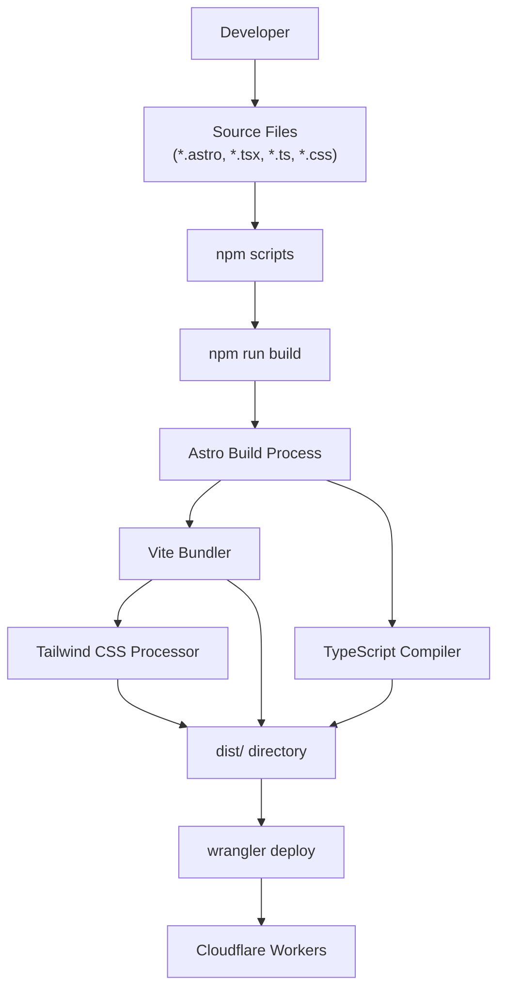
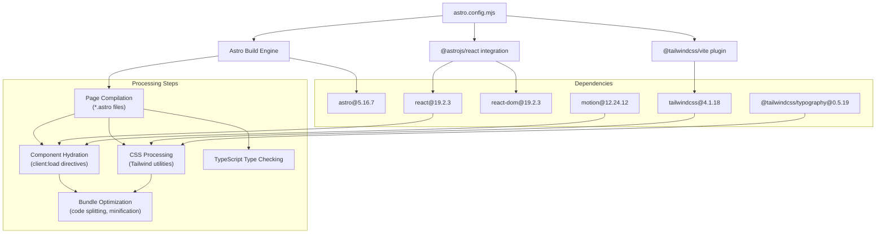
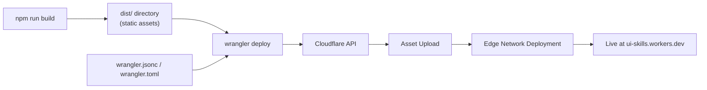
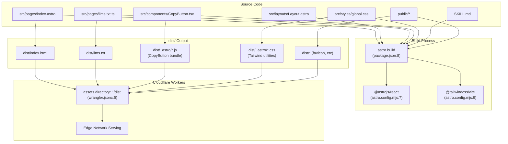

<!-- source: DeepWiki mcp.deepwiki.com · repo ibelick/ui-skills · page 2.3 Build and Deployment Pipeline · fetched 2026-10-26 -->

# Build and Deployment Pipeline

<details>
<summary>Relevant source files</summary>

The following files were used as context for generating this wiki page:

- [astro.config.mjs](astro.config.mjs)
- [package.json](package.json)
- [wrangler.jsonc](wrangler.jsonc)
- [wrangler.toml](wrangler.toml)

</details>


## Purpose and Scope

This document describes the build and deployment pipeline for the ui-skills repository, covering the transformation of source code into production artifacts and their deployment to Cloudflare Workers. This includes the npm build scripts, Astro's build process, dependency management, and Wrangler configuration for edge deployment.

For information about the individual technologies used in the pipeline, see [Technology Stack](#2.1). For deployment-specific configuration details, see [Deployment Configuration](#6.2).

## Pipeline Overview

The build and deployment pipeline transforms source files (Astro pages, React components, TypeScript, CSS) into optimized static assets that are deployed to Cloudflare's edge network. The process involves multiple stages: dependency resolution, TypeScript compilation, Astro build orchestration, Vite bundling, and Cloudflare Workers deployment via Wrangler.



**Sources:** [package.json:1-32](), [astro.config.mjs:1-11](), [wrangler.jsonc:1-7]()

## NPM Scripts

The build pipeline is orchestrated through npm scripts defined in `package.json`. These scripts provide consistent entry points for development, building, and maintenance tasks.

| Script | Command | Purpose |
|--------|---------|---------|
| `dev` | `astro dev` | Starts development server with hot module replacement |
| `build` | `astro build` | Triggers production build process |
| `preview` | `astro preview` | Serves built application locally for testing |
| `typecheck` | `astro check` | Runs TypeScript type checking without building |
| `format` | `prettier --write .` | Formats all source files using Prettier |

The primary build script executes `astro build`, which initiates the entire build toolchain. This command reads the Astro configuration, processes all pages and components, and outputs optimized static files to the `dist/` directory.

**Sources:** [package.json:6-12]()

## Build Toolchain

The build process leverages multiple integrated tools that work together through Astro's orchestration layer.



**Sources:** [astro.config.mjs:1-11](), [package.json:14-31]()

### Astro Configuration

The `astro.config.mjs` file defines the build configuration:

- **React Integration** ([astro.config.mjs:7]()): Enables React component support through `@astrojs/react`, allowing `.tsx` files to be used within Astro pages
- **Vite Plugins** ([astro.config.mjs:8-10]()): Integrates Tailwind CSS via `@tailwindcss/vite` plugin, enabling utility-first styling with JIT compilation

The configuration uses ES modules (`type: "module"` in [package.json:3]()) for modern JavaScript syntax and import/export statements.

**Sources:** [astro.config.mjs:1-11](), [package.json:3]()

### Dependency Resolution

Build dependencies are categorized in `package.json`:

**Runtime Dependencies** ([package.json:14-23]()):
- `astro@5.16.7`: Core static site generator
- `@astrojs/react@4.4.2`: React integration bridge
- `react@19.2.3` and `react-dom@19.2.3`: React runtime
- `tailwindcss@4.1.18` and `@tailwindcss/vite@4.1.18`: Styling framework
- `motion@12.24.12`: Animation library

**Development Dependencies** ([package.json:25-31]()):
- `@tailwindcss/typography@0.5.19`: Typography plugin for prose content
- `typescript@5.6.3`: Type checking and compilation
- `prettier@3.3.3`: Code formatting
- Prettier plugins for Astro and Tailwind

**Sources:** [package.json:14-31]()

## Build Output Structure

The build process generates static assets in the `dist/` directory, which serves as the deployment root. This directory contains:

- **HTML Files**: Pre-rendered static HTML pages, including `index.html` and API endpoints like `llms.txt`
- **JavaScript Bundles**: Optimized client-side code for interactive components (e.g., CopyButton)
- **CSS Assets**: Processed Tailwind stylesheets with only used utilities
- **Static Assets**: Files from `/public` directory (favicon, images)
- **Metadata Files**: Build artifacts and routing information

The output structure is optimized for edge deployment with minimal file sizes and efficient caching strategies.

**Sources:** [wrangler.jsonc:5](), [wrangler.toml:5]()

## Deployment Configuration

Deployment to Cloudflare Workers is configured through Wrangler configuration files. The repository includes both JSON and TOML formats with identical settings.

### Wrangler Configuration Files

**wrangler.jsonc** ([wrangler.jsonc:1-7]()):
```json
{
  "name": "ui-skills",
  "compatibility_date": "2026-01-07",
  "assets": {
    "directory": "./dist"
  }
}
```

**wrangler.toml** ([wrangler.toml:1-5]()):
```toml
name = "ui-skills"
compatibility_date = "2026-01-07"

[assets]
directory = "./dist"
```

| Field | Value | Purpose |
|-------|-------|---------|
| `name` | `"ui-skills"` | Worker name in Cloudflare dashboard |
| `compatibility_date` | `"2026-01-07"` | Cloudflare Workers runtime version |
| `assets.directory` | `"./dist"` | Path to static assets for deployment |

The `compatibility_date` ensures consistent runtime behavior and access to specific Cloudflare Workers API features. The `assets.directory` directive tells Wrangler to deploy all files from the `dist/` directory as static assets.

**Sources:** [wrangler.jsonc:1-7](), [wrangler.toml:1-5]()

## Deployment Process

Deployment to Cloudflare Workers follows a straightforward process using the Wrangler CLI:



**Deployment Steps:**

1. **Build Generation**: Execute `npm run build` to create production assets in `dist/`
2. **Wrangler Invocation**: Run `wrangler deploy` with appropriate authentication
3. **Configuration Reading**: Wrangler reads `wrangler.jsonc` or `wrangler.toml` for deployment settings
4. **Asset Upload**: Wrangler uploads all files from `./dist` directory to Cloudflare
5. **Edge Distribution**: Cloudflare propagates assets to edge locations globally
6. **Service Activation**: The worker becomes live at the configured domain

The deployment leverages Cloudflare's Workers Assets feature, which serves static files directly from the edge network with optimal caching and minimal latency.

**Sources:** [wrangler.jsonc:1-7](), [wrangler.toml:1-5](), [package.json:8]()

## Build-to-Deployment Mapping

The following diagram maps source code entities to their deployment artifacts, bridging the natural language concepts with actual code symbols:



**Sources:** [package.json:8](), [astro.config.mjs:7-9](), [wrangler.jsonc:4-6]()

## Performance Optimizations

The build pipeline implements several optimizations for production deployment:

- **Static Site Generation**: All pages are pre-rendered at build time, eliminating server-side processing
- **Partial Hydration**: Only interactive components (marked with `client:load`) ship JavaScript to the browser
- **Code Splitting**: Vite automatically splits code into optimal chunks for parallel loading
- **CSS Purging**: Tailwind CSS only includes used utility classes in the final bundle
- **Minification**: All HTML, CSS, and JavaScript are minified for smaller file sizes
- **Edge Deployment**: Cloudflare Workers serve assets from geographically distributed edge nodes

These optimizations result in fast load times and minimal bandwidth usage, with most content served as static HTML requiring no JavaScript execution.

**Sources:** [astro.config.mjs:1-11](), [package.json:14-31]()

---

