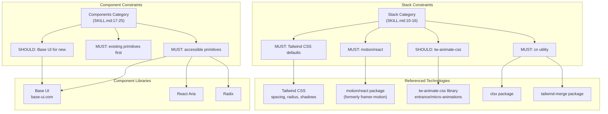
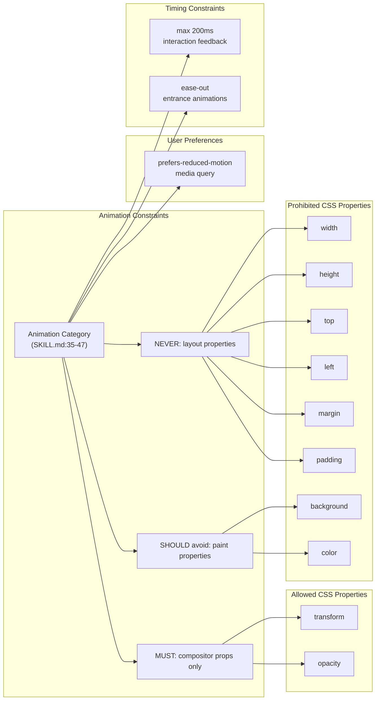
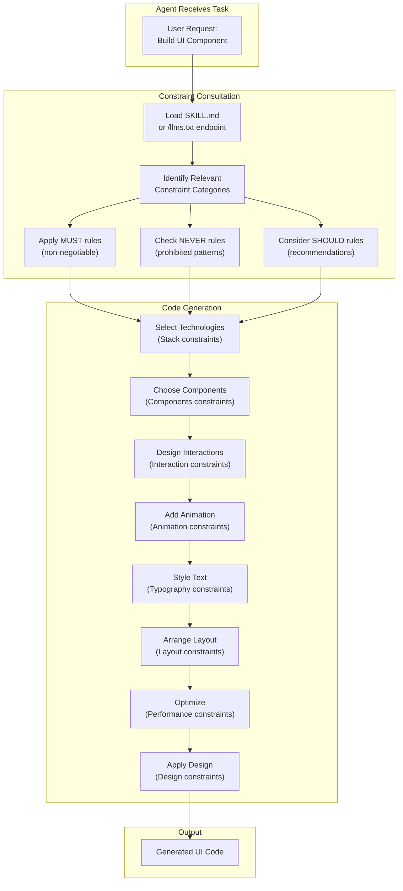
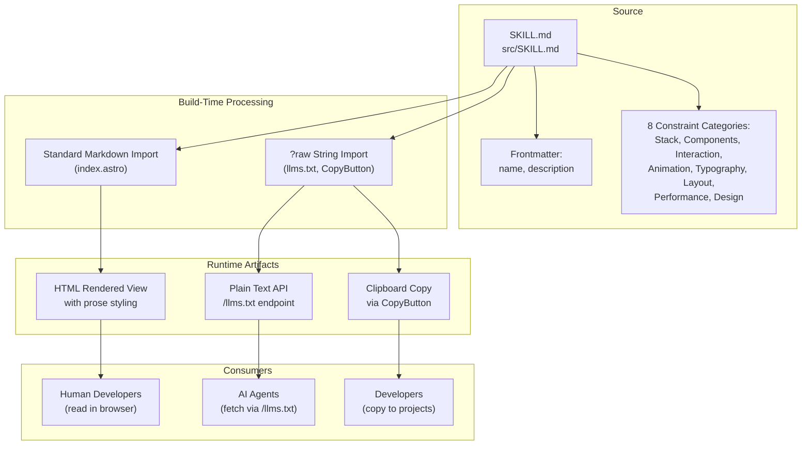

<!-- source: DeepWiki mcp.deepwiki.com · repo ibelick/ui-skills · page 3 UI Skills Documentation · fetched 2026-10-26 -->

# UI Skills Documentation

<details>
<summary>Relevant source files</summary>

The following files were used as context for generating this wiki page:

- [README.md](README.md)
- [src/SKILL.md](src/SKILL.md)

</details>


This document describes the core content of the ui-skills system: the UI Skills constraints themselves. These are opinionated rules that guide AI agents when building user interfaces.

**Scope:** This page covers the purpose, structure, and content of the UI Skills constraints defined in `SKILL.md`. For implementation details of how this content is served to different consumers, see [SKILL.md Content Structure](#3.1) and [LLMs.txt API Endpoint](#3.2). For how this content is rendered on the main page, see [Main Index Page](#4.2).

## Purpose and Rationale

UI Skills is a set of **opinionated, evolving constraints** designed to guide agents when building interfaces. As stated in [README.md:5](), these constraints address specific pain points encountered when using agents to build UI - patterns that consistently produced poor results or unnecessary friction.

The constraints are intentionally opinionated rather than comprehensive. They emerge from practical experience rather than theoretical completeness, focusing on the most common failure modes and anti-patterns observed in agent-generated interfaces.

**Key Characteristics:**
- **Constraint-based:** Rules use imperative keywords (MUST, SHOULD, NEVER) to establish clear boundaries
- **Technology-specific:** References concrete tools and libraries rather than abstract concepts
- **Practical:** Each rule addresses a real problem observed in agent behavior
- **Evolving:** The constraint set updates as new patterns emerge

Sources: [README.md:5-7](), [src/SKILL.md:1-8]()

## Constraint Categories

The UI Skills constraints are organized into eight primary categories, each addressing a specific aspect of interface development:

| Category | Focus Area | Rule Count | Key Priorities |
|----------|-----------|------------|----------------|
| **Stack** | Technology choices and tooling | 4 | Tailwind CSS defaults, motion/react animation, utility functions |
| **Components** | UI primitives and accessibility | 6 | Accessible primitives, consistent primitive systems, keyboard/focus behavior |
| **Interaction** | User interaction patterns | 6 | Destructive action dialogs, loading states, viewport units, error placement |
| **Animation** | Motion design and performance | 9 | Compositor-only props, respect user preferences, tight timing constraints |
| **Typography** | Text rendering and layout | 4 | Text wrapping algorithms, tabular numbers, truncation strategies |
| **Layout** | Spatial organization | 2 | Fixed z-index scale, square element utilities |
| **Performance** | Runtime optimization | 3 | Avoid expensive effects, minimize useEffect, conditional will-change |
| **Design** | Visual aesthetics | 7 | Restrained color usage, shadow scales, empty state guidance |

Sources: [src/SKILL.md:10-75]()

## Content Structure

### Metadata and Frontmatter

The `SKILL.md` file includes YAML frontmatter that identifies the skill for agent consumption:

```yaml
---
name: ui-skills
description: Opinionated constraints for building better interfaces with agents.
---
```

This metadata allows agents and tools to programmatically identify and reference the skill set.

Sources: [src/SKILL.md:1-4]()

### Constraint Specification Format

Each constraint follows a consistent format:

**Structure:**
- **Imperative keyword** (MUST, SHOULD, NEVER) indicates priority level
- **Specific action or requirement** states what to do or avoid
- **Context or qualifier** provides conditions or alternatives when applicable

**Keyword Semantics:**
- `MUST`: Non-negotiable requirement; deviation produces incorrect or broken behavior
- `SHOULD`: Strong recommendation; deviation should have clear justification
- `NEVER`: Absolute prohibition; indicates a known anti-pattern

Sources: [src/SKILL.md:10-75]()

## Technology and Code Entity Mapping

### Constraint-to-Technology Mapping



**Diagram: Technology Stack Constraints to Code Entities**

This diagram shows how abstract constraint categories in `SKILL.md` map to specific npm packages and libraries that agents should use. The Stack category mandates specific technologies, while the Components category establishes a hierarchy of acceptable primitive libraries.

Sources: [src/SKILL.md:10-25]()

### CSS and Animation Property Mapping



**Diagram: Animation Constraints to CSS Property Space**

This diagram maps the Animation category constraints to specific CSS properties that agents should use or avoid. It shows the technical rationale: compositor properties (transform, opacity) don't trigger layout recalculation or repaint, while layout properties (width, height, positioning) and paint properties (background, color) cause expensive browser operations.

Sources: [src/SKILL.md:35-47]()

## Constraint Severity and Enforcement

### Rule Priority Matrix

| Keyword | Meaning | Violation Impact | Example Use Cases |
|---------|---------|------------------|-------------------|
| **MUST** | Mandatory requirement | Breaks functionality, accessibility, or performance | `MUST use accessible component primitives` [src/SKILL.md:19]() |
| **SHOULD** | Strong recommendation | Suboptimal but functional | `SHOULD use tw-animate-css for entrance animations` [src/SKILL.md:14]() |
| **NEVER** | Absolute prohibition | Introduces known anti-patterns | `NEVER animate layout properties` [src/SKILL.md:39]() |

Sources: [src/SKILL.md:10-75]()

### Category-Specific Patterns

Different categories emphasize different constraint types:

**Animation Category**: Heavy use of NEVER constraints to prevent performance issues
- `NEVER animate large blur() or backdrop-filter surfaces` [src/SKILL.md:62]()
- `NEVER apply will-change outside an active animation` [src/SKILL.md:63]()

**Components Category**: Heavy use of MUST constraints for accessibility requirements
- `MUST use accessible component primitives` [src/SKILL.md:19]()
- `MUST add an aria-label to icon-only buttons` [src/SKILL.md:23]()

**Design Category**: Heavy use of NEVER constraints to prevent common aesthetic mistakes
- `NEVER use gradients unless explicitly requested` [src/SKILL.md:68]()
- `NEVER use purple or multicolor gradients` [src/SKILL.md:69]()

Sources: [src/SKILL.md:35-75]()

## Constraint Application Flow



**Diagram: Agent Constraint Application Workflow**

This diagram illustrates how an agent should apply UI Skills constraints when generating code. The agent first consults the constraints from either the rendered `SKILL.md` or the `/llms.txt` endpoint (see [LLMs.txt API Endpoint](#3.2)), identifies which categories apply to the task, then systematically applies rules in order of priority (MUST → NEVER → SHOULD) across all relevant constraint categories.

Sources: [src/SKILL.md:1-75](), [README.md:5-9]()

## Design Philosophy

### Constraint Selection Criteria

The constraints in `SKILL.md` follow specific selection criteria. Each rule exists because:

1. **Observed Agent Failure**: The pattern addressed by the constraint represents something that "bored" the author when using agents [README.md:7]()
2. **Frequency**: The issue appears repeatedly across different agent interactions
3. **Specificity**: The rule provides actionable, specific guidance rather than general principles
4. **Technology-Grounded**: The constraint references specific tools, libraries, or CSS properties

### Evolution and Maintenance

The constraint set is described as **evolving** [README.md:5](), indicating:
- New constraints may be added as new patterns emerge
- Existing constraints may be refined based on experience
- Technology references may be updated as tools evolve (e.g., "formerly `framer-motion`" note in [src/SKILL.md:13]())

Sources: [README.md:5-9]()

## Integration with Agent Skills Framework

UI Skills is positioned as an example of **Agent Skills**, a broader concept for guiding agent behavior. The README references Anthropic's Agent Skills documentation, suggesting that UI Skills follows patterns established in that framework.

**Relationship to Agent Skills:**
- UI Skills = Domain-specific skill set (UI/frontend development)
- Agent Skills = General framework for providing constraints to agents
- Connection: Learn more at [platform.claude.com/docs/en/agents-and-tools/agent-skills/overview](https://platform.claude.com/docs/en/agents-and-tools/agent-skills/overview) [README.md:9]()

Sources: [README.md:9]()

## Key Constraint Highlights

### Most Restrictive Constraints

Some constraints are particularly strict, using strong language to prevent common mistakes:

**Animation Domain:**
- `NEVER add animation unless it is explicitly requested` [src/SKILL.md:37]() - Default to no animation
- `NEVER animate layout properties` [src/SKILL.md:39]() - Prevents expensive reflows
- `NEVER exceed 200ms for interaction feedback` [src/SKILL.md:42]() - Ensures responsiveness

**Design Domain:**
- `NEVER use gradients unless explicitly requested` [src/SKILL.md:68]() - Avoids visual complexity
- `NEVER use purple or multicolor gradients` [src/SKILL.md:69]() - Specific aesthetic prohibition
- `NEVER use glow effects as primary affordances` [src/SKILL.md:70]() - Prevents reliance on decorative effects

**Components Domain:**
- `NEVER mix primitive systems within the same interaction surface` [src/SKILL.md:21]() - Maintains consistency
- `NEVER rebuild keyboard or focus behavior by hand` [src/SKILL.md:24]() - Prevents accessibility issues

Sources: [src/SKILL.md:21-75]()

### Technology-Specific Mandates

Some constraints establish a clear technology stack:

| Constraint | Required Technology | Purpose |
|------------|-------------------|---------|
| Animation library | `motion/react` | JavaScript animations [src/SKILL.md:13]() |
| CSS utility merging | `cn` utility (`clsx` + `tailwind-merge`) | Class name logic [src/SKILL.md:15]() |
| Component primitives | Base UI, React Aria, or Radix | Accessibility and keyboard behavior [src/SKILL.md:19]() |
| Preferred new primitives | Base UI | Consistency in new components [src/SKILL.md:22]() |

Sources: [src/SKILL.md:10-25]()

### Viewport and Spacing Specifics

Several constraints address common viewport and spacing mistakes:

- `NEVER use h-screen, use h-dvh` [src/SKILL.md:30]() - Accounts for mobile browser chrome
- `MUST respect safe-area-inset for fixed elements` [src/SKILL.md:31]() - Handles notches and home indicators
- `MUST use Tailwind CSS defaults (spacing, radius, shadows) before custom values` [src/SKILL.md:12]() - Maintains design system consistency

Sources: [src/SKILL.md:12-32]()

## Content Consumption Paths

The constraints in `SKILL.md` are consumed through multiple paths:



**Diagram: SKILL.md Content Distribution**

This diagram shows how the single source of truth (`SKILL.md`) is processed and distributed to three different consumer types. For details on HTML rendering, see [Main Index Page](#4.2). For details on the plain text API, see [LLMs.txt API Endpoint](#3.2). For details on the copy functionality, see [CopyButton Component](#5.1).

Sources: [src/SKILL.md:1-75]()

---

