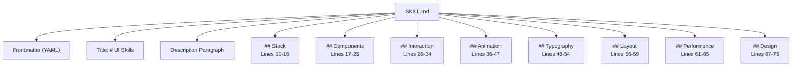
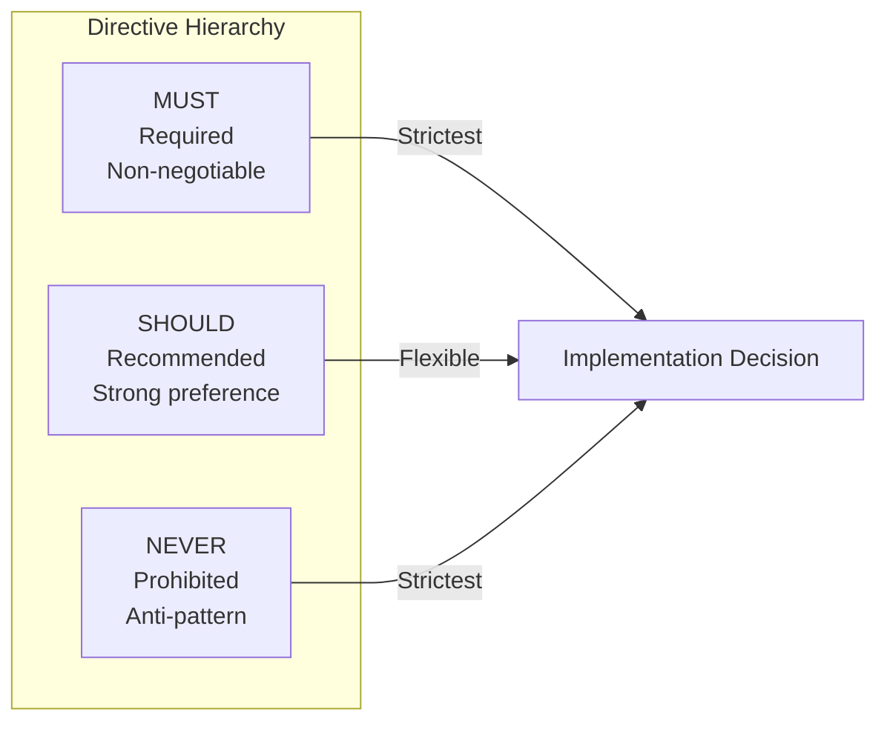
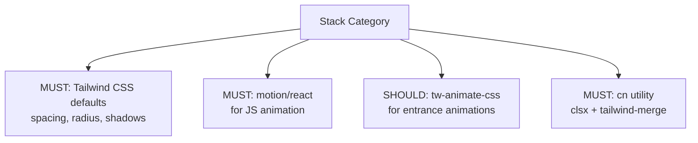
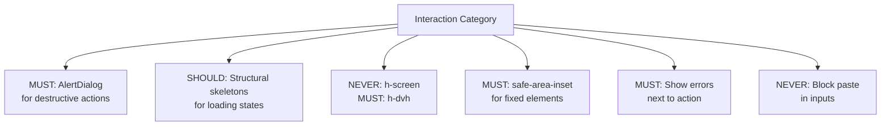
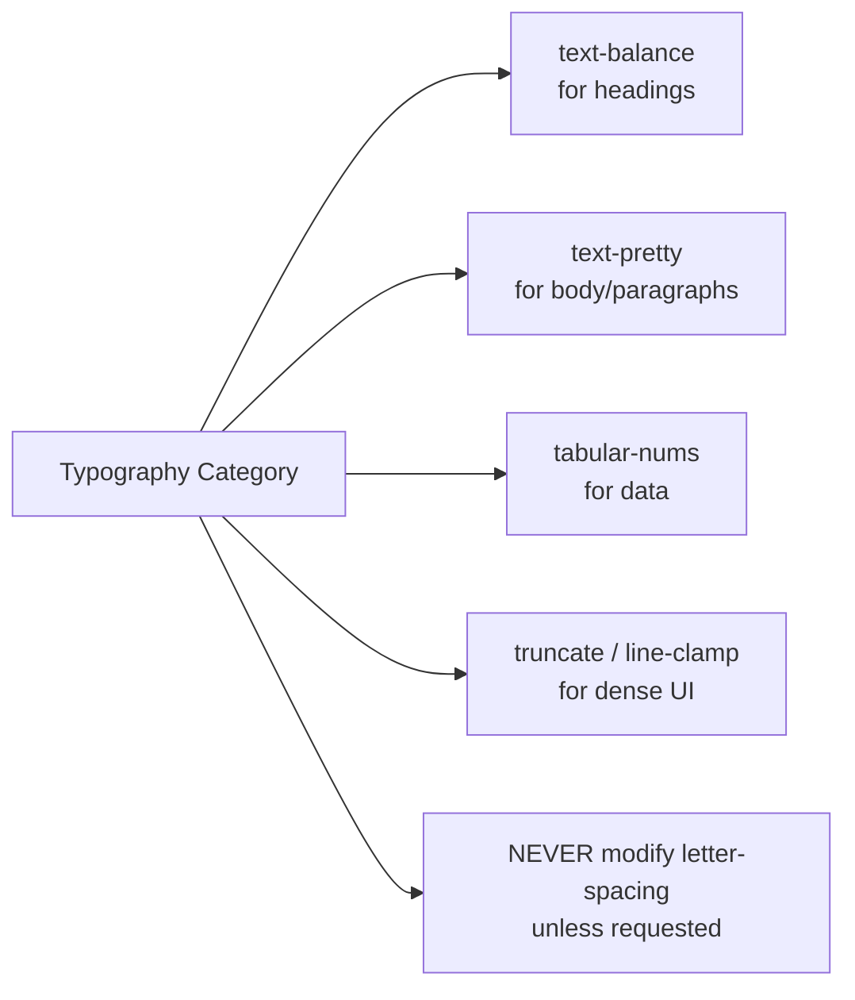
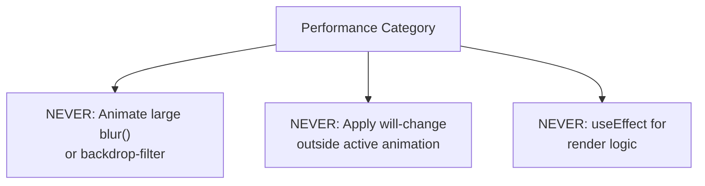
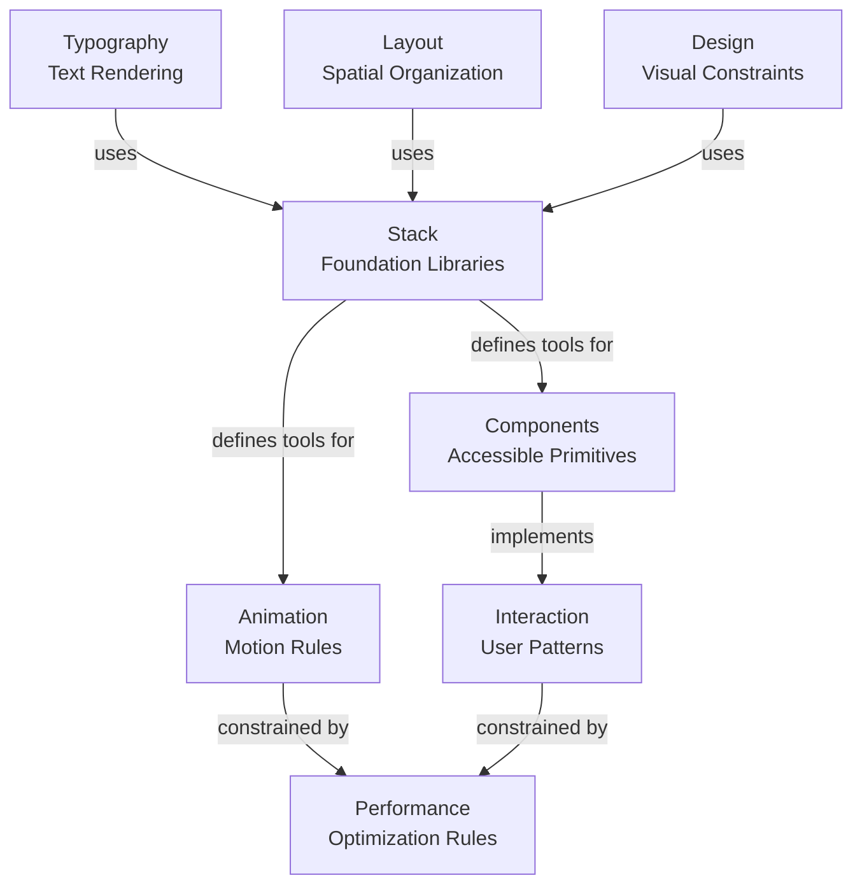

<!-- source: DeepWiki mcp.deepwiki.com · repo ibelick/ui-skills · page 3.1 SKILL.md Content Structure · fetched 2026-10-26 -->

# SKILL.md Content Structure

Relevant source files

The following files were used as context for generating this wiki page:

- [src/SKILL.md](src/SKILL.md)

This document details the structure, organization, and content of the `SKILL.md` file, which serves as the single source of truth for UI Skills constraints. The file defines opinionated rules that guide AI agents in building user interfaces, organized into eight constraint categories with specific directive patterns.

For information about how this content is served via the plain-text API endpoint, see [LLMs.txt API Endpoint](#3.2). For details on how it is rendered in the main web interface, see [Main Index Page](#4.2).

## Purpose and Organization

The `SKILL.md` file is a Markdown document located at [src/SKILL.md:1-75]() that defines prescriptive constraints for building user interfaces with AI agents. The file uses a structured format with YAML frontmatter for metadata and organized sections for different constraint categories.

### File Structure Overview

Sources: [src/SKILL.md:1-75]()

## Frontmatter Metadata

The file begins with YAML frontmatter that provides metadata for the skill set:

| Field | Value | Purpose |
|-------|-------|---------|
| `name` | `"ui-skills"` | Identifier for the skill set |
| `description` | `"Opinionated constraints for building better interfaces with agents."` | Human-readable description |

This metadata is defined at [src/SKILL.md:1-4]() and can be accessed programmatically when the Markdown file is imported into Astro components.

Sources: [src/SKILL.md:1-4]()

## Constraint Directive Patterns

The file uses three primary directive patterns to express the strictness of each constraint:

### Directive Usage Patterns

| Directive | Usage | Example |
|-----------|-------|---------|
| `MUST` | Mandatory requirements that define correct behavior | `MUST use Tailwind CSS defaults` |
| `SHOULD` | Strong recommendations with justified exceptions | `SHOULD use tw-animate-css for entrance animations` |
| `NEVER` | Absolute prohibitions identifying anti-patterns | `NEVER use h-screen, use h-dvh` |

Sources: [src/SKILL.md:12-75]()

## Constraint Categories

### Stack Constraints

The Stack section [src/SKILL.md:10-16]() defines technology and library requirements:

| Line | Directive | Constraint |
|------|-----------|------------|
| 12 | `MUST` | Use Tailwind CSS defaults (spacing, radius, shadows) before custom values |
| 13 | `MUST` | Use `motion/react` (formerly `framer-motion`) for JavaScript animation |
| 14 | `SHOULD` | Use `tw-animate-css` for entrance and micro-animations in Tailwind CSS |
| 15 | `MUST` | Use `cn` utility (`clsx` + `tailwind-merge`) for class logic |

Sources: [src/SKILL.md:10-16]()

### Components Constraints

The Components section [src/SKILL.md:17-25]() focuses on accessible component primitives:

| Line | Directive | Constraint | Key Libraries Mentioned |
|------|-----------|------------|------------------------|
| 19 | `MUST` | Use accessible component primitives for keyboard/focus behavior | Base UI, React Aria, Radix |
| 20 | `MUST` | Use project's existing component primitives first | N/A |
| 21 | `NEVER` | Mix primitive systems within same interaction surface | N/A |
| 22 | `SHOULD` | Prefer Base UI for new primitives if stack-compatible | Base UI |
| 23 | `MUST` | Add `aria-label` to icon-only buttons | N/A |
| 24 | `NEVER` | Rebuild keyboard/focus behavior by hand unless requested | N/A |

Sources: [src/SKILL.md:17-25]()

### Interaction Constraints

The Interaction section [src/SKILL.md:26-34]() covers user interaction patterns:

Key constraints:
- **Line 28**: `AlertDialog` for destructive or irreversible actions
- **Line 30**: Use `h-dvh` instead of `h-screen` for viewport height
- **Line 31**: Respect `safe-area-inset` for fixed elements
- **Line 33**: Never block paste in `input` or `textarea` elements

Sources: [src/SKILL.md:26-34]()

### Animation Constraints

The Animation section [src/SKILL.md:36-47]() is the most detailed category, defining performance-critical animation rules:

| Line | Directive | Constraint | Technical Detail |
|------|-----------|------------|-----------------|
| 37 | `NEVER` | Add animation unless explicitly requested | Default: no animation |
| 38 | `MUST` | Animate only compositor props | `transform`, `opacity` |
| 39 | `NEVER` | Animate layout properties | `width`, `height`, `top`, `left`, `margin`, `padding` |
| 40 | `SHOULD` | Avoid animating paint properties | Exception: small, local UI (text, icons) |
| 41 | `SHOULD` | Use `ease-out` on entrance | Timing function |
| 42 | `NEVER` | Exceed `200ms` for interaction feedback | Performance threshold |
| 43 | `MUST` | Pause looping animations when off-screen | Resource management |
| 44 | `MUST` | Respect `prefers-reduced-motion` | Accessibility |
| 45 | `NEVER` | Introduce custom easing curves unless requested | Default easing only |
| 46 | `SHOULD` | Avoid animating large images or full-screen surfaces | Performance |

Sources: [src/SKILL.md:36-47]()

### Typography Constraints

The Typography section [src/SKILL.md:48-54]() defines text rendering rules:

All typography constraints map to specific Tailwind CSS utility classes:
- `text-balance` for headings
- `text-pretty` for body text and paragraphs
- `tabular-nums` for numerical data
- `truncate` or `line-clamp-x` for space-constrained interfaces

Sources: [src/SKILL.md:48-54]()

### Layout Constraints

The Layout section [src/SKILL.md:56-59]() provides structural organization rules:

| Line | Directive | Constraint | Implementation |
|------|-----------|------------|----------------|
| 57 | `MUST` | Use fixed `z-index` scale | No arbitrary `z-x` values |
| 58 | `SHOULD` | Use `size-x` for square elements | Instead of `w-x` + `h-x` |

The `size-x` utility is a Tailwind CSS shorthand that sets both width and height simultaneously, reducing class bloat for square elements.

Sources: [src/SKILL.md:56-59]()

### Performance Constraints

The Performance section [src/SKILL.md:61-65]() identifies critical performance anti-patterns:

Each constraint addresses a specific performance pitfall:
- **Line 62**: Large `blur()` or `backdrop-filter` animations cause significant GPU load
- **Line 63**: `will-change` should only be applied during active animations to avoid memory pressure
- **Line 64**: `useEffect` is often misused for logic that should be expressed as direct render logic

Sources: [src/SKILL.md:61-65]()

### Design Constraints

The Design section [src/SKILL.md:67-75]() establishes visual design boundaries:

| Line | Directive | Constraint Category | Specific Rule |
|------|-----------|-------------------|---------------|
| 68 | `NEVER` | Gradients | Don't use unless explicitly requested |
| 69 | `NEVER` | Gradient Colors | No purple or multicolor gradients |
| 70 | `NEVER` | Glow Effects | Not for primary affordances |
| 71 | `SHOULD` | Shadows | Use Tailwind default shadow scale |
| 72 | `MUST` | Empty States | One clear next action |
| 73 | `SHOULD` | Accent Colors | Limit to one per view |
| 74 | `SHOULD` | Color Tokens | Use existing theme or Tailwind defaults |

The design constraints prevent visual complexity and maintain consistency by defaulting to framework-provided design tokens.

Sources: [src/SKILL.md:67-75]()

## Category Relationships and Dependencies

The categories have implicit dependencies:
- **Stack** provides foundational technology choices that other categories build upon
- **Components** and **Animation** both reference specific libraries from Stack
- **Performance** acts as a constraint layer over **Animation** and **Interaction**
- **Typography**, **Layout**, and **Design** all depend on Tailwind CSS conventions from Stack

Sources: [src/SKILL.md:10-75]()

## Constraint Distribution

The following table summarizes the distribution of directives across categories:

| Category | MUST Count | SHOULD Count | NEVER Count | Total Constraints |
|----------|------------|--------------|-------------|-------------------|
| Stack | 3 | 1 | 0 | 4 |
| Components | 3 | 1 | 2 | 6 |
| Interaction | 4 | 1 | 2 | 7 |
| Animation | 4 | 3 | 5 | 12 |
| Typography | 3 | 1 | 1 | 5 |
| Layout | 1 | 1 | 0 | 2 |
| Performance | 0 | 0 | 3 | 3 |
| Design | 1 | 3 | 3 | 7 |
| **Total** | **19** | **11** | **16** | **46** |

Animation has the highest constraint density (12 rules), reflecting its complexity and performance sensitivity. Performance uses only `NEVER` directives, acting purely as a negative constraint layer identifying anti-patterns.

Sources: [src/SKILL.md:10-75]()

---

