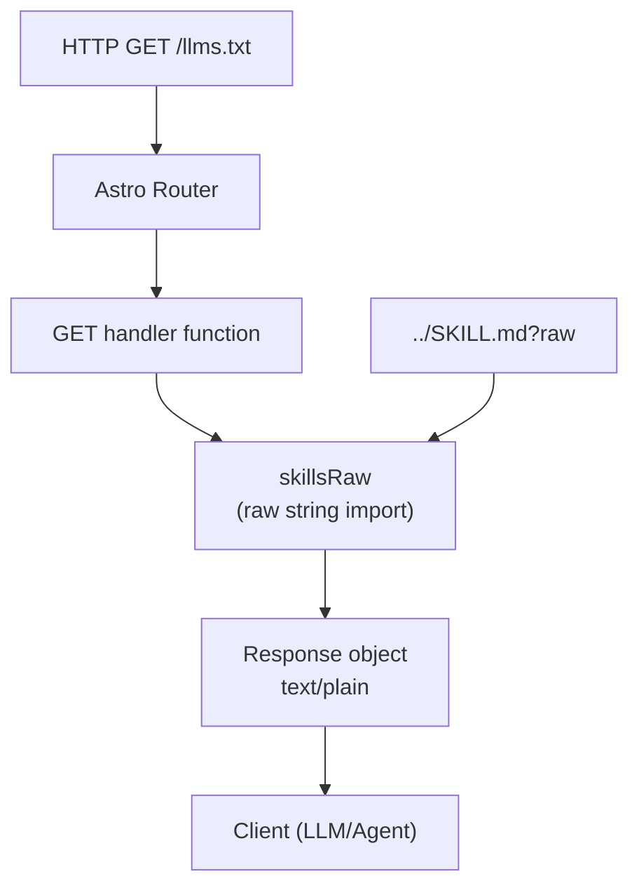
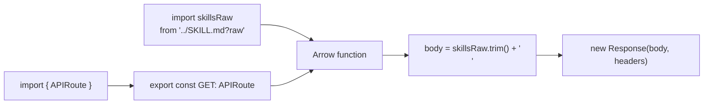
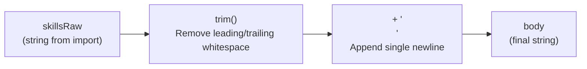
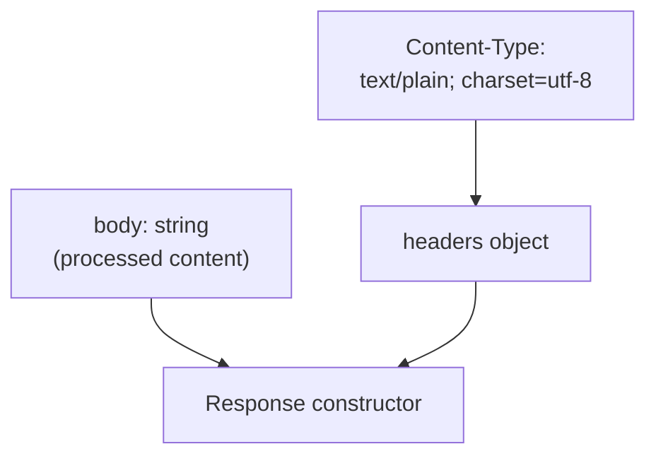
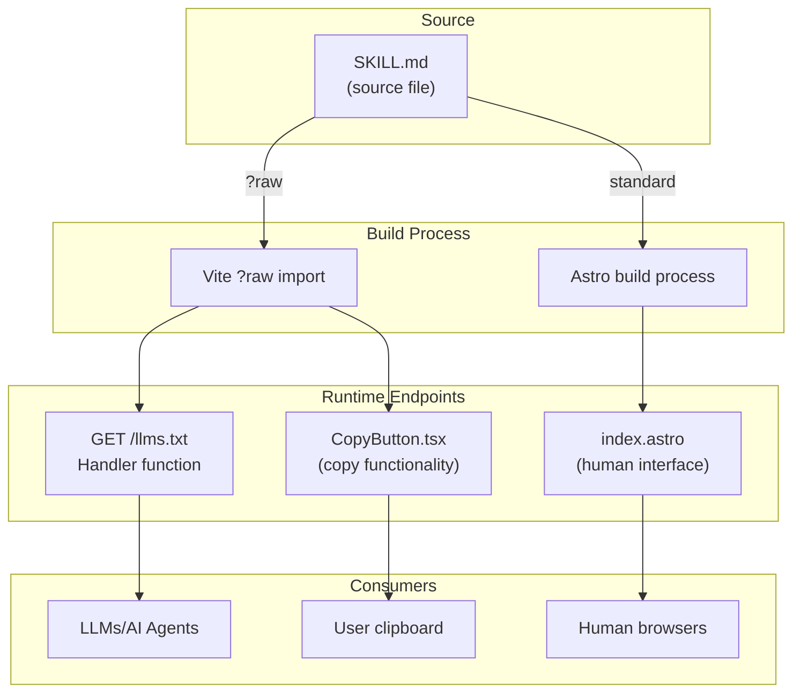
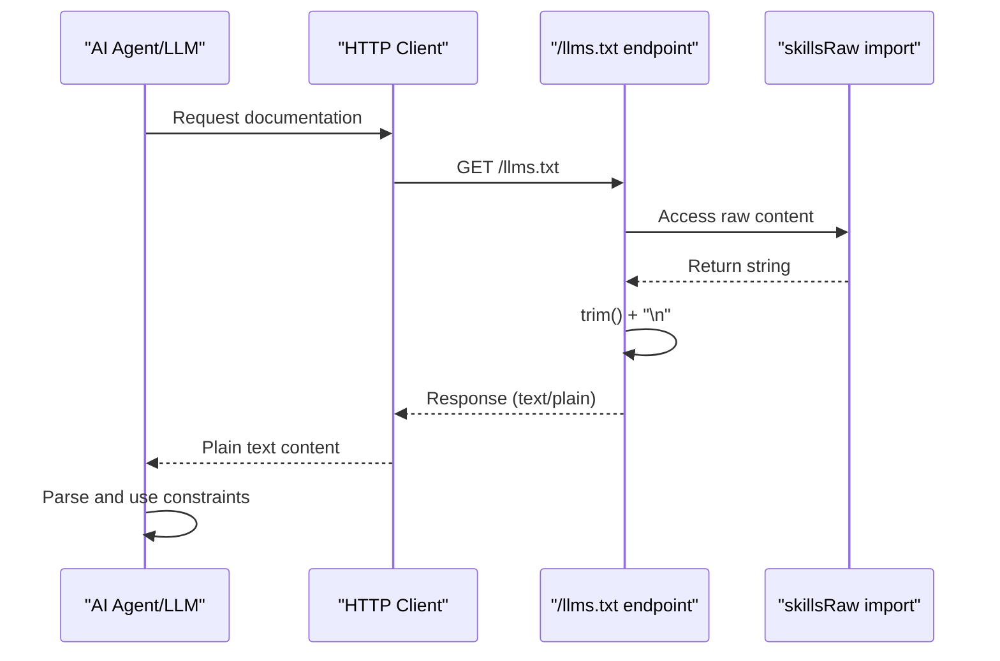

<!-- source: DeepWiki mcp.deepwiki.com · repo ibelick/ui-skills · page 3.2 LLMs.txt API Endpoint · fetched 2026-10-26 -->

# LLMs.txt API Endpoint

<details>
<summary>Relevant source files</summary>

The following files were used as context for generating this wiki page:

- [src/pages/llms.txt.ts](src/pages/llms.txt.ts)

</details>


## Purpose and Scope

This document describes the `/llms.txt` API endpoint, which serves the UI Skills documentation content as plain text for consumption by Large Language Models and automated systems. The endpoint implements a machine-readable interface to the same SKILL.md content that humans view through the rendered HTML interface.

For information about the content structure and constraints served by this endpoint, see [SKILL.md Content Structure](#3.1). For details on how this endpoint fits into the broader content delivery strategy, see [Content Dual-Path Architecture](#2.2).

## Endpoint Overview

The `/llms.txt` endpoint is an Astro API route that provides programmatic access to the UI Skills documentation. It returns the raw markdown content of SKILL.md as plain text with appropriate HTTP headers for machine consumption.

**Sources:** [src/pages/llms.txt.ts:1-12]()

### Key Characteristics

| Characteristic | Value |
|---------------|-------|
| HTTP Method | GET |
| Response Type | text/plain |
| Content Source | SKILL.md (raw) |
| Character Encoding | UTF-8 |
| Dynamic Processing | None (static import at build time) |

**Sources:** [src/pages/llms.txt.ts:7-10]()

## Implementation Architecture

The endpoint uses Astro's file-based routing system where a file at `src/pages/llms.txt.ts` automatically creates a route at `/llms.txt`.



**Diagram: Request Flow Through llms.txt Endpoint**

**Sources:** [src/pages/llms.txt.ts:1-12]()

## Code Structure

The endpoint implementation consists of a single exported function that handles GET requests:



**Diagram: Code Entity Relationships in llms.txt.ts**

The implementation follows this structure:

1. **Import Statement**: [src/pages/llms.txt.ts:2]() imports the SKILL.md file using Vite's `?raw` suffix, which instructs the bundler to import the file content as a raw string rather than processing it
2. **Export Declaration**: [src/pages/llms.txt.ts:4]() exports a `GET` function conforming to Astro's `APIRoute` type
3. **Content Processing**: [src/pages/llms.txt.ts:5]() trims whitespace and appends a single newline character
4. **Response Construction**: [src/pages/llms.txt.ts:7-10]() creates a Response object with appropriate headers

**Sources:** [src/pages/llms.txt.ts:1-12]()

## Content Transformation

### Raw Import Mechanism

The endpoint uses Vite's special import syntax with the `?raw` suffix:

```
import skillsRaw from "../SKILL.md?raw";
```

This import directive has the following behavior:

| Aspect | Behavior |
|--------|----------|
| Processing | No markdown parsing or transformation |
| Type | String primitive |
| Timing | Build-time (static) |
| Content | Exact file contents as-is |

The `?raw` suffix instructs Vite to skip all markdown processing and return the file contents as a plain string. This ensures that LLMs receive the exact markdown syntax without HTML rendering.

**Sources:** [src/pages/llms.txt.ts:2]()

### Text Processing

The only transformation applied to the content is:



**Diagram: Content Processing Pipeline**

The `.trim()` method removes any extraneous whitespace from the beginning and end of the file, and a single newline character is appended to ensure proper formatting. This results in clean, normalized content without altering the actual documentation text.

**Sources:** [src/pages/llms.txt.ts:5]()

## Response Format

The Response object is constructed with specific headers optimized for machine consumption:



**Diagram: Response Object Structure**

### HTTP Headers

| Header | Value | Purpose |
|--------|-------|---------|
| Content-Type | text/plain | Indicates plain text format (not HTML) |
| charset | utf-8 | Specifies UTF-8 character encoding |

The `text/plain` MIME type signals to HTTP clients that the response contains unformatted text, preventing browsers from attempting to render it as HTML or other formats. The `utf-8` charset ensures proper handling of Unicode characters that may appear in the documentation.

**Sources:** [src/pages/llms.txt.ts:7-11]()

## Integration Points

The `/llms.txt` endpoint integrates with other system components as follows:



**Diagram: System Integration - Multiple Consumption Paths from SKILL.md**

The endpoint shares the same source content (SKILL.md) with the main index page and the CopyButton component, but serves it through a different transformation pipeline optimized for programmatic access. This architecture ensures consistency across all consumption methods while providing format-appropriate interfaces.

**Sources:** [src/pages/llms.txt.ts:2]()

## Usage Pattern

The endpoint is designed to be accessed by automated systems following this pattern:



**Diagram: Typical Access Sequence**

Consumers of this endpoint typically:
1. Make an HTTP GET request to `/llms.txt`
2. Receive the plain text response
3. Parse the markdown content directly
4. Extract and apply the UI constraints to their code generation process

**Sources:** [src/pages/llms.txt.ts:4-11]()

## Technical Constraints

### Build-Time Resolution

The import statement at [src/pages/llms.txt.ts:2]() resolves at build time, not runtime. This means:

- The content is embedded in the built JavaScript bundle
- Changes to SKILL.md require a rebuild to be reflected in the endpoint
- No file system access occurs during request handling
- Response time is minimal (no I/O operations)

### Static Content

The endpoint serves static content with no request-specific processing. Each request receives identical content regardless of:
- Request headers
- Query parameters  
- Client identity
- Time of request

**Sources:** [src/pages/llms.txt.ts:1-12]()

## Deployment Considerations

When deployed to Cloudflare Workers (as configured via wrangler.jsonc), the endpoint:

- Executes at edge locations globally
- Returns responses with minimal latency
- Incurs no database or file system overhead
- Scales automatically with request volume

The static nature of the content makes it ideal for edge deployment, as the entire response can be generated from in-memory data without external dependencies.

**Sources:** [src/pages/llms.txt.ts:1-12]()

---

