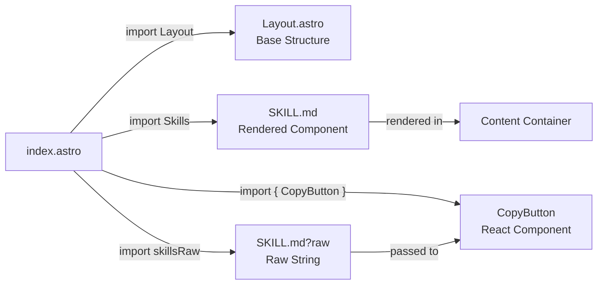
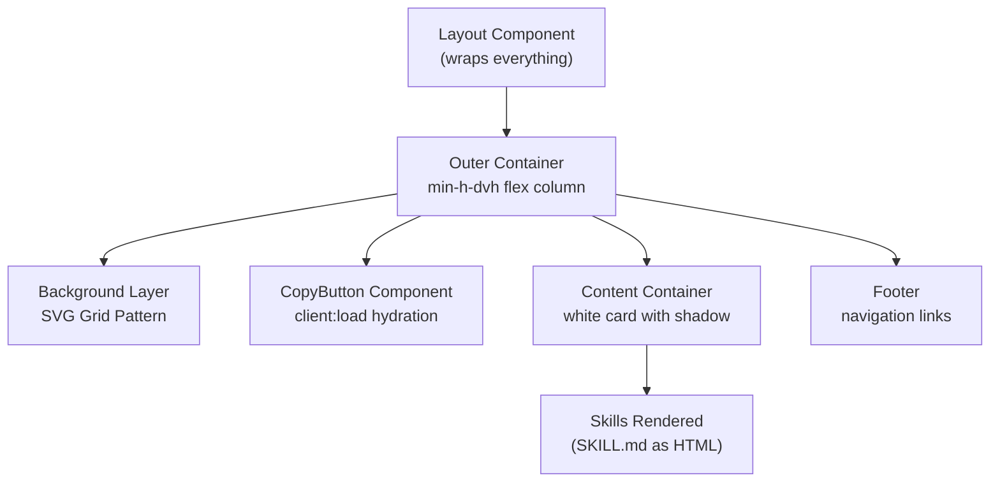
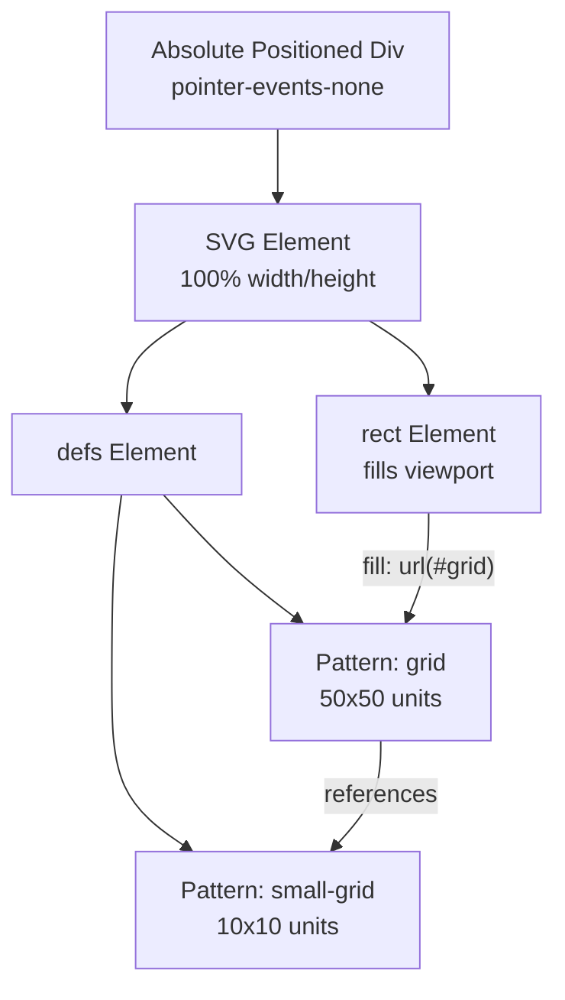
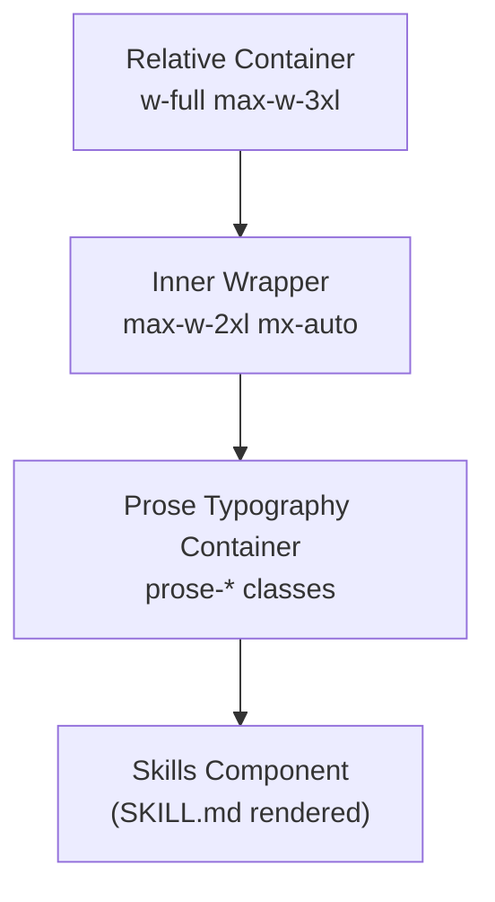
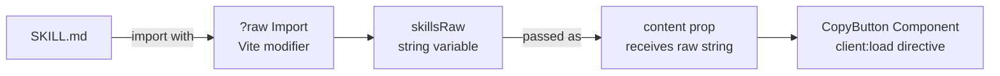
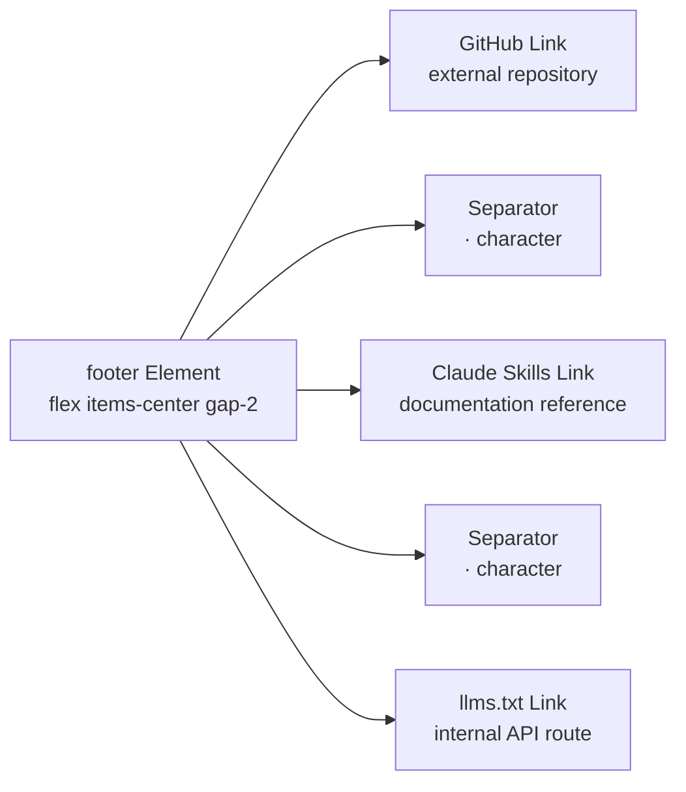
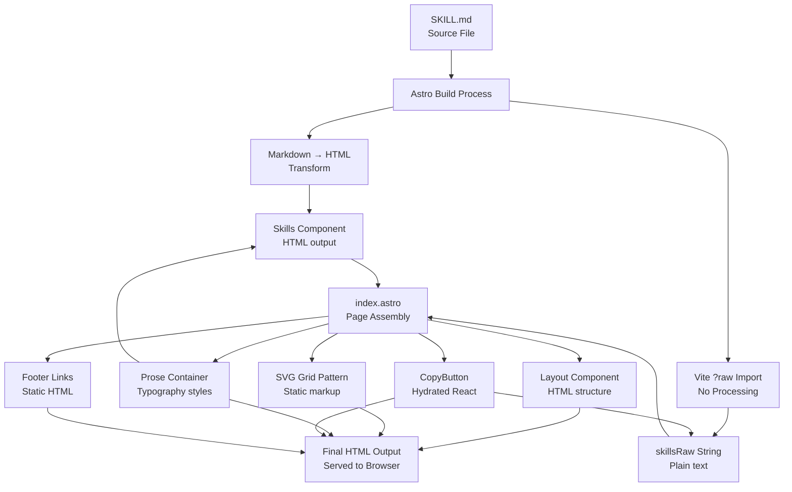
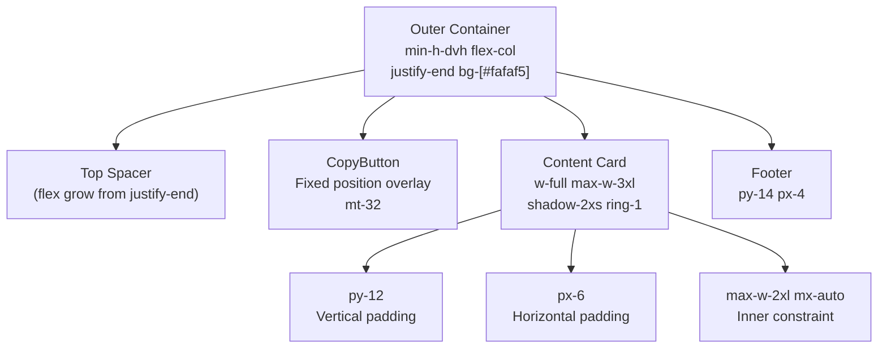

<!-- source: DeepWiki mcp.deepwiki.com · repo ibelick/ui-skills · page 4.2 Main Index Page · fetched 2026-10-26 -->

# Main Index Page

Relevant source files

The following files were used as context for generating this wiki page:

- [src/SKILL.md](src/SKILL.md)
- [src/pages/index.astro](src/pages/index.astro)

This document describes the main entry point of the ui-skills website, implemented in `src/pages/index.astro`. This page is responsible for rendering the SKILL.md documentation with visual enhancements, background patterns, and interactive features. It serves as the primary human-facing interface for the UI Skills documentation.

For information about the base HTML structure and meta tags, see [Layout Component](#4.1). For styling details including Tailwind configuration and typography, see [Styling System](#4.3).

## Purpose and Scope

The index page (`index.astro`) is the main route (`/`) of the application. It coordinates the rendering of the SKILL.md content within a visually enhanced container, provides clipboard functionality through the CopyButton component, and displays a decorative SVG grid background. The page is entirely static except for the hydrated CopyButton component.

Sources: [src/pages/index.astro:1-89]()

## File Structure and Imports

The index page uses four key imports:

| Import | Type | Purpose |
|--------|------|---------|
| `Layout` | Astro Component | Base HTML structure from [Layout Component](#4.1) |
| `Skills` | Markdown Component | Transformed HTML from SKILL.md |
| `skillsRaw` | Raw String | Unprocessed SKILL.md text for clipboard |
| `CopyButton` | React Component | Interactive copy-to-clipboard functionality |

The `?raw` import modifier [src/pages/index.astro:4]() tells Vite to import the file content as a plain string rather than processing it, enabling the same source file to be used both for rendering (transformed to HTML) and for clipboard functionality (raw text).

Sources: [src/pages/index.astro:2-5]()

## Page Structure Overview

The page consists of four main visual layers rendered within the Layout component:

The outer container [src/pages/index.astro:9-11]() uses `min-h-dvh` (dynamic viewport height) to ensure full-screen coverage on mobile devices with varying browser chrome heights, following the constraint from SKILL.md: "NEVER use `h-screen`, use `h-dvh`" [src/SKILL.md:30]().

Sources: [src/pages/index.astro:8-88]()

## Background Pattern Implementation

The background consists of a nested SVG pattern system creating a two-level grid:

| Pattern | Dimensions | Stroke | Purpose |
|---------|------------|--------|---------|
| `small-grid` | 10×10 | 0.5px, 10% opacity | Fine grid lines |
| `grid` | 50×50 | 1px, 20% opacity | Major grid lines |

The SVG pattern implementation [src/pages/index.astro:12-48]() creates a technical blueprint aesthetic:

The container uses `mask-b-from-80% mask-b-to-100%` classes [src/pages/index.astro:13]() to create a gradient fade at the bottom 20% of the viewport, preventing the grid from competing visually with the footer content.

The `pointer-events-none` attribute [src/pages/index.astro:13]() ensures the background doesn't interfere with any interactive elements, and `aria-hidden="true"` [src/pages/index.astro:14]() marks it as decorative for screen readers.

Sources: [src/pages/index.astro:12-48]()

## Content Container

The content container [src/pages/index.astro:52-62]() is structured as a centered card with responsive styling:

### Responsive Border Treatment

The card uses a conditional border strategy based on viewport size:

| Viewport | Border Style | Purpose |
|----------|--------------|---------|
| Mobile (default) | `border-t border-b` only | Edge-to-edge horizontal |
| Desktop (`sm:`) | `sm:border-none` with `sm:ring-1` | Fully bordered card |

The mobile layout [src/pages/index.astro:53]() uses `rounded-none` and horizontal borders only, creating an edge-to-edge card that extends to screen edges. On larger viewports, `sm:rounded-[8px] sm:border-none sm:ring-1 sm:ring-black/10` creates a traditional floating card with subtle border via ring utilities.

### Prose Typography Configuration

The prose container [src/pages/index.astro:56-58]() uses extensive Tailwind Typography customization:

| Element | Customization | Value |
|---------|---------------|-------|
| All headings | `font-medium text-[15px]` | Consistent size, medium weight |
| H1 | `mb-6` | Extra bottom margin for title |
| H2 | `mt-10 mb-3` | Section spacing |
| Paragraphs | `my-4 text-[15px] text-neutral-500` | Consistent spacing and muted color |
| List items | `my-2 pl-0 text-[15px] marker:text-neutral-300` | Tight spacing, muted bullets |

The `max-w-none` class overrides the prose plugin's default max-width, allowing the parent's `max-w-2xl` to control line length instead. The `font-mono` class applies the monospace font (JetBrains Mono, loaded in Layout) to all content.

Sources: [src/pages/index.astro:52-62]()

## Copy Button Integration

The CopyButton component is integrated at the top level of the page structure:

The component is rendered with the `client:load` directive [src/pages/index.astro:50](), which tells Astro to hydrate this component immediately on page load. This is the only JavaScript-required element on the page, implementing Astro's partial hydration architecture.

The `content={skillsRaw}` prop passes the raw, unprocessed SKILL.md text, enabling users to copy the exact source content rather than the HTML-transformed version. For details on the CopyButton implementation, see [CopyButton Component](#5.1).

Sources: [src/pages/index.astro:4](), [src/pages/index.astro:50]()

## Footer Navigation

The footer [src/pages/index.astro:64-86]() provides three navigation links:

Each link uses the `hover:text-neutral-900` class for subtle interaction feedback, transitioning from muted gray (`text-neutral-400`) to near-black on hover.

The links serve distinct purposes:

| Link | Destination | Purpose |
|------|-------------|---------|
| GitHub | `https://github.com/ibelick/ui-skills` | Source code repository |
| Claude Skills | Claude platform documentation | Context for UI Skills concept |
| llms.txt | `/llms.txt` | Machine-readable API endpoint (see [LLMs.txt API Endpoint](#3.2)) |

The separators use `text-neutral-300` [src/pages/index.astro:75]() for a lighter gray than the links, creating visual hierarchy.

Sources: [src/pages/index.astro:64-86]()

## Complete Rendering Flow

The following diagram shows how data flows from source files through transformations to the final rendered output:

Sources: [src/pages/index.astro:1-89](), [src/SKILL.md:1-75]()

## Visual Layout Structure

The page uses a vertical flex layout with strategic spacing:

The `justify-end` on the flex container [src/pages/index.astro:10]() pushes content toward the bottom, with the `mt-32` margin on the content card [src/pages/index.astro:53]() creating breathing room from the top edge. This layout ensures the content is centered vertically when there's extra viewport height, while still allowing natural scrolling for shorter viewports.

The background color `bg-[#fafaf5]` [src/pages/index.astro:10]() is a warm off-white that matches the overall design system's neutral palette.

Sources: [src/pages/index.astro:9-88]()

---

