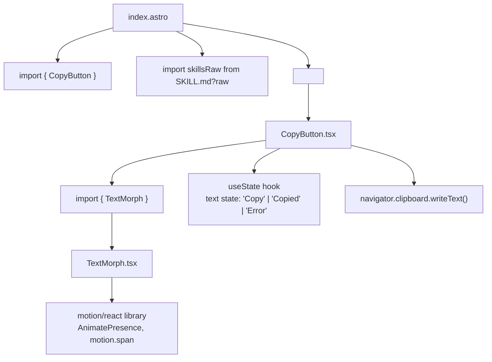
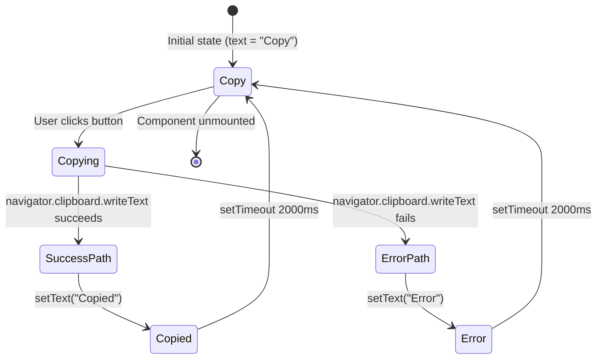
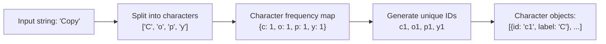
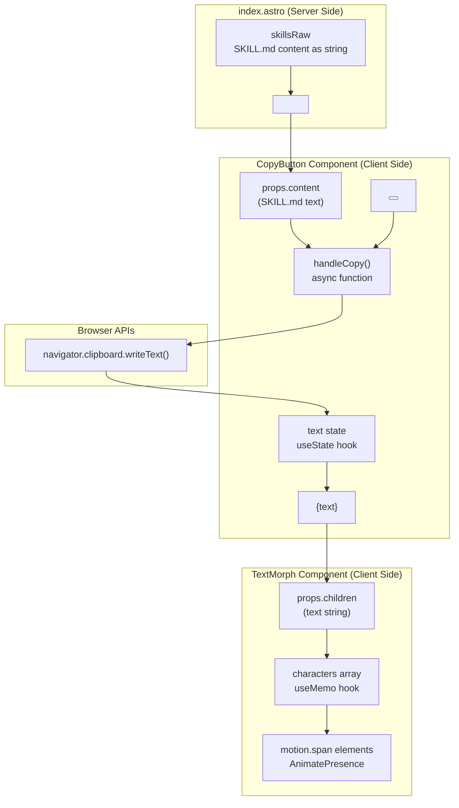

<!-- source: DeepWiki mcp.deepwiki.com · repo ibelick/ui-skills · page 5 Interactive Components · fetched 2026-10-26 -->

# Interactive Components

<details>
<summary>Relevant source files</summary>

The following files were used as context for generating this wiki page:

- [src/pages/index.astro](src/pages/index.astro)
- [src/ui/copy-button.tsx](src/ui/copy-button.tsx)
- [src/ui/text-morph.tsx](src/ui/text-morph.tsx)

</details>


This document describes the client-side React components that provide interactivity in the ui-skills website. These components leverage Astro's selective hydration approach, where only specific interactive elements are hydrated with JavaScript while the rest of the page remains static HTML. The codebase contains two interactive components: `CopyButton` and `TextMorph`, which work together to provide clipboard functionality with animated user feedback.

For information about the overall page structure and how these components fit into the layout, see [Page Structure and Rendering](#4). For details on the styling applied to these components, see [Styling System](#4.3).

## Component Architecture and Hydration Strategy

The interactive components in this codebase follow Astro's island architecture pattern, where React components are selectively hydrated on the client side using the `client:load` directive. This approach minimizes JavaScript bundle size and improves performance by only shipping interactive code where necessary.

**Diagram: Interactive Component Integration**



The integration follows this pattern:

| Component | Hydration Strategy | Purpose |
|-----------|-------------------|---------|
| `CopyButton` | `client:load` | Hydrates immediately on page load to enable clipboard interaction |
| `TextMorph` | Child of `CopyButton` | Rendered as part of the CopyButton component, shares the same hydration boundary |

Sources: [src/pages/index.astro:1-89](), [src/ui/copy-button.tsx:1-34]()

## CopyButton Component

The `CopyButton` component provides clipboard functionality, allowing users to copy the entire SKILL.md content to their clipboard with a single click. It manages internal state to provide visual feedback during the copy operation.

**Component Interface**

```typescript
type CopyButtonProps = {
  content: string;
};
```

The component accepts a single `content` prop containing the raw text to be copied. In the application, this is the raw SKILL.md content imported using Vite's `?raw` suffix [src/pages/index.astro:4]().

**Diagram: CopyButton State Machine and Event Flow**



Sources: [src/ui/copy-button.tsx:8-20]()

### State Management

The component uses React's `useState` hook to track the button's text state [src/ui/copy-button.tsx:9]():

```
Initial: text = "Copy"
Success: text = "Copied"  (2 second timeout)
Error:   text = "Error"   (2 second timeout)
```

### Event Handling

The `handleCopy` async function [src/ui/copy-button.tsx:11-20]() orchestrates the clipboard operation:

1. Calls `navigator.clipboard.writeText(content)` to write to the system clipboard
2. On success: Updates state to "Copied" and schedules a reset after 2000ms
3. On error: Updates state to "Error" and schedules a reset after 2000ms
4. The try-catch block ensures graceful error handling if clipboard API is unavailable

### Component Structure

The rendered output consists of:

- **Container**: Sticky-positioned div at the top of the viewport [src/ui/copy-button.tsx:23]()
  - `sticky top-4 z-10` ensures the button remains visible during scrolling
  - Flexbox layout positions the button at the end of the container
  
- **Button Element**: [src/ui/copy-button.tsx:24-28]()
  - Fixed width of 80px to prevent layout shifts during text transitions
  - Rounded-full styling creates a pill-shaped button
  - Hover state changes text color from neutral-400 to neutral-900
  
- **TextMorph Child**: Animates text transitions between states [src/ui/copy-button.tsx:29]()

Sources: [src/ui/copy-button.tsx:1-34](), [src/pages/index.astro:50]()

## TextMorph Component

The `TextMorph` component provides smooth, character-level text animations using the motion/react library (formerly Framer Motion). It animates transitions between different text strings by individually animating each character, creating a morphing effect.

**Component Interface**

```typescript
export type TextMorphProps = {
  children: string;
  as?: React.ElementType;
  className?: string;
  style?: React.CSSProperties;
  variants?: Variants;
  transition?: Transition;
};
```

The component accepts a string as `children` and optional customization for the container element, styling, and animation parameters [src/ui/text-morph.tsx:9-16]().

### Character Mapping Algorithm

The component implements a character identification system to ensure smooth transitions. Each character is assigned a unique ID based on its position and frequency within the string [src/ui/text-morph.tsx:34-46]():

**Diagram: Character ID Generation Process**



The algorithm:

1. Splits the input string into individual characters
2. Maintains a `charCounts` map to track how many times each lowercase character has appeared
3. Generates a unique ID for each character: `${uniqueId}-${lowerChar}${count}`
4. Special handling: Spaces are converted to non-breaking spaces (`\u00A0`) for proper rendering

This ensures that when transitioning from "Copy" to "Copied", characters that exist in both strings (c, o, p) maintain their identity and animate smoothly to their new positions, while new characters (i, e, d) animate in and removed characters (y) animate out.

Sources: [src/ui/text-morph.tsx:34-46]()

### Animation Configuration

The component uses motion/react's animation primitives with configurable variants and transitions:

**Default Variants** [src/ui/text-morph.tsx:48-52]():
```
initial: { opacity: 0 }    // Characters fade in from transparent
animate: { opacity: 1 }    // Characters fully visible
exit: { opacity: 0 }       // Characters fade out to transparent
```

**Default Transition** [src/ui/text-morph.tsx:54-59]():
| Property | Value | Effect |
|----------|-------|--------|
| `type` | `"spring"` | Uses spring physics for natural motion |
| `stiffness` | `280` | Controls spring tension (higher = faster) |
| `damping` | `18` | Controls oscillation (higher = less bouncy) |
| `mass` | `0.3` | Controls perceived weight (lower = lighter feel) |

These defaults can be overridden via the `variants` and `transition` props.

### Rendering Strategy

The component uses motion/react's `AnimatePresence` with `mode="popLayout"` [src/ui/text-morph.tsx:63]() to coordinate the entry/exit animations:

1. Each character is wrapped in a `motion.span` with a unique `layoutId` [src/ui/text-morph.tsx:65-77]()
2. The `layoutId` enables shared element transitions - characters that exist in both states smoothly transition positions
3. `inline-block` display ensures characters can be individually transformed
4. Accessibility: The container has `aria-label` with the full text, and individual spans are `aria-hidden="true"` to prevent screen readers from reading each character separately

Sources: [src/ui/text-morph.tsx:1-83]()

## Component Integration Pattern

The `CopyButton` and `TextMorph` components form a tightly coupled integration where `TextMorph` provides the presentation layer for `CopyButton`'s state transitions.

**Diagram: Data Flow and Component Communication**



### Integration Details

| Aspect | Implementation |
|--------|----------------|
| **Data Source** | Raw SKILL.md content passed from index.astro [src/pages/index.astro:4,50]() |
| **Parent Component** | `CopyButton` manages state and clipboard interaction [src/ui/copy-button.tsx:8-33]() |
| **Child Component** | `TextMorph` receives current state text and animates transitions [src/ui/copy-button.tsx:29]() |
| **State Transitions** | CopyButton's text state changes trigger TextMorph re-renders with new children prop |
| **Animation Trigger** | React's reconciliation detects children prop change, causing TextMorph to compute new character array and animate |

The fixed-width button container (80px) prevents layout shifts during the animation as text length varies between "Copy", "Copied", and "Error". The animation completes within approximately 300-500ms based on the spring configuration, providing immediate feedback while the 2-second timeout ensures users have time to notice the state change before it resets.

Sources: [src/ui/copy-button.tsx:1-34](), [src/ui/text-morph.tsx:1-83](), [src/pages/index.astro:50]()

---

